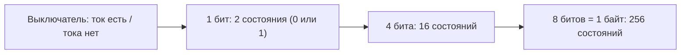

*Почему компьютеры считают двойками, а не десятками, и как восемь простых переключателей задают 256 разных состояний.*

> «Ключевое слово здесь — *два*. Два вида вспышек, два гласных звука — да вообще любые две разные штуки в нужных комбинациях способны передать какую угодно информацию.»  
> — Чарльз Петцольд, *Code (2nd ed.)*

Представьте, что вы переговариваетесь с другом через двор ночью с помощью обычного фонарика. Телефон сел, кричать нельзя — разбудите соседей. Единственное, чем вы управляете, — кнопка на корпусе: свет горит или свет погас.

Можно договориться о простой системе: одна короткая вспышка — «да», две — «нет». Это работает для одного вопроса. Но что делать, если нужно передать название книги, время встречи или номер квартиры? На первый взгляд кажется, что фонарик с одной кнопкой безнадёжно слаб.

## Почему электричество не любит десятку

В повседневной жизни мы считаем десятками — просто потому, что у человека десять пальцев на руках. Казалось бы, и внутри компьютера удобно передавать десять разных уровней напряжения: 0 вольт для нуля, 1 вольт для единицы, 2 вольта для двойки и так до 9 вольт.

На практике такая схема разваливается мгновенно. Любой провод обладает сопротивлением, нагревается и ловит наводки от соседних цепей. Сигнал в 4,0 вольта на длинном участке легко проседает до 3,6 вольта — и принимающая схема уже не понимает, отправили ей тройку или четвёрку. Чем теснее расположены уровни, тем чаще шум превращает одно число в другое.

Теперь уменьшим число уровней до двух. Либо тока почти нет (условно 0 вольт), либо напряжение высокое (например, 3,3 вольта или 1,0 вольта в современных чипах). Между этими крайностями лежит широкая «мёртвая зона». Даже если сигнал просядет на 20%, схема безошибочно отличит «выключено» от «включено».

Эту идею поняли задолго до электронных компьютеров. В 1830-х годах Сэмюэл Морзе передавал тексты по одному телеграфному проводу с помощью всего двух сигналов — короткой точки и длинного тире. А Луи Брайль ещё раньше закодировал весь алфавит шеститочечной матрицей, где каждая точка либо выпуклая, либо гладкая.

## Сила комбинаций: от одного переключателя к байту

Один переключатель передаёт два состояния: `0` или `1`. Этого хватает на выбор «да/нет», «вкл/выкл» или «истина/ложь». Как только мы ставим рядом **два** независимых переключателя, число возможных комбинаций удваивается:

| Переключатель 1 | Переключатель 2 | Комбинация |
|---|---|---|
| Выкл | Выкл | `00` |
| Выкл | Вкл | `01` |
| Вкл | Выкл | `10` |
| Вкл | Вкл | `11` |

Два переключателя дают $2 \times 2 = 4$ уникальных кода. Три — уже $2 \times 2 \times 2 = 8$. Каждый новый переключатель не прибавляет две комбинации, а **умножает общее число состояний на два**.

Рост получается взрывным:

* 4 переключателя — $2^4 = 16$ комбинаций;
* 8 переключателей — $2^8 = 256$ комбинаций;
* 16 переключателей — $2^{16} = 65\,536$ комбинаций;
* 32 переключателя — $2^{32} = 4\,294\,967\,296$ комбинаций (свыше 4 миллиардов).

Вот теперь можно назвать вещи своими инженерными именами.

## Термины после понимания: бит и байт

**Бит** (*binary digit*, двоичная цифра) — минимальная единица информации, способная принимать ровно одно из двух значений: `0` или `1`. Это не физический шарик и не крошечная частица, а договорённость о том, как считывать состояние цепи.

Термин «бит» ввёл математик Джон Тьюки в 1947 году, а Клод Шеннон закрепил его в основополагающей работе 1948 года по теории информации. Любую аналогию с «выключателем» полезно помнить ровно в одной точке: у состояния нет промежуточного значения «наполовину включено». Но на этом аналогия заканчивается — внутри современного процессора вместо механических тумблеров работают миллиарды микроскопических транзисторов, которые переключаются миллиарды раз в секунду без единой движущейся детали.

**Байт** — группа из **8 битов**, с которой компьютер работает как с единым кирпичиком. Восемь битов дают ровно **256** различных комбинаций — от `00000000` до `11111111`.

Почему выбрали именно 8, а не 6 или 10? В 1950–1960-х годах инженеры действительно пробовали байты разной ширины — по 6, 7 и 9 битов. Решающую роль сыграла система IBM System/360 (1964 год): её авторы закрепили 8-битный байт. Число 8 удобно сразу по двум причинам. Во-первых, 256 комбинаций с запасом хватало для английских заглавных и строчных букв, цифр, знаков препинания и управляющих сигналов. Во-вторых, 8 — это степень двойки ($2^3$), что упростило схемотехнику адресации.

## Как масштабируются байты: кило- против киби-

Накопленные байты измеряют приставками. Здесь инженеры и маркетологи до сих пор путают новичков двумя разными шкалами:

| Единица | Десятичная (диски, сети) | Двоичная (память, ОС) | Разница |
|---|---|---|---|
| Кило / Киби | 1 КБ = $1000$ Б | 1 КиБ = $2^{10} = 1024$ Б | 2,4% |
| Мега / Меби | 1 МБ = $10^6$ Б | 1 МиБ = $2^{20} = 1\,048\,576$ Б | 4,9% |
| Гига / Гиби | 1 ГБ = $10^9$ Б | 1 ГиБ = $2^{30} \approx 1{,}074 \times 10^9$ Б | 7,4% |

Вот почему новый накопитель с надписью «1 ТБ» на коробке в операционной системе часто отображается как «931 ГБ». Производитель диска считает десятками ($10^{12}$ байтов), а операционная система делит это же число на $1024^3$. Никто не украл 70 гигабайт — просто две программы пользуются разными линейками.

## Ловушка «смысла» битов

Посмотрите на байт `01000001`. Что он означает?

* Если программа читает его как целое число без знака — это **65**.
* Если та же цепочка попадает в текстовый редактор — это латинская заглавная буква **`A`**.
* Если этот байт описывает яркость красного канала пикселя — это **тёмно-красный оттенок** (65 из 255).
* Если байт лежит в сегменте машинных команд — это фрагмент **инструкции для процессора**.

Сам по себе байт не хранит никакой метки «я буква» или «я число». В проводах и памяти бегают только нули и единицы. Смысл накладывает **интерпретация** — договорённость программы о том, как читать конкретный участок памяти.

> [!check] Проверь понимание
> Сколько битов понадобится, чтобы закодировать 33 буквы русского алфавита (без учёта регистра), если каждой букве нужен свой уникальный код одинаковой длины?
>
> Пять битов дают $2^5 = 32$ комбинации — одной буквы не хватит. Значит, минимум **6 битов** ($2^6 = 64$ комбинации).

## Вопросы на понимание

**Вопрос 1 (Базовый).** Вы добавили к 8-битному байту всего один дополнительный бит (получилось 9 битов). На сколько выросло число возможных комбинаций — на 2, на 8 или вдвое?

> [!solution] Показать решение
> Число комбинаций выросло **вдвое** — с $2^8 = 256$ до $2^9 = 512$. Каждый новый бит может принять значение `0` или `1` для каждой из 256 старых комбинаций, поэтому общее количество всегда умножается на 2.

**Вопрос 2 (Практический).** Накопитель объёмом 500 ГБ (в десятичной системе: $500 \times 10^9$ байтов) подключили к компьютеру, чья операционная система измеряет объём в двоичных гибибайтах ($1\text{ ГиБ} = 1024^3$ байтов). Почему система покажет примерно 465 ГБ, а не 500?

> [!solution] Показать решение
> Потому что $1024^3 = 1\,073\,741\,824$ байта, что на 7,37% больше десятичного миллиарда. Если разделить $500\,000\,000\,000$ байтов на $1\,073\,741\,824$, получится $\approx 465{,}66$ ГиБ. Физическая ёмкость диска не уменьшилась — изменилась единица измерения.

**Вопрос 3 (Со звёздочкой \*).** Вы получили по сети один байт `00110010` и знаете, что отправитель передал цифру `2` в виде текста, а ваша программа случайно прочитала этот байт как обычное целое число (50). Может ли сама аппаратура компьютера заметить эту ошибку?

> [!solution] Показать решение
> Нет. Аппаратура видит только восемь сигналов `00110010` и не знает, что отправитель вкладывал в них символ `'2'`. Различать типы данных — задача протокола обмена и компилятора языка программирования. Именно поэтому в языках со строгой типизацией (таких как Go) тип каждого значения проверяется заранее.

---

Один байт даёт 256 безымянных комбинаций. Сами по себе они бесполезны, пока люди не договорились, какая комбинация изображает число 42, а какая — букву «Ж» или эмодзи ракеты. В следующей главе [[2. Как компьютер хранит числа и текст]] мы разберём эти договорённости — от двоичной арифметики до UTF-8.
