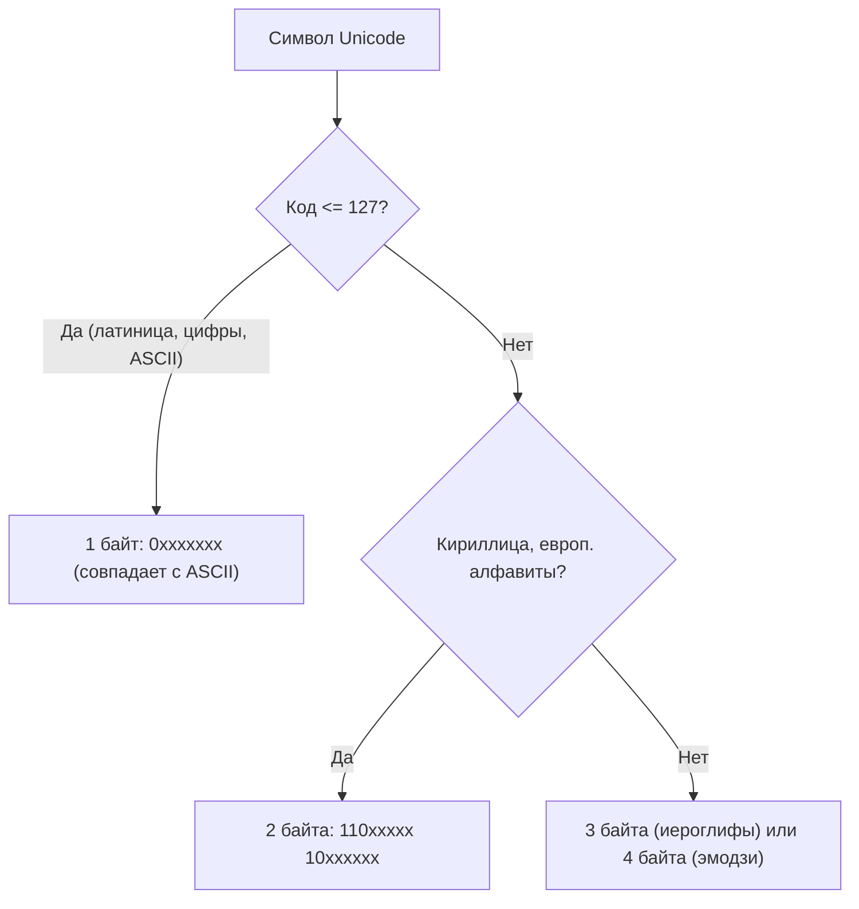

*Как нули и единицы превращаются в числа, почему программисты любят шестнадцатеричную запись и откуда берутся «кракозябры» в тексте.*

Вы открыли текстовый файл, присланный коллегой, и вместо аккуратной русской таблицы увидели строку `Привет`. Файл не повреждён и не заражён вирусом. Ни один байт на диске не потерялся.

Просто отправитель и ваш редактор прочитали **одни и те же байты** по разным словарям. Чтобы понимать, почему так происходит — и почему в Go строки устроены именно так, как мы скоро увидим, — достаточно разобраться с двумя простыми соглашениями: как записывают числа и как кодируют текст.

## Позиционная запись: от десятки к двойке

Когда вы видите десятичное число `425`, вы автоматически раскладываете его по степеням десятки:

$$425 = 4 \times 100 + 2 \times 10 + 5 \times 1 = 4 \times 10^2 + 2 \times 10^1 + 5 \times 10^0$$

Двоичная система работает по тому же правилу, только основание равно не 10, а 2. Каждый разряд справа налево весит вдвое больше предыдущего: 1, 2, 4, 8, 16, 32, 64, 128.

Прочитаем байт `01000001` слева направо:

| Разряд (вес) | 128 | 64 | 32 | 16 | 8 | 4 | 2 | 1 |
|---|---:|---:|---:|---:|---:|---:|---:|---:|
| Бит | `0` | `1` | `0` | `0` | `0` | `0` | `0` | `1` |
| Вклад | 0 | 64 | 0 | 0 | 0 | 0 | 0 | 1 |

Складываем ненулевые столбцы: $64 + 1 = 65$.

Максимальное беззнаковое число, которое помещается в один байт (`11111111`), равно $128 + 64 + 32 + 16 + 8 + 4 + 2 + 1 = 255$. Всего 256 значений — от `0` до `255` включительно.

## Переполнение: что случается, когда разряды кончаются

В школьной тетради можно дописать слева ещё одну цифру. В ячейке памяти компьютера ширина фиксирована заранее — 8, 16, 32 или 64 бита.

Представьте механический одометр автомобиля на шесть цифр. Когда пробег доходит до `999999`, следующий километр переворачивает все колёсики обратно в `000000`. В компьютере происходит ровно то же самое: прибавьте `1` к 8-битному числу `255` (`11111111`), и девятая единица вывалится за пределы байта. В ячейке останется `00000000` — то есть **ноль**.

Это явление называют **переполнением** (*overflow*). В 2014 году счётчик просмотров одного популярного видеоролика на YouTube перевалил за максимум 32-битного знакового целого ($2\,147\,483\,647$), и инженерам пришлось срочно расширять поле до 64 битов. Подробно отрицательные числа и переполнение мы разберём в Модуле 5, когда уже будем проверять их живыми программами.

## Зачем программистам шестнадцатеричная система

Двоичная запись честна, но невыносима для глаз. Попробуйте с ходу сравнить два 32-битных числа `11000000101010000000000100001010` и `11000000101010000000000100001110` — глаза устанут через секунду.

Выход нашли простой: разбивать биты на четвёрки. Четыре бита дают ровно $2^4 = 16$ комбинаций — от `0000` (0) до `1111` (15). Чтобы записать каждое из 16 значений **одним** символом, к цифрам `0–9` добавили первые шесть латинских букв `A–F` (10–15).

Так получилась **шестнадцатеричная система** (*hexadecimal*, сокращённо `hex`). Её красота в том, что **любой байт всегда записывается ровно двумя знаками**:

| Двоичная четвёрка | Десятичное | Hex |
|---|---:|---|
| `0000` | 0 | `0` |
| `0100` | 4 | `4` |
| `1010` | 10 | `A` |
| `1111` | 15 | `F` |

Возьмём наш байт `01000001`. Делим пополам: `0100` (`4`) и `0001` (`1`). Получаем `0x41` (префикс `0x` подсказывает, что перед нами hex, а не сорок один). Цвет в вебе `#FF0080` — это просто три байта подряд: красный `255`, зелёный `0`, синий `128`. Шестнадцатеричная запись — не прихоть математиков, а компактный бинокль для разглядывания байтов.

## Как в байтах живёт текст: от ASCII к Unicode и UTF-8

С числами всё ясно — их значения вытекают из арифметики. С буквами иначе: у буквы «A» нет природного числового веса. Люди просто сели за стол и составили таблицу соответствий — **кодировку**.

В 1963 году в США утвердили стандарт **ASCII** (*American Standard Code for Information Interchange*). Он использовал всего 7 битов (128 кодов, от `0` до `127`):

* `0–31` — управляющие символы (перевод строки, табуляция, звонок терминала);
* `32` — пробел;
* `48–57` — цифры от `'0'` до `'9'`;
* `65–90` — заглавные латинские буквы `'A'`–`'Z'`;
* `97–122` — строчные `'a'`–`'z'`.

Обратите внимание на важную деталь: символ `'2'` имеет код `50` (`0x32`), а вовсе не число `2`. Текст `"42"` в памяти — это два байта `0x34` и `0x32`, а число `42` — один байт `0x2A`. Смешение текста и числа — частый источник ошибок у новичков.

Пока компьютеры говорили только по-английски, ASCII хватало всем. Но стоило добавить кириллицу, греческий, иероглифы и арабскую вязь — 128 кодов закончились мгновенно. В 1980–1990-е годы каждая страна придумала свои 8-битные расширения для верхней половины байта (`128–255`): в России прижились сразу три несовместимых стандарта — `Windows-1251`, `KOI8-R` и `CP866`. Открываете текст из `KOI8-R` в редакторе с `Windows-1251` — и получаете нечитаемую кашу.

Решением стал **Unicode** — единый всемирный каталог символов, где каждому знаку всех письменностей мира (плюс эмодзи и математическим символам) присвоен свой уникальный номер — *кодовая точка* (*code point*). Например:

* `'A'` → `U+0041`
* `'П'` → `U+041F`
* `'🚀'` → `U+1F680`

Оставался инженерный вопрос: как записать номера, которые доходят до миллиона, в обычные байты? Если отводить на каждый символ по 4 байта (кодировка UTF-32), любой английский файл распухнет в четыре раза и сломает миллионы старых программ, ожидавших ASCII.

В сентябре 1992 года Кен Томпсон и Роб Пайк — те самые инженеры из Bell Labs, которые через 15 лет создадут Go, — придумали кодировку **UTF-8** прямо за ужином в придорожном кафе в Нью-Джерси. Идея оказалась гениальной своей простотой: длина символа переменная — от **1 до 4 байтов**.

У UTF-8 три редких достоинства сразу:

1. Любой текст на чистом ASCII **побайтно совпадает** с UTF-8. Старые программы даже не замечают подмены.
2. По старшим битам первого байта сразу ясно, сколько байтов занимает символ: `0...` — один, `110...` — два, `1110...` — три, `11110...` — четыре.
3. Байты продолжения всегда начинаются с `10...`, поэтому поиск подстроки никогда не совпадёт со «случайной серединой» другого символа.

Теперь тайна «кракозябр» из первого абзаца раскрывается целиком. Слово «Привет» в UTF-8 занимает **12 байтов** (6 кириллических букв по 2 байта). Если открыть эти 12 байтов как `Windows-1251` (где 1 байт = 1 буква), редактор послушно покажет 12 странных символов `Привет` — ровно по два на каждую исходную букву.

> [!check] Проверь понимание
> Сколько байтов занимает строка `"Go! Привет"` в кодировке UTF-8?
>
> Латинские `G`, `o`, `!` и пробел — 4 символа ASCII по 1 байту (4 байта). Кириллическое «Привет» — 6 букв по 2 байта (12 байтов). Итого: **16 байтов**, хотя видимых символов всего **10**. Запомните эту разницу — в Модуле 2 она напрямую объяснит поведение строк в Go.

## Вопросы на понимание

**Вопрос 1 (Базовый).** Переведите байт `10100101` в шестнадцатеричную (`hex`) и десятичную запись.

> [!solution] Показать решение
> Разбиваем байт на две четвёрки: `1010` и `0101`.  
> Первая четвёрка: $8 + 2 = 10$, в hex это `A`. Вторая: $4 + 1 = 5$, в hex это `5`. Значит, в hex это **`0xA5`**.  
> В десятичной системе: $10 \times 16 + 5 = 165$ (или по степеням двойки: $128 + 32 + 4 + 1 = 165$).

**Вопрос 2 (Практический).** Почему файл с текстом `"255"` весит 3 байта, хотя число `255` свободно помещается в 1 байт?

> [!solution] Показать решение
> В текстовом файле хранится не двоичное число, а последовательность из трёх печатных символов ASCII: `'2'` (`0x32`), `'5'` (`0x35`) и `'5'` (`0x35`). Каждый символ занимает 1 байт. Бинарные форматы хранят число `255` в одном байте `0xFF`, зато текстовые удобно читать человеку.

**Вопрос 3 (Со звёздочкой \*).** В системе учёта товаров количество штук на складе хранится в 16-битном беззнаковом числе (максимум $65\,535$). На склад с остатком `65530` привезли ещё 10 единиц товара, а проверка на переполнение в коде отсутствует. Какое значение окажется в ячейке?

> [!solution] Показать решение
> Значение перешагнёт предел $65\,535$ и обернётся через ноль: $65\,530 + 10 = 65\,540$, вычитаем $65\,536$ ($2^{16}$) и получаем **`4`**. Именно поэтому системные программисты всегда выбирают ширину типа с запасом и проверяют границы входных данных.

---

Мы научились упаковывать в биты числа и любой текст мира. Но сами по себе байты — мёртвый груз: они лежат и ничего не вычисляют. В следующей главе [[3. Логика без магии — от реле к процессору]] мы соберём из простых переключателей схему, которая умеет складывать числа и сама выполнять список команд.
