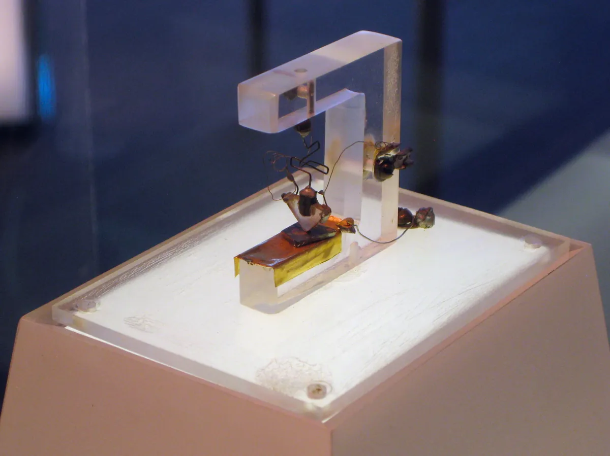
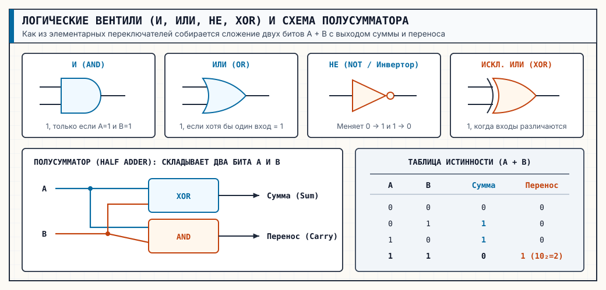
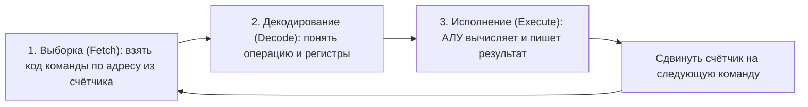
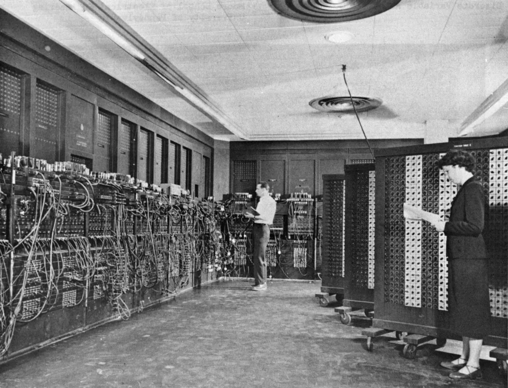

*Как из трёх простых логических элементов складывается арифметика, зачем процессору тактовый генератор и что отличает компьютер от калькулятора.*

> «На самом базовом уровне и аппаратура, и программы — это просто электрические сигналы, взаимодействующие с логическими вентилями.»  
> — Чарльз Петцольд, *Code (2nd ed.)*

Вы нажимаете на клавиатуре `2 + 3`, и через миллионную долю секунды экран показывает `5`. Внутри корпуса нет крошечного бухгалтера со счётами. Там течёт электрический ток по кремниевым дорожкам.

Как кусок кремния без разума и глаз узнаёт, что `2 + 3` даёт `5`, а не `7`? Ответ проще, чем кажется: сложение распадается на крошечные проверки вида «да или нет», а каждую проверку выполняет элементарная электрическая цепь.

## Три кирпичика всей логики: И, ИЛИ, НЕ

Вспомним фонарик из первой главы, но усложним схему: поставим в цепь **два** выключателя.

1. **Соединим выключатели последовательно** (друг за другом в одном проводе). Лампочка загорится, только если замкнут **первый И второй**. Если разомкнуть хотя бы один, цепь разорвётся. Это логический элемент **И (AND)**.
2. **Соединим выключатели параллельно** (две ветки рядом). Ток дойдёт до лампочки, если замкнут **первый ИЛИ второй**, либо оба сразу. Это элемент **ИЛИ (OR)**.
3. **Добавим инвертор (реле с размыкающимся контактом)**: подаём ток на вход — лампочка гаснет; убираем ток — лампочка загорается. Он переворачивает `0` в `1` и `1` в `0`. Это элемент **НЕ (NOT)**.

Эти три схемы называют **логическими вентилями** (*logic gates*). В 1930-х годах инженеры строили их из электромагнитных реле, в 1940-х — из стеклянных радиоламп, а с конца 1950-х — из транзисторов. Транзистор делает ровно то же самое, что реле: слабый сигнал на управляющем входе открывает или перекрывает путь току между двумя другими выводами. Только транзистор не щёлкает, не перегревается так быстро и уменьшился до размеров в несколько нанометров.

Удивительный факт булевой логики: **из комбинации И, ИЛИ и НЕ можно построить любую цифровую схему на планете** — от калькулятора до графического ускорителя.

## Складываем два бита на переключателях

Попробуем сложить два однобитных числа `A` и `B`. Все четыре возможных случая помещаются в маленькую таблицу:

| A | B | Сумма (младший бит) | Перенос в следующий разряд |
|---:|---:|---:|---:|
| `0` | `0` | `0` | `0` |
| `0` | `1` | `1` | `0` |
| `1` | `0` | `1` | `0` |
| `1` | `1` | `0` | `1` |

Присмотритесь к двум правым столбцам.

Столбец **«Перенос»** равен `1` только когда оба входа равны `1`. Но мы только что видели такую схему — это обычный вентиль **И (AND)**!

Столбец **«Сумма»** равен `1`, когда входы **различаются** (`0` и `1`, либо `1` и `0`), и равен `0`, когда они одинаковы. Эту операцию называют «исключающее ИЛИ» (**XOR**), и она собирается всего из четырёх базовых вентилей (И, ИЛИ, НЕ).

Соединяем два этих блока вместе — и получаем **полусумматор** (*half adder*). Он уже умеет складывать два бита. Чтобы складывать многобитные числа и учитывать перенос из предыдущего разряда, добавляют вход для прошлого переноса (получается *полный сумматор*) и выстраивают восемь таких блоков в ряд. Готова 8-битная схема сложения; выстроите 64 блока — получите современный 64-битный сумматор.

Здесь работает главный принцип инженерии Чарльза Петцольда — **инкапсуляция в «коробку»**. Поняв, как сумматор собран из вентилей, вы закрываете его крышкой с надписью «Сложение» и больше не рисуете отдельные транзисторы. Над сумматором строятся вычитание (через сложение с обратным числом), умножение и сравнение. Всё это объединяют в единый узел — **АЛУ** (*арифметико-логическое устройство*).

## Зачем процессору пульс и цикл команд

АЛУ умеет считать, но само не знает, *что* и *когда* вычислять. Если просто подать напряжения на входы, сигналы побегут по разным дорожкам с чуть разной скоростью и на выходе возникнет хаос.

Поэтому в компьютер ставят **тактовый генератор** (*clock*) — кварцевый кристалл, выдающий ровные электрические импульсы, как метроном. На частоте **3 ГГц** этот метроном отбивает **3 миллиарда тактов в секунду** — один шаг занимает примерно **0,33 наносекунды** (за это время свет в вакууме пролетает всего 10 сантиметров).

Внутри **процессора (CPU)** рядом с АЛУ находятся крошечные сверхбыстрые ячейки памяти — **регистры** — и **блок управления**. Работа процессора сводится к бесконечному конвейеру из трёх шагов (**цикл команд**, *Fetch–Decode–Execute*):

Проследим один цикл на земном примере. Допустим, в памяти лежит крошечная программа из трёх команд:

1. `LOAD R1, 10` — загрузить число `10` в регистр `R1`.
2. `ADD R1, 5` — прибавить `5` к значению в `R1` (теперь в `R1` лежит `15`).
3. `STORE R1, [0x20]` — записать `15` в ячейку памяти по адресу `0x20`.

На первом шаге блок управления смотрит в специальный регистр — **счётчик команд** (*Program Counter*), читает байты `LOAD R1, 10`, декодирует их и отправляет сигнал на загрузку. Затем счётчик сдвигается к следующей команде. На втором шаге подключается АЛУ и обновляет `R1`. На третьем — результат уходит в память.

Никакой магии. Поток данных (*data path*) проходит через регистры и АЛУ, а поток управления (*control path*) лишь включает нужные вентили по коду текущей команды.

## Что отличает компьютер от калькулятора

Пока команды выполняются строго одна за другой, перед нами всего лишь быстрый автоматический арифмометр. Настоящим компьютером машину делает ровно одна дополнительная команда — **условный переход** (*conditional jump*).

Она звучит буднично: *«Если результат прошлого сравнения равен нулю — не двигай счётчик вперёд, а перепрыгни на команду по адресу `0x04`»*.

> «Контролируемое повторение последовательности команд, или цикл, — это то, что отличает компьютеры от калькуляторов.»  
> — Чарльз Петцольд, *«Код. Тайный язык информатики»*

Как только процессор умеет менять собственный счётчик команд в зависимости от данных, в железе рождаются и ветвление (`если ... иначе ...`), и циклы, и вызовы функций.

Честное упрощение на этом уровне: реальные современные процессоры выполняют по нескольку команд одновременно, предсказывают ветвления и хранят несколько ядер на одном кристалле. Но для программиста модель остаётся прежней — каждая инструкция логически исполняется последовательно, а о конвейерах и кэшах CPU мы подробно поговорим в Модуле 5 и в Томе 5 «Под капотом».

> [!check] Проверь понимание
> Увеличили разрядность процессора с 32 битов до 64 битов. Научился ли процессор решать принципиально новые классы задач, недоступные 32-битному?
>
> Нет. Как точно заметил Чарльз Петцольд, переход от 8 к 16, 32 и 64 битам не меняет класс решаемых задач — процессор просто обрабатывает более крупные числа и адресует больше памяти за меньшее число шагов.

## Вопросы на понимание

**Вопрос 1 (Базовый).** Вы подали `1` и `1` на вход полусумматора. Какие значения появятся на выходах «Сумма» и «Перенос», и что они означают в двоичной системе?

> [!solution] Показать решение
> «Сумма» = `0`, «Перенос» = `1`. Вместе они образуют двоичное число `10`, то есть десятичную **двойку** ($1 + 1 = 2$). Младший разряд обнулился, а единица ушла в старший разряд — ровно так же, как при сложении $5 + 5 = 10$ в десятичной системе.

**Вопрос 2 (Практический).** Зачем процессору нужен отдельный регистр «счётчик команд» (*Program Counter*), если все инструкции и так лежат в памяти подряд?

> [!solution] Показать решение
> Без счётчика команд процессор не знал бы, какую инструкцию читать следующей и куда возвращаться после ветвления или цикла. Когда выполняется условный переход, процессор просто записывает в счётчик команд новый адрес, и следующий шаг `Fetch` забирает инструкцию уже оттуда.

**Вопрос 3 (Со звёздочкой \*).** Представьте, что тактовый генератор компьютера остановился, но питание на транзисторы подаётся. Что произойдёт с запущенной программой?

> [!solution] Показать решение
> Программа мгновенно замрёт на текущей микрооперации: без фронтов тактового импульса счётчик команд не сдвинется и регистры не примут новые значения. Данные в регистрах сохранятся, пока есть ток, но ни одного следующего шага вычислений не случится.

---

В нашем цикле команд процессор то и дело обращался к загадочной «ячейке памяти по адресу `0x20`». Откуда берутся эти адреса, почему всё исчезает при выключении питания и зачем рядом с быстрой памятью держат медленный диск — разберём в главе [[4. Память и диск — почему RAM забывает]].
