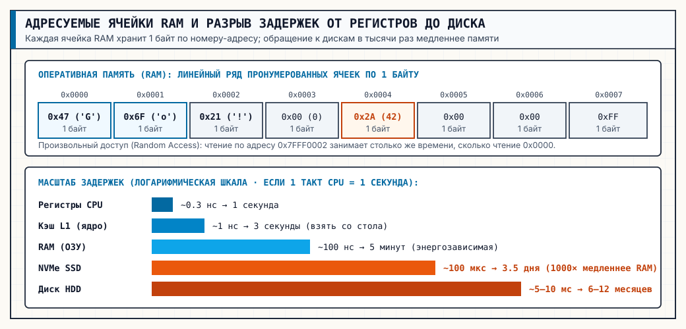
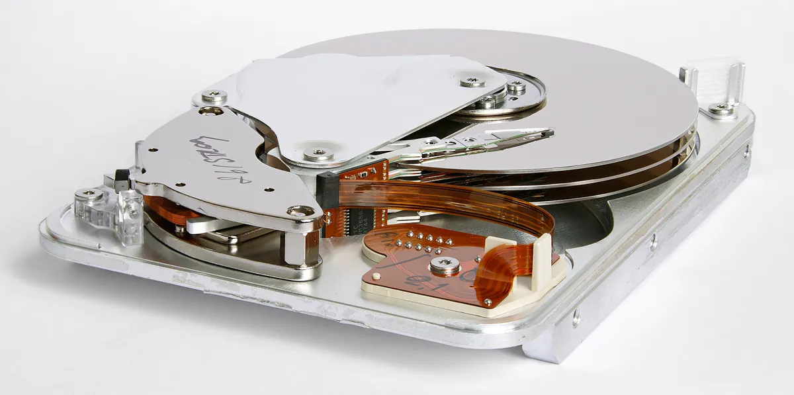
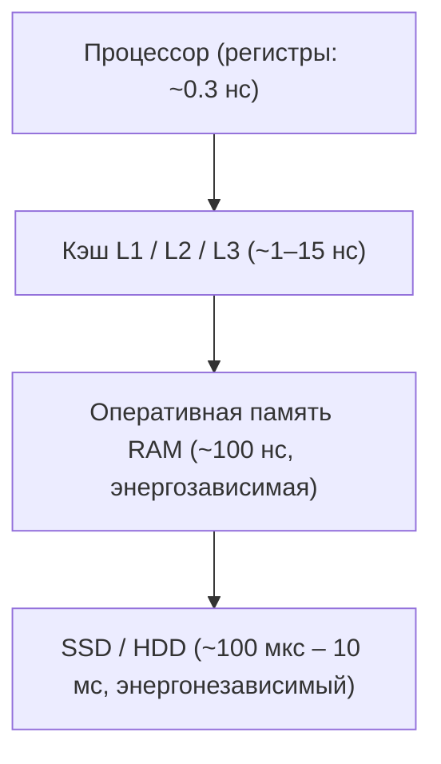

*Почему оперативная память теряет данные без электричества, как устроена адресация байтов и во сколько раз кэш CPU быстрее диска.*

> «Мы пишем, а позже читаем. Сохраняем, а позже извлекаем. Храним, а позже обращаемся к сохранённому. Назначение памяти — уберечь информацию без искажений между двумя этими событиями.»  
> — Чарльз Петцольд, *Code (2nd ed.)*

Вы два часа правили текст в редакторе, отвлеклись на звонок, а в доме мигнул свет. Ноутбук без батареи погас. После включения на диске осталась только утренняя версия файла — два часа работы испарились без следа.

Дело не в ошибке редактора и не в капризе операционной системы. Всё объясняется простой физикой двух разных видов памяти, между которыми живёт любая программа.

## Честная модель оперативной памяти

В популярных статьях оперативную память (RAM) любят сравнивать со «столешницей письменного стола», а жёсткий диск — с «ящиками». У этой картинки есть опасный изъян: она скрывает самое важное свойство памяти — **адресацию**.

Оперативную память точнее представлять как длинный ряд пронумерованных ячеек. В каждой ячейке лежит ровно **один байт**. Порядковый номер ячейки называют **адресом**.



```
Адрес:    0x0000   0x0001   0x0002   0x0003   0x0004   ...   0xFFFF
        +--------+--------+--------+--------+--------+     +--------+
Данные: |  0x47  |  0x6F  |  0x21  |  0x00  |  0x2A  | ... |  0xFF  |
        +--------+--------+--------+--------+--------+     +--------+
           'G'      'o'      '!'       0       42
```

У этой модели есть сходство с почтовыми ящиками в подъезде — но ровно в одном свойстве: зная номер ящика, вы подходите сразу к нему, не заглядывая в предыдущие. На этом аналогия заканчивается. В почтовый ящик можно сунуть три письма или посылку; в ячейке RAM всегда помещается ровно 8 битов — ни битом больше, ни битом меньше.

Чтобы прочитать ячейку `0x0002` или ячейку `0x7FFF0002`, контроллеру памяти требуется одинаковое время. Ему не нужно перематывать предыдущие байты, как на кассетной ленте. Именно за это качество память прозвали памятью с произвольным доступом — **RAM** (*Random Access Memory*).

Если программе нужно сохранить 64-битное целое число (8 байтов), она занимает восемь соседних ячеек подряд, а адресом этого числа считается адрес первого байта. Позже в Модуле 3, когда мы подойдём к указателям в Go, эта картинка с пронумерованными ячейками сделает их понятными с первой минуты.

## Почему RAM забывает всё при отключении тока

Как ячейка RAM вообще удерживает бит? В массовой оперативной памяти (DRAM) каждый бит хранится в паре из крошечного транзистора и микроскопического конденсатора. Заряженный конденсатор означает `1`, разряженный — `0`.

Конденсатор настолько мал, что заряд утекает из него за десятки миллисекунд — контроллер памяти обязан перезаряжать (обновлять) ячейки десятки раз в секунду. Стоит выдернуть шнур из розетки, и все конденсаторы разряжаются мгновенно. Энергозависимая память (*volatile memory*) забывает всё, что хранила.

Поэтому компьютеру необходим второй уровень хранения — **энергонезависимый накопитель** (SSD или жёсткий диск HDD). В SSD биты заперты в ловушках электронов внутри флеш-памяти (NAND), а в HDD — в намагниченных участках вращающегося металлического блина. Обе технологии удерживают данные годами без розетки.



Тогда возникает естественный вопрос: если SSD не боится отключения света и стоит дешевле на гигабайт, зачем вообще нужна оперативная память?

## Пирамида скоростей: масштабы, которые решают всё

Ответ кроется в разрыве скоростей. Называть цифры в наносекундах бесполезно, пока не перевести их в человеческий масштаб. Представьте, что один такт процессора (чтение из регистра) длится **1 секунду**:

| Уровень хранения | Реальное время доступа | Если 1 такт CPU = 1 секунда | Объём (обычный ПК) |
|---|---:|---|---|
| Регистры CPU | ~0,3 нс | **1 секунда** | сотни байтов |
| Кэш L1 (внутри ядра) | ~1 нс | **3 секунды** | 32–64 КиБ на ядро |
| Кэш L2 / L3 | ~4–15 нс | **12–45 секунд** | 1–64 МиБ |
| Оперативная память (RAM) | ~100 нс | **5 минут** | 16–64 ГиБ |
| Накопитель NVMe SSD | ~100 мкс (100 000 нс) | **3,5 дня** | 512 ГБ – 4 ТБ |
| Жёсткий диск HDD | ~5–10 мс | **6–12 месяцев** | 1–20 ТБ |

Всмотритесь в эту таблицу. Обращение к RAM в **100 раз медленнее** кэша L1. Обращение к быстрому NVMe SSD ещё в **1 000 раз медленнее** оперативной памяти — и в **100 000 раз медленнее** кэша процессора. Если бы процессор читал инструкции и переменные напрямую с SSD, компьютер работал бы в десятки тысяч раз медленнее.

Между быстрым процессором и относительно медленной RAM инженеры вставили буфер — **кэш-память** (уровней L1, L2 и L3). Она построена на более дорогой схеме (SRAM — несколько транзисторов на бит без конденсаторов), занимает больше места на кристалле, зато отвечает почти в темпе ядра.



## Принцип близости: почему кэш вообще помогает

Кэш L1 вмещает всего 32–64 килобайта — в миллион раз меньше объёма RAM. Откуда процессор знает, какие именно байты ему понадобятся через наносекунду?

Он пользуется двумя закономерностями почти любой реальной программы:

1. **Временная локальность:** если программа только что обратилась к переменной (например, счётчику цикла), скорее всего, через пару тактов она обратится к ней снова.
2. **Пространственная локальность:** если программа прочитала байт по адресу `0x1000`, с высокой вероятностью следующим шагом ей понадобятся соседние байты `0x1001`, `0x1002` и так далее.

Поэтому при чтении одного байта процессор подтягивает из RAM сразу целый соседний кусок — **кэш-линию** (обычно **64 байта**). Когда данные лежат в памяти плотно рядом, процессор почти не ждёт RAM. Когда данные разбросаны по случайным адресам, ядро простаивает «по пять минут» на каждом шаге.

Когда в 1970-х годах на мини-компьютерах PDP-11 оперативная память измерялась десятками килобайтов, дефицит байтов заставлял программистов считать каждый бит вручную. Сегодня в ноутбуке гигабайты RAM, но физический разрыв между CPU и памятью вернул ту же дисциплину: расположение данных в памяти напрямую влияет на скорость программы.

Подробно устройство кэш-линий и разницу между стеком и кучей мы разберём в Модуле 5, а пока достаточно одного твёрдого правила: **RAM быстрая, но временная; диск долговечный, но медленный**. Именно поэтому текстовый редактор держит открытый документ в RAM, пока вы печатаете, и сбрасывает его на SSD только по команде «Сохранить».

> [!check] Проверь понимание
> Программа считает сумму миллиона чисел, лежащих в памяти. В первом варианте числа лежат в RAM подряд друг за другом; во втором — каждое число лежит по случайному адресу, и к нему ведёт ссылка. Какой вариант отработает быстрее и почему?
>
> Первый вариант отработает в разы быстрее: процессор загружает память кэш-линиями по 64 байта, поэтому чтение первого числа автоматически приносит в быстрый кэш и несколько следующих. При случайных прыжках почти каждый шаг требует долгого похода в RAM.

## Вопросы на понимание

**Вопрос 1 (Базовый).** Почему несохранённый документ исчезает при внезапном отключении электричества, а уже сохранённый файл остаётся на месте?

> [!solution] Показать решение
> Несохранённые правки находятся только в оперативной памяти (RAM), которая энергозависима: без питания заряд конденсаторов исчезает за доли секунды. Команда «Сохранить» копирует байты из RAM на энергонезависимый накопитель (SSD или HDD), которому электричество для хранения не нужно.

**Вопрос 2 (Практический).** Программа читает 10 000 небольших записей: в первом сценарии они уже загружены в RAM (по 100 нс на чтение), во втором — каждая запись требует отдельного чтения с NVMe SSD (по 100 мкс). Во сколько раз второй сценарий медленнее и сколько времени займёт каждый?

> [!solution] Показать решение
> Второй сценарий медленнее в **1 000 раз**.  
> Из RAM: $10\,000 \times 100\text{ нс} = 1\,000\,000\text{ нс} = \mathbf{1\text{ миллисекунда}}$.  
> С NVMe SSD: $10\,000 \times 100\text{ мкс} = 1\,000\,000\text{ мкс} = \mathbf{1\text{ секунда}}$.  
> Вот почему веб-серверы стараются держать горячие данные в памяти, а на диск писать пакетами или асинхронно.

**Вопрос 3 (Со звёздочкой \*).** Сколько разных байтов памяти сможет пронумеровать процессор, если ширина адреса составляет ровно 16 битов? А если 32 бита?

> [!solution] Показать решение
> При 16-битном адресе доступно $2^{16} = 65\,536$ уникальных адресов, то есть ровно **64 КиБ** памяти (так были ограничены ранние 8-битные компьютеры 1970-х). При 32-битном адресе — $2^{32} = 4\,294\,967\,296$ байтов, то есть ровно **4 ГиБ**. Именно из-за этого потолка в 4 ГиБ индустрия перешла на 64-битные процессоры.

---

Теперь у нас есть процессор, который исполняет байты команд, и память, где эти байты лежат. Но программисты не набирают программы нулями и единицами. Как человеческий текст кода превращается в машинные инструкции и почему одни языки запускаются напрямую, а другим нужен переводчик на лету — разберём в главе [[5. От машинных кодов к компилятору и программе]].
