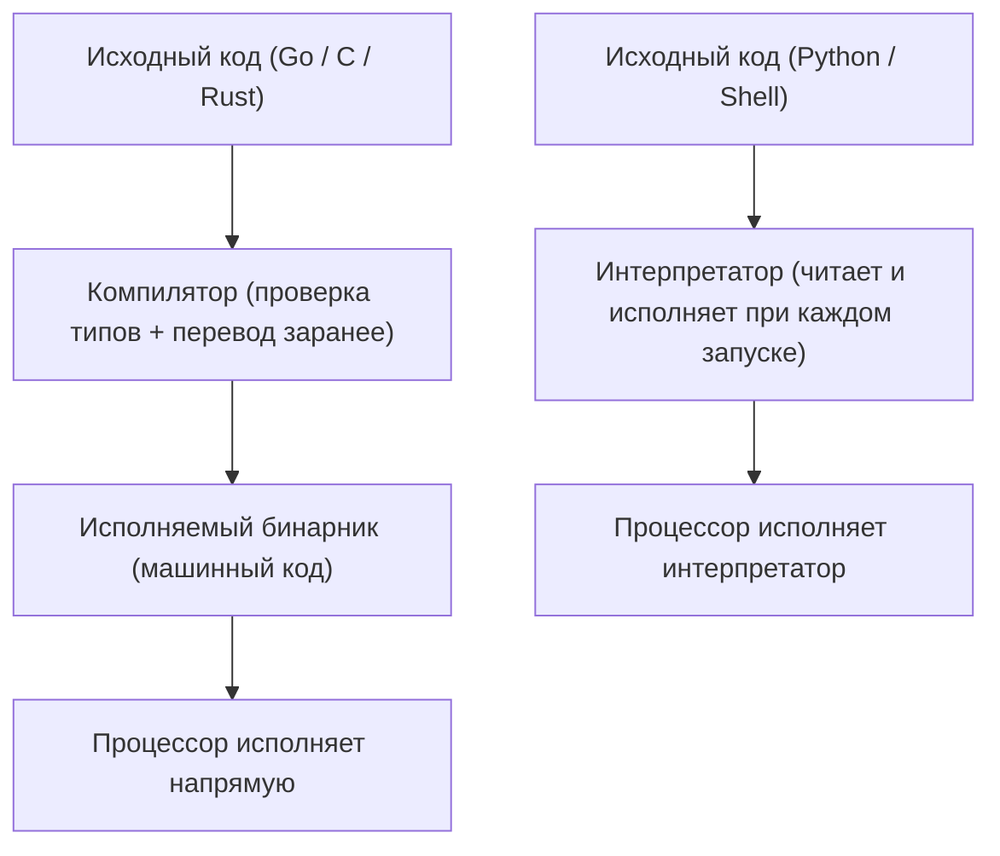

*Почему люди перестали писать программы нулями и единицами, как компилятор превращает текст в исполняемый файл и чем это отличается от интерпретации.*

> «Си — язык со странностями, с изъянами и с колоссальным успехом. Исторические случайности, конечно, помогли, но очевидно, что он закрыл потребность в языке для системной разработки — достаточно эффективном, чтобы вытеснить ассемблер, и в то же время достаточно абстрактном и выразительном, чтобы описывать алгоритмы и взаимодействия в самых разных средах.»  
> — Деннис Ритчи, доклад HOPL-II (1993)

Представьте, что вы открыли старый компьютер конца 1940-х годов и хотите сложить сто чисел. У вас нет текстового редактора, нет клавиатуры с подсветкой и нет кнопки «Запустить». Перед вами таблица кодов инструкций: `0xB8` значит «положить число в регистр», `0x05` — «прибавить», `0x75` — «прыгнуть назад».

Набрать так программу из десяти строк ещё можно. Но попробуйте написать так веб-сервер или текстовый редактор на сто тысяч строк. Стоит вставить одну новую инструкцию в середину — и все адреса переходов ниже сдвигаются на пару байтов, ломая всю программу.

## От машинного кода к ассемблеру и языкам высокого уровня

То, что процессор понимает напрямую, называют **машинным кодом** — это просто цепочка байтов в памяти. Первым спасением от ручного счёта байтов стал **ассемблер**. Вместо `0x05` программист писал короткое слово-мнемонику вроде `ADD`, а вместо числового адреса перехода — человеческую метку `loop_start`. Специальная программа-транслятор подставляла настоящие байты и сама пересчитывала адреса.

Ассемблер убрал самую мучительную рутину, но оставил две тяжёлые проблемы:

1. Программа на ассемблере намертво привязана к одному семейству процессоров. Код, написанный под чип `x86-64` на настольном ПК, процессор `ARM` в телефоне просто не поймёт.
2. Чтобы выразить одну простую мысль вроде «вычислить скидку и вывести итог», приходится писать десятки мелких инструкций перекладывания байтов между регистрами.

Поэтому в 1950–1970-е годы появились **языки высокого уровня** — Fortran, Lisp, Алгол, затем C, а позже Python, Java, Rust и Go. Программист описывает задачу в терминах переменных, условий, циклов и функций — почти как в обычном инженерном тексте. Такой текст называют **исходным кодом** (*source code*).

Процессор по-прежнему не умеет читать исходный код напрямую. Ему нужны родные машинные байты. Чтобы перекинуть мост между текстом программиста и кремнием, индустрия выработала два главных подхода: **компиляцию** и **интерпретацию**.

## Компиляция против интерпретации: две модели перевода

Разницу проще всего увидеть на честной аналогии из работы переводчиков — но ровно в одном свойстве: *когда* именно происходит перевод текста. (За пределами этого свойства аналогия заканчивается: машина не «понимает смысл» фраз, а механически строит цепочку байтов по строгим правилам грамматики.)

**Компилятор** работает как переводчик книги. Он берёт весь ваш исходный код заранее, проверяет его на опечатки и несовпадение типов, оптимизирует лишние шаги и целиком переводит в готовый **исполняемый файл** (*бинарник*) из машинных инструкций под конкретный процессор и операционную систему. Когда пользователь запускает этот файл, переводчик уже не нужен — процессор исполняет готовые байты напрямую. Так работают C, C++, Rust и Go.

**Интерпретатор** работает как синхронный переводчик на конференции. У вас нет готового машинного файла: на диске лежит сам текст программы (или промежуточный байт-код). При запуске стартует программа-интерпретатор, читает ваши инструкции шаг за шагом и тут же выполняет их за вас. Так работают классический Python, Ruby и оболочка командной строки.

Есть и промежуточный вариант — виртуальные машины с JIT-компиляцией (как в Java, C# или JavaScript в браузере): сначала код переводят в универсальный байт-код, а во время работы «горячие» участки докомпилируют в машинные инструкции прямо на лету.

## Цена выбора: почему оба подхода живы

Если скомпилированные программы работают быстрее, зачем вообще нужны интерпретаторы? В инженерии не бывает бесплатных побед — за каждое достоинство приходится платить.

| Критерий | Компиляция (Go, C, Rust) | Интерпретация (Python, Shell) |
|---|---|---|
| Скорость работы | Высокая — инструкции идут прямо на CPU | Ниже — интерпретатор тратит время на разбор и проверки в работе |
| Проверка ошибок | Опечатки и неверные типы ловятся **до** запуска | Ошибка в редкой ветке может взорваться только через неделю в работе |
| Перенос на сервер | Один готовый бинарник (особенно в Go) | На сервере должен стоять интерпретатор нужной версии и библиотеки |
| Переносимость файла | Нужна сборка отдельно под Linux, macOS, Windows | Один и тот же текстовый скрипт запускается везде, где есть интерпретатор |

Взгляните на строку про перенос на сервер — в бэкенд-разработке она весит очень много. Чтобы запустить типичный сервис на интерпретируемом языке на чистом сервере, нужно установить правильную версию самого интерпретатора, менеджер пакетов и десятки зависимостей. Скомпилированный бинарник Go вы просто копируете на сервер и запускаете.

## Что прячется внутри исполняемого файла

Когда вы видите на диске программу `server` или `app.exe`, внутри неё лежат не только инструкции процессора. Операционной системе нужно знать, с какого адреса начинать выполнение, где лежат готовые текстовые константы вроде `"Ошибка доступа"` и сколько памяти выделить под переменные.

Поэтому компилятор упаковывает машинный код в структурированный контейнер: в Linux это формат **ELF**, в Windows — **PE**, в macOS — **Mach-O**. Именно из-за различий в этих форматах и наборах системных вызовов бинарник, собранный под Windows, не запустится напрямую в Linux, даже если процессор один и тот же.

Исторически именно язык Си в начале 1970-х доказал, что на языке высокого уровня можно написать даже ядро операционной системы: Кен Томпсон и Деннис Ритчи переписали Unix с ассемблера на Си в 1973 году, потеряв немного в размере кода, но получив возможность переносить систему между разными машинами. Прошло полвека, но сама связка «исходный код → компилятор → машинный бинарник» осталась фундаментом системной и серверной инженерии. Подробнее о том, как компилятор Go собирает автономный бинарник, мы поговорим в Модуле 5, а о его внутреннем устройстве — в Томе 5 «Под капотом».

> [!check] Проверь понимание
> Программист скомпилировал программу на ноутбуке с Linux на процессоре `x86-64` и переслал готовый исполняемый файл другу с ноутбуком Apple на процессоре `ARM64` и macOS. Запустится ли файл напрямую?
>
> Нет, сразу по двум причинам: у процессоров `x86-64` и `ARM64` разные наборы машинных инструкций, а у Linux и macOS разные форматы исполняемых файлов (ELF против Mach-O) и разные системные вызовы. Нужно перекомпилировать исходный код под целевую платформу.

## Вопросы на понимание

**Вопрос 1 (Базовый).** В программе есть опечатка: в ветке, которая срабатывает раз в год первого января, к числу пытаются прибавить строку текста. В каком языке эту ошибку поймают раньше — в строго типизированном компилируемом языке или в динамическом интерпретируемом?

> [!solution] Показать решение
> В строго типизированном компилируемом языке компилятор остановит сборку немедленно — ещё на машине разработчика, до первого запуска программы. В динамическом интерпретируемом языке код может спокойно проработать весь год и упасть лишь первого января, когда выполнение впервые дойдёт до ошибочной ветки.

**Вопрос 2 (Практический).** Почему исполняемый файл программы, которая просто печатает одну строчку `"Привет"`, на диске может весить пару мегабайт, хотя сама строка занимает всего 12 байтов?

> [!solution] Показать решение
> В автономный исполняемый файл компилятор включает не только ваш короткий код, но и служебные заголовки формата ОС, код для взаимодействия с операционной системой, функции форматирования текста, а в языках вроде Go — ещё и встроенную среду выполнения (управление памятью и планирование задач). Зато такой файл запускается на чистом сервере без установки внешних библиотек.

**Вопрос 3 (Со звёздочкой \*).** Зачем вообще изобрели промежуточный байт-код и виртуальные машины (как в Java), если уже существовали чистые компиляторы и чистые интерпретаторы?

> [!solution] Показать решение
> Это компромисс между переносимостью и скоростью. Компилятор один раз проверяет типы и переводит исходники в компактный байт-код, который одинаково запускается на Windows, Linux и macOS везде, где установлена виртуальная машина. А встроенный в неё JIT-компилятор во время работы переводит часто вызываемые функции в родной машинный код процессора. Цена такого удобства — более долгий старт и повышенный расход оперативной памяти.

---

Мы уже дважды упомянули загадочного посредника — операционную систему, которая умеет читать формат исполняемых файлов и запускать программы. Но зачем вообще ставить между программой и процессором ещё один слой софта? Разберём в главе [[6. Зачем нужна операционная система]].
