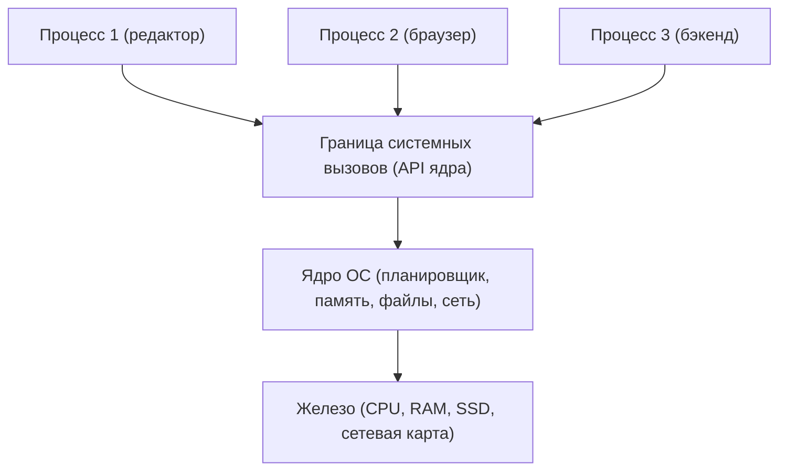
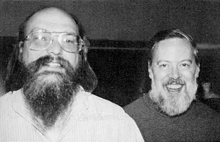

*Что происходит, когда на одном процессоре хотят работать сто программ одновременно, зачем нужны системные вызовы и почему файл — просто цепочка байтов.*

> «В идеальном мире прикладному программисту достаточно знать только API — без того, как этот API реализован и к какому железу он обращается. В реальности же чуть более глубокие знания порой оказываются весьма кстати.»  
> — Чарльз Петцольд, *Code (2nd ed.)*

Представьте компьютер без операционной системы. Вы написали полезный редактор текста и загрузили его прямо в память. Чтобы вывести букву на экран, вам пришлось самому изучить документацию конкретной видеокарты и записать байты в её аппаратные регистры. Чтобы сохранить файл на SSD, нужно вручную общаться с контроллером диска.

А теперь вы хотите одновременно запустить браузер, музыкальный плеер и терминал. Без арбитра начнётся катастрофа: плеер перепишет ячейки памяти, где лежал ваш документ, браузер заберёт процессор навсегда и не отдаст его редактору, а две программы, пишущие на диск одновременно, перемешают байты в нечитаемую кашу.

Именно эту задачу решает **операционная система (ОС)** — главная программа-диспетчер, которая стартует при включении компьютера и берёт всё железо под свой контроль.

## Ядро ОС: арбитр, который держит ключи от железа

Сердце операционной системы называют **ядром** (*kernel*). У ядра есть привилегия, которой лишены обычные программы: только оно имеет прямой доступ к диску, сетевой карте, таймерам и физической памяти.

Если обычная программа попытается залезть в чужую память или напрямую дёрнуть контроллер диска, процессор аппаратно прервёт такую попытку, а ядро немедленно завершит нарушителя. Вместо самодеятельности программа вежливо просит ядро выполнить работу за неё — делает **системный вызов** (*syscall*): «открой файл», «прочитай 100 байтов», «отправь данные по сети».



У ядра три повседневные обязанности, без которых не работает ни один современный компьютер:

1. **Делить время процессора.** Даже если в компьютере одно ядро CPU, на нём могут «одновременно» крутиться десятки программ. Ядро каждые несколько миллисекунд ставит одну программу на паузу, сохраняет её регистры и передаёт процессор следующей. Человеку кажется, что всё работает параллельно.
2. **Изолировать память.** Каждой запущенной программе ядро выдаёт собственное защищённое адресное пространство. Если в браузере случится сбой, он упадёт в одиночку — ваш текстовый редактор и запущенный сервер этого даже не заметят.
3. **Прятать разнообразие железа за единым интерфейсом.** Ваша программа вызывает одну и ту же операцию «записать байты в файл», а уж ядро само разбирается, стоит ли у пользователя флешка USB, быстрый NVMe SSD или сетевой диск.

## Программа против процесса

Новички часто путают два слова — *программа* и *процесс*. Разница простая и чёткая.

**Программа** — пассивный исполняемый файл, который спокойно лежит на диске, пока его не трогают. Это как рецепт торта на бумаге.

**Процесс** — живой экземпляр программы, загруженный в оперативную память и выполняющийся прямо сейчас: со своим счётчиком команд, своими переменными, открытыми файлами и уникальным номером (**PID**, *Process ID*).

Один и тот же исполняемый файл можно запустить трижды — на диске по-прежнему одна программа, но в системе живут три независимых процесса со своими номерами и изолированной памятью. Стоит выключить один процесс, два других продолжат работу как ни в чём не бывало.

## Файл в Unix: просто последовательность байтов

В 1969 году Кен Томпсон и Деннис Ритчи в Bell Labs начали создавать операционную систему **Unix** (прямого предка Linux и macOS) на скромном мини-компьютере PDP-7. Вместо десятков громоздких форматов записей, принятых на мейнфреймах того времени, они утвердили предельно простую идею.



> «Файл в Unix — это просто последовательность байтов. Любую структуру и организацию его содержимого определяют лишь программы, которые с ним работают; самой файловой системе безразлично, что лежит внутри. А значит, любая программа может читать и записывать любой файл.»  
> — Брайан Керниган, *UNIX: A History and a Memoir*

Эту простоту трудно переоценить. С точки зрения ядра ОС файл с фотографией, текстовый документ и файл закладок в формате JSON устроены одинаково — это цепочка байтов с именем и путём в дереве каталогов (например, `/home/user/bookmarks.json`). Более того, в Unix и Linux по тем же правилам «прочитать байты / записать байты» работают даже клавиатура, экран терминала и сетевое соединение.

## Зачем разработчику командная строка (терминал)

Графический интерфейс с окнами и кнопками удобен, когда вы открываете один документ или смотрите фильм. Но как только нужно повторить одну и ту же операцию на ста файлах, запустить сервер на удалённой машине без монитора или автоматизировать сборку проекта, кликать мышкой становится мучительно и ненадёжно.

**Командная строка** (*терминал*, *CLI — Command-Line Interface*) — прямой текстовый диалог с операционной системой. Вместо поиска иконок вы вводите имя программы и её аргументы, например:

```text
bookmark add "Документация Go" https://go.dev/doc
```

У текстового интерфейса есть три важных плюса, которые мы оценим с первых шагов в Модуле 2:

* **Точность и воспроизводимость.** Команду можно скопировать в инструкцию или скрипт, и через год она выполнит в точности те же действия.
* **Три стандартных потока.** Любой консольный процесс при запуске получает канал ввода (обычно клавиатура), канал обычного вывода (экран) и отдельный канал для сообщений об ошибках. Благодаря этому вывод одной маленькой программы можно направить прямо на вход другой — так в Unix родились конвейеры (*pipes*).
* **Код возврата.** Завершаясь, процесс отдаёт операционной системе одно число: `0` означает успех, любое ненулевое число сигнализирует об ошибке.

Честное упрощение на этом этапе: мы намеренно не трогаем сейчас устройство виртуальной памяти, прав доступа и потоков внутри процесса. В Модуле 5 мы вернёмся к Linux с живыми экспериментами и заглянем внутрь запущенной программы на Go, а в Томе 5 разберём ядро Linux уже на уровне системного инженера.

> [!check] Проверь понимание
> На сервере одновременно запущены две копии одного и того же сервиса. Одна копия упала из-за ошибки деления на ноль. Упадёт ли автоматически вторая копия?
>
> Нет. Это два разных **процесса** с изолированными адресными пространствами. Ядро ОС завершит упавший процесс и освободит его память, а второй продолжит обслуживать запросы.

## Вопросы на понимание

**Вопрос 1 (Базовый).** Чем «программа» отличается от «процесса»? Приведите короткий пример из повседневной работы за компьютером.

> [!solution] Показать решение
> Программа — это статичный файл с кодом на диске, а процесс — запущенный экземпляр этой программы в памяти со своим состоянием и номером (PID). Пример: браузер установлен на диске один раз (одна программа), но при запуске система создаёт несколько процессов — под интерфейс и отдельные вкладки.

**Вопрос 2 (Практический).** Почему операционная система не разрешает обычным программам записывать байты напрямую в секторы диска, а заставляет делать это через системный вызов?

> [!solution] Показать решение
> Если каждая программа будет писать на диск напрямую, две одновременно работающие программы перезапишут данные друг друга и разрушат структуру каталогов. Кроме того, любая вредоносная или ошибочная программа смогла бы прочитать чужие пароли и личные файлы. Ядро ОС выступает единым контролёром целостности и прав доступа.

**Вопрос 3 (Со звёздочкой \*).** Зачем консольной программе разделять обычный вывод и вывод сообщений об ошибках на два разных потока, если оба всё равно печатаются в одно окно терминала?

> [!solution] Показать решение
> Чтобы автоматизировать обработку данных. Если вы перенаправите результат работы программы в файл или передадите его следующей программе по конвейеру, туда попадут только чистые полезные данные, а диагностические сообщения об ошибках всё равно покажутся на экране (или уйдут в отдельный лог) и не испортят формат результата.

---

Операционная система научила программы мирно делить процессор, память и файлы внутри одного компьютера. Но современному сервису мало одного ноутбука — ему нужно принимать запросы от пользователей на другом конце планеты. Как байты выходят за пределы одного корпуса и находят нужную программу в сети, разберём в главе [[7. Как работает Интернет — пакеты, IP, порты и DNS]].
