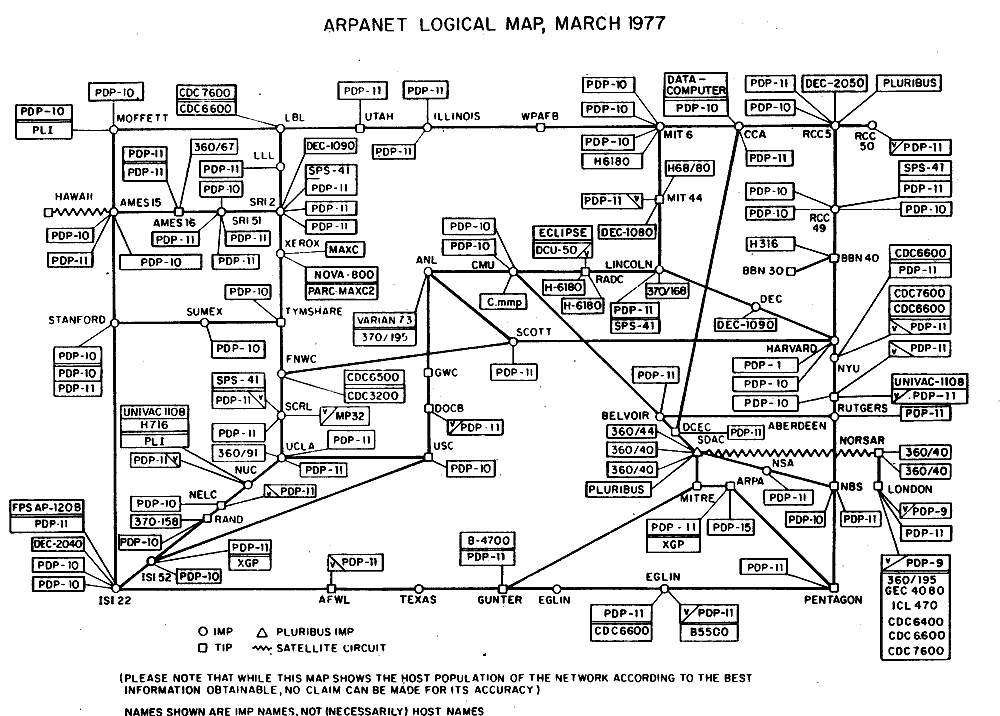
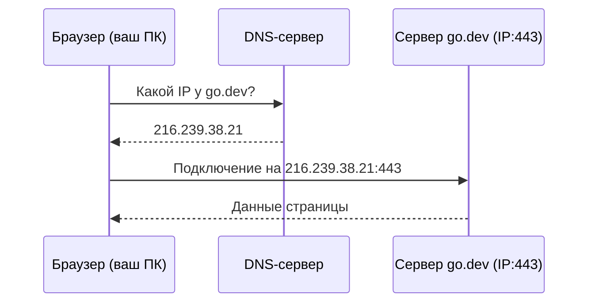

*Почему Интернет не тянет отдельный провод к каждому сайту, как IP-адрес и порт находят нужный процесс и зачем миру понадобился DNS.*

Вы открываете браузер, набираете короткий адрес `go.dev` и нажимаете Enter. Меньше чем через секунду на экране появляется страница документации, хотя сервер, который её отдал, стоит в дата-центре за тысячи километров от вас.

Как ваш ноутбук узнал, куда именно отправить запрос? Как ответ не перепутался с трафиком соседа и попал именно в нужную вкладку браузера, а не в запущенный рядом мессенджер? За этим не стоит никакого «облачного волшебства» — только четыре простые инженерные договорённости: **пакеты**, **IP-адреса**, **порты** и **DNS**.

## Пакетная передача вместо «выделенного провода»

В старых телефонных сетях середины XX века для разговора двух абонентов на время звонка выделялась сплошная физическая линия от одного конца до другого. Пока два человека молчат в трубку, канал простаивает впустую, а если где-то оборвался кабель — связь рвётся мгновенно.

В конце 1960-х годов инженеры ARPANET (прародителя Интернета) решили задачу иначе. Любое сообщение — веб-страница, картинка или письмо — режется на небольшие пронумерованные кусочки, **пакеты** (обычно до полутора килобайт каждый).

На каждый пакет приклеивается короткий заголовок: «от кого», «кому» и «номер части». После этого пакеты отправляются в общую сеть из маршрутизаторов (*routers*). Каждый маршрутизатор смотрит на адрес получателя, сверяется со своей таблицей и пересылает пакет к ближайшему следующему узлу. Разные пакеты одного файла могут даже пройти разными маршрутами, обойдя оборванный кабель, а компьютер получателя снова склеит их в правильном порядке.

У этой модели есть полезная аналогия с обычной почтой — ровно в одном свойстве: письмо (пакет) передаётся от отделения к отделению по адресу на конверте, а не летит по индивидуальной трубе. На этом аналогия заканчивается: в сети пакеты могут дублироваться, приходить не по порядку или молча пропадать при перегрузке канала.

## IP-адрес: как найти нужный компьютер

Чтобы маршрутизаторы знали, куда вести пакет, у каждого устройства в сети есть числовой адрес — **IP-адрес** (*Internet Protocol address*).

Самый распространённый формат **IPv4** состоит из 4 байтов (32 битов). Для удобства чтения их записывают четырьмя десятичными числами от `0` до `255` через точку, например: `192.168.1.10` или `216.239.38.21`.

Четыре байта дают около $4{,}3$ миллиарда адресов — в 1980-х казалось, что их хватит навсегда, но смартфоны, серверы и умные устройства быстро исчерпали запас. Поэтому мир постепенно переходит на **IPv6** длиной 16 байтов (128 битов), который записывают в шестнадцатеричной системе. Для понимания логики сетей на старте достаточно знать один принцип: **IP-адрес указывает на конкретную машину в сети**.

Есть один особенный IP-адрес, который вы увидите сотни раз во время разработки: **`127.0.0.1`** (или имя **`localhost`**). Пакет, отправленный на `127.0.0.1`, никуда не уходит в кабель или Wi-Fi — ядро ОС разворачивает его обратно на ваш собственный компьютер. Это идеальная «песочница» для запуска и проверки вашего будущего бэкенда локально.

## Порт: как найти нужную программу на этом компьютере

Допустим, пакет долетел по IP-адресу до вашего сервера. Но на этом сервере одновременно работают пять программ: веб-сервер, служба удалённого доступа, почтовая служба и ваш сервис закладок. Кому именно ядро ОС должно вручить прилетевшие байты?

Для этого к IP-адресу добавляют 16-битное число от `1` до `65535` — **порт**.

* **IP-адрес** — это адрес дома на улице (конкретный компьютер).
* **Порт** — номер квартиры в этом доме (конкретная программа, которая слушает сеть).

Когда программа хочет принимать входящие запросы, она просит ядро ОС закрепить за ней свободный порт, например `8080`. Занятый порт принадлежит одному процессу: если вы попробуете запустить вторую копию сервера на том же порту `8080`, операционная система сразу вернёт ошибку — квартира уже занята.

Часть портов закреплены за популярными протоколами по соглашению:

| Порт | Назначение |
|---:|---|
| `80` | Обычный HTTP (без шифрования) |
| `443` | Защищённый HTTPS (с шифрованием) |
| `22` | Удалённый доступ к терминалу (SSH) |
| `8080` | Популярный порт для локальной разработки бэкендов |

## DNS: телефонная книга Интернета

Люди плохо запоминают числа вроде `216.239.38.21`, но легко помнят `go.dev`. Чтобы не диктовать друзьям IP-адреса, в 1983 году Пол Мокапетрис разработал **DNS** (*Domain Name System*) — распределённую адресную книгу Интернета.

Когда вы вводите `go.dev`, ваш компьютер сперва отправляет короткий запрос ближайшему DNS-серверу: *«Какой IP-адрес сейчас закреплён за именем `go.dev`?»* DNS отвечает числом, ваш компьютер кэширует ответ на некоторое время, чтобы не спрашивать заново каждую секунду, и только после этого открывает соединение по полученному IP.

## Надёжная доставка поверх ненадёжной сети: TCP на пальцах

Сам по себе протокол IP не даёт никаких гарантий: пакет может потеряться на перегруженном маршрутизаторе или прийти позже соседа. Для веб-страниц, файлов и API это неприемлемо — пропажа одного байта способна сломать весь документ.

Поэтому поверх IP работает протокол **TCP** (*Transmission Control Protocol*). Его задача — превратить ненадёжный поток отдельных пакетов в ровную, надёжную двустороннюю трубу для байтов:

1. Перед обменом клиент и сервер обмениваются коротким приветствием (трёхсторонним рукопожатием), чтобы убедиться, что обе стороны на связи.
2. Каждый отправленный кусочек данных нумеруется.
3. Получатель подтверждает приход: *«Принял байты до номера 4096»*. Если подтверждение не пришло вовремя, отправитель сам пересылает пропавший фрагмент.
4. На приёмной стороне TCP складывает байты в исходном порядке и отдаёт программе чистый поток, без дыр и перестановок.

Когда важна мгновенная скорость, а потеря одного кадра не страшна (например, в голосовом звонке или онлайн-игре), вместо TCP выбирают лёгкий протокол **UDP**, который не тратит время на подтверждения и переотправку.

Честное упрощение на этом шаге: мы опустили домашние маршрутизаторы с подменой адресов (NAT), шифрование TLS и детали работы сокетов. К каждому из этих механизмов мы вернёмся в Модуле 5 с практическими проверками и даже напишем на Go собственный мини-сервер поверх TCP, а глубокий сетевой стек Linux разберём в Томе 5.

> [!check] Проверь понимание
> На вашем компьютере запущен тестовый сервис на адресе `127.0.0.1:8080`. Вы пытаетесь запустить рядом вторую копию этого же сервиса на `127.0.0.1:8080`. Что произойдёт и как решить задачу?
>
> Ядро ОС отклонит запуск второй копии, потому что порт `8080` уже занят первым процессом. Чтобы запустить две копии одновременно, достаточно назначить второй другой свободный порт — например, `8081`.

## Вопросы на понимание

**Вопрос 1 (Базовый).** Какую задачу в Интернете решает DNS, и сможет ли браузер открыть сайт, если DNS-сервер временно недоступен, но вы знаете точный IP-адрес сервера?

> [!solution] Показать решение
> DNS переводит понятные человеку доменные имена (`go.dev`) в числовые IP-адреса. Если вы знаете точный IP-адрес (и сервер готов принимать обращения по IP), соединение установится и без DNS — сам обмен данными идёт строго по IP-адресам.

**Вопрос 2 (Практический).** Зачем нужен протокол TCP, если пакеты и так умеет доставлять протокол IP?

> [!solution] Показать решение
> Протокол IP занимается только маршрутизацией отдельных пакетов и не гарантирует, что они дойдут без потерь и в нужном порядке. TCP поверх IP добавляет нумерацию, подтверждение доставки, повторную отправку потерянных фрагментов и сборку байтов в исходной последовательности.

**Вопрос 3 (Со звёздочкой \*).** Вы запустили свой веб-сервис на адресе `127.0.0.1:8080` и попросили коллегу с соседнего ноутбука в той же Wi-Fi сети открыть `http://127.0.0.1:8080` у себя в браузере. Почему у него ничего не откроется?

> [!solution] Показать решение
> Адрес `127.0.0.1` всегда указывает на **собственный** компьютер отправителя. Браузер коллеги стучится в порт `8080` на его же ноутбуке, где ничего не запущено. Чтобы коллега попал к вам, ваш сервер должен слушать сетевой интерфейс машины (а не только локальную петлю), а коллега должен обращаться по вашему локальному IP-адресу в сети Wi-Fi (например, `192.168.1.42:8080`).

---

Теперь две программы на разных концах света умеют открыть надёжный канал TCP и пересылать друг другу сырые байты. Но о чём именно они разговаривают? Как браузер объясняет серверу, что ему нужна конкретная закладка, а сервер отвечает «создано» или «не найдено»? Это язык протокола **HTTP** — тема нашей следующей главы [[8. Что такое HTTP, клиент и бэкенд]].
