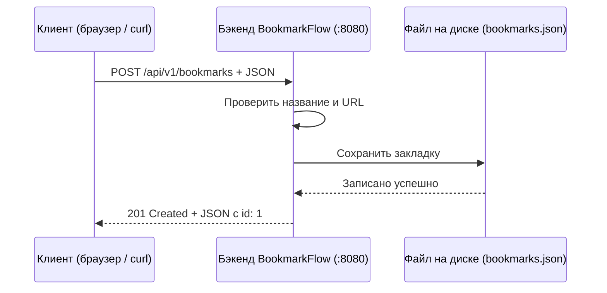

*Как браузер и мобильное приложение разговаривают с сервером по HTTP, из чего состоят запрос и ответ, что такое JSON и чем на самом деле занимается бэкенд.*

Вы нажимаете кнопку «Сохранить закладку» в приложении. Через долю секунды карточка появляется в списке, а если открыть тот же аккаунт с телефона — она уже там.

Что произошло между нажатием кнопки и появлением карточки на телефоне? Никакой мистики: программа на вашем устройстве отправила структурированное текстовое сообщение на удалённый компьютер, а программа на том компьютере проверила данные, записала их на диск и прислала короткий ответ. Первую программу называют **клиентом**, вторую — **бэкендом**, а язык, на котором они общаются, — протоколом **HTTP**.

## Модель «клиент — сервер» и кто такой бэкенд

В сетевом приложении работа почти всегда разделена на две роли:

* **Клиент** (*frontend*, мобильное приложение, браузер или консольная утилита) рисует интерфейс, принимает действия пользователя и отправляет запросы по сети.
* **Сервер** (**бэкенд**) работает круглосуточно на удалённой машине, хранит общие данные, проверяет правила и права доступа, выполняет тяжёлые вычисления и отвечает клиентам.

Зачем выносить логику и данные на сервер? По трём причинам: данные должны быть доступны с разных устройств, правила проверки нельзя доверять клиентской программе (пользователь может изменить код в своём браузере), а секреты и общие ресурсы должны жить в одном контролируемом месте.

Удобно думать о бэкенде просто: это обычная программа (процесс в операционной системе), которая открыла сетевой порт, ждёт входящих запросов и на каждый запрос возвращает ответ. Всё, что мы узнали в главах 1–7, — байты, UTF-8, процессор, RAM, диск, процессы ОС и TCP — прямо сейчас складывается в одну картину.

## Анатомия HTTP: обычный текст поверх TCP

В 1989–1991 годах Тим Бернерс-Ли в ЦЕРНе придумал Всемирную паутину и её главный протокол — **HTTP** (*HyperText Transfer Protocol*). Его замысел поражал простотой: вместо сложного бинарного формата клиент и сервер обмениваются понятными человеку текстовыми сообщениями по схеме **«запрос → ответ»** (*request → response*).

Взгляните на реальный HTTP-запрос на создание закладки в нашем будущем сервисе `BookmarkFlow`:

```http
POST /api/v1/bookmarks HTTP/1.1
Host: localhost:8080
Content-Type: application/json

{"title": "Документация Go", "url": "https://go.dev/doc", "tags": ["go", "docs"]}
```

Этот блок состоит ровно из трёх частей, разделённых переводами строк:

1. **Стартовая строка:** `POST /api/v1/bookmarks HTTP/1.1`
   * **Метод** (`POST`) говорит, *что* клиент хочет сделать.
   * **Путь** (`/api/v1/bookmarks`) указывает, *с каким ресурсом* работаем.
   * **Версия протокола** (`HTTP/1.1`).
2. **Заголовки** (*headers*) — служебные пары «Имя: значение». Здесь `Host` называет адрес сервера, а `Content-Type` предупреждает, что внутри лежит формат JSON.
3. **Пустая строка и тело** (*body*) — сами полезные данные запроса.

А вот ответ сервера на этот запрос:

```http
HTTP/1.1 201 Created
Content-Type: application/json

{"id": 1, "title": "Документация Go", "url": "https://go.dev/doc", "tags": ["go", "docs"]}
```

В ответе те же три части: стартовая строка с **кодом статуса** (`201 Created`), заголовки и тело ответа.



## Четыре базовых метода и пять семейств кодов статуса

Для повседневной работы с данными (создание, чтение, обновление, удаление — сокращённо **CRUD**) в HTTP используют четыре главных метода:

| Метод | Смысл действия | Есть ли тело запроса | Пример |
|---|---|---|---|
| `GET` | Прочитать данные (не меняя их) | Нет | `GET /api/v1/bookmarks/1` |
| `POST` | Создать новый ресурс | Да | `POST /api/v1/bookmarks` |
| `PUT` | Обновить существующий ресурс | Да | `PUT /api/v1/bookmarks/1` |
| `DELETE` | Удалить ресурс | Обычно нет | `DELETE /api/v1/bookmarks/1` |

Чтобы клиент сразу понимал, чем закончилась операция, не гадая по тексту сообщения, HTTP использует трёхзначные **коды статуса**. Запоминать десятки кодов не нужно — достаточно знать их первую цифру:

* **`2xx` (Успех):** всё прошло хорошо. `200 OK` — ответ с данными; `201 Created` — новый объект создан; `204 No Content` — удалено успешно, возвращать нечего.
* **`3xx` (Перенаправление):** ресурс переехал на другой адрес (например, `301 Moved Permanently`).
* **`4xx` (Ошибка клиента):** что-то не так в самом запросе. `400 Bad Request` — сломанный синтаксис; `404 Not Found` — закладки с таким номером нет; `422 Unprocessable Entity` — формат JSON верный, но данные не прошли проверку (скажем, пустое название).
* **`5xx` (Ошибка сервера):** запрос был нормальным, но сломался сам бэкенд (например, `500 Internal Server Error` — диск переполнен или в коде случился непредвиденный сбой).

Различие между `4xx` и `5xx` — одно из самых полезных правил бэкенда. Если посыпались ошибки `400`, проблема у клиента; если `500` — срочно чинить сервер.

## Почему API общается на JSON, а не на HTML

Когда вы открываете сайт в браузере, сервер обычно возвращает **HTML** — разметку для показа человеку: заголовки, абзацы, кнопки и цвета.

Но если к вашему бэкенду обращается мобильное приложение, другой сервис или консольная утилита, им не нужны шрифты и отступы — им нужны **чистые структурированные данные**. Универсальным языком таких данных стал **JSON** (*JavaScript Object Notation*):

```json
{
  "id": 1,
  "title": "Документация Go",
  "url": "https://go.dev/doc",
  "tags": ["go", "docs"]
}
```

У JSON всего шесть строительных элементов: объекты `{...}`, списки `[...]`, строки в двойных кавычках, числа, логические значения `true`/`false` и `null`. Он текстовый (хранится в UTF-8), легко читается глазами и одинаково разбирается в любом языке программирования. Интерфейс, по которому клиент обменивается с бэкендом такими структурированными запросами, называют **HTTP API**.

## Как устроен рабочий цикл бэкенда

Соберём путь одного запроса внутри бэкенда по шагам:

1. **Приём:** процесс слушает порт `8080` и получает байты HTTP-запроса от операционной системы.
2. **Маршрутизация:** по методу и пути (`POST /api/v1/bookmarks`) выбирается нужный обработчик.
3. **Разбор и валидация:** тело JSON проверяется на корректность — не пустое ли название, начинается ли ссылка с `http://` или `https://`. Если есть ошибка — сразу возвращается `400` или `422`.
4. **Бизнес-логика и сохранение:** присваивается новый `id`, и запись сохраняется в хранилище (в Томе 1 — в JSON-файл на диске, а в Томе 2 мы перенесём хранение в полноценные базы данных).
5. **Ответ:** формируется JSON-ответ со статусом `201 Created` и отправляется клиенту.

Никаких секретных технологий. Бэкенд — это аккуратный конвейер проверки, хранения и отдачи данных.

> [!check] Проверь понимание
> Клиент отправил запрос `POST /api/v1/bookmarks` с пустым полем `"title": ""`. Какой код статуса должен вернуть бэкенд — `200`, `422` или `500`?
>
> Корректно вернуть **`422 Unprocessable Entity`** (или `400 Bad Request`). Сервер работает исправно, поэтому `500` здесь будет ошибкой проектирования: сбой вызван некорректными данными от клиента, значит нужна группа `4xx`.

## Вопросы на понимание

**Вопрос 1 (Базовый).** Из каких трёх частей состоит любое HTTP-сообщение (как запрос, так и ответ) и что отделяет заголовки от тела?

> [!solution] Показать решение
> Любое HTTP-сообщение состоит из (1) стартовой строки, (2) блока заголовков в формате «Имя: значение» и (3) необязательного тела сообщения. Заголовки всегда отделяются от тела ровно одной **пустой строкой**.

**Вопрос 2 (Практический).** Почему для удаления закладки используют метод `DELETE /api/v1/bookmarks/5`, а не `GET /api/v1/bookmarks/5/delete`?

> [!solution] Показать решение
> По стандарту HTTP метод `GET` считается безопасным — он должен только читать данные и ничего не менять на сервере. Браузеры, кэши и поисковые роботы вправе предварительно загружать ссылки `GET` без ведома пользователя. Если повесить удаление на `GET`, один автоматический предпросмотр ссылки сотрёт пользовательские данные.

**Вопрос 3 (Со звёздочкой \*).** Пользователь нажал кнопку «Создать закладку», но в момент записи файла на сервере закончилось свободное место на диске. Какой код статуса обязан вернуть бэкенд и почему нельзя молча вернуть `201 Created`?

> [!solution] Показать решение
> Сервер обязан вернуть **`500 Internal Server Error`** (и записать причину в свой журнал событий). Возвращать `201 Created`, когда данные не сохранились на диск, — грубейшая ошибка: клиент поверит, что закладка надёжно записана, и при следующем перезапуске сервера пользователь безвозвратно потеряет данные.

---

Мы прошли всю цепочку от выключателя фонарика до работающего HTTP-бэкенда. Остался последний вопрос пролога: на каком языке писать этот бэкенд и почему тысячи компаний выбрали именно Go? Разберём в финальной главе модуля [[9. Почему Go и что мы построим в этом томе]].
