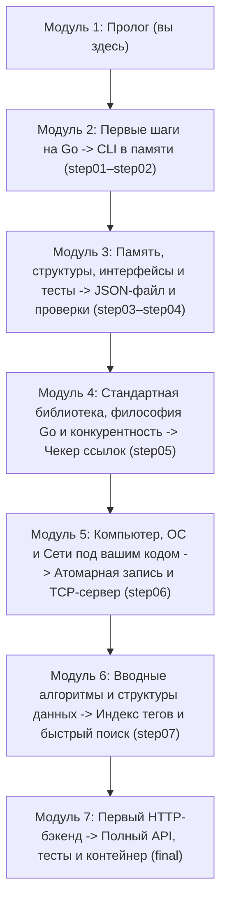

*Какие компромиссы породили язык Go, почему он так популярен в серверной разработке и какой проект вы соберёте шаг за шагом в Томе 1.*

> «Можно уверенно предсказать, что новые языки, делающие программирование проще и безопаснее, будут появляться и дальше. Но столь же уверенно можно сказать, что единого языка не будет никогда: в разработке слишком много компромиссов, чтобы один-единственный язык одинаково хорошо подходил для всех задач.»  
> — Брайан Керниган, *UNIX: A History and a Memoir*

В предыдущих главах мы собрали полную карту того, как работает бэкенд: двоичные данные, процессор, быстрая RAM и долговечный диск, компилятор, процессы ОС, TCP и HTTP. Казалось бы, написать HTTP-сервис можно на любом популярном языке — Python, JavaScript, Java, C++ или Rust.

И действительно можно. Тогда зачем в 2007 году трое инженеров Google — Роберт Гризмер, Роб Пайк и Кен Томпсон (тот самый соавтор Unix и UTF-8) — решили потратить годы на создание ещё одного языка, **Go**?

## Три боли серверной разработки, из которых родился Go

В середине 2000-х команда серверной инфраструктуры Google столкнулась с неудобной развилкой, знакомой каждому инженеру и сегодня:

1. **Быстро работает, но тяжело писать и долго собирать (C++).** Программы на C++ выжимают из железа максимум скорости, но проекты на миллионы строк компилируются десятками минут, а одна ошибка с ручным управлением памятью обрушивает сервер или открывает уязвимость.
2. **Удобно писать, но медленно в работе и хрупко при росте (Python, Ruby, динамический JS).** Прототип появляется за вечер, но при росте нагрузки интерпретатор упирается в потолок скорости и расхода памяти, а отсутствие строгих проверок до запуска превращает рефакторинг крупного сервиса в хождение по минному полю.
3. **Мощные корпоративные платформы (Java, C#).** Надёжные и быстрые в долгой работе, но тяжёлые по памяти, сложные по числу абстракций и требующие установленной виртуальной машины.

К тому же в те же годы закончилась эпоха бесконечного роста частоты одного ядра процессора. Вместо одного ядра на 10 ГГц производители начали ставить 4, 16, 64 ядра на один кристалл. Языки 1990-х создавались до эры многоядерных серверов и тысяч одновременных сетевых подключений.

Создатели Go поставили дерзкую цель: соединить **скорость и строгую проверку компилируемого языка**, **простоту чтения динамического языка** и **лёгкую встроенную работу с множеством одновременных сетевых задач**.

## Пять инженерных качеств Go без прикрас

Go не пытается стать «самым умным» языком на свете. Напротив, его главная сила — в осознанных ограничениях.

* **Минимализм.** В языке всего 25 ключевых слов. Программист тратит внимание не на разгадывание хитрых конструкций языка, а на саму задачу сервиса. Чужой код на Go читается почти так же легко, как собственный.
* **Молниеносная компиляция в один файл.** Go компилируется за доли секунды в единый автономный исполняемый файл без внешних виртуальных машин и без «зоопарка версий интерпретатора» на сервере.
* **Автоматическое управление памятью.** Встроенный сборщик мусора сам освобождает ненужную память, избавляя разработчика от самых опасных классов ошибок C и C++.
* **Мощная стандартная библиотека.** Всё, что нужно для работы с текстом, файлами, временем, JSON и полноценным HTTP-сервером, уже встроено в сам Go. Вам не придётся в первую же неделю учить тяжёлый сторонний фреймворк.
* **Встроенная конкурентность.** Язык с первого дня спроектирован так, чтобы один процесс спокойно держал десятки тысяч одновременных сетевых соединений, расходуя скромный объём оперативной памяти.

Честность требует назвать и **границы**, где Go проигрывает другим инструментам:

* Для микроконтроллеров с парой килобайт памяти, ядер ОС или игровых движков, где недопустима даже миллисекундная пауза сборщика мусора, лучше подходят C и Rust.
* Для быстрых исследовательских расчётов, анализа данных и обучения нейросетей экосистема Python вне конкуренции.
* Для интерфейсов прямо в браузере стандартом остаётся JavaScript/TypeScript.

Go выбирают там, где нужно быстро писать надёжные, понятные и экономичные **бэкенды, сетевые сервисы, CLI-утилиты и облачную инфраструктуру**.

## Карта вашего пути в Томе 1: сквозной проект `BookmarkFlow`

Учиться по оторванным задачкам про абстрактных «кошек и собак» скучно и бесполезно: вы запоминаете синтаксис, но не понимаете, как из него складывается живой сервис.

Поэтому через весь Том 1 проходит один реальный проект — **`BookmarkFlow`**. Вы начнёте с крошечной консольной программы в Модуле 2 и к финалу Модуля 7 вырастите её в полноценный HTTP-сервис в контейнере, который умеет сохранять, искать, обновлять, удалять и проверять доступность закладок.

Обратите внимание на последнюю ступеньку: в Томе 1 сервис `BookmarkFlow` будет хранить данные в обычном JSON-файле на диске — за чистой внутренней границей хранилища. А когда вы перейдёте к **Тому 2 «Базы данных»**, вы узнаете, почему файловое хранилище упирается в потолок при росте нагрузки, и переключите бэкенд на настоящую промышленную систему управления базами данных.

## Как выжать максимум из следующих модулей

> «Если почувствуете, что начинаете тонуть, — пожалуйста, вынырните глотнуть воздуха.»  
> — Чарльз Петцольд, *Code (2nd ed.)*

С Модуля 2 начнётся настоящая практика за клавиатурой. Три простые привычки ускорят ваш прогресс вдвое:

1. **Печатайте примеры руками, а не копируйте.** Мышечная память и мелкие опечатки, которые сразу поймает компилятор, учат быстрее любого пассивного чтения.
2. **Не бойтесь сообщений об ошибках.** Компилятор Go — не строгий экзаменатор, а напарник, который бережёт вас от сбоев на сервере. В каждом уроке мы будем специально разбирать реальные ошибки компилятора и учиться читать их спокойно.
3. **Решайте упражнения до открытия спойлера.** Даже пять минут собственных попыток формируют прочные связи в голове; готовый ответ без попытки забывается к вечеру.

> [!check] Проверь понимание
> Назовите хотя бы два инженерных преимущества, из-за которых Go стал популярным именно для бэкендов и консольных утилит, и одну область, где его выбирать не стоит.
>
> Для бэкендов и CLI сильны быстрая компиляция в один автономный файл, строгая проверка типов, богатая стандартная библиотека и лёгкая работа с множеством сетевых задач. А вот для микроконтроллеров без сборщика мусора или исследовательских скриптов машинного обучения лучше выбрать C/Rust или Python соответственно.

## Вопросы на понимание

**Вопрос 1 (Базовый).** Почему для запуска скомпилированной программы на Go на чистом сервере Linux обычно достаточно скопировать всего один файл?

> [!solution] Показать решение
> Компилятор Go заранее переводит ваш код вместе с нужными частями стандартной библиотеки и среды выполнения в единый автономный бинарник с машинными инструкциями под целевую ОС и процессор. На сервере не нужно устанавливать интерпретатор, виртуальную машину или десятки системных пакетов.

**Вопрос 2 (Практический).** Команда пишет сервис обработки платежей, который должен круглосуточно обслуживать тысячи одновременных HTTP-запросов, а развивать его будут десять инженеров с разным опытом. Какие два свойства Go помогут этой команде больше всего?

> [!solution] Показать решение
> Во-первых, **простой и единообразный язык со строгой проверкой типов**: новые участники быстрее читают чужой код, а часть ошибок отсекается на этапе компиляции. Во-вторых, **встроенная модель конкурентности и предсказуемое потребление памяти**: сервис спокойно держит тысячи одновременных запросов без сложной ручной настройки потоков.

**Вопрос 3 (Со звёздочкой \*).** В Томе 1 наш сервис `BookmarkFlow` будет хранить данные в обычном JSON-файле на диске. Назовите два реальных ограничения, с которыми неизбежно столкнётся такой файл, если число пользователей вырастет до десятков тысяч.

> [!solution] Показать решение
> Во-первых, **скорость обновления**: при каждом добавлении или удалении одной закладки приходится заново записывать на диск весь файл целиком, а поиск по миллионам записей требует сканировать весь файл. Во-вторых, **совместный доступ и масштаб**: один файл на одном диске плохо выдерживает тысячи одновременных записей с нескольких серверов. Именно для решения этих проблем создали базы данных — им целиком посвящён Том 2.

---

Пролог завершён: теперь слова «байт», «UTF-8», «процессор», «RAM», «компилятор», «процесс», «порт» и «HTTP» перестали быть чёрными ящиками. В Модуле 2 «Первые шаги на Go» мы установим инструменты разработчика, откроем терминал и напишем вашу первую компилируемую программу на Go.
