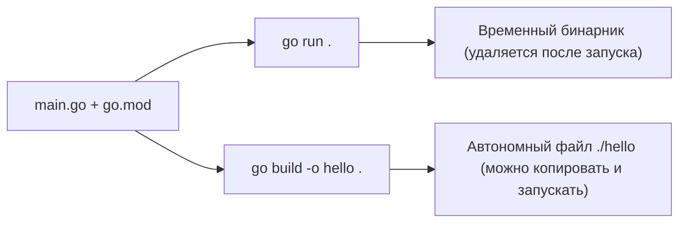

*Как поставить Go 1.24, настроить рабочую папку с Git и собрать свою первую автономную программу из командной строки.*

Вы прочитали Пролог и уже представляете, как текст программы превращается в машинные инструкции и запускается операционной системой. Но пока всё это теория: на вашем компьютере нет ни одного работающего `.go`-файла.

Задача этого урока простая и осязаемая: за пятнадцать минут подготовить чистую среду разработчика, понять разницу между запуском на лету и сборкой бинарника и получить первый исполняемый файл Go, который работает сам по себе.

## Установка Go 1.24 и проверка среды

В этом томе мы опираемся на **Go 1.24** (все примеры совместимы с Go 1.22–1.24 и новее). Скачайте официальный установщик для своей ОС со страницы `go.dev/dl` или поставьте пакет через менеджер вашей системы (например, `brew install go` на macOS).

Откройте терминал и проверьте, что компилятор доступен в `PATH`:

```bash
go version
```

Вы увидите строку вида:

```text
go version go1.24.0 linux/amd64
```

Точная минорная цифра (например, `1.24.2` или `1.25.x`) и пара «ОС/архитектура» (`darwin/arm64`, `windows/amd64`) будут вашими — главное, чтобы версия была **не ниже `1.22`**.

Заодно проверьте, установлен ли **Git** — система контроля версий, которая хранит снимки вашего кода и позволяет откатить неудачный эксперимент за секунду:

```bash
git --version
```

Если команда не найдена, установите Git (`git-scm.com` или системный пакетный менеджер) и один раз задайте своё имя и почту для истории изменений:

```bash
git config --global user.name "Ваше Имя"
git config --global user.email "you@example.com"
```

Для редактирования кода подойдёт любой текстовый редактор с поддержкой Go — чаще всего берут **VS Code** с официальным расширением *Go* (от Go Team at Google) либо **GoLand**. Впрочем, компилятору Go всё равно, в чём вы набрали текст: он читает обычные файлы UTF-8.

## Рабочая папка, Git и модуль `go.mod`

В старых статьях о Go до сих пор встречается страшное слово `GOPATH` — жёсткое требование складывать все проекты мира в одну специальную папку. **Забудьте про это.** С 2019 года Go работает через **модули**: проект может лежать в любом каталоге на диске.

Создадим чистую папку для упражнений этого модуля, инициализируем Git и объявим Go-модуль:

```bash
mkdir -p ~/go-practice/hello
cd ~/go-practice/hello
git init
go mod init example.com/hello
```

Команда `go mod init` создаст в папке единственный маленький файл `go.mod`:

```text
module example.com/hello

go 1.24
```

Файл `go.mod` — это паспорт проекта. Он сообщает компилятору две вещи: где находится корень проекта и какую минимальную версию языка Go вы используете. Имя `example.com/hello` — условный путь модуля; если вы позже выложите проект на GitHub, его обычно называют `github.com/ваш-логин/имя-проекта`, но для локальных задач подойдёт любое корректное имя.

## Первая программа: `Hello, World`

Создайте в той же папке файл `main.go` и наберите этот код **вручную**, не копируя:

```go
package main

import "fmt"

func main() {
	fmt.Println("Привет, Go! Среда готова к работе.")
}
```

Запустите программу из терминала командой `go run`:

```bash
go run .
```

Терминал выведет:

```text
Привет, Go! Среда готова к работе.
```

А теперь посмотрите, чем `go run` отличается от `go build`. Запустите:

```bash
go build -o hello .
ls -lh hello
./hello
```

На экране появится та же строка, но в каталоге останется самостоятельный исполняемый файл `hello` (на Windows — `hello.exe`).



У `go run` и `go build` под капотом работает **один и тот же компилятор**:
* `go run .` компилирует проект во временную папку ОС, сразу запускает результат и удаляет бинарник после завершения. Это удобно в процессе написания и быстрых проверок.
* `go build .` компилирует проект и кладёт готовый автономный бинарный файл прямо в текущий каталог. Этот файл можно перенести на другой компьютер с той же ОС и архитектурой, где Go вообще не установлен, и он запустится.

## Первый коммит в Git и полезная ошибка компилятора

Зафиксируем рабочий старт в Git — заодно привыкнем не класть скомпилированный бинарник в репозиторий:

```bash
echo "hello" > .gitignore
git add go.mod main.go .gitignore
git commit -m "chore: first Go program"
```

Теперь намеренно сломайте программу — уберите закрывающую кавычку в `main.go`:

```go
fmt.Println("Привет, Go!)
```

И запустите `go run .`. Компилятор тут же остановит сборку и выдаст точный адрес проблемы:

```text
# example.com/hello
./main.go:6:14: string literal not terminated
```

Научитесь сразу читать формат сообщений компилятора Go:

```text
./main.go : 6 : 14 : string literal not terminated
  файл     строка столбец     суть ошибки
```

В шестой строке на четырнадцатом символе началась строка, но не нашлась закрывающая кавычка. Верните кавычку на место и убедитесь, что `go run .` снова работает чисто.

> [!check] Проверь понимание
> Вы передали коллеге скомпилированный файл `./hello`, собранный через `go build` на Linux `amd64`. Нужно ли коллеге на таком же сервере Linux `amd64` устанавливать Go, чтобы запустить этот файл?
>
> Нет. `go build` собирает автономный исполняемый файл с машинными инструкциями и нужными частями стандартной библиотеки. Целевой машине с той же ОС и архитектурой компилятор Go не нужен.

## Практика

**Упражнение 1 (Базовое). Измените приветствие и соберите бинарник.**  
Допишите в `main.go` вторую строку `fmt.Println(...)`, которая выводит ваше имя и текущую цель (например, `"Собираю BookmarkFlow"`). Соберите бинарник с именем `greet` командой `go build -o greet .` и запустите его напрямую как `./greet`.

> [!solution] Показать решение
> ```go
> package main
>
> import "fmt"
>
> func main() {
> 	fmt.Println("Привет, Go! Среда готова к работе.")
> 	fmt.Println("Цель: собрать консольный и веб-сервис BookmarkFlow.")
> }
> ```
> Сборка и запуск:
> ```bash
> go build -o greet .
> ./greet
> ```
> Обратите внимание: если вы меняете `main.go`, старый файл `./greet` сам не обновится — его нужно пересобрать через `go build`.

**Упражнение 2 (Практическое). Что сломается?**  
Попробуйте внести в `main.go` по очереди два изменения, каждый раз запуская `go run .`, и объясните текст ошибки компилятора:
1. Удалите строку `import "fmt"`, оставив вызов `fmt.Println(...)`.
2. Верните `import "fmt"`, но переименуйте `func main()` в `func start()`.

> [!solution] Показать решение
> 1. Без `import "fmt"` компилятор выведет:
>    ```text
>    ./main.go:4:2: undefined: fmt
>    ```
>    Пакет `fmt` не подключён, поэтому имя `fmt` в этом файле неизвестно.
> 2. Без функции `main` в пакете `main` компилятор выведет:
>    ```text
>    runtime.main_main·f: function main is undeclared in the main package
>    ```
>    Исполняемая программа на Go обязана содержать точку входа `func main()` в пакете `main`.

**Упражнение 3 (Со звёздочкой \*). Кросс-компиляция в одну строчку.**  
Выясните с помощью `go env GOOS GOARCH`, под какую платформу собирает ваш компилятор по умолчанию. Затем соберите бинарник этой же программы под Windows `amd64` (даже если вы работаете на Linux или macOS), задав переменные окружения прямо перед `go build`:
```bash
GOOS=windows GOARCH=amd64 go build -o hello.exe .
```
Проверьте размер и тип полученного файла (на Linux/macOS командой `file hello.exe`). Почему это сработало без виртуальной машины Windows?

> [!solution] Показать решение
> ```bash
> go env GOOS GOARCH
> GOOS=windows GOARCH=amd64 go build -o hello.exe .
> file hello.exe
> # hello.exe: PE32+ executable (console) x86-64, for MS Windows
> ```
> Компилятор Go и стандартная библиотека содержат генераторы машинного кода сразу под все поддерживаемые ОС и архитектуры процессоров. Переопределяя `GOOS` и `GOARCH`, вы просите компилятор выдать инструкции и формат исполняемого файла под другую платформу — без установки сторонних SDK.

---

Программа компилируется, запускается и лежит под присмотром Git. Но в нашем пятистрочном файле уже спрятаны три обязательные конструкции — `package`, `import` и `func main`, — а рядом стоит утилита `gofmt`, которая диктует стиль кода всему сообществу Go. В следующей главе [[2. Анатомия программы на Go — package, import, main и gofmt]] разберём каждую строку под микроскопом.
