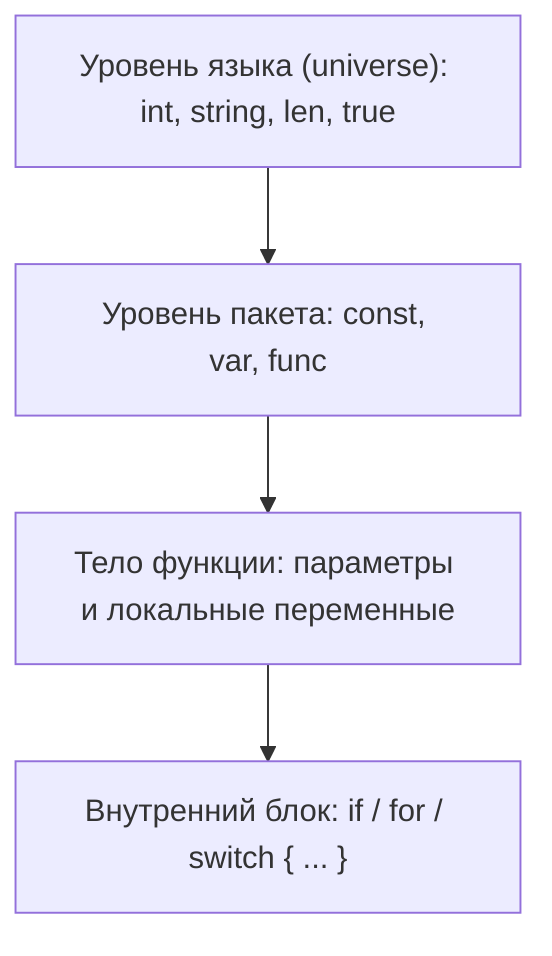

*Как функции в Go возвращают сразу несколько значений, зачем нужен пустой идентификатор `_` и как не попасться в ловушку затенения переменной через `:=`.*

В C, Java или Python, если функции нужно вернуть сразу два результата — например, найденный порт и признак «удалось ли его разобрать», — приходится либо заводить специальный класс-обёртку, либо возвращать магическое число `-1` и надеяться, что вызывающий код не забудет его проверить.

В Go функция может вернуть **два, три или сколько угодно значений напрямую**. Этот простой механизм — фундамент всего языка: именно на нём держатся проверка ошибок и безопасное чтение данных. Но рядом с ним живёт одна коварная ловушка области видимости, в которую попадает почти каждый новичок. Разберём оба механизма вместе.

## Множественный возврат (*multiple return values*)

Чтобы функция вернула несколько значений, их типы перечисляют в круглых скобках после списка параметров:

```go
package main

import (
	"fmt"
	"strings"
)

// splitHostPort разделяет строку вида "localhost:8080" на хост, порт и флаг успеха.
func splitHostPort(addr string) (string, string, bool) {
	host, port, found := strings.Cut(addr, ":")
	if !found || host == "" || port == "" {
		return "", "", false
	}
	return host, port, true
}

func main() {
	host, port, ok := splitHostPort("api.example.com:8080")
	if ok {
		fmt.Printf("Хост: %s, порт: %s\n", host, port)
	}

	_, onlyPort, ok := splitHostPort("127.0.0.1:9000")
	if ok {
		fmt.Println("Только порт:", onlyPort)
	}
}
```

Вывод:

```text
Хост: api.example.com, порт: 8080
Только порт: 9000
```

Обратите внимание на две идиомы Go прямо в этом примере:

1. **Паттерн «значение + `ok`» (*comma ok*).** Стандартная функция `strings.Cut(addr, ":")` возвращает `(до, после, найдено bool)`. Если разделителя нет, третий результат равен `false`, и вызывающему коду не нужно гадать, означает ли пустая строка отсутствие порта или отсутствие двоеточия.
2. **Пустой идентификатор `_` (*blank identifier*).** Помните правило из урока 3: любая объявленная локальная переменная должна использоваться, иначе код не скомпилируется. Когда из нескольких возвращаемых значений вам нужно только одно (как `onlyPort` выше), лишнее значение принимают в `_` — это честная корзина, которая показывает компилятору и читателю: «я отбросил это значение осознанно».

## Лексические блоки и область видимости (*scope*)

Каждая пара фигурных скобок `{ ... }` в Go создаёт свой **лексический блок**. Кроме того, скрытые блоки есть у заголовков `if`, `for` и `switch`, у файла, у пакета и у всего языка в целом (так называемый *universe block*, где живут `int`, `string`, `len`, `true`).

Правило поиска имени простое: компилятор ищет переменную сначала в текущем блоке, потом во внешнем, потом ещё выше — до уровня пакета.



Из внутреннего блока видны переменные внешнего, но из внешнего не видны переменные внутреннего:

```go
package main

import "fmt"

const maxLimit = 100 // видна во всём пакете

func main() {
	limit := 50 // видна во всей функции main

	if limit < maxLimit {
		step := 10 // видна только внутри этого if
		limit += step
	}
	// fmt.Println(step) // compile error: undefined: step
	fmt.Println("Итоговый лимит:", limit) // 60
}
```

## Ловушка затенения (*variable shadowing*) через `:=`

Теперь посмотрите на ошибку, которая сбивала с толку даже опытных разработчиков. Прочитайте код внимательно и предскажите вывод:

```go
package main

import "fmt"

func loadPort(custom bool) (int, bool) {
	if custom {
		return 9090, true
	}
	return 0, false
}

func main() {
	port := 8080
	useCustom := true

	if useCustom {
		// ОПАСНО: здесь := создаёт НОВУЮ локальную переменную port внутри if!
		port, ok := loadPort(useCustom)
		if ok {
			fmt.Println("Внутри if:", port) // 9090
		}
	}

	fmt.Println("После if:", port) // 8080, а не 9090!
}
```

Вывод:

```text
Внутри if: 9090
После if: 8080
```

Что случилось? Внутри `if` мы написали `port, ok := loadPort(useCustom)` потому что `ok` — новая переменная. Но правило переобъявления `:=` действует **только в пределах одного и того же блока**! Внутри вложенного блока `if` компилятор решил, что вы хотите объявить **совершенно новую** переменную `port`, которая временно **затеняет** (*shadows*) внешнюю `port`.

Как только блок `if` закончился, внутренняя `port = 9090` исчезла, а внешняя `port` осталась нетронутой (`8080`). Компилятор при этом промолчал, потому что внутренняя `port` была прочитана в `fmt.Println`.

**Как чинить затенение:**
* Объявите вторую переменную (`var ok bool`) до присваивания и используйте обычное `=`:
  ```go
  if useCustom {
  	var ok bool
  	port, ok = loadPort(useCustom)
  	if ok {
  		fmt.Println("Внутри if:", port)
  	}
  }
  ```
* Либо дайте внутренней переменной понятное отдельное имя (`customPort, ok := loadPort(useCustom)`), и при `ok` явно выполните `port = customPort`. Второй способ часто читается даже яснее.

Кстати, в Go можно случайно затенить даже встроенные имена вроде `len` или `true` (`len := 5` скомпилируется, после чего вызов `len(s)` внутри этого блока сломается). Никогда не называйте переменные именами встроенных типов и функций.

> [!check] Проверь понимание
> Что выведет код ниже?
> ```go
> status := "init"
> if true {
> 	status := "running"
> 	_ = status
> }
> fmt.Println(status)
> ```
>
> Выведет `"init"`. Внутри `if` оператор `:=` создал новую переменную `status`, затенившую внешнюю; строка `_ = status` лишь заглушила ошибку «переменная не используется», а внешняя `status` так и не изменилась.

## Практика

**Упражнение 1 (Базовое). Функция разбора пары `ключ=значение`.**  
Напишите функцию `parseKeyValue(raw string) (string, string, bool)`, которая с помощью `strings.Cut(raw, "=")` делит строку вида `"env=production"` на очищенные от крайних пробелов ключ и значение. Если символа `"="` нет или ключ после очистки пуст, возвращайте `"", "", false`. Проверьте на `"port = 8080"`, `"=value"` и `"just-text"`.

> [!solution] Показать решение
> ```go
> package main
>
> import (
> 	"fmt"
> 	"strings"
> )
>
> func parseKeyValue(raw string) (string, string, bool) {
> 	k, v, found := strings.Cut(raw, "=")
> 	if !found {
> 		return "", "", false
> 	}
> 	k = strings.TrimSpace(k)
> 	v = strings.TrimSpace(v)
> 	if k == "" {
> 		return "", "", false
> 	}
> 	return k, v, true
> }
>
> func main() {
> 	k, v, ok := parseKeyValue("port = 8080")
> 	fmt.Printf("ok=%t key=%q val=%q\n", ok, k, v)
>
> 	_, _, ok2 := parseKeyValue("=value")
> 	fmt.Println("empty key ok:", ok2)
>
> 	_, _, ok3 := parseKeyValue("just-text")
> 	fmt.Println("no equals ok:", ok3)
> }
> ```
> Обратите внимание, как удобно игнорировать ненужные значения через `_, _, ok2`.

**Упражнение 2 (Практическое). Проследи вывод и найди затенение.**  
Определите, что напечатает программа, а затем исправьте её так, чтобы финальный вывод был `Итог: 150`:

```go
package main

import "fmt"

func calcBonus(base int) (int, bool) {
	if base >= 100 {
		return base + 50, true
	}
	return base, false
}

func main() {
	score := 100
	if score > 0 {
		score, upgraded := calcBonus(score)
		if upgraded {
			fmt.Println("Бонус начислен:", score)
		}
	}
	fmt.Println("Итог:", score)
}
```

> [!solution] Показать решение
> Исходная программа напечатает:
> ```text
> Бонус начислен: 150
> Итог: 100
> ```
> Причина — затенение `score` внутри `if` из-за `:=`.
> Исправление (через отдельное имя или предварительное объявление `upgraded`):
> ```go
> if score > 0 {
> 	if nextScore, upgraded := calcBonus(score); upgraded {
> 		score = nextScore
> 		fmt.Println("Бонус начислен:", score)
> 	}
> }
> ```
> Теперь внешняя переменная `score` обновляется явно и без двусмысленности.

**Упражнение 3 (Со звёздочкой \*). Что сломается?**  
Почему этот код не скомпилируется, хотя в строке `len := 10` нет никакой синтаксической ошибки?

```go
package main

import "fmt"

func main() {
	len := 10
	title := "BookmarkFlow"
	fmt.Println(len, len(title))
}
```

> [!solution] Показать решение
> Переменная `len` в локальной области видимости затенила встроенную функцию `len` из блока языка (*universe block*). В выражении `len(title)` компилятор видит уже локальную переменную типа `int` и сообщает:
> ```text
> ./main.go:8:19: cannot call non-function len (variable of type int)
> ```
> Называйте переменную `length`, `size` или `count` — никогда не перекрывайте `len`, `cap`, `copy`, `new`, `make`, `true`, `false`, `error`, `string`, `int`.

---

Теперь функции умеют возвращать пары и тройки значений, а вы замечаете затенение ещё до запуска. Прежде чем перейти к главной паре Go — `(результат, error)`, — разберём ещё один встроенный инструмент функции, который делает уборку ресурсов и выход по ошибкам удивительно чистыми: отложенный вызов `defer` в следующей главе [[11. Отложенный вызов defer и порядок выполнения]].
