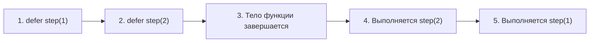

*Как работает ключевое слово `defer`, в каком порядке срабатывают несколько отложенных вызовов и когда именно вычисляются их аргументы.*

Представьте функцию с тремя проверками и тремя точками `return`: сначала она открывает временный ресурс (например, файл, блокировку или сетевое соединение), затем проверяет формат данных, затем выполняет расчёт и только в конце закрывает ресурс. Если закрытие написано в самом низу функции, любой ранний `return` в середине **пропустит** закрытие — и ресурс утечёт. Дублировать строчку закрытия перед каждым `return` утомительно и легко забыть при правке через месяц.

В Go эту проблему решает одно ключевое слово — **`defer`** (*отложить*). Вы пишете уборку **прямо под строкой захвата ресурса**, и компилятор гарантирует, что она выполнится при любом выходе из функции.

## Главная модель: стек отложенных вызовов (LIFO)

Инструкция `defer f(args...)` не запускает `f` немедленно. Она кладёт этот вызов в специальный внутренний список текущей функции, устроенный как **стопка тарелок** (*Last In, First Out — LIFO*): кто был отложен последним, тот выполнится первым.

Как только текущая функция завершается — по любому `return` или дойдя до закрывающей `}` — Go снимает отложенные вызовы со стека сверху вниз и выполняет их один за другим.



Посмотрим на порядок выполнения в живом примере:

```go
package main

import "fmt"

func processTask(name string) {
	fmt.Println("Старт задачи:", name)
	defer fmt.Println("Шаг 1 (отложен первым): закрыть журнал")
	defer fmt.Println("Шаг 2 (отложен вторым): освободить временный буфер")

	fmt.Println("Выполняем полезную работу...")
}

func main() {
	processTask("импорт закладок")
	fmt.Println("Возврат в main")
}
```

Вывод программы:

```text
Старт задачи: импорт закладок
Выполняем полезную работу...
Шаг 2 (отложен вторым): освободить временный буфер
Шаг 1 (отложен первым): закрыть журнал
Возврат в main
```

Почему именно обратный порядок (LIFO), а не прямой? Потому что ресурсы почти всегда захватываются вложенно: сначала открыли каталог, потом открыли файл внутри него, потом заблокировали запись. Освобождать их правильно строго в обратном порядке — снять блокировку, закрыть файл, освободить каталог.

## Когда вычисляются аргументы `defer` (главная ловушка)

Здесь новички чаще всего ошибаются. Запомните точное правило:

**Сам вызов откладывается до выхода из функции, но значения его аргументов вычисляются немедленно — в строке, где написано `defer`.**

Проверьте это на примере со счётчиком и замером времени:

```go
package main

import "fmt"

func main() {
	status := "started"
	defer fmt.Println("1. Прямой аргумент status =", status)

	// Анонимная функция читает переменную в момент своего выполнения, при выходе!
	defer func() {
		fmt.Println("2. Внутри анонимной функции status =", status)
	}()

	status = "completed"
	fmt.Println("Тело main, status =", status)
}
```

Вывод:

```text
Тело main, status = completed
2. Внутри анонимной функции status = completed
1. Прямой аргумент status = started
```

Разберите обе строки внимательно:
1. В первом `defer fmt.Println(..., status)` значение `"started"` было **зафиксировано сразу** в момент встречи с `defer`. Последующее `status = "completed"` уже не повлияло на сохранённую копию аргумента.
2. Во втором `defer func() { ... }()` аргументов у вызова нет — есть безымянная функция (*closure*), тело которой выполнится лишь при выходе из `main`, когда `status` уже равен `"completed"`.

Кстати, заметьте круглые скобки `()` в конце `defer func() { ... }()`: после `defer` **всегда** должен стоять *вызов* функции, а не просто её объявление. Забудете `()` — компилятор сразу напомнит: `expression in defer must be function call`.

## Практическое применение: трассировка и замер времени

Свойство немедленного вычисления аргументов можно обратить себе на пользу. Посмотрите, как в одну строчку измерять длительность работы любой функции с помощью `time.Now()` и `time.Since`:

```go
package main

import (
	"fmt"
	"time"
)

func trackDuration(op string, start time.Time) {
	fmt.Printf("Операция %q заняла %v\n", op, time.Since(start))
}

func heavySum(limit int) int {
	// time.Now() вычисляется СРАЗУ на входе в функцию,
	// а trackDuration выполнится при выходе и посчитает time.Since(start)!
	defer trackDuration("heavySum", time.Now())

	total := 0
	for i := range limit {
		total += i
	}
	return total
}

func main() {
	fmt.Println("Сумма:", heavySum(1_000_000))
}
```

Вывод (точное время зависит от вашего процессора):

```text
Операция "heavySum" заняла 312.5µs
Сумма: 499999500000
```

Вот что произошло: `time.Now()` сработало при входе в `heavySum`, сохранилось как аргумент `start`, а `trackDuration` вызвалась на выходе, вычислив разницу `time.Since(start)`. Если в `heavySum` позже добавится пять ранних `return`, замер всё равно отработает честно на каждом из них.

## Две ловушки `defer`, которые стоит знать заранее

1. **`defer` привязан к функции, а не к блоку `{}` или циклу `for`.** Если поставить `defer` внутри цикла на 10 000 итераций, все 10 000 вызовов накопятся в памяти и выполнятся только при выходе из **всей функции**, а не в конце каждого шага цикла. Когда позже вы будете открывать много файлов в цикле, обработку одного файла нужно выносить в отдельную маленькую функцию, чтобы `defer` срабатывал после каждого файла.
2. **Порядок с именованными результатами.** `defer` выполняется *после* того, как `return` записал возвращаемое значение, но *до* того, как управление вернулось вызывающему коду. Это позволяет, например, аккуратно логировать или дополнять именованную ошибку в конце функции — пользоваться этим стоит редко и осознанно, чтобы не запутывать читателя.

> [!check] Проверь понимание
> Что напечатает фрагмент кода?
> ```go
> for i := range 3 {
> 	defer fmt.Print(i, " ")
> }
> ```
>
> Напечатает `2 1 0 `. На каждой итерации аргумент `i` вычисляется и сохраняется сразу (`0`, затем `1`, затем `2`), а при выходе из функции вызовы снимаются со стека в обратном порядке LIFO.

## Практика

**Упражнение 1 (Базовое). Проследи вывод (Code Tracing).**  
Предскажите точный порядок строк, которые выведет программа:

```go
package main

import "fmt"

func runStep(n int) {
	fmt.Println("вход:", n)
	defer fmt.Println("выход:", n)
	if n == 1 {
		fmt.Println("ранний возврат")
		return
	}
	defer fmt.Println("доп. уборка:", n)
}

func main() {
	runStep(1)
	fmt.Println("---")
	runStep(2)
}
```

> [!solution] Показать решение
> ```text
> вход: 1
> ранний возврат
> выход: 1
> ---
> вход: 2
> доп. уборка: 2
> выход: 2
> ```
> В `runStep(1)` второй `defer` так и не был достигнут из-за раннего `return`, поэтому сработал только первый `defer`. В `runStep(2)` зарегистрировались оба, и они выполнились в порядке LIFO.

**Упражнение 2 (Практическое). Поймай момент вычисления аргумента.**  
Исправьте функцию `audit` ниже так, чтобы она при выходе всегда печатала **итоговое** значение `result`, а не начальное `"pending"`, не убирая `defer` из начала функции:

```go
package main

import "fmt"

func audit(ok bool) {
	result := "pending"
	defer fmt.Println("Итог аудита:", result)

	if !ok {
		result = "rejected"
		return
	}
	result = "approved"
}

func main() {
	audit(false)
	audit(true)
}
```

> [!solution] Показать решение
> Оберните печать в анонимную функцию, чтобы `result` читалась в момент выхода:
> ```go
> func audit(ok bool) {
> 	result := "pending"
> 	defer func() {
> 		fmt.Println("Итог аудита:", result)
> 	}()
>
> 	if !ok {
> 		result = "rejected"
> 		return
> 	}
> 	result = "approved"
> }
> ```
> Теперь вывод будет:
> ```text
> Итог аудита: rejected
> Итог аудита: approved
> ```

**Упражнение 3 (Со звёздочкой \*). Что сломается?**  
Программист решил измерить длительность операции, написав:
```go
defer fmt.Println("Заняло:", time.Since(time.Now()))
```
Почему эта строка почти всегда будет печатать `0s` (или пару десятков наносекунд), даже если функция работает 2 секунды?

> [!solution] Показать решение
> Потому что **все аргументы** отложенного вызова `fmt.Println(...)` вычисляются немедленно в строке `defer`! Выражение `time.Since(time.Now())` вычисляет разницу между двумя соседними наносекундами прямо на входе в функцию и передаёт готовое `~0s` в отложенный `Println`. Правильно сохранить `start := time.Now()` и отложить вычисление `time.Since(start)` внутри анонимной функции:
> ```go
> start := time.Now()
> defer func() {
> 	fmt.Println("Заняло:", time.Since(start))
> }()
> ```

---

С `defer` любая функция гарантированно убирает за собой, сколько бы ранних `return` в ней ни было. А ранних `return` в идиоматичном Go много — потому что именно так в Go обрабатывают ошибки. В следующем уроке [[12. Ошибки как обычные значения — тип error и if err != nil]] разберём фирменный подход Go к ошибкам.
