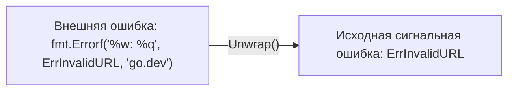

*Как создавать собственные ошибки через `errors.New`, добавлять контекст через `fmt.Errorf("%w")` и надёжно проверять причину сбоя функцией `errors.Is`.*

В прошлом уроке мы заметили слабую сторону `(int, bool)`: если `parsePort` просто вернула `false`, пользователь не понимает, в чём проблема — в лишней букве или в выходе за `65535`. А если функция возвращает строку ошибки вроде `"invalid input"`, вызывающий код не сможет программно отличить «закладка не найдена» от «пустое название», не разбирая текст руками.

В Go для создания, оборачивания и распознавания ошибок есть ровно три стандартных инструмента — **`errors.New`**, **`fmt.Errorf` с `%w`** и **`errors.Is`**. Их хватит, чтобы построить чистую систему ошибок для всего `BookmarkFlow`.

## 1. Сигнальные ошибки: `errors.New`

Самый простой способ создать ошибку с фиксированным текстом — вызвать `errors.New("...")` из стандартного пакета `errors`.

Если ошибку нужно различать в вызывающем коде, её объявляют как переменную уровня пакета с префиксом `Err` — такую переменную называют **сигнальной ошибкой** (*sentinel error*):

```go
var (
	ErrEmptyTitle = errors.New("название закладки не может быть пустым")
	ErrInvalidURL = errors.New("ссылка должна начинаться с http:// или https://")
)
```

По соглашению Go тексты ошибок **начинают со строчной буквы и не ставят точку в конце** — потому что позже их часто оборачивают в более длинную цепочку через двоеточие (например, `добавление закладки: ссылка должна начинаться с http:// или https://`).

## 2. Оборачивание ошибок: `fmt.Errorf` с `%w`

Когда ошибка поднимается вверх по цепочке вызовов, сухой фразы `"invalid syntax"` недостаточно — нужно знать, *какой именно* параметр сломался. Функция `fmt.Errorf` собирает ошибку по шаблону, точно как `fmt.Sprintf`.

Здесь есть решающая разница между **`%v`** и **`%w`** (*wrap*):
* `fmt.Errorf("некорректная ссылка %q: %v", rawURL, ErrInvalidURL)` — просто **склеивает текст** в новую строку; связь с исходной `ErrInvalidURL` теряется навсегда.
* `fmt.Errorf("%w: %q", ErrInvalidURL, rawURL)` — **оборачивает** исходную ошибку внутрь новой, сохраняя её в цепочке причин.



## 3. Проверка причины: `errors.Is` против `==`

Почему для проверки завёрнутых ошибок нельзя писать `if err == ErrInvalidURL`? Потому что после `fmt.Errorf("%w: %q", ErrInvalidURL, rawURL)` значение `err` — это уже **новая внешняя ошибка**, и прямое сравнение `==` вернёт `false`.

Для этого в стандартной библиотеке есть **`errors.Is(err, target)`**: она сама раскручивает всю цепочку обёрток от внешней ошибки до первопричины и возвращает `true`, если на любом уровне нашлась `target`.

Посмотрим на все три инструмента вместе в рабочем коде, который ляжет в основу `BookmarkFlow`:

```go
package main

import (
	"errors"
	"fmt"
	"strings"
)

var (
	ErrEmptyTitle = errors.New("название закладки не может быть пустым")
	ErrInvalidURL = errors.New("ссылка должна начинаться с http:// или https://")
)

func validateBookmark(title, rawURL string) (string, string, error) {
	cleanTitle := strings.TrimSpace(title)
	cleanURL := strings.TrimSpace(rawURL)

	if cleanTitle == "" {
		return "", "", ErrEmptyTitle
	}
	if !strings.HasPrefix(cleanURL, "http://") && !strings.HasPrefix(cleanURL, "https://") {
		return "", "", fmt.Errorf("%w: %q", ErrInvalidURL, cleanURL)
	}
	return cleanTitle, cleanURL, nil
}

func main() {
	_, _, err := validateBookmark("Go", "go.dev/doc")
	if err != nil {
		fmt.Println("Текст ошибки:", err)
		fmt.Println("Прямое сравнение == :", err == ErrInvalidURL)
		fmt.Println("Проверка errors.Is  :", errors.Is(err, ErrInvalidURL))
	}
}
```

Вывод программы:

```text
Текст ошибки: ссылка должна начинаться с http:// или https://: "go.dev/doc"
Прямое сравнение == : false
Проверка errors.Is  : true
```

Посмотрите, насколько элегантный результат мы получили:
* Человек видит понятное сообщение **с конкретным проблемным значением** (`"go.dev/doc"`).
* Код надёжно распознаёт категорию ошибки через `errors.Is(err, ErrInvalidURL)` — даже если сверху её завернут ещё в три слоя контекста.

## Когда выбирать `%w`, а когда `%v`

Оборачивание `%w` делает внутреннюю ошибку частью публичного контракта вашей функции: вызывающий код сможет полагаться на `errors.Is`. Поэтому:
* используйте **`%w`**, когда хотите сохранить первопричину для проверки выше (`ErrInvalidURL`, `ErrNotFound`, `os.ErrNotExist`);
* используйте **`%v`**, если внутренняя ошибка — деталь реализации, от которой вызывающий код не должен зависеть.

Также не логируйте и не печатайте одну и ту же ошибку на каждом этаже программы: **обработайте её ровно один раз** — либо залогируйте/покажите пользователю, либо заверните через `fmt.Errorf("...: %w", err)` и отдайте выше. Иначе в терминале появятся три дублирующих сообщения про один и тот же сбой.

> [!check] Проверь понимание
> Функция `parseID` вернула `fmt.Errorf("удаление: %w", ErrNotFound)`. Что вернут выражения `err == ErrNotFound` и `errors.Is(err, ErrNotFound)`?
>
> `err == ErrNotFound` вернёт `false`, потому что `err` — обёртка поверх `ErrNotFound`. А `errors.Is(err, ErrNotFound)` раскрутит обёртку и вернёт `true`.

## Практика

**Упражнение 1 (Базовое). Проследи вывод (Code Tracing).**  
Что напечатает программа ниже и почему две проверки `errors.Is` дадут разные результаты?

```go
package main

import (
	"errors"
	"fmt"
)

var ErrLimit = errors.New("превышен лимит")

func main() {
	errA := fmt.Errorf("импорт: %w", ErrLimit)
	errB := fmt.Errorf("импорт: %v", ErrLimit)

	fmt.Println("A:", errors.Is(errA, ErrLimit))
	fmt.Println("B:", errors.Is(errB, ErrLimit))
}
```

> [!solution] Показать решение
> ```text
> A: true
> B: false
> ```
> В `errA` использован спецификатор `%w`, который сохраняет `ErrLimit` в цепочке обёрток, поэтому `errors.Is` находит её. В `errB` спецификатор `%v` просто подставил строку `"превышен лимит"` — связь с переменной `ErrLimit` утрачена.

**Упражнение 2 (Практическое). Умный `parsePort` с ошибками.**  
Перепишите функцию `parsePort` из прошлого урока так, чтобы её сигнатура стала `func parsePort(raw string) (int, error)`. Объявите две сигнальные ошибки `ErrNotNumber` и `ErrPortRange`. При ошибке `strconv.Atoi` оборачивайте `ErrNotNumber` с указанием `raw`, а при выходе за `1..65535` — оборачивайте `ErrPortRange` с числом. В `main` проверьте вводы `"8080"`, `"abc"`, `"70000"` и выведите разные подсказки через `errors.Is`.

> [!solution] Показать решение
> ```go
> package main
>
> import (
> 	"errors"
> 	"fmt"
> 	"strconv"
> 	"strings"
> )
>
> var (
> 	ErrNotNumber = errors.New("порт должен быть целым числом")
> 	ErrPortRange = errors.New("порт должен быть в диапазоне 1..65535")
> )
>
> func parsePort(raw string) (int, error) {
> 	port, err := strconv.Atoi(strings.TrimSpace(raw))
> 	if err != nil {
> 		return 0, fmt.Errorf("%w: получено %q", ErrNotNumber, raw)
> 	}
> 	if port < 1 || port > 65535 {
> 		return 0, fmt.Errorf("%w: получено %d", ErrPortRange, port)
> 	}
> 	return port, nil
> }
>
> func main() {
> 	for _, sample := range []string{"8080", "abc", "70000"} {
> 		port, err := parsePort(sample)
> 		if errors.Is(err, ErrNotNumber) {
> 			fmt.Println("Подсказка: введите цифры ->", err)
> 			continue
> 		}
> 		if errors.Is(err, ErrPortRange) {
> 			fmt.Println("Подсказка: выберите порт 1..65535 ->", err)
> 			continue
> 		}
> 		fmt.Println("Порт принят:", port)
> 	}
> }
> ```
> Вызывающий код точно отличает причины сбоя через `errors.Is`, а текст ошибки остаётся информативным для человека.

**Упражнение 3 (Со звёздочкой \*). Двойное оборачивание и `strconv.ErrSyntax`.**  
Стандартный пакет `strconv` сам экспортирует сигнальную ошибку `strconv.ErrSyntax` и `strconv.ErrRange`. Если внутри `parsePort` вернуть `fmt.Errorf("разбор порта %q: %w", raw, err)`, не заменяя исходную `err` от `strconv.Atoi`, что вернёт `errors.Is(err, strconv.ErrSyntax)` для входа `"abc"` и `errors.Is(err, strconv.ErrRange)` для входа `"99999999999999999999999"`? Проверьте в терминале.

> [!solution] Показать решение
> Оба вызова вернут **`true`**!
> `strconv.Atoi` сам оборачивает `strconv.ErrSyntax` или `strconv.ErrRange`. Когда мы ещё раз оборачиваем его `err` через `%w`, образуется цепочка из двух звеньев — а `errors.Is` проходит цепочку любой глубины до самого корня.

---

Теперь наши функции умеют честно сообщать о любой проблеме и сохранять контекст по всей цепочке вызовов. Но пока входные данные мы вписываем прямо внутрь `main.go`. Пора научить программу читать команды от пользователя из терминала и возвращать операционной системе честный код завершения — в следующей главе [[14. Аргументы командной строки os.Args и коды выхода процесса]].
