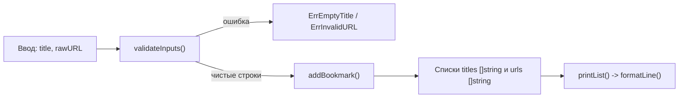

*Собираем первый рабочий шаг сквозного проекта `BookmarkFlow`: валидация названия и URL, добавление закладок в память и чистый вывод списка (`project/step01/`).*

Четырнадцать уроков вы оттачивали отдельные инструменты: типы, строки, циклы, функции, `error` и `os.Args`. Пора соединить их в первую живую версию нашего сквозного проекта — менеджера закладок **`BookmarkFlow`**.

На этом шаге мы ставим скромную, но честную инженерную цель: научиться проверять входные данные закладки, добавлять проверенные записи в память программы и печатать их в едином формате. Никаких файлов на диске и никаких сложных структур данных — только то, что мы уже прошли в Модуле 2.

## Проектируем контракт первого шага

Прежде чем писать код, договоримся о правилах и функциях нашей программы. Каждая закладка состоит из двух строк — **названия** (`title`) и **ссылки** (`url`) — плюс порядкового номера при печати.

Разобьём задачу на четыре маленькие функции с одной ясной ответственностью:



1. `validateInputs(title, rawURL string) (string, string, error)` — очищает пробелы по краям через `strings.TrimSpace`, проверяет, что название не пустое (`ErrEmptyTitle`), а ссылка начинается с `http://` или `https://` (`ErrInvalidURL`).
2. `addBookmark(titles, urls []string, title, rawURL string) ([]string, []string, error)` — вызывает `validateInputs`, и если данные корректны, добавляет их в конец двух списков с помощью встроенной функции **`append`**.
3. `formatLine(id int, title, rawURL string) string` — собирает одну строку вывода вида `#1 | Документация Go -> https://go.dev/doc`.
4. `printList(titles, urls []string)` — если закладок нет, печатает `"Список закладок пуст."`; иначе проходит циклом `for i := range len(titles)` и печатает каждую строку.

> [!tip] Упрощение на этом шаге
> Сейчас мы храним названия и ссылки в двух динамических списках строк `[]string` и добавляем элементы через `titles = append(titles, cleanTitle)`. В Модуле 3 мы подробно разберём, как такие списки и `append` устроены в памяти, и заменим пару параллельных списков на единую структуру `Bookmark`.

## Реализация шага 1 (`main.go`)

Создайте папку `~/go-practice/bookmarkflow-step01`, выполните `go mod init example.com/bookmarkflow` и запишите этот код в `main.go`:

```go
package main

import (
	"errors"
	"fmt"
	"os"
	"strings"
)

var (
	// ErrEmptyTitle возвращается, если название закладки пустое.
	ErrEmptyTitle = errors.New("название закладки не может быть пустым")
	// ErrInvalidURL возвращается, если адрес не начинается с http:// или https://.
	ErrInvalidURL = errors.New("ссылка должна начинаться с http:// или https://")
)

func validateInputs(title, rawURL string) (string, string, error) {
	cleanTitle := strings.TrimSpace(title)
	cleanURL := strings.TrimSpace(rawURL)
	if cleanTitle == "" {
		return "", "", ErrEmptyTitle
	}
	if !strings.HasPrefix(cleanURL, "http://") && !strings.HasPrefix(cleanURL, "https://") {
		return "", "", fmt.Errorf("%w: %q", ErrInvalidURL, cleanURL)
	}
	return cleanTitle, cleanURL, nil
}

func addBookmark(titles, urls []string, title, rawURL string) ([]string, []string, error) {
	cleanTitle, cleanURL, err := validateInputs(title, rawURL)
	if err != nil {
		return titles, urls, err
	}
	return append(titles, cleanTitle), append(urls, cleanURL), nil
}

func formatLine(id int, title, rawURL string) string {
	return fmt.Sprintf("#%d | %s -> %s", id, title, rawURL)
}

func printList(titles, urls []string) {
	if len(titles) == 0 {
		fmt.Println("Список закладок пуст.")
		return
	}
	for i := range len(titles) {
		fmt.Println(formatLine(i+1, titles[i], urls[i]))
	}
}

func main() {
	var titles, urls []string

	// Проверяем вывод пустого списка
	printList(titles, urls)

	// Добавляем две корректные закладки (обратите внимание на лишние пробелы в первой)
	var err error
	titles, urls, err = addBookmark(titles, urls, "  Документация Go  ", "https://go.dev/doc")
	if err != nil {
		fmt.Fprintln(os.Stderr, "Ошибка:", err)
		os.Exit(1)
	}

	titles, urls, err = addBookmark(titles, urls, "Блог Go", "https://go.dev/blog")
	if err != nil {
		fmt.Fprintln(os.Stderr, "Ошибка:", err)
		os.Exit(1)
	}

	// Пробуем добавить некорректную ссылку и проверяем категорию через errors.Is
	titles, urls, err = addBookmark(titles, urls, "Плохая ссылка", "ftp://example.com")
	if errors.Is(err, ErrInvalidURL) {
		fmt.Fprintln(os.Stderr, "Отклонено валидатором:", err)
	}

	fmt.Println()
	printList(titles, urls)
}
```

Запустите `go run .` и сравните вывод:

```text
Список закладок пуст.
Отклонено валидатором: ссылка должна начинаться с http:// или https://: "ftp://example.com"

#1 | Документация Go -> https://go.dev/doc
#2 | Блог Go -> https://go.dev/blog
```

## Что происходит при ошибке и почему `addBookmark` возвращает старые списки

Присмотритесь к строчке внутри `addBookmark`:

```go
if err != nil {
	return titles, urls, err
}
```

Почему при ошибке мы возвращаем исходные `titles, urls`, а не `nil, nil`? Посмотрите на вызов в `main`:

```go
titles, urls, err = addBookmark(titles, urls, "Плохая ссылка", "ftp://example.com")
```

Если бы при ошибке `addBookmark` вернула `nil, nil`, неудачная попытка добавить третью закладку **стёрла бы** первые две уже сохранённые закладки! Возвращая неизменённые `titles, urls`, функция сохраняет прежнее состояние программы в безопасности.

## Связь с репозиторием проекта `project/step01/`

Откройте файл `project/step01/bookmark.go` в корне этого учебника. Вы узнаете почти каждую строчку — те же `ErrEmptyTitle`, `ErrInvalidURL`, `ValidateInputs`, `AddBookmark`, `FormatLine` и `PrintList`.

Единственное отличие эталонного пакета `project/step01/` от нашего `main.go`: в репозитории функции экспортированы (начинаются с заглавной буквы), а `PrintList` принимает дополнительный первый параметр потока вывода, чтобы автоматическая проверка в `bookmark_test.go` могла перехватить напечатанный текст в буфер. С пакетами, потоками вывода и автоматическими проверками вы познакомитесь в Модуле 3 — а вся логика первого шага `BookmarkFlow` у вас уже в руках.

> [!check] Проверь понимание
> Что вернёт `validateInputs("   ", "https://go.dev")` и что вернёт `validateInputs("Go", "HTTPS://go.dev")` в нашей текущей реализации?
>
> Первый вызов очистит пробелы до `""` и вернёт `ErrEmptyTitle`. Второй вызов вернёт ошибку, оборачивающую `ErrInvalidURL`, потому что `strings.HasPrefix` **чувствителен к регистру** (`"HTTPS://"` не совпадает с `"https://"`). В следующем уроке мы исправим и эту тонкость.

## Практика

**Упражнение 1 (Базовое). Запретите ссылки с пробелами внутри.**  
Сейчас `validateInputs("Go", "https://go.dev /doc")` пройдёт проверку, хотя в URL не бывает неэкранированных пробелов. Добавьте в `validateInputs` проверку через `strings.Contains(cleanURL, " ")` и возвращайте обёрнутую `ErrInvalidURL`.

> [!solution] Показать решение
> ```go
> if (!strings.HasPrefix(cleanURL, "http://") && !strings.HasPrefix(cleanURL, "https://")) ||
> 	strings.Contains(cleanURL, " ") {
> 	return "", "", fmt.Errorf("%w: %q", ErrInvalidURL, cleanURL)
> }
> ```
> Теперь адрес с пробелом внутри отклоняется с тем же понятным типом ошибки `ErrInvalidURL`.

**Упражнение 2 (Практическое). Добавление закладки из `os.Args`.**  
Измените `main()` так, чтобы после добавления двух стартовых закладок программа проверяла `os.Args`: если пользователь передал ещё два аргумента (`go run . "Go Spec" https://go.dev/ref/spec`), они тоже добавляются через `addBookmark` до вызова `printList`. При ошибке валидации выводите сообщение в `os.Stderr` и завершайтесь с кодом `1`.

> [!solution] Показать решение
> ```go
> func run(args []string) error {
> 	var titles, urls []string
> 	var err error
>
> 	titles, urls, err = addBookmark(titles, urls, "Документация Go", "https://go.dev/doc")
> 	if err != nil {
> 		return err
> 	}
> 	titles, urls, err = addBookmark(titles, urls, "Блог Go", "https://go.dev/blog")
> 	if err != nil {
> 		return err
> 	}
>
> 	if len(args) == 2 {
> 		titles, urls, err = addBookmark(titles, urls, args[0], args[1])
> 		if err != nil {
> 			return err
> 		}
> 	} else if len(args) != 0 {
> 		return errors.New("использование: bookmarkflow [<название> <url>]")
> 	}
>
> 	printList(titles, urls)
> 	return nil
> }
> ```
> В `main()` остаётся стандартный вызов `if err := run(os.Args[1:]); err != nil { fmt.Fprintln(os.Stderr, "Ошибка:", err); os.Exit(1) }`.

**Упражнение 3 (Со звёздочкой \*). Проверка дубликата URL.**  
Напишите функцию `hasURL(urls []string, target string) bool`, которая проверяет, нет ли уже такой ссылки в списке `urls`. Объявите сигнальную ошибку `ErrDuplicateURL = errors.New("такая ссылка уже сохранена")` и вызовите `hasURL` внутри `addBookmark` до `append`.

> [!solution] Показать решение
> ```go
> var ErrDuplicateURL = errors.New("такая ссылка уже сохранена")
>
> func hasURL(urls []string, target string) bool {
> 	for _, existing := range urls {
> 		if existing == target {
> 			return true
> 		}
> 	}
> 	return false
> }
>
> func addBookmark(titles, urls []string, title, rawURL string) ([]string, []string, error) {
> 	cleanTitle, cleanURL, err := validateInputs(title, rawURL)
> 	if err != nil {
> 		return titles, urls, err
> 	}
> 	if hasURL(urls, cleanURL) {
> 		return titles, urls, fmt.Errorf("%w: %q", ErrDuplicateURL, cleanURL)
> 	}
> 	return append(titles, cleanTitle), append(urls, cleanURL), nil
> }
> ```
> Заметьте порядок проверок: сначала очистка и валидация `validateInputs`, и только потом сравнение уже очищенного `cleanURL` со списком.

---

Первая рабочая версия `BookmarkFlow` умеет валидировать, добавлять и печатать закладки. Но настоящему консольному менеджеру нужны ещё три вещи: более аккуратная валидация, регистронезависимый поиск по подстроке и ровная таблица для списка. Разберём все три приёма в следующем уроке [[16. Валидация ввода, поиск по подстроке и чистый табличный вывод]].
