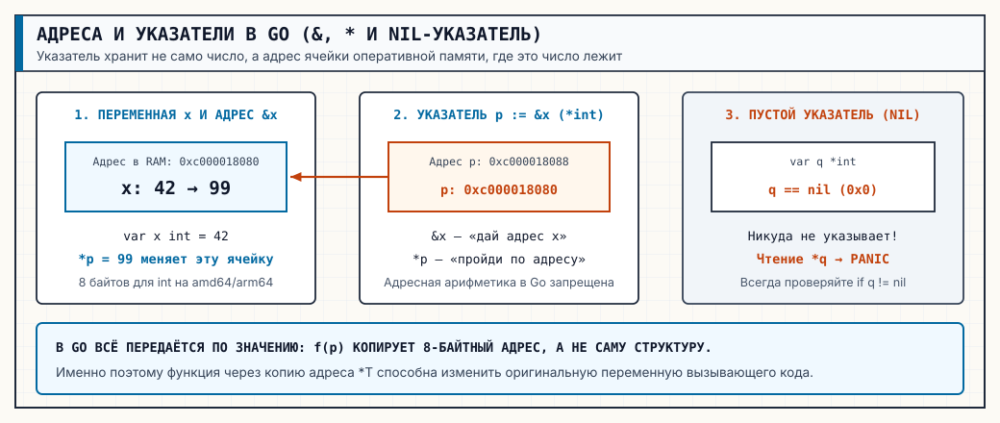

*Как переменные располагаются в оперативной памяти, что означают операторы `&` и `*` и почему обращение к нулевому указателю `nil` роняет программу.*

> «Не у каждого значения есть адрес, но у каждой переменной он есть.»  
> — Алан Донован и Брайан Керниган, *The Go Programming Language*

В конце Модуля 2 функция `execute` в `BookmarkFlow` возвращала пять значений сразу — иначе она не могла обновить состояние. А в девятом уроке попытка увеличить счётчик внутри `tryIncrement(visits)` провалилась, потому что функция получила лишь копию числа.

Чтобы код обращался к **той же самой** переменной, а не к её дубликату, нужно знать, где эта переменная лежит в оперативной памяти. За это в Go отвечают адреса и указатели.

## Переменная в оперативной памяти

В Модуле 1 мы договорились смотреть на RAM без сказок про «столешницу»: это ряд пронумерованных ячеек по одному байту, где номер ячейки называется **адресом**.

Когда программа объявляет `port := 8080`, рантайм отводит подряд 8 байтов (размер `int` на 64-битной системе) и записывает туда число `8080`. У этого участка есть начальный адрес — скажем, `0xc000018090`.

Здесь уместна короткая аналогия: номер дома на листке бумаги позволяет передать другу координаты здания, не двигая сам дом. Граница аналогии жёсткая: в Go адрес не бывает «просто номером». Компилятор привязывает к нему **точный тип** (`*int` указывает только на `int`, никогда на `string`) и запрещает арифметику над адресами — прибавить единицу к указателю, как в Си, нельзя.

Заведём вторую переменную `p`, которая хранит адрес `port`. В памяти это выглядит так:

```text
Адрес в RAM     Переменная   Содержимое
--------------  ----------   ----------------------
0xc000018090    port         [ 8080 ]  <-----------+
                                                   |
0xc000018098    p            [ 0xc000018090 ] -----+
```

Две переменные лежат по разным адресам: в `port` хранится число, в `p` — адрес ячейки `port`.



## Указатели, `&` и `*`

Переменную, хранящую адрес другой переменной, называют **указателем** (*pointer*). Если исходная переменная имеет тип `T`, указатель на неё имеет тип `*T` (`*int`, `*string`, `*int64`).

С указателями работают два оператора:
* **`&x`** (взятие адреса, *address-of*) — возвращает адрес переменной `x` типа `*T`.
* **`*p`** (разыменование, *dereference*) — открывает доступ на чтение и запись к переменной по адресу `p`.

Звёздочка `*` в двух ролях поначалу сбивает с толку. Выручает простая мнемоника:
* в **типе** (`var p *int`) читайте `*int` как **«указатель на `int`»**;
* в **выражении** (`*p = 9090`) читайте `*p` как **«значение по адресу `p`»**.

Прочитайте вслух `*p = 9090`: «записать `9090` в значение по адресу `p`». Всё становится на свои места.

Отсюда и правило из эпиграфа: адрес есть у **переменной** (она занимает ячейку в RAM), но не у безымянного литерала (`8080`, `"go"`). Взять `&8080` компилятор не позволит. *(Где именно в памяти — на стеке или в куче — размещается переменная, мы разберём в Модуле 5, а детали рантайма — в Томе 5.)*

## Рабочий код и живой запуск

Проверим `&`, `*`, запись через указатель и сравнение адресов:

```go
package main

import "fmt"

func main() {
	port := 8080
	p := &port // тип *int

	fmt.Printf("port = %d, адрес = %p, *p = %d\n", port, p, *p)

	*p = 9090 // меняем port через указатель
	fmt.Printf("после *p = 9090: port = %d, *p = %d\n", port, *p)

	backupPort := 9090
	p2 := &port
	p3 := &backupPort
	fmt.Println("p == p2:", p == p2) // одна ячейка
	fmt.Println("p == p3:", p == p3) // числа равны, адреса разные
}
```

Вывод терминала (точные адреса при каждом запуске различаются):

```text
port = 8080, адрес = 0xc000018090, *p = 8080
после *p = 9090: port = 9090, *p = 9090
p == p2: true
p == p3: false
```

Спецификатор `%p` печатает адрес в шестнадцатеричном виде. Сравнение `p == p3` дало `false`, хотя в обеих переменных лежит `9090`: указатели равны только тогда, когда смотрят на **одну и ту же** переменную (или оба равны `nil`).

Три типичные ошибки компилятор ловит ещё до запуска:

```go
_ = &8080        // invalid operation: cannot take address of 8080 (untyped int constant)
var q *int64 = p // cannot use p (variable of type *int) as *int64 value in variable declaration
p++              // invalid operation: p++ (non-numeric type *int)
```

Запрет арифметики `p++` и строгие типы указателей отсекают целый класс ошибок Си, где случайный сдвиг адреса портил соседние данные.

## Нулевое значение `nil` и паника разыменования

Нулевое значение любого указателя — **`nil`** («указатель никуда не смотрит»).

```go
package main

import "fmt"

func main() {
	var p *int
	fmt.Println("p == nil:", p == nil) // true
	// *p = 42 -> паника во время выполнения
}
```

Если раскомментировать `*p = 42`, код скомпилируется, но при запуске процессор попытается обратиться к нулевому адресу, и рантайм остановит программу паникой:

```text
panic: runtime error: invalid memory address or nil pointer dereference
[signal SIGSEGV: segmentation violation code=0x1 addr=0x0 ...]
```

Строку `nil pointer dereference` вы ещё не раз встретите в логах. Лекарство одно: прежде чем разыменовать указатель, который может прийти пустым, проверяйте `if p != nil`.

> [!check] Проверь понимание
> Что напечатает этот фрагмент?
> ```go
> count := 10
> p := &count
> copyVal := *p
> *p = 25
> fmt.Println(count, copyVal, *p)
> ```
>
> Выведет `25 10 25`. Выражение `copyVal := *p` прочитало `10` и скопировало его в независимую переменную `copyVal`. Запись `*p = 25` изменила `count`, но не `copyVal`.

## Практика

**Упражнение 1 (Базовое). Проследи вывод.**  
Определите без запуска, что напечатает программа:

```go
package main

import "fmt"

func main() {
	price := int64(1500)
	a := &price
	b := a
	*a += 250
	fmt.Println(price, *b, a == b)
}
```

> [!solution] Показать решение
> Выведет `1750 1750 true`. Присваивание `b := a` копирует адрес `price`, поэтому оба указателя смотрят на одну ячейку. Операция `*a += 250` меняет `price` на `1750`, `*b` читает обновлённое число, а `a == b` истинно.

**Упражнение 2 (Практическое). Безопасное переключение указателя.**  
Объявите `retries := 3`, `maxRetries := 5` и `var active *int`. Если `active == nil`, напечатайте `"активный счётчик не задан"`. Затем направьте `active` на `retries`, увеличьте `*active` на `1`, переключите `active` на `maxRetries`, увеличьте `*active` на `2` и напечатайте `retries`, `maxRetries` и `*active`.

> [!solution] Показать решение
> ```go
> package main
>
> import "fmt"
>
> func main() {
> 	retries, maxRetries := 3, 5
> 	var active *int
> 	if active == nil {
> 		fmt.Println("активный счётчик не задан")
> 	}
> 	active = &retries
> 	*active++
> 	active = &maxRetries
> 	*active += 2
> 	fmt.Printf("retries=%d, maxRetries=%d, *active=%d\n", retries, maxRetries, *active)
> }
> ```
> Вывод: `retries=4, maxRetries=7, *active=7`. Переключение `active = &maxRetries` меняет адрес внутри `active`, не затрагивая прежнюю переменную `retries`.

**Упражнение 3 (Со звёздочкой \*). Что сломается?**  
Какие из трёх фрагментов не скомпилируются, а какой упадёт в рантайме? Объясните причины и исправьте:

```go
// А
var p *string
*p = "https://go.dev"

// Б
urlPtr := &"https://go.dev"

// В
var port int32 = 8080
var ptr *int = &port
```

> [!solution] Показать решение
> * **А** — скомпилируется, но упадёт паникой `nil pointer dereference` (`p == nil`). Фикс: `u := "https://go.dev"; p := &u`.
> * **Б** — ошибка компиляции `cannot take address of "https://go.dev"` (литерал не переменная). Фикс: сначала положить строку в переменную `raw := "https://go.dev"` и взять `&raw`.
> * **В** — ошибка компиляции: типы `*int32` и `*int` несовместимы. Фикс: `var ptr *int32 = &port` (или `port := 8080`).

---

Теперь вы умеете получать адрес через `&`, обращаться к ячейке через `*` и защищаться от `nil`. В следующем уроке [[2. Передача по значению и по указателю — когда нужен указатель]] разберём, как передавать указатели в функции для изменения данных и в каких случаях звёздочка только вредит.
