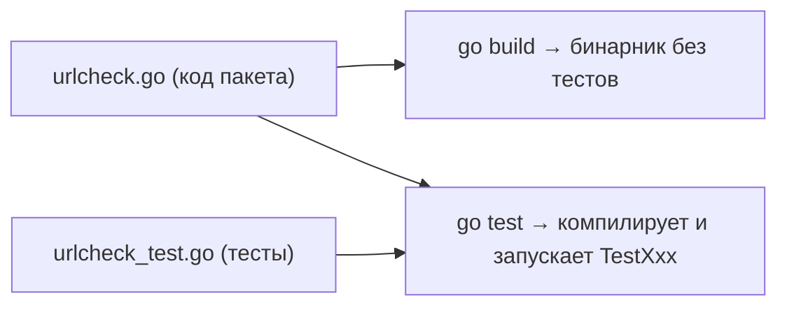

*Как устроен встроенный инструмент `go test` и пакет `testing`, чем `t.Error` отличается от `t.Fatal`, как писать понятные сообщения `got ..., want ...` и измерять покрытие кода.*

> «Меня со всей силой настигло осознание того, что добрую часть оставшейся жизни мне предстоит провести в поисках ошибок в собственных программах.»
> — Морис Уилкс (*Memoirs of a Computer Pioneer*, 1949)

В финале Модуля 2 мы проверяли `BookmarkFlow` вручную: запускали команды в терминале и глазами сверяли таблицу вывода. На пятидесяти строках кода это ещё терпимо. На пятистах строках одна правка в проверке ссылок тихо ломает старый сценарий — а вы замечаете это лишь спустя неделю.

Нужен код, который сам проверяет ваши функции и мгновенно сообщает, где результат разошёлся с ожиданием.

## Аскетичный подход Go: тест — это обычный код

Во многих языках для тестов ставят внешние фреймворки со своим мини-языком утверждений вроде `expect(x).toEqual(y)`. В Go инструмент `go test` и пакет `testing` встроены прямо в язык.

Принцип предельно простой: **тест — это обычный код на Go без магии**. Вы пишете те же `if`, циклы и `fmt`-спецификаторы, что и в основной программе.

Чтобы `go test` нашёл и выполнил проверки, соблюдают два соглашения:

1. **Имя файла заканчивается на `_test.go`** — например, рядом с `urlcheck.go` лежит `urlcheck_test.go` в том же пакете. Команда `go build` такие файлы игнорирует: в итоговый бинарник тесты не попадают.
2. **Сигнатура функции — `func TestXxx(t *testing.T)`**. Имя начинается с `Test`, а следующий символ не может быть строчной буквой (`TestCleanURL` и `TestClean_empty` сработают, а `Testclean` — нет). Функция принимает один параметр `*testing.T` и ничего не возвращает.



Параметр `t *testing.T` — пульт управления тестом: через него фиксируют провал проверки, выводят диагностику и останавливают выполнение.

## Первый unit-тест и запуск `go test`

Возьмём функцию `CleanURL`, которая убирает пробелы по краям и проверяет протокол ссылки:

```go
// urlcheck.go
package bookmark

import (
	"errors"
	"fmt"
	"strings"
)

var ErrInvalidURL = errors.New("ссылка должна начинаться с http:// или https://")

// CleanURL обрезает пробелы и проверяет протокол ссылки.
func CleanURL(raw string) (string, error) {
	cleaned := strings.TrimSpace(raw)
	if !strings.HasPrefix(cleaned, "http://") && !strings.HasPrefix(cleaned, "https://") {
		return "", fmt.Errorf("%w: %q", ErrInvalidURL, cleaned)
	}
	return cleaned, nil
}
```

Напишем рядом `urlcheck_test.go` с двумя тестами — на корректную и ошибочную ссылки:

```go
// urlcheck_test.go
package bookmark

import (
	"errors"
	"testing"
)

func TestCleanURLValid(t *testing.T) {
	got, err := CleanURL("  https://go.dev/doc  ")
	if err != nil {
		t.Fatalf("CleanURL unexpected error: %v", err)
	}
	want := "https://go.dev/doc"
	if got != want {
		t.Errorf("CleanURL() = %q, want %q", got, want)
	}
}

func TestCleanURLInvalid(t *testing.T) {
	_, err := CleanURL("ftp://example.com")
	if !errors.Is(err, ErrInvalidURL) {
		t.Errorf("CleanURL(ftp) err = %v, want ErrInvalidURL", err)
	}
}
```

Запустим проверку в тихом и подробном (`-v`) режимах:

```bash
go test ./...
# ok  	example.com/bookmark	0.002s

go test -v ./...
# === RUN   TestCleanURLValid
# --- PASS: TestCleanURLValid (0.00s)
# === RUN   TestCleanURLInvalid
# --- PASS: TestCleanURLInvalid (0.00s)
# PASS
# ok  	example.com/bookmark	0.002s
```

Шаблон `./...` проверяет текущий пакет и все вложенные каталоги. В обычном режиме `go test` молчалив: одна строка `ok` на пакет. Флаг `-v` печатает имя и время каждой тестовой функции.

## `t.Error` против `t.Fatal`

В `TestCleanURLValid` использованы два разных метода — `t.Fatalf` и `t.Errorf`. Выбор между ними напрямую влияет на читаемость сбоев:

| Метод | Поведение | Когда использовать |
|---|---|---|
| `t.Error`, `t.Errorf` | Помечает тест проваленным, печатает сообщение и **продолжает** функцию | Независимые проверки (например, сверка нескольких полей структуры) |
| `t.Fatal`, `t.Fatalf` | Помечает тест проваленным, печатает сообщение и **немедленно останавливает** функцию | Нарушена предпосылка: неожиданная `err != nil`, `nil`-указатель, неверная длина слайса перед `got[0]` |

Если заменить `t.Fatalf` на `t.Errorf` перед обращением к `items[0]` пустого слайса, выполнение продолжится и тест упадёт с паникой `index out of range` вместо короткого отчёта о неверной длине. Правило простое: **сломалась предпосылка — `t.Fatalf`; не сошлось значение — `t.Errorf`**.

## Сообщения `got ..., want ...`

> «Автор теста должен стремиться помочь программисту, которому придётся разбираться в причинах его падения.»
> — Алан Донован, Брайан Керниган (*The Go Programming Language*)

Сообщение вроде `t.Error("invalid")` не даёт никакой зацепки: неизвестно ни что пришло на вход, ни что вернулось. В Go принят формат **`got ..., want ...`** (сначала полученное значение, потом ожидаемое). Если убрать `strings.TrimSpace` из `CleanURL`, терминал покажет:

```text
--- FAIL: TestCleanURLValid (0.00s)
    urlcheck_test.go:15: CleanURL() = "  https://go.dev/doc  ", want "https://go.dev/doc"
FAIL
```

Спецификатор `%q` обводит строки кавычками — лишние пробелы видны мгновенно.

## Покрытие кода: `go test -cover`

Флаг `-cover` показывает, какую долю инструкций выполнили тесты:

```bash
go test -cover ./...
# ok  	example.com/bookmark	0.002s	coverage: 100.0% of statements
```

Покрытие подсвечивает ветки `if`, до которых тесты не добрались. Но `100.0%` не гарантирует отсутствие багов: это лишь факт, что каждая строка выполнилась хотя бы раз, а не проверка всех граничных случаев.

## Подводные камни

1. **Строчная буква после `Test`.** Функция `func TestcleanURL(t *testing.T)` компилируется без ошибок, но `go test` её пропустит. Проверяйте список запущенных функций флагом `-v`.
2. **Кэш тестов.** Повторный `go test ./...` без правок кода выведет `(cached)`. Принудительно перезапустить прогон можно флагом `-count=1`.

> [!check] Проверь понимание
> В тесте написали `if err != nil { t.Errorf("err: %v", err) }`, а строкой ниже прочитали `cfg.Port` у возвращённого `*Config`. Что случится, если функция вернёт `(nil, err)`?
>
> `t.Errorf` не остановит выполнение, и чтение `cfg.Port` вызовет панику `nil pointer dereference`. Для проверки предпосылки нужен `t.Fatalf`.

## Практика

**Упражнение 1 (Базовое). Что запустит `go test`?**  
Какие из трёх функций выполнит `go test`, а какие пропустит, и почему?
```go
func testDiscount(t *testing.T)         { /* ... */ }
func TestDiscountZero(t *testing.T)     { /* ... */ }
func TestdiscountNegative(t *testing.T) { /* ... */ }
```

> [!solution] Показать решение
> Выполнится **только `TestDiscountZero`**. `testDiscount` начинается со строчной буквы, а в `TestdiscountNegative` после `Test` идёт строчная `d` — пакет `testing` требует заглавную букву, цифру или `_`.

**Упражнение 2 (Практическое). Первый тест с `got/want`.**  
Напишите `FormatKopecks(amount int) (string, error)` (`1205 → "12.05 RUB"`, отрицательное число → сигнальная ошибка `ErrNegativeAmount`) и два теста: `TestFormatKopecksValid` и `TestFormatKopecksNegative` с `t.Fatalf`, `t.Errorf` и форматом `got ..., want ...`.

> [!solution] Показать решение
> ```go
> package money
>
> import (
> 	"errors"
> 	"fmt"
> )
>
> var ErrNegativeAmount = errors.New("сумма не может быть отрицательной")
>
> func FormatKopecks(amount int) (string, error) {
> 	if amount < 0 {
> 		return "", fmt.Errorf("%w: %d", ErrNegativeAmount, amount)
> 	}
> 	return fmt.Sprintf("%d.%02d RUB", amount/100, amount%100), nil
> }
> ```
> ```go
> package money
>
> import (
> 	"errors"
> 	"testing"
> )
>
> func TestFormatKopecksValid(t *testing.T) {
> 	got, err := FormatKopecks(1205)
> 	if err != nil {
> 		t.Fatalf("unexpected error: %v", err)
> 	}
> 	if want := "12.05 RUB"; got != want {
> 		t.Errorf("got %q, want %q", got, want)
> 	}
> }
>
> func TestFormatKopecksNegative(t *testing.T) {
> 	_, err := FormatKopecks(-1)
> 	if !errors.Is(err, ErrNegativeAmount) {
> 		t.Errorf("got err %v, want ErrNegativeAmount", err)
> 	}
> }
> ```
> Команда `go test -v -cover` покажет `100.0% of statements`.

**Упражнение 3 (Со звёздочкой \*). 100% покрытия и скрытый баг.**  
Функция `SafePercent` покрыта на 100% вызовами `(0, 0)` и `(1, 4)`. Назовите два случая, которые сломают её логику, несмотря на 100% покрытия.
```go
func SafePercent(part, total int) int {
	if total == 0 {
		return 0
	}
	return part * 100 / total
}
```

> [!solution] Показать решение
> 1. Отрицательный `total` (`SafePercent(5, -10)` даст `-50`), потому что проверяется `total == 0`, а не `total <= 0`.
> 2. Большой `part` при `part * 100` способен переполнить `int`, а целочисленное деление `SafePercent(1, 3)` усекает дробную часть до `33`.
>
> Флаг `-cover` фиксирует лишь выполнение строк, но не заменяет продуманные граничные входы.

---

Один тест пишется быстро, но проверять десять граничных входов десятью одинаковыми функциями утомительно. В следующей главе освоим главный приём тестирования в Go — [[17. Табличные тесты, подтесты t.Run и временные каталоги t.TempDir]].
