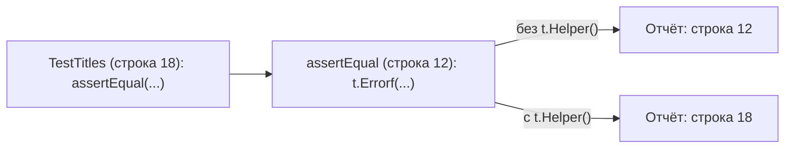

*Как проверять десятки сценариев в одном табличном тесте с `t.Run`, выносить общие проверки в хелперы через `t.Helper()` и работать с файлами в чистых временных каталогах `t.TempDir()`.*

Допустим, для `CleanURL` из прошлого урока нужно проверить восемь случаев: пустую строку, пробелы, `http://`, `https://`, отсутствие схемы, протокол `ftp://` и ссылки с путём. Копировать восемь однотипных функций `TestCleanURL1`…`TestCleanURL8` неудобно: при смене сигнатуры придётся править восемь мест.

Вторая проблема — файлы на диске. Если тест пишет `./bookmarks.json` прямо в папку проекта, он засоряет репозиторий и ломает повторные запуски.

Пакет `testing` закрывает обе боли тремя приёмами: табличными тестами с `t.Run`, пометкой `t.Helper()` и временными каталогами `t.TempDir()`.

## Табличные тесты и подтесты `t.Run`

Раз тест в Go — обычный код, все сценарии удобно описать слайсом анонимных структур и прогнать в одном цикле. Этот паттерн называют **табличным тестом** (*table-driven test*).

Чтобы сценарии не мешали друг другу, каждый шаг оборачивают в подтест **`t.Run(tc.name, func(t *testing.T) { ... })`**:

```go
// urlcheck_test.go
package bookmark

import (
	"errors"
	"testing"
)

func TestCleanURL(t *testing.T) {
	tests := []struct {
		name    string
		input   string
		want    string
		wantErr error
	}{
		{name: "https with spaces", input: "  https://go.dev  ", want: "https://go.dev"},
		{name: "plain http", input: "http://example.com/docs", want: "http://example.com/docs"},
		{name: "empty string", input: "   ", wantErr: ErrInvalidURL},
		{name: "missing scheme", input: "go.dev/doc", wantErr: ErrInvalidURL},
		{name: "unsupported ftp", input: "ftp://files.local", wantErr: ErrInvalidURL},
	}

	for _, tc := range tests {
		t.Run(tc.name, func(t *testing.T) {
			got, err := CleanURL(tc.input)
			if !errors.Is(err, tc.wantErr) {
				t.Fatalf("CleanURL(%q) err = %v, want %v", tc.input, err, tc.wantErr)
			}
			if got != tc.want {
				t.Errorf("CleanURL(%q) = %q, want %q", tc.input, got, tc.want)
			}
		})
	}
}
```

Подтесты дают два серьёзных преимущества перед обычным циклом:

1. **Изоляция `t.Fatalf`.** Провал одного сценария останавливает только его подтест — остальные строки таблицы выполняются и сразу показывают все сломанные случаи.
2. **Точечный запуск через `-run`.** Можно прогнать один конкретный подтест, указав `ИмяТеста/имя_подтеста` (пробелы `go test` заменяет на `_`):

```bash
go test -v -run TestCleanURL/missing_scheme
# === RUN   TestCleanURL
# === RUN   TestCleanURL/missing_scheme
# --- PASS: TestCleanURL (0.00s)
#     --- PASS: TestCleanURL/missing_scheme (0.00s)
# PASS
```

## Вспомогательные функции и `t.Helper()`

Часто повторяющиеся проверки выносят во вспомогательную функцию. Но без специальной пометки при падении `go test` напечатает номер строки **внутри хелпера**, а не в том месте теста, откуда его вызвали.

Добавьте первой строкой вызов **`t.Helper()`**:

```go
func assertEqual(t *testing.T, got, want string) {
	t.Helper()
	if got != want {
		t.Errorf("got %q, want %q", got, want)
	}
}
```



С `t.Helper()` среда тестирования пропускает кадр вспомогательной функции и точно указывает на упавший вызов. Правило простое: **каждый хелпер, принимающий `*testing.T`, начинается с `t.Helper()`**.

## Чистая работа с файлами: `t.TempDir()` и `t.Cleanup(...)`

Для тестов, читающих и пишущих файлы, в `*testing.T` есть метод **`t.TempDir()`**. Он создаёт уникальный временный каталог и **автоматически удаляет** его вместе со всем содержимым, когда тест завершится — даже после `t.Fatalf`.

Пути внутри него собирают через `filepath.Join`:

```go
func writeTempFile(t *testing.T, name, content string) string {
	t.Helper()
	path := filepath.Join(t.TempDir(), name)
	if err := os.WriteFile(path, []byte(content), 0o600); err != nil {
		t.Fatalf("write %s: %v", name, err)
	}
	return path
}
```

Для произвольных ресурсов (открытых файлов, временных настроек) есть метод **`t.Cleanup(func() { ... })`**. Он регистрирует функцию уборки, которая сработает после окончания теста и всех его подтестов в обратном порядке (LIFO).

Внутри хелпера-конструктора используйте именно `t.Cleanup`, а не `defer`:

```go
func openTempLog(t *testing.T) *os.File {
	t.Helper()
	f, err := os.Create(filepath.Join(t.TempDir(), "app.log"))
	if err != nil {
		t.Fatalf("create log: %v", err)
	}
	// defer f.Close() закроет файл слишком рано — при выходе из openTempLog
	t.Cleanup(func() { _ = f.Close() })
	return f
}
```

`defer` привязан к выходу из функции `openTempLog`, поэтому вернул бы тесту уже закрытый файл. `t.Cleanup` привязан к жизни самого теста `t`.

## Подводные камни

1. **Два вызова `t.TempDir()` в одном тесте.** Каждый вызов создаёт **новый** пустой каталог. Сохраняйте `dir := t.TempDir()` в переменную, если нужно создать и прочитать файл в одной папке.
2. **Общее состояние между подтестами.** Не переиспользуйте изменяемые структуры, созданные до цикла `for _, tc := range tests` — готовьте свежий экземпляр внутри `t.Run`.

> [!check] Проверь понимание
> В тесте записали файл по пути `filepath.Join(t.TempDir(), "a.txt")`, а строкой ниже читают `filepath.Join(t.TempDir(), "a.txt")`. Что произойдёт?
>
> Чтение завершится ошибкой «файл не существует»: второй вызов `t.TempDir()` вернул путь к другому, пустому каталогу. Нужно сохранить `dir := t.TempDir()` один раз.

## Практика

**Упражнение 1 (Базовое). Объясни почему.**  
Почему в хелпере, создающем и возвращающем открытый `*os.File`, закрывать файл нужно через `t.Cleanup`, а не через `defer`?

> [!solution] Показать решение
> `defer` выполнится при возврате из самого хелпера — тест получит уже закрытый файл и упадёт при первой записи. `t.Cleanup` сработает только после завершения всего теста (и всех его подтестов).

**Упражнение 2 (Практическое). Табличный тест с `t.Run`.**  
Напишите `NormalizeTag(raw string) string` (убирает пробелы и переводит в нижний регистр) и табличный тест `TestNormalizeTag` с `t.Run` на 5 случаев: чистый тег, смешанный регистр, пробелы по краям, пустая строка, одни пробелы. Проверьте запуск одного подтеста через `-run`.

> [!solution] Показать решение
> ```go
> package tag
>
> import "strings"
>
> func NormalizeTag(raw string) string {
> 	return strings.ToLower(strings.TrimSpace(raw))
> }
> ```
> ```go
> package tag
>
> import "testing"
>
> func TestNormalizeTag(t *testing.T) {
> 	tests := []struct {
> 		name, input, want string
> 	}{
> 		{name: "clean", input: "go", want: "go"},
> 		{name: "mixed case", input: "GoLang", want: "golang"},
> 		{name: "spaces", input: "  docs  ", want: "docs"},
> 		{name: "empty", input: "", want: ""},
> 		{name: "spaces only", input: "   ", want: ""},
> 	}
> 	for _, tc := range tests {
> 		t.Run(tc.name, func(t *testing.T) {
> 			if got := NormalizeTag(tc.input); got != tc.want {
> 				t.Errorf("NormalizeTag(%q) = %q, want %q", tc.input, got, tc.want)
> 			}
> 		})
> 	}
> }
> ```
> Запуск одного подтеста: `go test -v -run TestNormalizeTag/mixed_case`.

**Упражнение 3 (Со звёздочкой \*). Хелпер с `t.Helper()` и `t.TempDir()`.**  
Напишите функцию `CountNonEmptyLines(path string) (int, error)` (через `os.ReadFile`), хелпер `writeFixture(t *testing.T, content string) string` с `t.Helper()` и `t.TempDir()`, и табличный тест на 3 случая: пустой файл, строки с пробелами, обычный текст.

> [!solution] Показать решение
> ```go
> package lines
>
> import (
> 	"os"
> 	"strings"
> )
>
> func CountNonEmptyLines(path string) (int, error) {
> 	data, err := os.ReadFile(path)
> 	if err != nil {
> 		return 0, err
> 	}
> 	count := 0
> 	for _, line := range strings.Split(string(data), "\n") {
> 		if strings.TrimSpace(line) != "" {
> 			count++
> 		}
> 	}
> 	return count, nil
> }
> ```
> ```go
> package lines
>
> import (
> 	"os"
> 	"path/filepath"
> 	"testing"
> )
>
> func writeFixture(t *testing.T, content string) string {
> 	t.Helper()
> 	path := filepath.Join(t.TempDir(), "sample.txt")
> 	if err := os.WriteFile(path, []byte(content), 0o600); err != nil {
> 		t.Fatalf("write fixture: %v", err)
> 	}
> 	return path
> }
>
> func TestCountNonEmptyLines(t *testing.T) {
> 	tests := []struct {
> 		name, content string
> 		want          int
> 	}{
> 		{name: "empty", content: "", want: 0},
> 		{name: "blank skipped", content: "go\n   \n\ntest\n", want: 2},
> 		{name: "one line", content: "bookmark", want: 1},
> 	}
> 	for _, tc := range tests {
> 		t.Run(tc.name, func(t *testing.T) {
> 			got, err := CountNonEmptyLines(writeFixture(t, tc.content))
> 			if err != nil {
> 				t.Fatalf("unexpected error: %v", err)
> 			}
> 			if got != tc.want {
> 				t.Errorf("got %d, want %d", got, tc.want)
> 			}
> 		})
> 	}
> }
> ```
> Каждый подтест работает в собственной временной папке, которая автоматически исчезает после завершения теста.

---

Весь арсенал Модуля 3 собран: указатели, слайсы, мапы, структуры, интерфейсы и автоматические тесты с `t.TempDir()`. Применим его к нашему сквозному проекту в главе [[18. Практика BookmarkFlow (шаг 3) — структуры, методы и сохранение в JSON-файл]].
