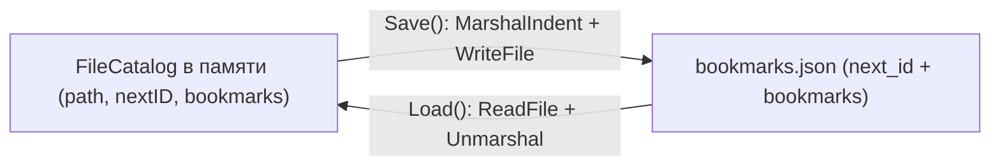

*Переводим `BookmarkFlow` с хрупких параллельных слайсов на структуру `Bookmark` с JSON-тегами, методы `FileCatalog`, сохранение на диск и первый тест в `t.TempDir()` (`project/step03/`).*

В финале Модуля 2 `BookmarkFlow` упёрся в три проблемы: данные одной закладки были размазаны по трём разным слайсам (`ids`, `titles`, `urls`), при выходе всё пропадало, а проверки шли вручную глазами.

На шаге 3 (`project/step03/`) мы закрываем сразу все три боли: объединяем поля закладки в структуру `Bookmark` с тегами и датой создания, сохраняем каталог в JSON-файл через стандартный пакет для JSON (детально его изучим в Модуле 4) и проверяем сохранение через `go test`.

## Структура `Bookmark`, снимок диска и `FileCatalog`

На диск мы пишем не голый слайс `[]Bookmark`, а обёртку `diskPayload` с полями `NextID` и `Bookmarks`. Если этого не сделать, после удаления закладки `#1` и перезапуска программы каталог забудет счётчик и выдаст `#1` повторно.



Вот полная реализация `project/step03/store.go`:

```go
package step03

import (
	"encoding/json"
	"errors"
	"fmt"
	"os"
	"slices"
	"strings"
	"time"
)

var (
	ErrEmptyTitle = errors.New("название закладки не может быть пустым")
	ErrInvalidURL = errors.New("ссылка должна начинаться с http:// или https://")
	ErrNotFound   = errors.New("закладка не найдена")
)

// Bookmark описывает одну сохранённую закладку.
type Bookmark struct {
	ID        int       `json:"id"`
	Title     string    `json:"title"`
	URL       string    `json:"url"`
	Tags      []string  `json:"tags,omitempty"`
	CreatedAt time.Time `json:"created_at"`
}

// FileCatalog хранит закладки и умеет сохранять их в JSON-файл.
type FileCatalog struct {
	path      string
	nextID    int
	bookmarks []Bookmark
}

type diskPayload struct {
	NextID    int        `json:"next_id"`
	Bookmarks []Bookmark `json:"bookmarks"`
}

// OpenFileCatalog загружает закладки из JSON-файла (или начинает пустой каталог, если файла нет).
func OpenFileCatalog(path string) (*FileCatalog, error) {
	c := &FileCatalog{path: path, nextID: 1}
	if err := c.Load(); err != nil {
		return nil, err
	}
	return c, nil
}

// Load считывает JSON-файл с диска.
func (c *FileCatalog) Load() error {
	data, err := os.ReadFile(c.path)
	if errors.Is(err, os.ErrNotExist) {
		c.nextID = 1
		c.bookmarks = nil
		return nil
	}
	if err != nil {
		return fmt.Errorf("чтение файла закладок: %w", err)
	}
	if len(strings.TrimSpace(string(data))) == 0 {
		c.nextID = 1
		c.bookmarks = nil
		return nil
	}

	var payload diskPayload
	if err := json.Unmarshal(data, &payload); err != nil {
		return fmt.Errorf("разбор JSON закладок: %w", err)
	}
	c.nextID = max(payload.NextID, 1)
	c.bookmarks = payload.Bookmarks
	return nil
}

// Save записывает текущее состояние каталога на диск в формате JSON.
func (c *FileCatalog) Save() error {
	payload := diskPayload{
		NextID:    c.nextID,
		Bookmarks: c.bookmarks,
	}
	data, err := json.MarshalIndent(payload, "", "  ")
	if err != nil {
		return fmt.Errorf("сериализация JSON: %w", err)
	}
	if err := os.WriteFile(c.path, data, 0o600); err != nil {
		return fmt.Errorf("запись файла закладок: %w", err)
	}
	return nil
}

// Add добавляет новую закладку и сразу сохраняет файл.
func (c *FileCatalog) Add(title, rawURL string, tags []string) (Bookmark, error) {
	cleanTitle := strings.TrimSpace(title)
	cleanURL := strings.TrimSpace(rawURL)
	if cleanTitle == "" {
		return Bookmark{}, ErrEmptyTitle
	}
	if !strings.HasPrefix(cleanURL, "http://") && !strings.HasPrefix(cleanURL, "https://") {
		return Bookmark{}, fmt.Errorf("%w: %q", ErrInvalidURL, cleanURL)
	}

	bm := Bookmark{
		ID:        c.nextID,
		Title:     cleanTitle,
		URL:       cleanURL,
		Tags:      normalizeTags(tags),
		CreatedAt: time.Now().UTC().Truncate(time.Second),
	}
	c.nextID++
	c.bookmarks = append(c.bookmarks, bm)
	if err := c.Save(); err != nil {
		return Bookmark{}, err
	}
	return bm, nil
}

// List возвращает копию всех закладок.
func (c *FileCatalog) List() []Bookmark {
	out := make([]Bookmark, len(c.bookmarks))
	for i, bm := range c.bookmarks {
		bm.Tags = slices.Clone(bm.Tags)
		out[i] = bm
	}
	return out
}

// Delete удаляет закладку по ID и сохраняет файл.
func (c *FileCatalog) Delete(id int) error {
	idx := slices.IndexFunc(c.bookmarks, func(b Bookmark) bool { return b.ID == id })
	if idx == -1 {
		return fmt.Errorf("%w: #%d", ErrNotFound, id)
	}
	c.bookmarks = slices.Delete(c.bookmarks, idx, idx+1)
	return c.Save()
}

func normalizeTags(tags []string) []string {
	var clean []string
	for _, t := range tags {
		tag := strings.ToLower(strings.TrimSpace(t))
		if tag != "" && !slices.Contains(clean, tag) {
			clean = append(clean, tag)
		}
	}
	slices.Sort(clean)
	return clean
}
```

## Пять ключевых решений в этом коде

1. **Теги структур (`json:"..."`).** Строки в обратных кавычках задают имена полей в JSON. Опция `omitempty` у `Tags` не пишет пустой список тегов в файл, а `time.Now().UTC().Truncate(time.Second)` хранит время без долей секунды.
2. **Отсутствие файла — штатный старт.** В `Load()` ветка `errors.Is(err, os.ErrNotExist)` начинает пустой каталог без ошибки. Прочие ошибки (нет прав, битый JSON) оборачиваются через `%w` и возвращаются выше.
3. **Читаемый файл и права `0o600`.** `json.MarshalIndent(payload, "", "  ")` форматирует JSON с отступами, а `0o600` в `os.WriteFile` оставляет доступ только владельцу файла.
4. **Защитное копирование в `List()`.** Скопировать один лишь внешний слайс `[]Bookmark` мало: поле `Tags` — это заголовок слайса `(ptr, len, cap)`, указывающий на внутренний массив каталога. Вызов `slices.Clone(bm.Tags)` разрывает алиасинг.
5. **Каноническая нормализация в `normalizeTags`.** Теги приводятся к нижнему регистру, очищаются от дубликатов (`"Go"` и `"go"` → `"go"`) и сортируются через `slices.Sort`.

## Тест сохранения и повторного открытия (`store_test.go`)

Файл `project/step03/store_test.go` проверяет, что закладка переживает закрытие каталога и повторное чтение с диска в `t.TempDir()`:

```go
package step03

import (
	"errors"
	"path/filepath"
	"slices"
	"testing"
)

func TestFileCatalogPersistence(t *testing.T) {
	filePath := filepath.Join(t.TempDir(), "bookmarks.json")

	cat, err := OpenFileCatalog(filePath)
	if err != nil {
		t.Fatalf("OpenFileCatalog failed: %v", err)
	}

	added, err := cat.Add("Go Effective", "https://go.dev/doc/effective_go", []string{"Go", "docs", "go"})
	if err != nil {
		t.Fatalf("Add failed: %v", err)
	}
	if added.ID != 1 {
		t.Fatalf("got ID %d, want 1", added.ID)
	}
	if !slices.Equal(added.Tags, []string{"docs", "go"}) {
		t.Fatalf("got tags %v, want [docs go]", added.Tags)
	}

	// Повторно открываем каталог с диска и убеждаемся, что данные сохранились.
	reloaded, err := OpenFileCatalog(filePath)
	if err != nil {
		t.Fatalf("reload failed: %v", err)
	}
	items := reloaded.List()
	if len(items) != 1 || items[0].Title != "Go Effective" {
		t.Fatalf("unexpected reloaded items: %+v", items)
	}

	if err := reloaded.Delete(added.ID); err != nil {
		t.Fatalf("Delete failed: %v", err)
	}
	if err := reloaded.Delete(added.ID); !errors.Is(err, ErrNotFound) {
		t.Fatalf("got err %v, want ErrNotFound", err)
	}
}
```

Запуск из `project/` подтверждает прохождение и покрытие:

```bash
go test -v -cover ./step03
# === RUN   TestFileCatalogPersistence
# --- PASS: TestFileCatalogPersistence (0.00s)
# PASS
# coverage: 83.1% of statements
# ok  	github.com/UnrealTemplier/go-textbook-v2-vol1/project/step03	0.002s	coverage: 83.1% of statements
```

Обратите внимание на два компромисса, которые мы честно улучшим дальше: `Add` пока возвращает `bm` без `slices.Clone(bm.Tags)` (исправим на шаге 4), а прямая перезапись `os.WriteFile` станет атомарной заменой через `os.Rename` в Модуле 5.

> [!check] Проверь понимание
> Что сломается, если убрать из `List()` строку `bm.Tags = slices.Clone(bm.Tags)`?
>
> Структура `Bookmark` скопируется по значению, но заголовок слайса `Tags` останется указывать на тот же базовый массив внутри `c.bookmarks`. Изменение `items[0].Tags[0]` снаружи молча испортит данные каталога.

## Практика

**Упражнение 1 (Базовое). Зачем `max(payload.NextID, 1)`.**  
Пользователь вручную создал файл `{"bookmarks": []}` без поля `"next_id"`. Что окажется в `payload.NextID` после `json.Unmarshal` и что сломалось бы без `max(payload.NextID, 1)`?

> [!solution] Показать решение
> `payload.NextID` получит нулевое значение `0`, и первая новая закладка получила бы некорректный `ID = 0`. Встроенный `max` гарантирует минимальный `nextID`, равный `1`.

**Упражнение 2 (Практическое). Поиск по тегу `FindByTag`.**  
Добавьте метод `(c *FileCatalog) FindByTag(rawTag string) []Bookmark`, который ищет закладки по нормализованному тегу, защищает `Tags` через `slices.Clone` и возвращает `nil` на пустой запрос. Проверьте его unit-тестом.

> [!solution] Показать решение
> ```go
> func (c *FileCatalog) FindByTag(rawTag string) []Bookmark {
> 	tag := strings.ToLower(strings.TrimSpace(rawTag))
> 	if tag == "" {
> 		return nil
> 	}
> 	var out []Bookmark
> 	for _, bm := range c.bookmarks {
> 		if slices.Contains(bm.Tags, tag) {
> 			bm.Tags = slices.Clone(bm.Tags)
> 			out = append(out, bm)
> 		}
> 	}
> 	return out
> }
> ```
> Тест открывает `FileCatalog` в `t.TempDir()`, добавляет закладку с тегом `"Lang"` и проверяет, что `FindByTag("  lang ")` возвращает ровно одну запись.

**Упражнение 3 (Со звёздочкой \*). Битый JSON и изоляция `List()`.**  
Напишите два теста в `t.TempDir()`: первый кладёт в файл `"{broken"` и проверяет, что `OpenFileCatalog` возвращает ошибку; второй мутирует `items[0].Tags[0] = "mutated"` после `List()` и убеждается, что внутри каталога тег остался прежним.

> [!solution] Показать решение
> ```go
> func TestFileCatalogCorruptJSON(t *testing.T) {
> 	path := filepath.Join(t.TempDir(), "broken.json")
> 	if err := os.WriteFile(path, []byte("{broken"), 0o600); err != nil {
> 		t.Fatalf("write: %v", err)
> 	}
> 	if _, err := OpenFileCatalog(path); err == nil {
> 		t.Fatal("got nil error on corrupt JSON, want error")
> 	}
> }
>
> func TestFileCatalogListIsolation(t *testing.T) {
> 	cat, err := OpenFileCatalog(filepath.Join(t.TempDir(), "bm.json"))
> 	if err != nil {
> 		t.Fatalf("open: %v", err)
> 	}
> 	if _, err := cat.Add("Go", "https://go.dev", []string{"go"}); err != nil {
> 		t.Fatalf("add: %v", err)
> 	}
> 	items := cat.List()
> 	items[0].Tags[0] = "mutated"
> 	if got := cat.List()[0].Tags; !slices.Equal(got, []string{"go"}) {
> 		t.Errorf("tags mutated: got %v, want [go]", got)
> 	}
> }
> ```
> Оба теста закрепляют важные инварианты: ошибки разбора не глотаются, а память каталога изолирована от внешнего кода.

---

Каталог уже сохраняет данные на диск, но любой вызывающий код намертво привязан к `*FileCatalog`. В финальной главе модуля отделим контракт от реализации — введём интерфейс `Store`, две реализации и единый контрактный тест в [[19. Практика BookmarkFlow (шаг 4) — интерфейс Store и покрытие unit-тестами]].
