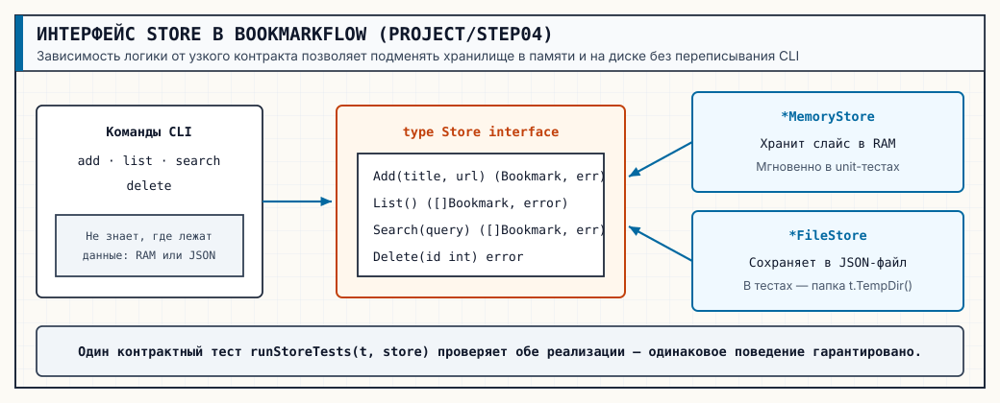
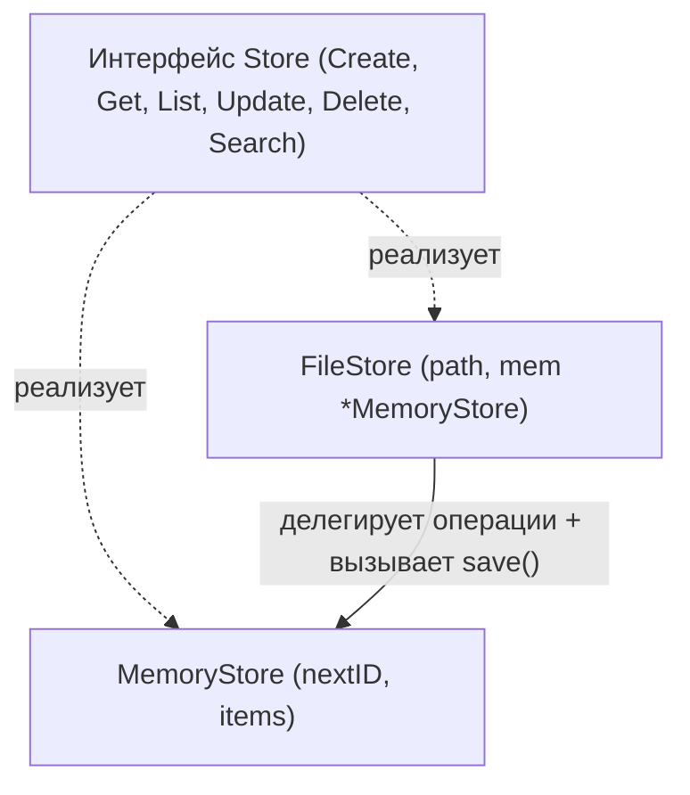

*Вводим интерфейс `Store`, строим две реализации — `MemoryStore` и `FileStore` через композицию — и проверяем обе единым контрактным тестом (`project/step04/`).*

В тринадцатом уроке мы вывели правило Go: интерфейсы нужны там, где есть две или более реализации, с которыми работают единообразно. На шаге 3 у `BookmarkFlow` был один `FileCatalog`, и интерфейс там был бы лишним.

На шаге 4 (`project/step04/`) появляются **два** хранилища: быстрое `MemoryStore` в памяти и долговременное `FileStore` на диске (работающее через стандартный пакет для JSON, который мы подробно разберём в Модуле 4). Пора вынести общий контракт в интерфейс `Store`.



## Архитектура шага 4: интерфейс, композиция и `cloneBookmark`

Вместо дублирования поиска, валидации и удаления в двух типах мы строим `FileStore` **через композицию** с `*MemoryStore`:



В `project/step04/store.go` собраны все четыре опоры Модуля 3 — метод с получателем-указателем `(*Bookmark).Validate()`, защита от алиасинга `cloneBookmark`, интерфейс `Store` и композиция:

```go
package step04

import (
	"encoding/json"
	"errors"
	"fmt"
	"os"
	"slices"
	"strings"
	"time"
)

var (
	ErrEmptyTitle = errors.New("название закладки не может быть пустым")
	ErrInvalidURL = errors.New("ссылка должна начинаться с http:// или https://")
	ErrNotFound   = errors.New("закладка не найдена")
)

// Bookmark — доменная модель закладки.
type Bookmark struct {
	ID        int       `json:"id"`
	Title     string    `json:"title"`
	URL       string    `json:"url"`
	Tags      []string  `json:"tags,omitempty"`
	CreatedAt time.Time `json:"created_at"`
}

// Validate нормализует и проверяет поля закладки.
func (b *Bookmark) Validate() error {
	b.Title = strings.TrimSpace(b.Title)
	b.URL = strings.TrimSpace(b.URL)
	if b.Title == "" {
		return ErrEmptyTitle
	}
	if !strings.HasPrefix(b.URL, "http://") && !strings.HasPrefix(b.URL, "https://") {
		return fmt.Errorf("%w: %q", ErrInvalidURL, b.URL)
	}
	b.Tags = normalizeTags(b.Tags)
	return nil
}

// Store описывает контракт хранилища закладок.
type Store interface {
	Create(b Bookmark) (Bookmark, error)
	Get(id int) (Bookmark, error)
	List() ([]Bookmark, error)
	Update(b Bookmark) (Bookmark, error)
	Delete(id int) error
	Search(query string) ([]Bookmark, error)
}

// MemoryStore хранит закладки в оперативной памяти.
type MemoryStore struct {
	nextID int
	items  []Bookmark
}

// NewMemoryStore создаёт пустое in-memory хранилище.
func NewMemoryStore() *MemoryStore {
	return &MemoryStore{nextID: 1}
}

func (m *MemoryStore) Create(b Bookmark) (Bookmark, error) {
	if err := b.Validate(); err != nil {
		return Bookmark{}, err
	}
	b.ID = m.nextID
	m.nextID++
	if b.CreatedAt.IsZero() {
		b.CreatedAt = time.Now().UTC().Truncate(time.Second)
	}
	b.Tags = slices.Clone(b.Tags)
	m.items = append(m.items, b)
	return cloneBookmark(b), nil
}

func (m *MemoryStore) Get(id int) (Bookmark, error) {
	for _, it := range m.items {
		if it.ID == id {
			return cloneBookmark(it), nil
		}
	}
	return Bookmark{}, fmt.Errorf("%w: #%d", ErrNotFound, id)
}

func (m *MemoryStore) List() ([]Bookmark, error) {
	out := make([]Bookmark, len(m.items))
	for i, it := range m.items {
		out[i] = cloneBookmark(it)
	}
	return out, nil
}

func (m *MemoryStore) Update(b Bookmark) (Bookmark, error) {
	if err := b.Validate(); err != nil {
		return Bookmark{}, err
	}
	for i, it := range m.items {
		if it.ID == b.ID {
			b.CreatedAt = it.CreatedAt
			m.items[i] = cloneBookmark(b)
			return cloneBookmark(b), nil
		}
	}
	return Bookmark{}, fmt.Errorf("%w: #%d", ErrNotFound, b.ID)
}

func (m *MemoryStore) Delete(id int) error {
	idx := slices.IndexFunc(m.items, func(b Bookmark) bool { return b.ID == id })
	if idx == -1 {
		return fmt.Errorf("%w: #%d", ErrNotFound, id)
	}
	m.items = slices.Delete(m.items, idx, idx+1)
	return nil
}

func (m *MemoryStore) Search(query string) ([]Bookmark, error) {
	q := strings.ToLower(strings.TrimSpace(query))
	if q == "" {
		return m.List()
	}
	var out []Bookmark
	for _, it := range m.items {
		if strings.Contains(strings.ToLower(it.Title), q) ||
			strings.Contains(strings.ToLower(it.URL), q) ||
			slices.Contains(it.Tags, q) {
			out = append(out, cloneBookmark(it))
		}
	}
	return out, nil
}

// FileStore сохраняет закладки в JSON-файл, переиспользуя логику MemoryStore через композицию.
type FileStore struct {
	path string
	mem  *MemoryStore
}

type fileSnapshot struct {
	NextID int        `json:"next_id"`
	Items  []Bookmark `json:"items"`
}

// OpenFileStore открывает или создаёт файловое хранилище.
func OpenFileStore(path string) (*FileStore, error) {
	fs := &FileStore{
		path: path,
		mem:  NewMemoryStore(),
	}
	if err := fs.load(); err != nil {
		return nil, err
	}
	return fs, nil
}

func (f *FileStore) Create(b Bookmark) (Bookmark, error) {
	created, err := f.mem.Create(b)
	if err != nil {
		return Bookmark{}, err
	}
	if err := f.save(); err != nil {
		return Bookmark{}, err
	}
	return created, nil
}

func (f *FileStore) Get(id int) (Bookmark, error)        { return f.mem.Get(id) }
func (f *FileStore) List() ([]Bookmark, error)           { return f.mem.List() }
func (f *FileStore) Search(q string) ([]Bookmark, error) { return f.mem.Search(q) }

func (f *FileStore) Update(b Bookmark) (Bookmark, error) {
	updated, err := f.mem.Update(b)
	if err != nil {
		return Bookmark{}, err
	}
	if err := f.save(); err != nil {
		return Bookmark{}, err
	}
	return updated, nil
}

func (f *FileStore) Delete(id int) error {
	if err := f.mem.Delete(id); err != nil {
		return err
	}
	return f.save()
}

func (f *FileStore) load() error {
	data, err := os.ReadFile(f.path)
	if errors.Is(err, os.ErrNotExist) {
		return nil
	}
	if err != nil {
		return fmt.Errorf("чтение %s: %w", f.path, err)
	}
	if len(strings.TrimSpace(string(data))) == 0 {
		return nil
	}
	var snap fileSnapshot
	if err := json.Unmarshal(data, &snap); err != nil {
		return fmt.Errorf("разбор %s: %w", f.path, err)
	}
	f.mem.nextID = max(snap.NextID, 1)
	f.mem.items = snap.Items
	return nil
}

func (f *FileStore) save() error {
	snap := fileSnapshot{NextID: f.mem.nextID, Items: f.mem.items}
	data, err := json.MarshalIndent(snap, "", "  ")
	if err != nil {
		return err
	}
	return os.WriteFile(f.path, data, 0o600)
}

func cloneBookmark(b Bookmark) Bookmark {
	b.Tags = slices.Clone(b.Tags)
	return b
}

func normalizeTags(tags []string) []string {
	var clean []string
	for _, raw := range tags {
		tag := strings.ToLower(strings.TrimSpace(raw))
		if tag != "" && !slices.Contains(clean, tag) {
			clean = append(clean, tag)
		}
	}
	slices.Sort(clean)
	return clean
}
```

Разберём четыре инженерные детали:

* **Контракт с `error` везде.** Даже `List()` и `Search()` возвращают `error`, хотя в `MemoryStore` она равна `nil`: контракт обязан допускать ошибки диска или сети в других реализациях.
* **Явное поле `mem *MemoryStore` вместо анонимного встраивания.** Чтение (`Get`, `List`, `Search`) делегируется одной строкой, а мутации (`Create`, `Update`, `Delete`) обязательно вызывают `f.save()`. Анонимное встраивание могло бы пропустить новый метод `MemoryStore` наружу в обход записи на диск.
* **`cloneBookmark` на входе и выходе.** Слайс `Tags` клонируется при сохранении и при каждом возврате, полностью закрывая алиасинг, который мы видели на шаге 3.
* **Защита `CreatedAt` в `Update`.** Строка `b.CreatedAt = it.CreatedAt` не даёт обновлению стереть дату создания.

*(Честная оговорка: если в `FileStore.Create` запись `f.save()` вернёт ошибку, память `f.mem` останется с новой записью. Надёжную атомарную запись и синхронизацию доступа мы добавим в следующих модулях.)*

## Единый контрактный тест (`store_test.go`)

Главный выигрыш интерфейса `Store` — функция `runStoreContract(t *testing.T, s Store)` с `t.Helper()`, которая прогоняет **одни и те же** проверки поверх обеих реализаций (`project/step04/store_test.go`):

```go
package step04

import (
	"errors"
	"path/filepath"
	"testing"
)

func TestStoreImplementations(t *testing.T) {
	t.Run("MemoryStore", func(t *testing.T) {
		runStoreContract(t, NewMemoryStore())
	})

	t.Run("FileStore", func(t *testing.T) {
		path := filepath.Join(t.TempDir(), "store.json")
		fs, err := OpenFileStore(path)
		if err != nil {
			t.Fatalf("OpenFileStore failed: %v", err)
		}
		runStoreContract(t, fs)
	})
}

func runStoreContract(t *testing.T, s Store) {
	t.Helper()

	bm1, err := s.Create(Bookmark{Title: "Go Tour", URL: "https://go.dev/tour", Tags: []string{"Go", "learning"}})
	if err != nil {
		t.Fatalf("Create failed: %v", err)
	}
	if bm1.ID != 1 {
		t.Fatalf("got ID %d, want 1", bm1.ID)
	}

	got, err := s.Get(bm1.ID)
	if err != nil {
		t.Fatalf("Get failed: %v", err)
	}
	if got.Title != "Go Tour" {
		t.Fatalf("got title %q, want %q", got.Title, "Go Tour")
	}

	got.Title = "A Tour of Go"
	updated, err := s.Update(got)
	if err != nil {
		t.Fatalf("Update failed: %v", err)
	}
	if updated.Title != "A Tour of Go" {
		t.Fatalf("got updated title %q", updated.Title)
	}

	found, err := s.Search("learning")
	if err != nil || len(found) != 1 {
		t.Fatalf("Search by tag got %d items, err=%v", len(found), err)
	}

	if err := s.Delete(bm1.ID); err != nil {
		t.Fatalf("Delete failed: %v", err)
	}
	if _, err := s.Get(bm1.ID); !errors.Is(err, ErrNotFound) {
		t.Fatalf("Get after delete got err=%v, want ErrNotFound", err)
	}
}
```

Запуск `go test -v -cover ./step04`:

```text
=== RUN   TestStoreImplementations
=== RUN   TestStoreImplementations/MemoryStore
=== RUN   TestStoreImplementations/FileStore
--- PASS: TestStoreImplementations (0.00s)
    --- PASS: TestStoreImplementations/MemoryStore (0.00s)
    --- PASS: TestStoreImplementations/FileStore (0.00s)
PASS
coverage: 70.7% of statements
ok  	github.com/UnrealTemplier/go-textbook-v2-vol1/project/step04	0.002s	coverage: 70.7% of statements
```

Стоит завтра добавить третье хранилище — достаточно одного нового `t.Run`, и весь контракт проверится автоматически.

> [!check] Проверь понимание
> Как компилятор понимает, что `*MemoryStore` и `*FileStore` подходят под `Store`, если в коде нет ключевого слова `implements`?
>
> Интерфейсы в Go удовлетворяются неявно: у обоих типов есть все шесть методов с нужными сигнатурами, и компилятор проверяет это прямо при вызове `runStoreContract(t, ...)`.

## Практика

**Упражнение 1 (Базовое). Получатель-указатель в `Validate`.**  
Что сломается, если поменять `func (b *Bookmark) Validate() error` на получатель-значение `func (b Bookmark) Validate() error`?

> [!solution] Показать решение
> Ошибки пустого названия и неверной ссылки продолжат ловиться, но нормализация пробелов и тегов исчезнет: метод отредактирует временную копию, а в хранилище попадут «сырые» данные.

**Упражнение 2 (Практическое). Расширяем контрактный тест.**  
Покрытие `step04` сейчас `70.7%`: в `runStoreContract` не проверяются `List()`, ошибки `ErrEmptyTitle` и `ErrInvalidURL`, а также `Update` для несуществующего ID. Допишите эти проверки в `runStoreContract` и замерьте новое покрытие.

> [!solution] Показать решение
> ```go
> if _, err := s.Create(Bookmark{Title: "  ", URL: "https://go.dev"}); !errors.Is(err, ErrEmptyTitle) {
> 	t.Errorf("empty title err = %v, want ErrEmptyTitle", err)
> }
> if _, err := s.Create(Bookmark{Title: "Bad", URL: "go.dev"}); !errors.Is(err, ErrInvalidURL) {
> 	t.Errorf("invalid url err = %v, want ErrInvalidURL", err)
> }
> if _, err := s.Update(Bookmark{ID: 999, Title: "Ghost", URL: "https://go.dev"}); !errors.Is(err, ErrNotFound) {
> 	t.Errorf("update missing err = %v, want ErrNotFound", err)
> }
> list, err := s.List()
> if err != nil || len(list) != 1 {
> 	t.Fatalf("List got %d items, err=%v; want 1", len(list), err)
> }
> ```
> Все четыре проверки прогоняются на обеих реализациях и заметно поднимают покрытие.

**Упражнение 3 (Со звёздочкой \*). Перезагрузка `FileStore` и защита от алиасинга.**  
Напишите тест `TestFileStoreReopenAndIsolation` в `t.TempDir()`: создайте закладку с тегом `"Go"`, испортите `created.Tags[0] = "broken"`, обновите название, откройте `OpenFileStore` заново и убедитесь, что название обновилось, а тег остался `["go"]`.

> [!solution] Показать решение
> ```go
> func TestFileStoreReopenAndIsolation(t *testing.T) {
> 	path := filepath.Join(t.TempDir(), "store.json")
> 	fs, err := OpenFileStore(path)
> 	if err != nil {
> 		t.Fatalf("open: %v", err)
> 	}
> 	created, err := fs.Create(Bookmark{Title: "Go Spec", URL: "https://go.dev/ref/spec", Tags: []string{"Go"}})
> 	if err != nil {
> 		t.Fatalf("create: %v", err)
> 	}
> 	created.Tags[0] = "broken"
> 	if _, err := fs.Update(Bookmark{ID: created.ID, Title: "Go Language Spec", URL: created.URL, Tags: []string{"Go"}}); err != nil {
> 		t.Fatalf("update: %v", err)
> 	}
> 	reopened, err := OpenFileStore(path)
> 	if err != nil {
> 		t.Fatalf("reopen: %v", err)
> 	}
> 	got, err := reopened.Get(created.ID)
> 	if err != nil {
> 		t.Fatalf("get: %v", err)
> 	}
> 	if got.Title != "Go Language Spec" || len(got.Tags) != 1 || got.Tags[0] != "go" {
> 		t.Fatalf("unexpected reopened bookmark: %+v", got)
> 	}
> }
> ```
> Тест подтверждает, что `cloneBookmark` изолирует внутренний слайс тегов и что `Update` сохраняется на диск.

---

Модуль 3 завершён: вы освоили ядро Go — указатели, слайсы и мапы, структуры, композицию, интерфейсы, пакеты, вводные дженерики и автоматические тесты — а `BookmarkFlow` получил чистый интерфейс `Store` с двумя реализациями. В Модуле 4 «Стандартная библиотека, философия Go и базовая конкурентность» мы разберём ключевые пакеты стандартной библиотеки, принципы проектирования языка и научимся выполнять задачи конкурентно.
