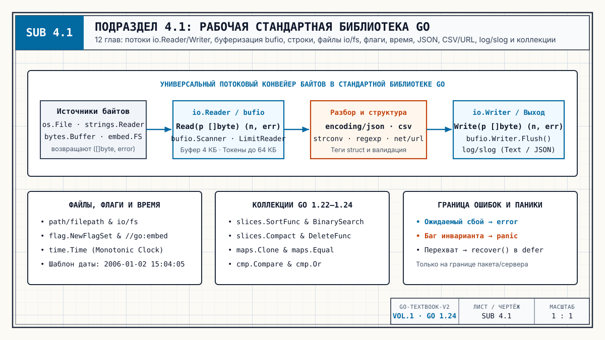

*Двенадцать уроков о пакетах стандартной библиотеки Go, на которых строится повседневный рабочий код: от потоков `io` и файлов до JSON, логов и работы с коллекциями.*

## Зачем изучать стандартную библиотеку до сторонних пакетов

Одна из главных особенностей Go — богатая, согласованная стандартная библиотека. В ней почти нет «магических» каркасов, зато есть небольшие, хорошо стыкующиеся кирпичики: интерфейсы `io.Reader` и `io.Writer`, буферизатор `bufio`, разбор аргументов `flag`, время `time`, кодировщики JSON и CSV, структурированный логгер `log/slog`.

Освоив эти двенадцать пакетов, вы сможете решать большую часть прикладных задач без единой внешней зависимости — от утилит разбора логов до подготовки данных в `BookmarkFlow`. К тому же сторонние библиотеки в экосистеме Go почти всегда следуют тем же соглашениям: принимают `io.Reader`, возвращают `(n, error)`, используют `time.Duration` и `fs.FS`.

## Как проходить этот подраздел

Идите последовательно. Первые два урока вводят сквозную модель потоков байтов (`io` и `bufio`), на которую опираются все остальные главы — работа со строками и буферами, файлами, встроенными ресурсами, JSON и CSV. Завершает подраздел разбор `panic` и `recover`, который проводит чёткую границу между обычной ошибкой и аварийной остановкой программы.

В каждом уроке собраны короткие рабочие примеры на Go 1.24, реальные ловушки стандартных API и три упражнения с разборами.

## Карта подраздела 4.1

1. [[1. Потоки ввода-вывода — io.Reader, io.Writer и io.Copy]] — два главных однометодных интерфейса Go, потоковое копирование, ограничение чтения и обёртки.
2. [[2. Буферизация и построчное чтение — bufio.Scanner и bufio.Writer]] — зачем нужен буфер, построчное чтение, лимит токена 64 КБ и обязательный `Flush`.
3. [[3. Строки и байты — strings, strings.Builder и bytes]] — быстрая сборка строк без лишних копий, утилиты разбора и `bytes.Buffer`.
4. [[4. Разбор и форматирование — strconv и регулярные выражения regexp]] — преобразования чисел и строк, `regexp.MustCompile` и границы применимости регулярных выражений.
5. [[5. Файлы и пути — os, path_filepath и io_fs]] — потоковая работа с файлами, переносимые пути `path/filepath` и абстракция `io/fs`.
6. [[6. Флаги командной строки flag и встроенные ресурсы embed]] — парсинг флагов, подкоманды через `flag.NewFlagSet` и вшивание файлов через `//go:embed`.
7. [[7. Время, длительности и таймеры — пакет time]] — календарное и монотонное время, `time.Duration`, шаблоны формата и таймеры.
8. [[8. Работа с JSON — encoding_json, теги структур и потоковое чтение]] — кодирование структур, теги `json:"..."` и потоковые `Decoder`/`Encoder`.
9. [[9. Формат CSV и разбор ссылок — encoding_csv и net_url]] — чтение и генерация таблиц CSV, разбор и сборка URL через `net/url`.
10. [[10. Структурированное логирование на log_slog]] — уровни логирования, пары ключ-значение и обработчики `log/slog`.
11. [[11. Утилиты коллекций — slices, maps и cmp в Go 1.22–1.24]] — обобщённая сортировка, поиск, фильтрация и копирование слайсов и мап.
12. [[12. Паника panic и перехват recover — когда применять]] — механика раскрутки стека, `recover` в `defer` и дисциплина обработки сбоев.
