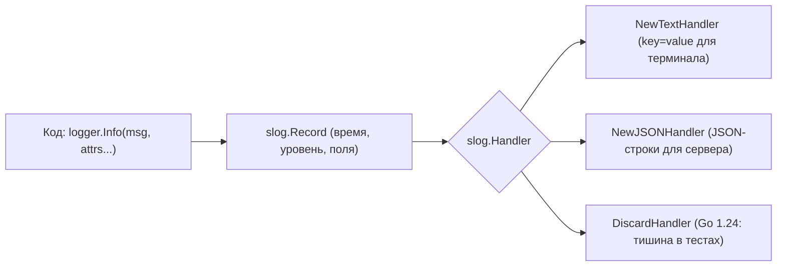

*Почему `fmt.Println` не годится для серверных журналов и как вести структурированные логи стандартным пакетом `log/slog` с уровнями, типизированными атрибутами и `slog.DiscardHandler`.*

Пока программа живёт на ноутбуке разработчика, `fmt.Println("закладка сохранена:", id)` кажется достаточным. Проблемы начинаются в день, когда сервис переезжает на сервер и начинает обрабатывать тысячи событий в минуту.

В потоке строк из `fmt.Println` нет ни точного времени, ни уровня важности, ни жёсткой структуры. Вы не сможете одной командой отфильтровать только ошибки за последние десять минут или найти все записи по `id=42` — придётся писать хрупкие регулярные выражения. К тому же `fmt.Println` пишет в `os.Stdout`, смешивая журналы с полезным выводом утилиты, а в тестах этот поток засоряет экран. Начиная с **Go 1.21**, стандартная библиотека закрывает эту задачу пакетом `log/slog`.

## Архитектура `log/slog`: логгер отдельно, формат отдельно

Пакет `log/slog` разделяет две ответственности:

- **`*slog.Logger`** — интерфейс для вашего кода (`logger.Info(...)`, `logger.Error(...)`). Бизнес-логика вызывает только его и ничего не знает о формате вывода.
- **`slog.Handler`** — обработчик, который решает, отбросить запись по уровню или отформатировать её в текст, JSON или никуда.

Путь одной записи выглядит так:



Стандартная библиотека даёт три готовых обработчика:

1. `slog.NewTextHandler(w, opts)` — читаемый человеком формат `time=... level=INFO msg=... id=7`. Удобен при локальной разработке.
2. `slog.NewJSONHandler(w, opts)` — машинно-читаемые JSON-строки для серверов и систем сбора логов.
3. `slog.DiscardHandler` — **новинка Go 1.24**. Он мгновенно отбрасывает все записи без выделения памяти. Именно его использует наш проект `BookmarkFlow` в `project/step05/checker.go`: если вызывающий код передал `logger == nil` (например, в unit-тестах), функция безопасно подставляет `slog.New(slog.DiscardHandler)` и дальше пишет в лог без единой проверки `if logger != nil`.

## Уровни, типизированные атрибуты и `logger.With`

У `log/slog` четыре стандартных уровня по возрастанию серьёзности: `Debug` (`-4`), `Info` (`0`), `Warn` (`4`) и `Error` (`8`). По умолчанию обработчик пропускает всё, начиная с `Info`, и молча отбрасывает `Debug`. Чтобы включить отладочные записи, передают `&slog.HandlerOptions{Level: slog.LevelDebug}`.

Вместо склейки строки через `fmt.Sprintf("bm %d: %s", id, url)` в `slog` передают короткое неизменное сообщение и пары «ключ-значение». Делать это можно двумя способами:

- Чередующимися аргументами: `logger.Info("сохранено", "id", 7, "url", u)`.
- Типизированными атрибутами `slog.Attr`: `slog.Int("id", 7)`, `slog.String("url", u)`, `slog.Bool("ok", true)`, `slog.Duration("latency", d)`.

Типизированные атрибуты надёжнее и быстрее: компилятор проверяет каждую пару «ключ + значение» ещё до запуска, поэтому вы не сможете случайно забыть значение и сломать структуру строки.

Если компонент много раз логирует одни и те же общие поля (например, имя подсистемы или идентификатор задачи), создают дочерний логгер через `child := logger.With(slog.String("component", "catalog"))`. Все записи через `child` автоматически получат поле `component=catalog`, а исходный `logger` останется нетронутым.

## Рабочий пример: текстовый и JSON-вывод, `With` и `DiscardHandler`

Соберём программу, которая показывает три режима обработчиков и дочерний логгер в стиле `BookmarkFlow`:

```go
package main

import (
	"bytes"
	"fmt"
	"log/slog"
	"time"
)

func checkBookmark(id int, rawURL string, logger *slog.Logger) {
	if logger == nil {
		logger = slog.New(slog.DiscardHandler)
	}
	logger.Debug("старт проверки", slog.Int("id", id))
	logger.Info("проверка завершена",
		slog.Int("id", id),
		slog.String("url", rawURL),
		slog.Duration("latency", 18*time.Millisecond),
	)
}

func main() {
	var textBuf bytes.Buffer
	textLogger := slog.New(slog.NewTextHandler(&textBuf, &slog.HandlerOptions{
		Level: slog.LevelDebug,
	})).With(slog.String("component", "checker"))

	checkBookmark(1, "https://go.dev", textLogger)
	fmt.Println("=== TextHandler ===")
	fmt.Print(textBuf.String())

	var jsonBuf bytes.Buffer
	jsonLogger := slog.New(slog.NewJSONHandler(&jsonBuf, nil)).
		With(slog.String("service", "bookmarkflow"))

	checkBookmark(2, "https://pkg.go.dev", jsonLogger)
	fmt.Println("=== JSONHandler ===")
	fmt.Print(jsonBuf.String())

	// Безопасный вызов без логгера (внутри сработает slog.DiscardHandler)
	checkBookmark(3, "https://example.com", nil)
}
```

Вывод терминала (метки времени зависят от момента запуска):

```text
=== TextHandler ===
time=2026-04-12T09:30:00.123Z level=DEBUG msg="старт проверки" component=checker id=1
time=2026-04-12T09:30:00.123Z level=INFO msg="проверка завершена" component=checker id=1 url=https://go.dev latency=18ms
=== JSONHandler ===
{"time":"2026-04-12T09:30:00.123Z","level":"INFO","msg":"проверка завершена","service":"bookmarkflow","id":2,"url":"https://pkg.go.dev","latency":18000000}
```

Сравните два вывода: у `textLogger` задан `LevelDebug`, поэтому видны обе строки; у `jsonLogger` опции `nil` (уровень по умолчанию `Info`), поэтому `Debug` исчезла сама, а `service` из `With` прикрепился к JSON-объекту. Третий вызов с `nil` не упал и не напечатал ничего лишнего благодаря `slog.DiscardHandler`.

## Две частые ловушки `log/slog`

**Ловушка 1. Непарный аргумент при нетипизированном вызове.** Если передать нечётное число аргументов без `slog.String`/`slog.Int`, код скомпилируется, но в лог попадёт аварийный ключ `!BADKEY`:

```go
logger.Info("сохранено", "id")
// ... level=INFO msg=сохранено !BADKEY=id
```

Использование `slog.Int`, `slog.String` и `slog.Bool` полностью исключает эту ошибку на этапе компиляции.

**Ловушка 2. Потерянные `Debug`-записи.** Вы добавили `logger.Debug(...)`, запустили программу и не видите строк в консоли. По умолчанию минимальный уровень равен `slog.LevelInfo` — без `&slog.HandlerOptions{Level: slog.LevelDebug}` все отладочные вызовы отфильтровываются.

> [!check] Проверь понимание
> Зачем в функции `checkBookmark` подставлять `slog.New(slog.DiscardHandler)` при `logger == nil`, вместо того чтобы писать `if logger != nil { logger.Info(...) }` перед каждым логом?
>
> Это паттерн «нулевого объекта» (*null object*): проверка делается один раз на входе в функцию, а дальше код остаётся линейным и чистым, без дублирования `if logger != nil` на каждой точке логирования. В Go 1.24 `slog.DiscardHandler` встроили прямо в стандартную библиотеку именно ради этого сценария.

## Практика

**Упражнение 1 (Базовое). Проследи вывод логгера.**  
Логгер создан через `l := slog.New(slog.NewTextHandler(os.Stderr, nil))`. Какие из трёх строк ниже появятся в выводе и что необычного окажется в третьей?
```go
l.Debug("шаг 1", slog.Int("n", 1))
l.Warn("медленный ответ", slog.Duration("took", 2*time.Second))
l.Info("загрузка", "bookmarks.json")
```

> [!solution] Показать решение
> 1. `l.Debug(...)` **не выведется**: при `opts == nil` минимальный уровень равен `Info`.
> 2. `l.Warn(...)` выведется с `level=WARN`, `msg="медленный ответ"` и `took=2s`.
> 3. `l.Info(...)` выведется, но так как у строки `"bookmarks.json"` нет пары, `slog` запишет её под служебным ключом `!BADKEY=bookmarks.json`. Исправление — передать `slog.String("file", "bookmarks.json")`.

**Упражнение 2 (Практическое). Конструктор логгера для `BookmarkFlow`.**  
Напишите функцию `NewLogger(w io.Writer, asJSON, debug bool) *slog.Logger`. Если `w == nil`, она должна вернуть `slog.New(slog.DiscardHandler)`. Иначе — настроить уровень (`LevelDebug` при `debug == true`, иначе `LevelInfo`), выбрать `JSONHandler` или `TextHandler` и вернуть дочерний логгер с постоянным полем `slog.String("app", "bookmarkflow")`.

> [!solution] Показать решение
> ```go
> func NewLogger(w io.Writer, asJSON, debug bool) *slog.Logger {
> 	if w == nil {
> 		return slog.New(slog.DiscardHandler)
> 	}
> 	level := slog.LevelInfo
> 	if debug {
> 		level = slog.LevelDebug
> 	}
> 	opts := &slog.HandlerOptions{Level: level}
>
> 	var handler slog.Handler
> 	if asJSON {
> 		handler = slog.NewJSONHandler(w, opts)
> 	} else {
> 		handler = slog.NewTextHandler(w, opts)
> 	}
> 	return slog.New(handler).With(slog.String("app", "bookmarkflow"))
> }
> ```
> Принимая `io.Writer`, функция одинаково легко работает с `os.Stderr` в программе и с `&bytes.Buffer{}` в тестах.

**Упражнение 3 (Со звёздочкой \*). Проверка JSON-лога в тесте.**  
Создайте `bytes.Buffer`, подключите к нему `slog.NewJSONHandler(&buf, nil)`, залогируйте событие `logger.With(slog.String("component", "store")).Error("сбой записи", slog.Int("id", 42))`, затем разберите содержимое `buf.Bytes()` через `json.Unmarshal` в структуру и убедитесь, что `Level == "ERROR"`, `Component == "store"` и `ID == 42`.

> [!solution] Показать решение
> ```go
> var buf bytes.Buffer
> logger := slog.New(slog.NewJSONHandler(&buf, nil)).
> 	With(slog.String("component", "store"))
> logger.Error("сбой записи", slog.Int("id", 42))
>
> var entry struct {
> 	Level     string `json:"level"`
> 	Msg       string `json:"msg"`
> 	Component string `json:"component"`
> 	ID        int    `json:"id"`
> }
> if err := json.Unmarshal(buf.Bytes(), &entry); err != nil {
> 	t.Fatalf("unmarshal log: %v", err)
> }
> if entry.Level != "ERROR" || entry.Component != "store" || entry.ID != 42 {
> 	t.Fatalf("unexpected log entry: %+v", entry)
> }
> ```
> Структурированные логи проверяются в unit-тестах так же строго, как любой другой JSON-вывод — без поиска подстрок.

---

Логи стали чистыми и предсказуемыми, но при обработке коллекций закладок и тегов мы до сих пор пишем однотипные циклы сортировки, фильтрации и выбора значений по умолчанию. В следующем уроке уберём этот шаблонный код с помощью современных пакетов Go 1.22–1.24 — [[11. Утилиты коллекций — slices, maps и cmp в Go 1.22–1.24]].
