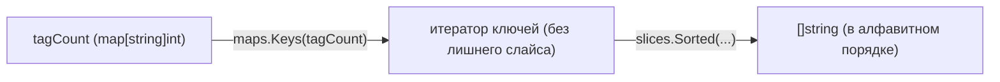

*Как пакеты `slices`, `maps` и `cmp` убирают сотни строк однотипных циклов, как `cmp.Or` заменяет цепочки `if` для значений по умолчанию и как итераторы Go 1.23+ дают предсказуемый обход мап в одну строку.*

В первые десять лет жизни Go разработчики постоянно переписывали одни и те же циклы: проверить, есть ли строка в слайсе, скопировать мапу, удалить элемент по индексу без сдвига памяти, отсортировать ключи мапы для печати. С появлением дженериков стандартная библиотека получила три компактных, типобезопасных пакета — `slices`, `maps` и `cmp` — которые превращают эту рутину в читаемые однострочники.

## Пакет `slices`: готовые операции над слайсами

Пакет `slices` работает с любым типом слайса `[]E` и не требует ручного приведения типов. Вот восемь функций, которые вы будете встречать в каждом проекте:

| Функция | Что делает |
|---|---|
| `slices.Sort(s)` | Сортирует слайс упорядочиваемых типов (`int`, `string`, `float64`) на месте |
| `slices.SortFunc(s, cmpFn)` | Сортирует слайс структур по пользовательской функции сравнения (`-1`, `0`, `+1`) |
| `slices.Contains(s, v)` | Проверяет наличие элемента `v` в слайсе |
| `slices.IndexFunc(s, match)` | Возвращает индекс первого элемента, для которого `match(e) == true`, или `-1` |
| `slices.Delete(s, i, j)` | Удаляет диапазон `[i:j)` и **обнуляет** освободившийся хвост, возвращая новый слайс |
| `slices.Clone(s)` | Создаёт независимую копию слайса (разрывая алиасинг базового массива) |
| `slices.Compact(s)` | Схлопывает **соседние** повторяющиеся элементы (удобно сразу после `slices.Sort`) |
| `slices.Equal(a, b)` | Поэлементно сравнивает два слайса |

Деталь про `slices.Delete` стоит запомнить: начиная с Go 1.22, при удалении элементов освободившиеся ячейки в хвосте базового массива обнуляются. Если в слайсе лежали строки или указатели, сборщик мусора сможет освободить их сразу, а не держать в памяти до пересоздания массива.

## Пакет `cmp`: сравнения и цепочка умолчаний `cmp.Or`

В сортировке `slices.SortFunc` больше не нужно писать громоздкие `if a < b { return -1 } else if a > b { return 1 }`. Функция `cmp.Compare(a, b)` делает это за вас и возвращает ровно `-1`, `0` или `+1`.

А в **Go 1.22** добавили ещё более удобную функцию — `cmp.Or(vals...)`. Она возвращает **первое ненулевое значение** среди аргументов (или нулевое, если все аргументы нулевые). Это решает сразу две частые задачи:

1. **Цепочка настроек по умолчанию.** Вместо каскада `if port == "" { port = envPort }; if port == "" { port = "8080" }` достаточно одной строки:
   ```go
   port := cmp.Or(flagPort, os.Getenv("APP_PORT"), "8080")
   ```
2. **Многоуровневая сортировка.** Поскольку `cmp.Compare` возвращает `0` при равенстве, `cmp.Or` естественно переходит к следующему критерию:
   ```go
   slices.SortFunc(items, func(a, b Bookmark) int {
       return cmp.Or(
           cmp.Compare(a.Priority, b.Priority),
           cmp.Compare(a.Title, b.Title),
       )
   })
   ```

Если приоритеты различаются, `cmp.Compare` вернёт `-1` или `+1`, и `cmp.Or` остановится сразу. Если приоритеты совпали (`0`), `cmp.Or` вернёт результат сравнения названий.

## Пакет `maps` и итераторы Go 1.23+ в связке с `slices`

Пакет `maps` закрывает базовые операции со словарями: `maps.Clone(m)` делает поверхностную копию, `maps.Equal(a, b)` сравнивает пары ключ-значение, а `maps.DeleteFunc(m, del)` удаляет все записи по условию.

Но помните ловушку из Модуля 3: порядок обхода `map` в Go намеренно случайный. Чтобы напечатать или сохранить статистику тегов в предсказуемом порядке, ключи нужно отсортировать. Начиная с **Go 1.23**, функции `maps.Keys(m)` и `maps.Values(m)` возвращают не готовый слайс, а **итератор** — лёгкую последовательность, которую можно напрямую обходить циклом `for range` или передать в `slices.Sorted` и `slices.Collect`.

Поток преобразования мапы в отсортированный список ключей выглядит так:



Не нужно глубоко нырять в устройство итераторов: на практике достаточно запомнить одну идиому Go 1.23+ — `slices.Sorted(maps.Keys(m))`. Она читается вслух почти как обычная фраза: «отсортированные ключи мапы `m`».

## Рабочий пример: сортировка закладок, очистка тегов и статистика

Соберём программу для аналитики каталога `BookmarkFlow`, объединяющую `slices`, `maps`, `cmp` и `slices.Sorted(maps.Keys(...))`:

```go
package main

import (
	"cmp"
	"fmt"
	"maps"
	"slices"
)

type Bookmark struct {
	Priority int
	Title    string
	Tags     []string
}

func main() {
	port := cmp.Or("", "9090", "8080")
	fmt.Println("выбранный порт:", port)

	items := []Bookmark{
		{Priority: 2, Title: "Effective Go", Tags: []string{"go", "docs", "go"}},
		{Priority: 1, Title: "Go Spec", Tags: []string{"spec", "go"}},
		{Priority: 1, Title: "Standard Library", Tags: []string{"stdlib", "docs"}},
	}

	// Сортируем по приоритету, а при равенстве — по названию.
	slices.SortFunc(items, func(a, b Bookmark) int {
		return cmp.Or(
			cmp.Compare(a.Priority, b.Priority),
			cmp.Compare(a.Title, b.Title),
		)
	})

	tagCounts := make(map[string]int)
	for i := range items {
		// Убираем дубликаты тегов: сначала Sort, затем Compact.
		slices.Sort(items[i].Tags)
		items[i].Tags = slices.Compact(items[i].Tags)
		for _, tag := range items[i].Tags {
			tagCounts[tag]++
		}
		fmt.Printf("[%d] %s %v\n", items[i].Priority, items[i].Title, items[i].Tags)
	}

	// Оставляем только популярные теги (встречаются больше 1 раза).
	popular := maps.Clone(tagCounts)
	maps.DeleteFunc(popular, func(_ string, count int) bool {
		return count < 2
	})

	fmt.Println("популярные теги:")
	for _, tag := range slices.Sorted(maps.Keys(popular)) {
		fmt.Printf("  %s: %d\n", tag, popular[tag])
	}
}
```

Вывод терминала:

```text
выбранный порт: 9090
[1] Go Spec [go spec]
[1] Standard Library [docs stdlib]
[2] Effective Go [docs go]
популярные теги:
  docs: 2
  go: 2
```

Ни одного ручного цикла сортировки, ни одного временного слайса для извлечения ключей мапы, и при каждом запуске вывод идентичен до байта.

## Две частые ловушки

**Ловушка 1. `slices.Compact` на неотсортированном слайсе.** Функция `slices.Compact` сравнивает только **соседние** элементы. Если вызвать её на `[]string{"go", "docs", "go"}`, дубликат `"go"` останется на месте. Для полной дедупликации всегда вызывайте пару `slices.Sort(s)` → `s = slices.Compact(s)`.

**Ловушка 2. Игнорирование возвращаемого значения `slices.Delete` и `slices.Compact`.** Обе функции меняют базовый массив, но уменьшают длину слайса в **возвращаемом** заголовке. Если написать `slices.Delete(s, 1, 2)` без присваивания `s = slices.Delete(s, 1, 2)`, переменная `s` сохранит старую длину, а на конце окажется обнулённый элемент.

> [!check] Проверь понимание
> Что окажется в слайсе `s` после двух строк?
> ```go
> s := []string{"go", "json", "csv"}
> _ = slices.Delete(s, 1, 2)
> ```
>
> Длина `s` останется равна `3`, элемент `"csv"` сдвинется на индекс `1`, а на индексе `2` окажется нулевая строка `""` (`["go", "csv", ""]`). Правильно всегда писать `s = slices.Delete(s, 1, 2)`.

## Практика

**Упражнение 1 (Базовое). Проследи `slices.Compact`.**  
Что вернёт `slices.Compact([]string{"a", "b", "a", "a", "b"})` без предварительной сортировки и что вернёт, если сначала вызвать `slices.Sort`?

> [!solution] Показать решение
> - Без сортировки схлопнется только соседняя пара `"a", "a"`: получится `[]string{"a", "b", "a", "b"}`.
> - После `slices.Sort` слайс станет `["a", "a", "a", "b", "b"]`, и `slices.Compact` вернёт чистый набор уникальных значений `[]string{"a", "b"}`.

**Упражнение 2 (Практическое). Немутирующая сортировка закладок.**  
Напишите функцию `SortBookmarks(items []Bookmark) []Bookmark`, которая **не изменяет** переданный слайс `items`, а возвращает отсортированную копию: сначала по `Priority` по возрастанию, затем по `Title` в алфавитном порядке (используйте `slices.Clone`, `slices.SortFunc`, `cmp.Or` и `cmp.Compare`).

> [!solution] Показать решение
> ```go
> func SortBookmarks(items []Bookmark) []Bookmark {
> 	out := slices.Clone(items)
> 	slices.SortFunc(out, func(a, b Bookmark) int {
> 		return cmp.Or(
> 			cmp.Compare(a.Priority, b.Priority),
> 			cmp.Compare(a.Title, b.Title),
> 		)
> 	})
> 	return out
> }
> ```
> Вызов `slices.Clone` гарантирует, что перестановка элементов в `out` не затронет порядок в исходном слайсе вызывающего кода.

**Упражнение 3 (Со звёздочкой \*). Выбор конфигурации и топ тегов.**  
Напишите функцию `TopTags(counts map[string]int, minCount int) []string`, которая клонирует `counts`, удаляет теги со счётчиком строго меньше `minCount` через `maps.DeleteFunc`, а оставшиеся ключи возвращает в порядке **убывания** счётчика (а при равных счётчиках — по алфавиту), используя `slices.SortedFunc`, `maps.Keys` и `cmp.Or`.

> [!solution] Показать решение
> ```go
> func TopTags(counts map[string]int, minCount int) []string {
> 	filtered := maps.Clone(counts)
> 	maps.DeleteFunc(filtered, func(_ string, n int) bool {
> 		return n < minCount
> 	})
> 	return slices.SortedFunc(maps.Keys(filtered), func(a, b string) int {
> 		return cmp.Or(
> 			cmp.Compare(filtered[b], filtered[a]), // по убыванию счётчика
> 			cmp.Compare(a, b),                     // при равенстве — по алфавиту
> 		)
> 	})
> }
> ```
> Обратите внимание на порядок аргументов `filtered[b], filtered[a]` для сортировки по убыванию и на то, что `slices.SortedFunc` напрямую принимает итератор от `maps.Keys(filtered)`.

---

У нас в руках уже почти весь рабочий набор стандартной библиотеки Go. Остался один деликатный механизм языка, который новички часто путают с исключениями из других языков, — завершим подраздел разбором `panic` и `recover` в уроке [[12. Паника panic и перехват recover — когда применять]].
