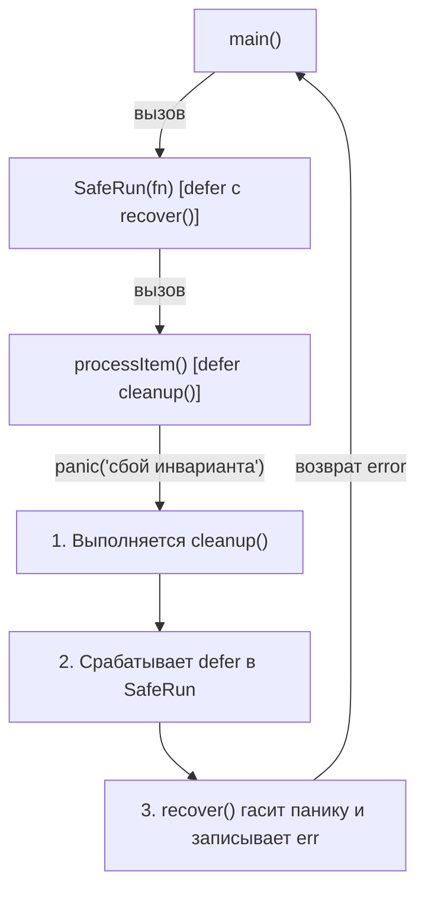

*Чем паника отличается от штатной ошибки `error`, как работает раскрутка стека и `defer`, почему `recover()` работает только внутри `defer` и как строить защитную границу пакета.*

> «В отличие от этого, программы на Go реагируют на ошибки обычными конструкциями управления потоком — такими как `if` и `return`. Бесспорно, такой стиль заставляет уделять обработке ошибок больше внимания — но ровно в этом и состоит его замысел.»
> — Алан Донован и Брайан Керниган, *The Go Programming Language*

Разработчики, приходящие в Go из Python, Java или JavaScript, часто воспринимают пару `panic` и `recover` как местный вариант `try / catch`. Соблазн понятен: бросить `panic("файл не найден")` глубоко внутри функции и поймать его где-то наверху, не протаскивая `if err != nil` через три уровня вызовов.

В Go такой подход ломает контракт языка. Штатная ошибка и паника описывают принципиально разные события — и путаница между ними превращает простую программу в источник скрытых падений.

## Штатная ошибка `error` против паники `panic`

Граница между ними проходит по вопросу **«может ли это случиться в исправной программе?»**:

- **Штатная ошибка (`error`)** — ожидаемый сбой внешнего мира: файл не найден, битый JSON, пустая ссылка, переполненный диск, недоступный сервер. Программа обязана возвращать `error`.
- **Паника (`panic`)** — **баг программиста** или нарушенный инвариант: выход за границы слайса, разыменование `nil`, запись в `nil`-мапу или невалидный жёстко зашитый шаблон в `regexp.MustCompile`.

Главное правило: **не паникуйте на плохих входных данных пользователя**. Повреждённый файл закладок — штатная ошибка, а не повод ронять процесс. Явный `panic` уместен лишь при старте в функциях `Must*` или в логически недостижимой ветке.

## Раскрутка стека и работа `recover()`

При панике выполнение текущей функции обрывается и начинается **раскрутка стека (*stack unwinding*)**:

1. В текущей функции срабатывают все её `defer` в обратном порядке (LIFO).
2. Управление поднимается к вызывающей функции, где тоже запускаются все `defer`.
3. Дойдя до `main`, программа завершается с трассировкой стека (*stack trace*) — картой вызовов до строки сбоя.

Поскольку `defer` работает и при панике, открытые файлы успевают закрыться.

Остановить раскрутку может встроенная функция `recover()`. Вызванная **напрямую внутри `defer`** во время паники, она возвращает переданное в `panic` значение, гасит панику и позволяет функции нормально завершиться. Вне паники `recover()` возвращает `nil`.



## Защитная граница задачи и перевод паники в `error`

Есть два инженерных сценария, где `recover()` оправдан:

1. **Защитная граница на входе задачи.** Если планировщик запускает независимые обработчики, баг в одном из них не должен обрушить весь процесс: обёртка перехватывает панику, превращает её в `error` и пишет в лог.
2. **Граница пакета.** Библиотека не должна выпускать внутренние паники наружу: как `encoding/json` и `regexp`, экспортируемая функция ставит `defer` с `recover()` и именованным результатом `(err error)`, возвращая обычный `error`.

## Рабочий пример: безопасный запуск задачи с переводом паники в `error`

Напишем защитную обёртку `SafeRun`, которая исполняет произвольную функцию, корректно возвращает её обычную ошибку, а в случае неожиданной паники перехватывает её и превращает в `error` с помощью именованного возвращаемого значения:

```go
package main

import (
	"errors"
	"fmt"
)

// SafeRun запускает fn и переводит неожиданную панику в обычную ошибку.
func SafeRun(fn func() error) (err error) {
	defer func() {
		if r := recover(); r != nil {
			err = fmt.Errorf("перехвачена паника: %v", r)
		}
	}()
	return fn()
}

func main() {
	tasks := []struct {
		name string
		fn   func() error
	}{
		{
			name: "нормальная задача",
			fn:   func() error { return nil },
		},
		{
			name: "штатная ошибка",
			fn:   func() error { return errors.New("файл не найден") },
		},
		{
			name: "баг с выходом за границы слайса",
			fn: func() error {
				items := []string{"go"}
				_ = items[5] // вызовет панику рантайма
				return nil
			},
		},
	}

	for _, task := range tasks {
		if err := SafeRun(task.fn); err != nil {
			fmt.Printf("[%s] ошибка: %v\n", task.name, err)
			continue
		}
		fmt.Printf("[%s] успешно\n", task.name)
	}
}
```

Вывод терминала:

```text
[нормальная задача] успешно
[штатная ошибка] ошибка: файл не найден
[баг с выходом за границы слайса] ошибка: перехвачена паника: runtime error: index out of range [5] with length 1
```

Обратите внимание на ключевую деталь сигнатуры: `(err error)`. Именно именованный результат позволяет анонимной функции внутри `defer` подменить возвращаемую ошибку в момент перехвата паники.

## Две частые ловушки `recover()`

**Ловушка 1. Вызов `recover()` не напрямую внутри `defer`.** Спецификация Go требует, чтобы `recover()` вызывался непосредственно в теле отложенной функции. Обе конструкции ниже **не сработают** и дадут программе упасть:

```go
defer recover() // НЕ работает: аргументы defer вычисляются до паники

defer func() {
	catchHelper() // НЕ работает: recover() внутри вложенной функции вернёт nil
}()
```

**Ловушка 2. Молчаливое проглатывание паники.** Конструкция `defer func() { _ = recover() }()` без логирования и без возврата ошибки скрывает реальные баги и оставляет программу работать с повреждённым состоянием. Если вы перехватили панику, обязательно верните её как `error` или запишите в структурированный лог.

> [!check] Проверь понимание
> Почему в функции `SafeRun` нельзя убрать имя `err` из возвращаемого типа `func SafeRun(fn func() error) (err error)`?
>
> Если результат неименованный, у `defer` не будет переменной, в которую можно записать ошибку после `recover()`. При перехвате паники функция вернёт нулевое значение `nil`, и вызывающий код решит, что задача завершилась успешно.

## Практика

**Упражнение 1 (Базовое). Проследи порядок вывода при панике.**  
Что именно и в какой последовательности напечатает следующая программа?

```go
func demo() {
	defer fmt.Println("defer 1")
	defer func() {
		if r := recover(); r != nil {
			fmt.Println("перехвачено:", r)
		}
	}()
	defer fmt.Println("defer 2")
	fmt.Println("перед паникой")
	panic("сбой")
	fmt.Println("после паники")
}
```

> [!solution] Показать решение
> Отложенные вызовы выполняются в порядке LIFO (последний зарегистрированный — первым), а код после `panic` недостижим:
> ```text
> перед паникой
> defer 2
> перехвачено: сбой
> defer 1
> ```
> Обратите внимание: `defer 1` всё равно выполнится после того, как средний `defer` погасит панику.

**Упражнение 2 (Практическое). Изолированный запуск пакета задач.**  
Напишите функцию `RunAll(tasks []func()) (failed int)`, которая по порядку вызывает каждую функцию из `tasks`, изолируя панику отдельной задачи во вспомогательной функции `runOne(fn func()) (err error)`. При панике `RunAll` увеличивает счётчик `failed`, печатает ошибку и продолжает выполнять оставшиеся задачи.

> [!solution] Показать решение
> ```go
> func runOne(fn func()) (err error) {
> 	defer func() {
> 		if r := recover(); r != nil {
> 			err = fmt.Errorf("паника в задаче: %v", r)
> 		}
> 	}()
> 	fn()
> 	return nil
> }
>
> func RunAll(tasks []func()) int {
> 	failed := 0
> 	for i, task := range tasks {
> 		if err := runOne(task); err != nil {
> 			fmt.Printf("задача #%d упала: %v\n", i+1, err)
> 			failed++
> 		}
> 	}
> 	return failed
> }
> ```
> Вынос `runOne` важен: если поставить `defer` прямо в цикл `for` внутри `RunAll`, он сработает только один раз при выходе из всей `RunAll`, и оставшиеся задачи не запустятся.

**Упражнение 3 (Со звёздочкой \*). Выборочный перехват на границе пакета.**  
Внутренний парсер пакета бросает специальную структуру `type parseBailout struct{ err error }` через `panic(parseBailout{err})`, чтобы быстро выйти из глубокой рекурсии. Напишите обёртку `ParseStrict(input string) (res string, err error)`, которая перехватывает **только** `parseBailout` и возвращает `b.err`, а любую другую неожиданную панику (например, `nil`-указатель) пробрасывает дальше вызовом `panic(r)`.

> [!solution] Показать решение
> ```go
> type parseBailout struct{ err error }
>
> func ParseStrict(input string) (res string, err error) {
> 	defer func() {
> 		r := recover()
> 		if r == nil {
> 			return
> 		}
> 		if b, ok := r.(parseBailout); ok {
> 			err = b.err
> 			return
> 		}
> 		panic(r) // чужие паники (баги рантайма) не маскируем
> 	}()
> 	if input == "" {
> 		panic(parseBailout{err: errors.New("пустой ввод")})
> 	}
> 	return input, nil
> }
> ```
> Выборочный перехват с повторным `panic(r)` не скрывает настоящие программные баги вроде разыменования `nil`, превращая в `error` только контролируемый тип пакета.

---

Мы прошли рабочий костяк стандартной библиотеки Go — от потоков ввода-вывода и JSON до структурированных логов, коллекций и границ паники. Прежде чем перейти к конкурентности, сделаем шаг назад и разберём, **почему** сам язык и его библиотека спроектированы именно так — переходим к подразделу философии Go и уроку [[1. Простота против удобства — почему в Go всего 25 ключевых слов]].
