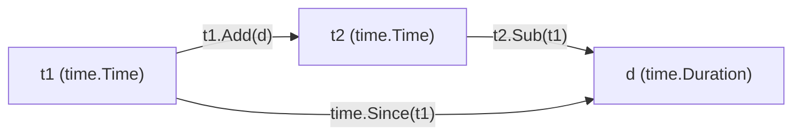

*Как в Go устроены моменты времени и длительности, почему формат даты задаётся 2006 годом, зачем нужны монотонные часы и как правильно останавливать таймеры.*

Представьте, что вы замеряете время проверки закладки в `BookmarkFlow`: запомнили текущее время, выполнили работу, вычли старт из финиша — и получили `-3.4s`. Сбой кажется невозможным, пока системные часы на сервере не переведутся на пять секунд назад по протоколу синхронизации времени.

Ещё одна классическая ловушка — перепутать момент времени и отрезок времени, сложив две «даты» или записав локальное время ноутбука в общий JSON-файл без часового пояса. Пакет `time` в Go решает обе задачи сразу: он жёстко разделяет точку на оси времени и длительность, а внутрь каждой метки незаметно встраивает вторые, «неоткатываемые» часы.

## Точка на оси и отрезок: `time.Time` и `time.Duration`

Пакет `time` различает два базовых типа:

- `time.Time` — конкретный **момент** на оси времени (`2026-04-12T09:30:00Z`).
- `time.Duration` — **отрезок** времени в наносекундах (`int64`, максимум около 290 лет в каждую сторону).

Это как координаты на линейке: `time.Time` — отметка, `time.Duration` — расстояние между отметками. Две отметки можно вычесть, но нельзя сложить; к отметке можно прибавить расстояние. Граница аналогии: `time.Time` дополнительно хранит часовой пояс (`*time.Location`).

Арифметика между двумя типами выглядит так:



Длительности задают умножением на константы: `500 * time.Millisecond`, `2 * time.Second`, `15 * time.Minute`. Моменты сравнивают методами `Before`, `After` и `Equal`, а округляют через `Truncate` и `Round` (как `time.Now().UTC().Truncate(time.Second)` в `BookmarkFlow`).

## Зачем в `time.Time` сразу двое часов

В значении `time.Time` от `time.Now()` Go хранит два показания одновременно:

1. **Настенные часы (*wall clock*)** — календарная дата, которая может скакнуть при синхронизации часов ОС. Нужна для печати и сохранения.
2. **Монотонные часы (*monotonic clock*)** — счётчик, идущий строго вперёд с момента запуска процесса.

Вызовы `time.Since(start)` и `end.Sub(start)` вычитают **монотонные** показания, поэтому перевод системных часов не ломает замер. При сохранении в текст или JSON монотонная часть отбрасывается.

## Эталонная дата вместо `%Y-%m-%d`

Почти каждый новичок в Go на секунду замирает, увидев шаблон форматирования даты:

```go
now.Format("2006-01-02 15:04:05")
```

Никаких `%Y`, `YYYY` или `dd.MM.yyyy`. В Go вы показываете пакетам `Format` и `Parse`, как должна выглядеть одна конкретная эталонная дата:

**`Mon Jan 2 15:04:05 MST 2006`** (в часовом поясе `-0700`).

Цифра здесь не случайна. Если записать эту дату в американском порядке, получится последовательность **1, 2, 3, 4, 5, 6, 7**:

| Компонент | Значение в эталоне | Номер в последовательности |
|---|---|---:|
| Месяц | `01` / `Jan` / `January` | **1** |
| День месяца | `02` / `2` | **2** |
| Час | `03` (12-часовой) / `15` (24-часовой) | **3** |
| Минута | `04` | **4** |
| Секунда | `05` | **5** |
| Год | `2006` / `06` | **6** |
| Смещение часового пояса | `-0700` / `Z07:00` | **7** |

Авторы Go отказались от кодов вроде `%m` и `%M` (где легко перепутать месяц с минутой), потому что наглядный пример читается глазами с первого взгляда. На практике писать шаблон вручную приходится редко: для обмена между программами и хранения в файлах берите готовые константы `time.RFC3339`, `time.DateOnly` (`"2006-01-02"`) и `time.DateTime` (`"2006-01-02 15:04:05"`).

Часовые пояса подчиняются простому инженерному правилу: **внутри программы и на диске храните время в UTC (`t.UTC()`), а в локальный пояс переводите только при показе пользователю** через `t.In(loc)`, где `loc, err := time.LoadLocation("Europe/Moscow")`.

## Таймеры и тикеры: `NewTimer` и `NewTicker`

Когда нужно подождать один раз, используют `time.NewTimer(d)`, а для повторяющегося интервала — `time.NewTicker(d)`. Оба типа отдают уведомление через поле-канал `C`: оператор `<-ticker.C` приостанавливает выполнение до следующего тика (каналы и `select` мы подробно разберём в подразделе 4.3, пока воспринимайте `<-ticker.C` просто как ожидание очередного сигнала).

До Go 1.23 забытый невызванный `ticker.Stop()` приводил к утечке памяти: сборщик мусора не мог освободить активный тикер. Начиная с **Go 1.23**, рантайм сам собирает недостижимые таймеры и тикеры, а `Stop` и `Reset` мгновенно сбрасывают старые сигналы. Тем не менее `defer ticker.Stop()` остаётся хорошей практикой: вы освобождаете ресурсы сразу при выходе из функции, не дожидаясь следующего цикла сборки мусора.

## Рабочий пример: учёт срока проверки и периодический опрос

Соберём небольшую программу, которая разбирает время последней проверки закладки, переводит его в UTC, замеряет длительность работы и запускает три такта тикера:

```go
package main

import (
	"fmt"
	"time"
)

func main() {
	const raw = "2026-04-12T12:30:00+03:00"
	checkedAt, err := time.Parse(time.RFC3339, raw)
	if err != nil {
		fmt.Println("ошибка разбора:", err)
		return
	}

	utcTime := checkedAt.UTC()
	nextCheck := utcTime.Add(24 * time.Hour)
	fmt.Println("UTC:", utcTime.Format(time.RFC3339))
	fmt.Println("Следующая проверка:", nextCheck.Format(time.DateOnly))

	start := time.Now()
	ticker := time.NewTicker(40 * time.Millisecond)
	defer ticker.Stop()

	for step := range 3 {
		<-ticker.C
		fmt.Printf("тик %d: прошло %v\n", step+1, time.Since(start).Truncate(time.Millisecond))
	}
}
```

Вывод терминала:

```text
UTC: 2026-04-12T09:30:00Z
Следующая проверка: 2026-04-13
тик 1: прошло 40ms
тик 2: прошло 80ms
тик 3: прошло 120ms
```

В коде видны три ключевые привычки: входную строку разбираем строгим `time.RFC3339`, сразу нормализуем в `UTC()`, а тикер закрываем через `defer ticker.Stop()`.

## Две частые ловушки пакета `time`

**Ловушка 1. Сравнение `time.Time` через `==`.** Оператор `==` сравнивает все внутренние поля структуры, включая указатель на часовой пояс и монотонную часть. Один и тот же момент в `+03:00` и в `UTC` для `==` окажется неравным:

```go
a, _ := time.Parse(time.RFC3339, "2026-04-12T12:30:00+03:00")
b := a.UTC()
fmt.Println(a == b)     // false: разные часовые пояса
fmt.Println(a.Equal(b)) // true: один и тот же момент времени
```

Для сравнения моментов времени всегда используйте `a.Equal(b)`.

**Ловушка 2. Опечатка в эталонной дате.** Если написать `now.Format("2026-01-02")` вместо `"2006-01-02"`, Go не выдаст ошибку: он воспримет `2026` как обычный текст, подставит только месяц и день, и напечатает `2026-04-12` даже в 2030 году. Точно так же `2006-02-01` молча поменяет местами день и месяц.

> [!check] Проверь понимание
> Почему `time.Now() == time.Now().Round(0)` почти всегда возвращает `false`, хотя время не округлилось ни на наносекунду?
>
> Вызов `Round(0)` отбрасывает показание монотонных часов у `time.Time`. Настенное время может совпасть, но из-за отсутствия монотонной части оператор `==` сочтёт структуры разными. Метод `Equal` вернёт `true`.

## Практика

**Упражнение 1 (Базовое). Почини шаблон форматирования.**  
Разработчик написал `t.Format("2025-12-31 23:59")` и удивился, что программа всегда печатает неверный год и странные минуты. Что именно пошло не так и как переписать шаблон, чтобы получить формат `ГГГГ-ММ-ДД ЧЧ:ММ`?

> [!solution] Показать решение
> В Go формат задаётся только компонентами эталонной даты `2006-01-02 15:04:05`. Числа `2025`, `12`, `31`, `23` и `59` пакет `time` воспринял как обычный текст или совпавшие по цифрам куски (например, `2` внутри `2025` и `12` подставились как день месяца). Правильный шаблон:
> ```go
> t.Format("2006-01-02 15:04")
> ```

**Упражнение 2 (Практическое). Остаток до истечения срока.**  
Напишите функцию `FormatRemaining(expiresAt, now time.Time) string`. Если `expiresAt` уже наступил или совпадает с `now`, верните `"истёк"`. Иначе вычислите оставшуюся длительность, округлите её вниз до минут через `Truncate(time.Minute)` и верните строку вида `"осталось 2h15m0s"`.

> [!solution] Показать решение
> Сравниваем моменты методом `Before`/`Equal`, затем берём разницу через `Sub`:
> ```go
> func FormatRemaining(expiresAt, now time.Time) string {
> 	if !expiresAt.After(now) {
> 		return "истёк"
> 	}
> 	rem := expiresAt.Sub(now).Truncate(time.Minute)
> 	return fmt.Sprintf("осталось %v", rem)
> }
> ```
> Условие `!expiresAt.After(now)` корректно покрывает и прошедшее время, и точное совпадение моментов, независимо от их часовых поясов.

**Упражнение 3 (Со звёздочкой \*). Проверка совпадения моментов и ограниченный таймер.**  
Напишите функцию `WaitTicks(count int, interval time.Duration) time.Duration`, которая при `count <= 0` сразу возвращает `0`, а иначе запускает `time.NewTicker(interval)`, ждёт ровно `count` тиков, обязательно останавливает тикер и возвращает реально прошедшее время через `time.Since`. Проверьте, что при `count == 3` и `interval == 20 * time.Millisecond` итоговое время не меньше `60ms`.

> [!solution] Показать решение
> ```go
> func WaitTicks(count int, interval time.Duration) time.Duration {
> 	if count <= 0 {
> 		return 0
> 	}
> 	start := time.Now()
> 	ticker := time.NewTicker(interval)
> 	defer ticker.Stop()
>
> 	for range count {
> 		<-ticker.C
> 	}
> 	return time.Since(start)
> }
> ```
> Вызов `time.Since(start)` использует монотонные часы, поэтому даже корректировка системного времени во время работы цикла не исказит результат.

---

Мы научились уверенно работать со временем, часовыми поясами и таймерами. Теперь разберёмся, как превращать структуры со временем и другими полями в JSON и читать их потоком без потери данных — в следующем уроке [[8. Работа с JSON — encoding_json, теги структур и потоковое чтение]].
