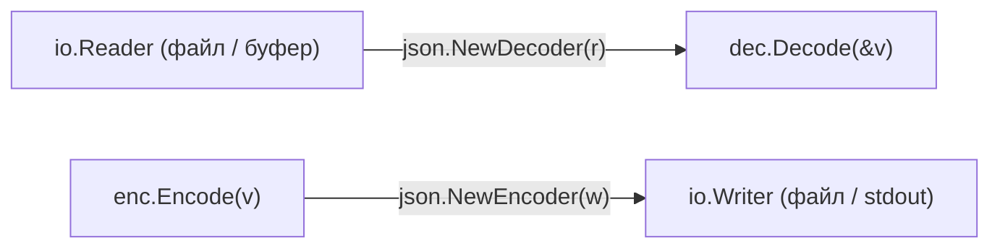

*Как устроен пакет `encoding/json`, зачем нужны теги `omitempty`, `omitzero` и `"-"`, почему неэкспортируемые поля исчезают без ошибок и как читать JSON потоком.*

В шаге 3 проекта `BookmarkFlow` мы уже сохраняли закладки на диск с помощью `json.MarshalIndent` и читали их через `json.Unmarshal`. Тогда всё работало гладко, пока структура была простой. Но стоит добавить скрытое поле, опечатку во входящем JSON или пустой `time.Time{}` — и `encoding/json` начинает вести себя неожиданно: молча теряет поля, пропускает мусорные ключи или превращает целые числа в `float64`.

Чтобы JSON перестал быть чёрным ящиком, разберём три вещи: правила отображения структур, потоковый режим поверх `io.Reader`/`io.Writer` и две главные ловушки декодирования.

## `Marshal` и `Unmarshal`: работа со срезом байтов

Базовая пара функций работает с данными целиком в памяти:

- `json.Marshal(v)` кодирует значение в компактный `[]byte`; `json.MarshalIndent(v, "", "  ")` добавляет переносы и отступы для читаемых файлов.
- `json.Unmarshal(data, &dst)` разбирает `[]byte` и записывает результат по **указателю** `&dst`. Передадите значение без `&` — получите ошибку во время выполнения, ведь Go передаёт аргументы по значению.

Главное правило видимости в `encoding/json` часто ловит врасплох: **пакет видит только экспортируемые поля структуры (с заглавной буквы)**. Неэкспортируемые поля со строчной буквы игнорируются молча — без ошибки компиляции и без ошибки во время выполнения.

```go
type brokenBookmark struct {
	id    int    `json:"id"` // неэкспортируемое поле: JSON его пропустит
	Title string `json:"title"`
}
```

При сериализации такой структуры в JSON окажется только `{"title":"..."}`, а при разборе поле `id` останется равным `0`.

## Теги полей: имена, `omitempty`, `omitzero` и `"-"`

Имена полей в Go принято писать в `CamelCase`, а в JSON — в `snake_case`. Управляют этим строковые теги структуры в обратных кавычках:

| Тег | Поведение при кодировании и декодировании |
|---|---|
| `json:"title"` | Сопоставляет поле Go с ключом `"title"` в JSON |
| `json:"-"` | Полностью скрывает поле от JSON (например, пароли или служебный кэш) |
| `json:"tags,omitempty"` | Пропускает пустое значение (`""`, `0`, `false`, `nil`, пустой слайс/мапа) при кодировании |
| `json:"checked_at,omitzero"` | **Go 1.24:** пропускает любое нулевое значение, включая структуры и `time.Time{}`, а также типы с методом `IsZero() bool` |

Опция `omitzero`, появившаяся в **Go 1.24**, закрыла давнюю боль языка. Раньше тег `json:"checked_at,omitempty"` у поля `time.Time` **не работал**: с точки зрения `omitempty` структура `time.Time{}` никогда не считалась «пустой», и в JSON уезжала некрасивая дата `"0001-01-01T00:00:00Z"`. С `omitzero` нулевой `time.Time{}` и нулевые вложенные структуры опускаются чисто, без костылей с указателями `*time.Time`.

## Потоковое чтение и запись: `NewDecoder` и `NewEncoder`

Функции `Marshal` и `Unmarshal` удобны, когда весь JSON уже лежит в `[]byte`. Но если данные идут из файла или любого `io.Reader` / `io.Writer`, держать в памяти лишнюю копию байтов незачем:



У `json.Decoder` есть важное преимущество перед `json.Unmarshal` — настройка строгости. По умолчанию `encoding/json` спокойно игнорирует неизвестные ключи. Если клиент прислал `{"titel": "Go"}` с опечаткой вместо `"title"`, декодер вернёт `err == nil` и пустое поле `Title`. Вызов `dec.DisallowUnknownFields()` превращает любую опечатку в явную ошибку.

## Рабочий пример: строгий разбор и `omitzero` в `BookmarkFlow`

Посмотрим, как работают `omitzero`, `"-"` и потоковый декодер со строгой проверкой полей:

```go
package main

import (
	"bytes"
	"encoding/json"
	"fmt"
	"strings"
	"time"
)

type Bookmark struct {
	ID        int       `json:"id"`
	Title     string    `json:"title"`
	Tags      []string  `json:"tags,omitempty"`
	CheckedAt time.Time `json:"checked_at,omitzero"`
	Secret    string    `json:"-"`
}

func main() {
	bm := Bookmark{
		ID:     1,
		Title:  "Go Documentation",
		Secret: "internal-token",
	}

	var buf bytes.Buffer
	enc := json.NewEncoder(&buf)
	enc.SetIndent("", "  ")
	if err := enc.Encode(bm); err != nil {
		fmt.Println("ошибка кодирования:", err)
		return
	}
	fmt.Print(buf.String())

	badInput := `{"id": 2, "titel": "Опечатка в ключе"}`
	dec := json.NewDecoder(strings.NewReader(badInput))
	dec.DisallowUnknownFields()

	var parsed Bookmark
	if err := dec.Decode(&parsed); err != nil {
		fmt.Println("строгий декодер поймал ошибку:", err)
	}
}
```

Вывод терминала:

```text
{
  "id": 1,
  "title": "Go Documentation"
}
строгий декодер поймал ошибку: json: unknown field "titel"
```

Обратите внимание на компактный JSON на выходе: поле `Secret` скрыто тегом `"-"`, пустые `Tags` пропущены через `omitempty`, а нулевой `CheckedAt` исчез благодаря `omitzero` из Go 1.24. На опечатке `"titel"` строгий декодер немедленно остановился и сообщил точное имя лишнего поля.

## Ловушка `float64` при декодировании в `any`

Иногда схема JSON заранее неизвестна, и данные декодируют в `map[string]any`. В самом формате JSON нет отдельных типов `int` и `float` — там есть один тип `number`. Поэтому `encoding/json` по умолчанию превращает **любое** число внутри `any` в `float64`:

```go
var m map[string]any
_ = json.Unmarshal([]byte(`{"id": 9007199254740993}`), &m)
fmt.Printf("%T %.0f\n", m["id"], m["id"])
// Вывод: float64 9007199254740992
```

Последняя цифра изменилась с `3` на `2`. Тип `float64` точно хранит целые числа лишь до $2^{53}$ (около $9 \times 10^{15}$), а попытка сделать утверждение типа `m["id"].(int)` приведёт к сбою. Если приходится разбирать произвольный JSON с большими целыми идентификаторами, включите у декодера `dec.UseNumber()`: тогда числа придут как `json.Number` (строка под капотом), из которой можно безопасно извлечь точный `int64` методом `Int64()`. А ещё лучше — везде, где структура известна заранее, декодируйте прямо в типизированный `struct`.

> [!check] Проверь понимание
> Вы передали в `json.Unmarshal(data, bm)` значение структуры `bm` вместо указателя `&bm`. Как отреагирует Go — ошибкой компиляции или ошибкой во время выполнения?
>
> Код скомпилируется, потому что второй параметр имеет тип `any` и принимает любое значение. Ошибка вернётся во время выполнения (`json: Unmarshal(non-pointer main.Bookmark)`), так как без указателя функция не может изменить исходную переменную.

## Практика

**Упражнение 1 (Базовое). Найди две скрытые проблемы.**  
После сериализации следующей структуры в JSON получилось `{"created_at":"0001-01-01T00:00:00Z"}` — пропало поле `title`, а нулевая дата осталась. Объясните обе причины и исправьте структуру для Go 1.24.

```go
type Note struct {
	title     string    `json:"title"`
	CreatedAt time.Time `json:"created_at,omitempty"`
}
```

> [!solution] Показать решение
> 1. Поле `title` начинается со строчной буквы, поэтому `encoding/json` его игнорирует — нужно экспортировать его как `Title`.
> 2. Тег `omitempty` не считает нулевой `time.Time{}` пустым — в Go 1.24 его нужно заменить на `omitzero`.
> ```go
> type Note struct {
> 	Title     string    `json:"title"`
> 	CreatedAt time.Time `json:"created_at,omitzero"`
> }
> ```

**Упражнение 2 (Практическое). Строгий декодер без хвоста.**  
Напишите функцию `DecodeStrictBookmark(r io.Reader) (Bookmark, error)`, которая создаёт `json.NewDecoder(r)`, включает `DisallowUnknownFields()`, декодирует одну структуру `Bookmark` и проверяет, что после JSON-объекта нет лишних данных (повторный вызов `dec.Decode(&struct{}{})` обязан вернуть `io.EOF`).

> [!solution] Показать решение
> ```go
> func DecodeStrictBookmark(r io.Reader) (Bookmark, error) {
> 	dec := json.NewDecoder(r)
> 	dec.DisallowUnknownFields()
>
> 	var bm Bookmark
> 	if err := dec.Decode(&bm); err != nil {
> 		return Bookmark{}, err
> 	}
> 	if err := dec.Decode(&struct{}{}); err != io.EOF {
> 		return Bookmark{}, fmt.Errorf("лишние данные после JSON-объекта")
> 	}
> 	return bm, nil
> }
> ```
> Без второй проверки вход вида `{"id":1,"title":"Go"} {"extra":2}` разобрался бы без ошибки, тихо отбросив второй объект.

**Упражнение 3 (Со звёздочкой \*). Точный `int64` из динамического JSON.**  
Напишите функцию `ExtractID(raw string) (int64, error)`, которая разбирает JSON-строку `{"id": 9007199254740993}` в `map[string]any` с помощью `json.NewDecoder` и `dec.UseNumber()`, извлекает поле `"id"` как `json.Number` и возвращает точное значение `int64` без потери точности через `float64`.

> [!solution] Показать решение
> ```go
> func ExtractID(raw string) (int64, error) {
> 	dec := json.NewDecoder(strings.NewReader(raw))
> 	dec.UseNumber()
>
> 	var payload map[string]any
> 	if err := dec.Decode(&payload); err != nil {
> 		return 0, err
> 	}
> 	num, ok := payload["id"].(json.Number)
> 	if !ok {
> 		return 0, fmt.Errorf("поле id отсутствует или не является числом")
> 	}
> 	return num.Int64()
> }
> ```
> Метод `UseNumber()` сохраняет исходную текстовую запись числа, поэтому `num.Int64()` разбирает все 64 бита точно, вернув `9007199254740993`.

---

JSON идеально подходит для обмена структурами между программами, но пользователям часто нужен экспорт в таблицы, а хранимые в закладках адреса требуют строгой проверки. В следующем уроке подключим пакеты для табличных файлов и разбора ссылок — [[9. Формат CSV и разбор ссылок — encoding_csv и net_url]].
