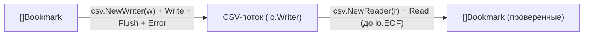

*Как безопасно экспортировать и импортировать табличные данные через `encoding/csv` и почему валидация ссылок в `net/url` надёжнее проверки префикса строки.*

> «Часть этой философии — использование текстовых файлов как общего знаменателя. Множество небольших консольных программ UNIX (утилит) читают текстовый файл, что-то с ним делают и записывают результат в другой текстовый файл.»
> — Чарльз Петцольд, *Code* (2-е изд.)

В `BookmarkFlow` рано или поздно появляется запрос от пользователя: «Дайте выгрузить все закладки в таблицу, чтобы открыть в Excel, и загрузить обратно». Первое искушение — склеить поля через `strings.Join(row, ",")`, а при чтении разрезать строки через `strings.Split(line, ",")`.

Этот план разваливается на первой же закладке с названием `"Go, язык систем"` или кавычками внутри текста: запятая в заголовке сдвинет все колонки вправо. Ровно так же ломается и наивная проверка ссылки из шага 3 (`strings.HasPrefix(rawURL, "https://")`): она спокойно пропустит мусор вроде `"https://"` без домена или `"https://bad host/path"`. В стандартной библиотеке для обеих задач есть готовые инструменты — `encoding/csv` и `net/url`.

## Таблицы без поломанных колонок: `encoding/csv`

Формат CSV кажется тривиальным, пока не встретятся запятые, двойные кавычки и переносы строк внутри одной ячейки. Стандарт RFC 4180 оборачивает такие поля в кавычки и удваивает кавычки внутри (`"Go, ""быстрый"" старт"`). Пакет `encoding/csv` берёт все правила экранирования на себя и работает поверх знакомых интерфейсов `io.Reader` и `io.Writer`.

Поток данных при экспорте и импорте выглядит так:



При записи через `w := csv.NewWriter(dst)` вы передаёте каждую строку как `[]string` в `w.Write(record)`. Внутри писатель буферизует вывод, поэтому в конце **обязательно** нужны два шага подряд:

1. `w.Flush()` — сбросить буфер в нижележащий `io.Writer`.
2. `if err := w.Error(); err != nil` — проверить, не случилась ли ошибка записи при сбросе буфера.

Обратите внимание: сам метод `Flush()` не возвращает `error`. Если забыть проверить `w.Error()`, переполнение диска или обрыв записи пройдут совершенно незаметно, а файл окажется обрезанным.

При чтении `r := csv.NewReader(src)` можно вызывать `r.Read()` в цикле до `errors.Is(err, io.EOF)` — так вы обрабатываете файл любого размера построчно, не загружая его целиком в память. Если файл гарантированно небольшой, подходит `r.ReadAll()`. Для европейских таблиц с точкой с запятой достаточно задать `r.Comma = ';'` или `w.Comma = ';'`.

## Почему `net/url` сильнее `strings.HasPrefix`

Проверка `!strings.HasPrefix(s, "https://")` смотрит только на первые восемь символов. Она не заметит, что после схемы вообще нет домена (`"https://"`), что в адресе затесался пробел или управляющий символ (`"https://go.dev\n"`), либо что схема записана в верхнем регистре (`"HTTPS://go.dev"`).

Функция `url.Parse(raw)` из пакета `net/url` разбирает строку на структурированные части типа `*url.URL`:

```text
https://go.dev:443/doc/effective_go?lang=ru#errors
\___/   \________/\_______________/ \_____/ \____/
Scheme     Host          Path       RawQuery Fragment
```

При этом важно помнить одно тонкое свойство `url.Parse`: он умеет разбирать **относительные** ссылки вроде `"/docs"` или `"go.dev/doc"`. В обоих случаях `err` будет `nil`, но поля `u.Scheme` и `u.Host` окажутся пустыми, а вся строка попадёт в `u.Path`. Поэтому для валидации абсолютной веб-ссылки недостаточно проверить `err == nil` — нужно убедиться, что `u.Scheme` равен `"http"` или `"https"`, а `u.Hostname()` не пуст.

Для параметров запроса (`?tag=go&sort=new`) не склеивайте строки вручную: пакет предоставляет тип `url.Values` (мапу `map[string][]string`). Вы заполняете его методами `Set`/`Add` и кодируете через `q.Encode()`, получая корректное экранирование пробелов, кириллицы и символов `&` и `=`.

## Рабочий пример: экспорт в CSV, импорт и сборка чистых URL

Соберём программу, которая выгружает закладки в CSV (включая запятую в названии), читает таблицу обратно, проверяет URL через `net/url` и добавляет параметры запроса через `url.Values`:

```go
package main

import (
	"bytes"
	"encoding/csv"
	"errors"
	"fmt"
	"io"
	"net/url"
	"strings"
)

type Bookmark struct {
	Title string
	URL   string
}

func validateURL(raw string) (string, error) {
	u, err := url.Parse(strings.TrimSpace(raw))
	if err != nil {
		return "", err
	}
	if u.Scheme != "http" && u.Scheme != "https" {
		return "", fmt.Errorf("неподдерживаемая схема %q", u.Scheme)
	}
	if u.Hostname() == "" {
		return "", errors.New("пустой хост")
	}
	return u.String(), nil
}

func main() {
	source := []Bookmark{
		{Title: `Go, "эффективный" стиль`, URL: "https://go.dev/doc/effective_go"},
		{Title: "Поиск пакетов", URL: "https://pkg.go.dev/search?q=json"},
	}

	var buf bytes.Buffer
	w := csv.NewWriter(&buf)
	_ = w.Write([]string{"title", "url"})
	for _, bm := range source {
		_ = w.Write([]string{bm.Title, bm.URL})
	}
	w.Flush()
	if err := w.Error(); err != nil {
		fmt.Println("ошибка записи CSV:", err)
		return
	}
	fmt.Println("CSV:")
	fmt.Print(buf.String())

	r := csv.NewReader(&buf)
	_, _ = r.Read() // пропускаем заголовок
	for {
		row, err := r.Read()
		if errors.Is(err, io.EOF) {
			break
		}
		if err != nil {
			fmt.Println("ошибка чтения CSV:", err)
			return
		}
		clean, err := validateURL(row[1])
		if err != nil {
			fmt.Println("битая ссылка:", err)
			continue
		}
		fmt.Printf("импорт: %s -> %s\n", row[0], clean)
	}

	// Безопасное формирование query-параметров через url.Values
	search := &url.URL{Scheme: "https", Host: "pkg.go.dev", Path: "/search"}
	q := search.Query()
	q.Set("q", "csv reader & writer")
	search.RawQuery = q.Encode()
	fmt.Println("собранный URL:", search.String())
}
```

Вывод терминала:

```text
CSV:
title,url
"Go, ""эффективный"" стиль",https://go.dev/doc/effective_go
Поиск пакетов,https://pkg.go.dev/search?q=json
импорт: Go, "эффективный" стиль -> https://go.dev/doc/effective_go
импорт: Поиск пакетов -> https://pkg.go.dev/search?q=json
собранный URL: https://pkg.go.dev/search?q=csv+reader+%26+writer
```

Заметьте, как аккуратно `csv.Writer` заэкранировал и запятую, и двойные кавычки, а `csv.Reader` вернул исходную строку в первозданном виде. Символ `&` внутри поискового запроса `url.Values.Encode()` превратил в `%26`, чтобы он не сломал разбор параметров.

## Две частые ловушки

**Ловушка 1. Забыть `w.Flush()` или `w.Error()`.** В коротких функциях запись в буфер проходит успешно, но без `Flush()` часть строк (или весь файл) так и остаётся в памяти и не попадает на диск. Всегда завершайте работу `csv.Writer` парой `w.Flush(); return w.Error()`.

**Ловушка 2. Принять `err == nil` от `url.Parse` за гарантию валидного веб-адреса.** Вызов `url.Parse("go.dev/doc")` не вернёт ошибку, но `u.Scheme` и `u.Host` будут пустыми. Проверяйте оба поля явно.

> [!check] Проверь понимание
> Что вернёт `url.Parse("https:///articles")` в полях `err`, `u.Scheme`, `u.Host` и `u.Path`?
>
> `err` будет `nil`, `u.Scheme` — `"https"`, `u.Host` — пустая строка `""`, а `u.Path` — `"/articles"`. Именно поэтому одной проверки `u.Scheme == "https"` недостаточно — нужно дополнительно проверять `u.Hostname() != ""`.

## Практика

**Упражнение 1 (Базовое). Разбор подвохов `url.Parse`.**  
Для трёх строк `"go.dev"`, `"https://"` и `"ftp://files.example.com/a.zip"` определите, какие значения получат `u.Scheme`, `u.Host` и `u.Path` после `url.Parse`, и на какой проверке каждая из них должна отсеяться в `BookmarkFlow`.

> [!solution] Показать решение
> - `"go.dev"` → `Scheme: ""`, `Host: ""`, `Path: "go.dev"` — отсеется на проверке схемы `http`/`https`.
> - `"https://"` → `Scheme: "https"`, `Host: ""`, `Path: ""` — отсеется на проверке `u.Hostname() == ""`.
> - `"ftp://files.example.com/a.zip"` → `Scheme: "ftp"`, `Host: "files.example.com"`, `Path: "/a.zip"` — отсеется, потому что схема не `http` и не `https`.

**Упражнение 2 (Практическое). Очистка URL от меток отслеживания.**  
Напишите функцию `StripUTM(raw string) (string, error)`, которая разбирает URL через `url.Parse`, удаляет все параметры запроса, начинающиеся с `"utm_"` (через `u.Query()` и `q.Del(key)`), обновляет `u.RawQuery = q.Encode()` и возвращает очищенную ссылку.

> [!solution] Показать решение
> ```go
> func StripUTM(raw string) (string, error) {
> 	u, err := url.Parse(raw)
> 	if err != nil {
> 		return "", err
> 	}
> 	q := u.Query()
> 	for key := range q {
> 		if strings.HasPrefix(key, "utm_") {
> 			q.Del(key)
> 		}
> 	}
> 	u.RawQuery = q.Encode()
> 	return u.String(), nil
> }
> ```
> В Go безопасно удалять ключи из мапы прямо во время обхода `for range`, а `q.Encode()` возвращает параметры в отсортированном по ключам порядке.

**Упражнение 3 (Со звёздочкой \*). Устойчивый экспорт CSV с проверкой ошибок.**  
Напишите функцию `ExportCSV(w io.Writer, items []Bookmark) error`, которая записывает заголовок `title,url` и все закладки через `csv.NewWriter`, проверяет ошибку каждого `Write`, затем вызывает `Flush()` и возвращает `cw.Error()`. Почему важно проверять ошибку и на `Write`, и на `Error()` после `Flush()`?

> [!solution] Показать решение
> ```go
> func ExportCSV(w io.Writer, items []Bookmark) error {
> 	cw := csv.NewWriter(w)
> 	if err := cw.Write([]string{"title", "url"}); err != nil {
> 		return err
> 	}
> 	for _, bm := range items {
> 		if err := cw.Write([]string{bm.Title, bm.URL}); err != nil {
> 			return err
> 		}
> 	}
> 	cw.Flush()
> 	return cw.Error()
> }
> ```
> При большом числе строк внутренний буфер `bufio.Writer` может сброситься посреди цикла — тогда сбой поймает `Write`. Последний кусок данных сбрасывается только на `Flush()`, и ошибку этой финальной записи можно узнать лишь через `cw.Error()`.

---

Закладки теперь умеют экспортироваться в CSV и валидировать ссылки, но все сообщения о ходе работы мы по-прежнему печатаем голым `fmt.Println`. В следующем уроке заменим отладочную печать на структурированные логи стандартной библиотеки — [[10. Структурированное логирование на log_slog]].
