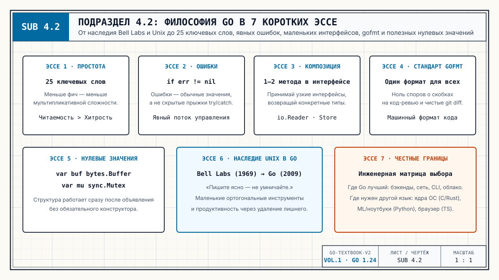

*Семь коротких эссе об инженерной философии Go: почему язык устроен аскетично, зачем ошибки стали обычными значениями, откуда выросла культура `gofmt` и где проходят честные границы инструмента.*

## Зачем говорить о философии именно сейчас

В Модуле 1 мы смотрели на Go со стороны — как на строчку в списке языков. К середине Модуля 4 вы уже писали циклы `for`, разбирали заголовок слайса, ловили типизированный `nil`, собирали `BookmarkFlow` с тестами и работали со стандартной библиотекой — `io.Reader`, `bufio.Scanner`, `strings.Builder`, `encoding/json` и `log/slog`.

К этому моменту у разработчиков накапливаются острые вопросы. Почему в Go нет тернарного оператора и привычного `try/catch`? Зачем подчинять всю команду одному формату `gofmt`? Почему `bytes.Buffer` работает без конструктора, а для `MemoryStore` мы написали `NewMemoryStore()`?

Без личной практики ответы звучат как лозунги. После Модулей 2–4 они складываются в цельную систему. Роберт Гризмер, Роб Пайк и Кен Томпсон проектировали Go не ради теоретической красоты, а для команд, которым годами читать и менять миллионы строк кода.

## Как читать подраздел

* **Спорьте с текстом.** Проверяйте каждый тезис на опыте `BookmarkFlow` и знакомых вам программ.
* **Ищите цену выбора.** У любого упрощения есть обратная сторона; в седьмом эссе мы сведём сильные и слабые стороны языка в честную матрицу.
* **Решайте мини-упражнения.** Они учат переносить принципы языка в сигнатуры собственных структур и функций.

## Карта подраздела

1. [[1. Простота против удобства — почему в Go всего 25 ключевых слов]] — мультипликативность сложности, концептуальная целостность и цена «удобных мелочей».
2. [[2. Ошибки как значения — почему Go обошёлся без исключений]] — скрытые прыжки `try/catch` против явного `if err != nil` и накопитель ошибок.
3. [[3. Композиция, маленькие интерфейсы и правило «требуй только нужное»]] — плоская композиция и однометодные контракты против глубоких иерархий.
4. [[4. Единый формат gofmt и экономия внимания команды]] — как один формат убирает споры, очищает диффы в Git и открывает автоматический рефакторинг.
5. [[5. Полезные нулевые значения и предсказуемость пакетов]] — структуры, готовые к работе из коробки, и честная граница, где нужен конструктор.
6. [[6. Пишите ясно, не умничайте — наследие Unix в Go]] — преемственность от Bell Labs к Go, правила Дуга Макилроя и продуктивность через удаление лишнего.
7. [[7. Компромиссы языков — где силён Go и когда нужен другой]] — трезвое сравнение Go с C/Rust, Python, Java/C# и TypeScript без «серебряной пули».
