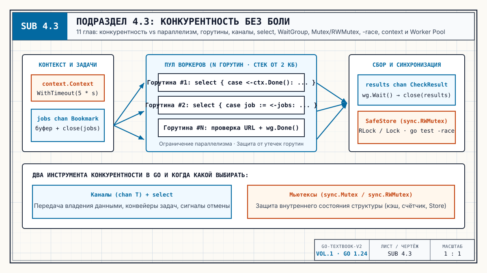

*Одиннадцать уроков о том, как в Go устроена конкурентность — от горутин и каналов до мьютексов, детектора гонок, `context.Context` и пула воркеров.*

> «Хотя поддержка конкурентности — одна из главных сильных сторон Go, рассуждать о конкурентных программах по природе труднее, чем о последовательных, и интуиция, выработанная на последовательном коде, порой подводит.»  
> — Алан Донован и Брайан Керниган, *The Go Programming Language*

## Зачем нужен этот подраздел

В `BookmarkFlow` накопилось двести сохранённых ссылок. Если проверять их по очереди по полсекунды на адрес, утилита зависнет почти на две минуты, пока процессор бездействует в ожидании сети.

В этом подразделе мы разведём конкурентность и параллелизм, освоим горутины, каналы, `select`, примитивы `sync`, детектор гонок `go test -race` и `context.Context`. В финале соберём шаг **`project/step05/`** — конкурентный чекер доступности ссылок.

## Что нужно знать до старта

* Модули 2–3: функции, замыкания, указатели, слайсы, мапы, структуры, интерфейсы и `go test`.
* Подраздел 4.1: `time`, обработка ошибок и логирование.
* Опыт многопоточности **не требуется**; детали планировщика и ОС оставим для Модуля 5 и Тома 5.

## Карта подраздела

1. [[1. Конкурентность против параллелизма — наглядная модель]] — структура кода против числа ядер CPU.
2. [[2. Горутины — запуск go f() и чем они отличаются от потоков ОС]] — оператор `go`, стек 2 КБ, выход `main` и Go 1.22+.
3. [[3. Небуферизированные каналы — синхронный обмен и закрытие close]] — синхронное рандеву, `close`, `for range` и направленные каналы.
4. [[4. Буферизированные каналы — очереди и предотвращение утечек горутин]] — очередь, семафор `chan struct{}` и защита от утечек.
5. [[5. Оператор select, неблокирующие операции и таймауты]] — мультиплексирование, ловушка `default`, таймеры и `ch = nil`.
6. [[6. Ожидание завершения группы задач — sync.WaitGroup]] — точное ожидание группы горутин.
7. [[7. Защита общих данных — sync.Mutex и sync.RWMutex]] — безопасный доступ к общему состоянию.
8. [[8. Гонки данных и детектор go test -race]] — поиск гонок данных в тестах.
9. [[9. Отмена и дедлайны — context.Context на практике]] — отмена операций и дедлайны.
10. [[10. Пул воркеров (Worker Pool) и ограничение числа задач]] — фиксированный пул обработчиков.
11. [[11. Практика BookmarkFlow (шаг 5) — конкурентный чекер доступности ссылок]] — сборка чекера (`project/step05/`).
