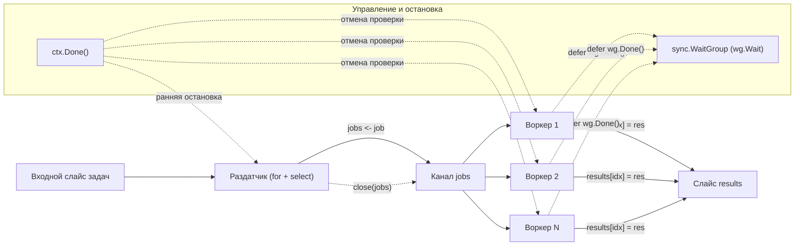
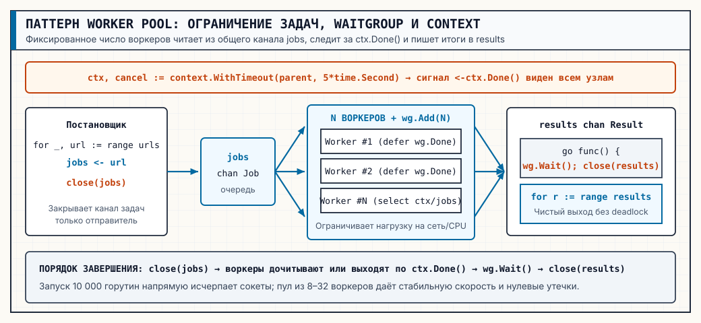

*Почему нельзя запускать по горутине на каждую из ста тысяч внешних задач и как собрать надёжный пул из фиксированного числа воркеров.*

Мы уже знаем, что стартовый стек горутины весит всего **2 КБ** против **1–8 МБ** у потока операционной системы. Из-за этой лёгкости велик соблазн проверять любой список закладок одним циклом: `for _, bm := range bookmarks { go check(bm) }`. На десяти ссылках это работает прекрасно.

Но стоит скормить такой функции файл со 100 000 URL — и программа окажется в беде. Рантайм Go действительно создаст 100 000 горутин, но внешние ресурсы не резиновые: под буферы и сетевые структуры мгновенно уйдут гигабайты памяти, операционная система упрётся в лимит одновременных сетевых соединений, а удалённые серверы заблокируют ваш IP за шквал запросов. Лёгкость горутин не отменяет пределов памяти, сети и чужих серверов.

## Архитектура пула воркеров (Worker Pool)

Решение проверено десятилетиями — **пул воркеров** (*Worker Pool*). Его главная идея проста: мы разделяем **количество задач** (их может быть хоть миллион) и **уровень конкурентности** (например, ровно `N = 8` рабочих горутин).

Вместо ста тысяч горутин мы запускаем всего `N` воркеров, которые читают задания из одного общего канала `jobs`:



На схеме видны два потока: **поток данных** (сплошные стрелки: входной слайс → канал `jobs` → свободный воркер → свой слот `results[idx]`) и **поток управления** (пунктир: `close(jobs)` завершает `for j := range jobs` во всех воркерах, `wg.Wait()` ждёт их выхода, а `ctx.Done()` прерывает раздачу и текущие проверки).



## Четыре инварианта надёжного пула

1. **Нормализуйте `workers`:** приводите число воркеров к диапазону `[1, len(tasks)]` через `max` и `min`. При `workers <= 0` никто не прочитает `jobs`, и программа зависнет; а 64 воркера на три задачи — пустая трата ресурсов.
2. **Закрывает `jobs` только раздатчик.** Воркеры читают `for j := range jobs` и выходят автоматически, как только канал закрыт.
3. **Отправка в `jobs` идёт через `select` с `<-ctx.Done()`.** При отмене контекста раздатчик не зависает на отправке занятым воркерам.
4. **`close(jobs)` всегда стоит *до* `wg.Wait()`.** Обратный порядок гарантирует deadlock.

## Рабочий код: пул с сохранением порядка и отменой

Соберём `RunPool`, ограничивающую число одновременных проверок до `workers`:

```go
package main

import (
	"context"
	"fmt"
	"sync"
	"time"
)

type JobResult struct {
	URL string
	OK  bool
	Err error
}

func RunPool(
	ctx context.Context,
	urls []string,
	workers int,
	probe func(context.Context, string) (bool, error),
) []JobResult {
	if len(urls) == 0 {
		return nil
	}
	workers = max(workers, 1)
	workers = min(workers, len(urls))

	type job struct {
		idx int
		url string
	}

	jobs := make(chan job)
	results := make([]JobResult, len(urls))

	var wg sync.WaitGroup
	for range workers {
		wg.Add(1)
		go func() {
			defer wg.Done()
			for j := range jobs {
				ok, err := probe(ctx, j.url)
				results[j.idx] = JobResult{URL: j.url, OK: ok, Err: err}
			}
		}()
	}

	for i, rawURL := range urls {
		select {
		case <-ctx.Done():
			results[i] = JobResult{URL: rawURL, OK: false, Err: ctx.Err()}
		case jobs <- job{idx: i, url: rawURL}:
		}
	}
	close(jobs)
	wg.Wait()

	return results
}

func main() {
	urls := []string{"https://go.dev", "https://pkg.go.dev", "https://go.dev/doc", "https://go.dev/blog", "https://go.dev/tour"}
	probe := func(ctx context.Context, _ string) (bool, error) {
		timer := time.NewTimer(20 * time.Millisecond)
		defer timer.Stop()
		select {
		case <-ctx.Done():
			return false, ctx.Err()
		case <-timer.C:
			return true, nil
		}
	}

	start := time.Now()
	res := RunPool(context.Background(), urls, 2, probe)
	fmt.Printf("checked %d urls in ~%dms\n", len(res), time.Since(start).Milliseconds())
}
```

Пять задач по 20 мс в пуле из 2 воркеров занимают ~60 мс (волны 2 + 2 + 1) вместо 100 мс последовательно, и активно одновременно не более двух проверок.

Небуферизированный канал `jobs` создаёт естественное **обратное давление** (*backpressure*): раздатчик передаёт задачу ровно тогда, когда один из воркеров освободился, и при отмене `ctx` в канале не застревают буферизированные задания. При срабатывании `<-ctx.Done()` индекс `i` не отправлялся в `jobs`, поэтому ни один воркер к `results[i]` не обращается — мьютекс не нужен, и `-race` чист.

## Частые ошибки

- **Поменять местами `close(jobs)` и `wg.Wait()`** → вечный deadlock.
- **Забыть `max(workers, 1)`** → ноль воркеров и зависание на `jobs <- ...`.
- **Использовать общий `append` вместо `results[j.idx]`** → гонка данных на заголовке слайса.

> [!check] Проверь понимание
> Что произойдёт в `RunPool`, если контекст `ctx` был отменён *до* начала цикла раздачи, а воркеры уже стоят на чтении из `jobs`?
>
> В операторе `select` окажутся готовы обе ветки: `<-ctx.Done()` и `jobs <- ...`. Go выбирает среди готовых веток псевдослучайно. Если сработает `<-ctx.Done()`, раздатчик сам запишет `Err: ctx.Err()`; если задача уйдёт воркеру, `probe` получит уже отменённый `ctx` и тоже вернёт `ctx.Err()`. В обоих случаях итог для каждой ссылки одинаков и детерминирован.

## Практика

**Упражнение 1 (Базовое). Найдите причину deadlock.**  
В этом фрагменте пул из трёх воркеров зависает сразу после раздачи всех задач. Почему?

```go
jobs := make(chan int)
var wg sync.WaitGroup
for range 3 {
	wg.Add(1)
	go func() {
		defer wg.Done()
		for n := range jobs {
			_ = n * n
		}
	}()
}
for i := range 10 {
	jobs <- i
}
wg.Wait()
close(jobs)
```

> [!solution] Показать решение
> Строки `wg.Wait()` и `close(jobs)` стоят в обратном порядке. Воркеры не выйдут из цикла `for n := range jobs`, пока канал `jobs` не закрыт, а `wg.Wait()` не вернётся, пока воркеры не завершатся. Поменяйте две последние строки местами: сначала `close(jobs)`, затем `wg.Wait()`.

**Упражнение 2 (Практическое). Пул для подсчёта длин строк.**  
Напишите функцию `Lengths(ctx context.Context, items []string, workers int) ([]int, error)`, которая с помощью пула из `workers` воркеров считает количество рун (`utf8.RuneCountInString`) в каждой строке в исходном порядке. Если `ctx` отменился, верните `nil, ctx.Err()`.

> [!solution] Показать решение
> Нормализуем `workers`, раздаём индексы и проверяем `ctx.Err()` после `wg.Wait()`:
> ```go
> func Lengths(ctx context.Context, items []string, workers int) ([]int, error) {
> 	if len(items) == 0 {
> 		return nil, ctx.Err()
> 	}
> 	workers = max(workers, 1)
> 	workers = min(workers, len(items))
>
> 	type job struct {
> 		idx int
> 		val string
> 	}
> 	jobs := make(chan job)
> 	out := make([]int, len(items))
>
> 	var wg sync.WaitGroup
> 	for range workers {
> 		wg.Add(1)
> 		go func() {
> 			defer wg.Done()
> 			for j := range jobs {
> 				out[j.idx] = utf8.RuneCountInString(j.val)
> 			}
> 		}()
> 	}
>
> 	for i, s := range items {
> 		select {
> 		case <-ctx.Done():
> 			close(jobs)
> 			wg.Wait()
> 			return nil, ctx.Err()
> 		case jobs <- job{idx: i, val: s}:
> 		}
> 	}
> 	close(jobs)
> 	wg.Wait()
> 	if ctx.Err() != nil {
> 		return nil, ctx.Err()
> 	}
> 	return out, nil
> }
> ```
> При ранней отмене `close(jobs)` и `wg.Wait()` всё равно выполняются перед `return`, поэтому ни один воркер не утекает.

**Упражнение 3 (Со звёздочкой \*). Как доказать в тесте, что лимит воркеров не превышен.**  
Вы хотите написать unit-тест, который проверяет: при `workers = 3` и 10 задачах функция `probe` никогда не выполняется одновременно больше чем в 3 горутинах. Почему для подсчёта активных вызовов внутри `probe` нельзя использовать обычные переменные `active++` и `if active > peak { peak = active }`? Как сделать этот замер безопасно с `sync/atomic`?

> [!solution] Показать решение
> Обычные `int`-переменные в нескольких горутинах вызовут гонку данных и уронят `go test -race`. Безопасный способ — счётчики `atomic.Int32` и цикл `CompareAndSwap` для обновления максимума:
> ```go
> var active atomic.Int32
> var peak atomic.Int32
>
> probe := func(ctx context.Context, _ string) (bool, error) {
> 	cur := active.Add(1)
> 	for {
> 		prev := peak.Load()
> 		if cur <= prev || peak.CompareAndSwap(prev, cur) {
> 			break
> 		}
> 	}
> 	defer active.Add(-1)
> 	time.Sleep(5 * time.Millisecond)
> 	return true, nil
> }
> ```
> После завершения пула тест проверяет `if peak.Load() > 3`. Именно этот приём мы сейчас увидим в тестах пятого шага `BookmarkFlow`.

---

Все детали подраздела собраны в единую систему: горутины, каналы, `select`, `sync.WaitGroup`, `sync.RWMutex`, `-race`, `context.Context` и пул воркеров. Пора применить их в нашем сквозном проекте и построить конкурентный чекер доступности ссылок в главе [[11. Практика BookmarkFlow (шаг 5) — конкурентный чекер доступности ссылок]].
