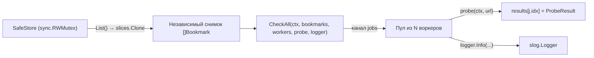

*Собираем потокобезопасное хранилище `SafeStore` и конкурентный чекер ссылок `CheckAll` на пуле воркеров, проверяем их тестами под `go test -race` (`project/step05/`).*

Коллекция закладок со временем устаревает: сайты переезжают, домены перестают отвечать, страницы удаляются. Если проверять 200 ссылок строго по очереди по 200 мс на каждую, пользователь прождёт 40 секунд. Если запустить 200 проверок одновременно — легко перегрузить сеть и получить блокировку от удалённых серверов.

На пятом шаге `BookmarkFlow` (`project/step05/`) мы соединяем все инструменты Модуля 4 в два компактных узла: потокобезопасное хранилище `SafeStore` на `sync.RWMutex` и конкурентный чекер `CheckAll` на пуле воркеров с `context.Context`, `sync.WaitGroup` и структурированным логированием `log/slog`.

## Архитектура шага 5

Данные проходят по чистому конвейеру без общих изменяемых буферов:



## Полный код `project/step05/checker.go`

Откроем реальный файл `project/step05/checker.go` целиком и разберём заложенные в него инженерные решения:

```go
package step05

import (
	"context"
	"log/slog"
	"slices"
	"sync"
	"time"
)

// Bookmark представляет закладку для проверки доступности.
type Bookmark struct {
	ID    int
	Title string
	URL   string
}

// ProbeResult хранит итог проверки одной ссылки.
type ProbeResult struct {
	BookmarkID int
	URL        string
	OK         bool
	Latency    time.Duration
	Err        error
}

// Prober проверяет доступность URL с учётом отмены контекста.
type Prober func(ctx context.Context, rawURL string) (bool, error)

// SafeStore обеспечивает потокобезопасный доступ к закладкам через sync.RWMutex.
type SafeStore struct {
	mu     sync.RWMutex
	nextID int
	items  []Bookmark
}

// NewSafeStore создаёт пустое потокобезопасное хранилище.
func NewSafeStore() *SafeStore {
	return &SafeStore{nextID: 1}
}

// Add безопасно добавляет закладку из любой горутины.
func (s *SafeStore) Add(title, rawURL string) Bookmark {
	s.mu.Lock()
	defer s.mu.Unlock()
	bm := Bookmark{ID: s.nextID, Title: title, URL: rawURL}
	s.nextID++
	s.items = append(s.items, bm)
	return bm
}

// List возвращает независимый снимок всех закладок.
func (s *SafeStore) List() []Bookmark {
	s.mu.RLock()
	defer s.mu.RUnlock()
	return slices.Clone(s.items)
}

// CheckAll конкурентно проверяет список закладок пулом из workers воркеров.
// Порядок результатов совпадает с порядком входного слайса bookmarks.
func CheckAll(
	ctx context.Context,
	bookmarks []Bookmark,
	workers int,
	probe Prober,
	logger *slog.Logger,
) []ProbeResult {
	if len(bookmarks) == 0 {
		return nil
	}
	workers = max(workers, 1)
	workers = min(workers, len(bookmarks))
	if logger == nil {
		logger = slog.New(slog.DiscardHandler)
	}

	type job struct {
		idx int
		bm  Bookmark
	}

	jobs := make(chan job)
	results := make([]ProbeResult, len(bookmarks))

	var wg sync.WaitGroup
	for range workers {
		wg.Add(1)
		go func() {
			defer wg.Done()
			for j := range jobs {
				start := time.Now()
				ok, err := probe(ctx, j.bm.URL)
				res := ProbeResult{
					BookmarkID: j.bm.ID,
					URL:        j.bm.URL,
					OK:         ok,
					Latency:    time.Since(start),
					Err:        err,
				}
				results[j.idx] = res
				logger.Info("проверка закладки завершена",
					slog.Int("id", j.bm.ID),
					slog.String("url", j.bm.URL),
					slog.Bool("ok", ok),
				)
			}
		}()
	}

	for i, bm := range bookmarks {
		select {
		case <-ctx.Done():
			results[i] = ProbeResult{
				BookmarkID: bm.ID,
				URL:        bm.URL,
				OK:         false,
				Err:        ctx.Err(),
			}
		case jobs <- job{idx: i, bm: bm}:
		}
	}
	close(jobs)
	wg.Wait()

	return results
}
```

Разберём пять ключевых решений:

- **`SafeStore` (`sync.RWMutex` + `slices.Clone`).** `Add` берёт `Lock`, `List` — разделяемый `RLock` и возвращает `slices.Clone(s.items)`. Независимый снимок гарантирует, что обход в `CheckAll` не пересечётся с параллельными записями.
- **Функциональный тип `Prober`.** `CheckAll` требует только `func(ctx context.Context, rawURL string) (bool, error)`: реальную сеть подключим позже, а в тестах передаём детерминированные быстрые функции.
- **`max`/`min` и `slog.DiscardHandler` (Go 1.24).** Границы `workers` защищают от нуля воркеров и лишних горутин. Новинка Go 1.24 `slog.DiscardHandler` позволяет передавать `logger = nil` без проверок `if logger != nil` внутри воркеров.
- **Порядок через `results[j.idx] = res` без мьютекса.** Каждый индекс выделенного заранее слайса `results` заполняется ровно один раз — либо воркером, либо раздатчиком в ветке `<-ctx.Done()`. Память не пересекается.
- **Отмена по `ctx.Done()`.** Если контекст отменён, `select` либо запишет `ctx.Err()` сразу, либо передаст отменённый `ctx` в `probe`, который также вернёт `ctx.Err()`. В конце `close(jobs)` и `wg.Wait()` гарантируют чистый выход всех воркеров.

## Тесты с проверкой лимита, отмены и гонок (`checker_test.go`)

Посмотрим на `project/step05/checker_test.go` — три теста, каждый из которых проверяет отдельный конкурентный инвариант:

```go
package step05

import (
	"context"
	"errors"
	"sync"
	"sync/atomic"
	"testing"
	"time"
)

func TestCheckAllWorkerPoolLimit(t *testing.T) {
	store := NewSafeStore()
	for range 10 {
		store.Add("Link", "https://example.com")
	}

	var active atomic.Int32
	var peak atomic.Int32

	probe := func(ctx context.Context, rawURL string) (bool, error) {
		cur := active.Add(1)
		for {
			prev := peak.Load()
			if cur <= prev || peak.CompareAndSwap(prev, cur) {
				break
			}
		}
		defer active.Add(-1)

		select {
		case <-ctx.Done():
			return false, ctx.Err()
		case <-time.After(5 * time.Millisecond):
			return true, nil
		}
	}

	const maxWorkers = 3
	results := CheckAll(context.Background(), store.List(), maxWorkers, probe, nil)
	if len(results) != 10 {
		t.Fatalf("got %d results, want 10", len(results))
	}
	for i, r := range results {
		if !r.OK || r.Err != nil || r.BookmarkID != i+1 {
			t.Fatalf("unexpected result[%d]: %+v", i, r)
		}
	}
	if peak.Load() > maxWorkers {
		t.Fatalf("worker pool limit exceeded: peak=%d, limit=%d", peak.Load(), maxWorkers)
	}
}

func TestCheckAllRespectsContextCancel(t *testing.T) {
	ctx, cancel := context.WithCancel(context.Background())
	cancel()

	bookmarks := []Bookmark{
		{ID: 1, Title: "A", URL: "https://a.example"},
		{ID: 2, Title: "B", URL: "https://b.example"},
	}
	probe := func(ctx context.Context, _ string) (bool, error) {
		return false, ctx.Err()
	}

	results := CheckAll(ctx, bookmarks, 2, probe, nil)
	for _, r := range results {
		if r.OK || !errors.Is(r.Err, context.Canceled) {
			t.Fatalf("expected context.Canceled, got %+v", r)
		}
	}
}

func TestSafeStoreConcurrentAccess(t *testing.T) {
	store := NewSafeStore()
	var wg sync.WaitGroup
	for range 8 {
		wg.Add(1)
		go func() {
			defer wg.Done()
			for range 25 {
				store.Add("Concurrent", "https://go.dev")
				_ = store.List()
			}
		}()
	}
	wg.Wait()

	if got := len(store.List()); got != 200 {
		t.Fatalf("got %d bookmarks, want 200", got)
	}
}
```

Что именно доказывает каждый тест:

1. **`TestCheckAllWorkerPoolLimit`** замеряет пиковое число одновременно выполняемых `probe` с помощью `atomic.Int32` и цикла `CompareAndSwap` — это позволяет обновлять максимум без мьютекса и без гонок. Тест проверяет сразу три инварианта: вернулось ровно 10 результатов, сохранился порядок (`BookmarkID == i+1`), а пик конкурентности не превысил `maxWorkers = 3`.
2. **`TestCheckAllRespectsContextCancel`** передаёт уже отменённый контекст и убеждается через `errors.Is(r.Err, context.Canceled)`, что каждая закладка получила отказ по отмене.
3. **`TestSafeStoreConcurrentAccess`** запускает 8 горутин по 25 циклов одновременной записи и чтения (200 добавлений и 200 снимков). Под флагом `-race` это сразу выявило бы и забытый мьютекс, и потерянный инкремент, и утечку внутреннего массива без `slices.Clone`.

Запустим проверку с детектором гонок из каталога `project/`:

```bash
go test -race -v ./step05
```

Реальный вывод терминала:

```text
=== RUN   TestCheckAllWorkerPoolLimit
--- PASS: TestCheckAllWorkerPoolLimit (0.02s)
=== RUN   TestCheckAllRespectsContextCancel
--- PASS: TestCheckAllRespectsContextCancel (0.00s)
=== RUN   TestSafeStoreConcurrentAccess
--- PASS: TestSafeStoreConcurrentAccess (0.00s)
PASS
ok  	github.com/UnrealTemplier/go-textbook-v2-vol1/project/step05	1.031s
```

Все три теста проходят чисто и без единого предупреждения детектора гонок.

> [!check] Проверь понимание
> Почему в `SafeStore.Add` мы защищаем слайс `s.items` мьютексом `sync.RWMutex`, а в `CheckAll` воркеры пишут в слайс `results[j.idx] = res` вообще без мьютекса?
>
> В `SafeStore.Add` несколько горутин одновременно меняют один и тот же счётчик `s.nextID` и заголовок слайса `s.items` через `append`. В `CheckAll` слайс `results` выделен заранее с фиксированной длиной, а каждый индекс `j.idx` принадлежит ровно одной задаче — две горутины никогда не обращаются к одной и той же ячейке памяти.

## Практика

**Упражнение 1 (Базовое). Защита границ `workers`.**  
Что произойдёт в `CheckAll`, если убрать строки `workers = max(workers, 1)` и `workers = min(workers, len(bookmarks))`, и кто-то вызовет `CheckAll` с `workers = 0` или с `workers = 100` для списка из двух закладок?

> [!solution] Показать решение
> При `workers = 0` цикл запуска воркеров не выполнится ни разу, никто не будет читать канал `jobs`, и раздача на `jobs <- job{...}` заблокируется навсегда (deadlock). При `workers = 100` на двух закладках программа запустит 98 лишних горутин, которые тут же закроются без единой задачи.

**Упражнение 2 (Практическое). Метод `Count` для `SafeStore`.**  
Добавьте к `SafeStore` потокобезопасный метод `Count() int` с использованием `RLock`/`RUnlock` и проверьте его в `TestSafeStoreConcurrentAccess` под `go test -race`.

> [!solution] Показать решение
> ```go
> // Count возвращает текущее число закладок в хранилище.
> func (s *SafeStore) Count() int {
> 	s.mu.RLock()
> 	defer s.mu.RUnlock()
> 	return len(s.items)
> }
> ```
> В отличие от `List()`, `Count()` не выделяет новый слайс через `slices.Clone` и работает за постоянное время, оставаясь полностью безопасным при одновременных вызовах `Add`.

**Упражнение 3 (Со звёздочкой \*). Частичное завершение по таймауту.**  
Напишите тест `TestCheckAllTimeoutPartial`: создайте 6 закладок, `workers = 2`, функцию `probe` с задержкой `40 * time.Millisecond` (уважающую `ctx.Done()`) и контекст с таймаутом `60 * time.Millisecond`. Убедитесь под `go test -race`, что хотя бы 2 закладки успели пройти с `OK == true`, а хотя бы 1 завершилась с `errors.Is(r.Err, context.DeadlineExceeded)`.

> [!solution] Показать решение
> ```go
> func TestCheckAllTimeoutPartial(t *testing.T) {
> 	store := NewSafeStore()
> 	for range 6 {
> 		store.Add("Link", "https://example.com")
> 	}
> 	probe := func(ctx context.Context, _ string) (bool, error) {
> 		timer := time.NewTimer(40 * time.Millisecond)
> 		defer timer.Stop()
> 		select {
> 		case <-ctx.Done():
> 			return false, ctx.Err()
> 		case <-timer.C:
> 			return true, nil
> 		}
> 	}
>
> 	ctx, cancel := context.WithTimeout(context.Background(), 60*time.Millisecond)
> 	defer cancel()
>
> 	results := CheckAll(ctx, store.List(), 2, probe, nil)
> 	var okCount, timeoutCount int
> 	for _, r := range results {
> 		if r.OK {
> 			okCount++
> 		} else if errors.Is(r.Err, context.DeadlineExceeded) {
> 			timeoutCount++
> 		}
> 	}
> 	if okCount < 2 || timeoutCount == 0 {
> 		t.Fatalf("got ok=%d, timeout=%d; want ok>=2 and timeout>=1", okCount, timeoutCount)
> 	}
> }
> ```
> Первая волна из двух воркеров успевает завершиться за ~40 мс, а оставшиеся задачи прерываются на отметке 60 мс с `context.DeadlineExceeded`.

---

Модуль 4 завершён: `BookmarkFlow` теперь умеет безопасно хранить данные при конкурентном доступе и проверять ссылки ограниченным пулом воркеров с отменой по контексту и чистым прохождением `go test -race`. Пока `Prober` оставался заглушкой, но скоро он выйдет в настоящую сеть. Впереди Модуль 5 «Компьютер, ОС и Сети под твоим кодом» — мы спустимся на уровень ниже кода Go и разберём, как устроены память и процессор, процессы и файлы Linux, а также протоколы TCP и HTTP, поверх которых работают современные сервисы.
