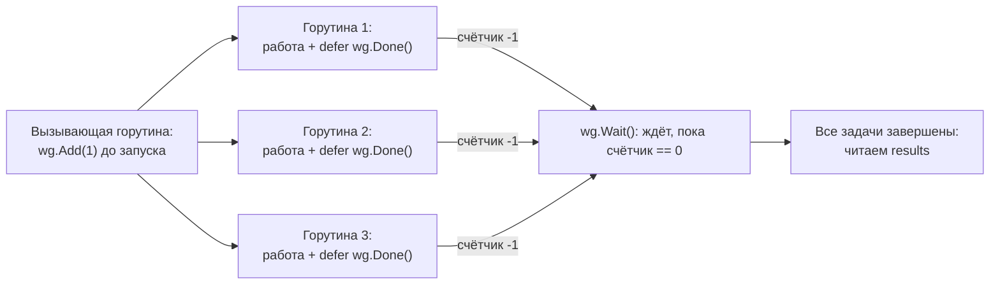

*Как дождаться завершения произвольного числа горутин без ручного подсчёта сигналов в канале и без двух классических ловушек `sync.WaitGroup`.*

В предыдущих уроках мы запускали задачи в горутинах и передавали значения через каналы. Но представьте: есть список из пяти URL, нужно проверить их конкурентно, сохранить итоги в исходном порядке и вывести отчёт.

Сигнальный канал `done := make(chan struct{})` с циклом `for range len(urls) { <-done }` работает, пока число задач фиксировано. Но как только задачи порождают подзадачи или пишут ответы напрямую в слайс без канала, ручной подсчёт сигналов запутывается. Для ожидания группы горутин в пакете `sync` есть специальный тип — `sync.WaitGroup`.

## Как устроен счётчик ожидания

Представьте турникет: отправляя работника на задачу, мы прибавляем `1` к счётчику; завершая работу, он вычитает `1`; координатор ждёт у выхода, пока на табло не загорится `0`. Граница аналогии проста: `WaitGroup` ничего не знает о самих горутинах и не отслеживает, *кто именно* уменьшил счётчик. Это потокобезопасный счётчик с ожиданием нуля:



## Три метода и три железных правила `sync.WaitGroup`

Тип `sync.WaitGroup` из пакета `sync` обладает полезным нулевым значением: объявления `var wg sync.WaitGroup` достаточно, конструктор не нужен. У него всего три метода:

- `wg.Add(delta int)` — прибавляет `delta` к внутреннему счётчику.
- `wg.Done()` — уменьшает счётчик на `1` (эквивалент `wg.Add(-1)`).
- `wg.Wait()` — блокирует текущую горутину, пока счётчик не станет равен `0`. Если счётчик уже `0`, вызов возвращается сразу.

*(Примечание: как именно `WaitGroup` хранит счётчик и очередь ожидающих горутин без лишних накладных расходов, подробно разобрано в Томе 5.)*

Надёжная работа с `WaitGroup` держится на трёх правилах, которые не стоит нарушать никогда:

1. **Вызывайте `wg.Add(1)` строго до `go func()`.** Счётчик должен вырасти раньше, чем вызывающая горутина доберётся до `wg.Wait()`.
2. **Пишите `defer wg.Done()` первой строкой внутри горутины.** Так счётчик уменьшится при любом выходе — штатном, досрочном через `return` или даже при панике.
3. **Вызывайте `wg.Wait()` в координирующей горутине** после того, как все нужные вызовы `Add` уже выполнены.

## Рабочий код: сохраняем порядок результатов без канала

Проверим список URL конкурентно и вернём результаты строго в исходном порядке. Вместо того чтобы пересылать ответы по каналу и потом сортировать их обратно, мы заранее выделим слайс `results` нужной длины и дадим каждой горутине её собственный индекс:

```go
package main

import (
	"fmt"
	"strings"
	"sync"
	"time"
)

type CheckResult struct {
	URL string
	OK  bool
}

func probeURL(rawURL string) bool {
	time.Sleep(15 * time.Millisecond) // имитация сетевой задержки
	return strings.HasPrefix(rawURL, "https://")
}

func checkAll(urls []string) []CheckResult {
	results := make([]CheckResult, len(urls))

	var wg sync.WaitGroup
	for idx, rawURL := range urls {
		wg.Add(1)
		go func(i int, target string) {
			defer wg.Done()
			results[i] = CheckResult{
				URL: target,
				OK:  probeURL(target),
			}
		}(idx, rawURL)
	}
	wg.Wait()

	return results
}

func main() {
	urls := []string{
		"https://go.dev",
		"http://insecure.example",
		"https://pkg.go.dev",
	}
	for _, r := range checkAll(urls) {
		fmt.Printf("%-26s ok=%v\n", r.URL, r.OK)
	}
}
```

Запуск выдаёт исходный порядок строк, хотя три проверки шли одновременно и заняли ~15 мс вместо 45 мс:

```text
https://go.dev             ok=true
http://insecure.example    ok=false
https://pkg.go.dev         ok=true
```

Слайс `results` выделен **до** запуска горутин с готовой длиной `len(urls)`. Ни одна горутина не вызывает `append`, а у каждой свой уникальный индекс `i`. Горутины пишут в непересекающиеся ячейки памяти, и после `wg.Wait()` все результаты безопасно доступны. *(С Go 1.22 переменные цикла `idx` и `rawURL` создаются заново на каждой итерации, но явная передача параметров полезна при выносе тела в отдельную функцию.)*

## Две классические ошибки с `sync.WaitGroup`

### Ошибка 1. Передача `WaitGroup` по значению

Забудете звёздочку `*` в параметре функции — и программа зависнет навсегда:

```go
// НЕПРАВИЛЬНО: wg копируется по значению
func checkOne(rawURL string, wg sync.WaitGroup) {
	defer wg.Done() // уменьшает локальную КОПИЮ счётчика
	_ = probeURL(rawURL)
}
```

Внутри `checkOne` уменьшается копия структуры `WaitGroup`, а счётчик в `main` так и остаётся больше нуля. Вызов `wg.Wait()` заблокируется навсегда, и рантайм остановит программу с ошибкой:

```text
fatal error: all goroutines are asleep - deadlock!
```

Правильная сигнатура всегда принимает указатель: `func checkOne(rawURL string, wg *sync.WaitGroup)`. Встроенный анализатор `go vet` ловит такую ошибку ещё до запуска и предупреждает: `checkOne passes lock by value: sync.WaitGroup`.

### Ошибка 2. Вызов `wg.Add(1)` внутри горутины

Вторая ловушка выглядит невинно:

```go
var wg sync.WaitGroup
for _, u := range urls {
	go func(target string) {
		wg.Add(1) // НЕПРАВИЛЬНО: гонка с wg.Wait()
		defer wg.Done()
		_ = probeURL(target)
	}(u)
}
wg.Wait()
```

Оператор `go` лишь ставит горутину в очередь на запуск и сразу возвращает управление циклу. Цикл может пробежать все итерации и дойти до `wg.Wait()` **раньше**, чем хоть одна горутина успеет выполнить свою первую строку `wg.Add(1)`. Тогда `wg.Wait()` увидит счётчик `0` и завершится мгновенно, бросив запущенные задачи на полпути.

> [!check] Проверь понимание
> Что произойдёт, если по ошибке вызвать `wg.Done()` больше раз, чем было прибавлено через `wg.Add(...)`?
>
> Как только внутренний счётчик попытается стать отрицательным, `sync.WaitGroup` немедленно вызовет панику `panic: sync: negative WaitGroup counter`. Это защитный механизм, который сразу сигнализирует о нарушении баланса между `Add` и `Done`.

## Практика

**Упражнение 1 (Базовое). Найдите обе ловушки.**  
В этом фрагменте спрятаны две ошибки, из-за которых код ведёт себя непредсказуемо или зависает. Назовите обе и покажите исправленный вариант:

```go
func runTask(id int, wg sync.WaitGroup) {
	wg.Add(1)
	defer wg.Done()
	fmt.Println("task", id)
}

func runAll() {
	var wg sync.WaitGroup
	for i := range 3 {
		go runTask(i, wg)
	}
	wg.Wait()
}
```

> [!solution] Показать решение
> Ошибки две: `wg` передаётся по значению вместо `*sync.WaitGroup`, а `wg.Add(1)` вызывается уже внутри запущенной горутины, создавая гонку с `wg.Wait()`.
> ```go
> func runTask(id int, wg *sync.WaitGroup) {
> 	defer wg.Done()
> 	fmt.Println("task", id)
> }
>
> func runAll() {
> 	var wg sync.WaitGroup
> 	for i := range 3 {
> 		wg.Add(1)
> 		go runTask(i, &wg)
> 	}
> 	wg.Wait()
> }
> ```
> Теперь счётчик увеличивается синхронно до запуска каждой горутины, а `runTask` уменьшает исходный экземпляр по указателю.

**Упражнение 2 (Практическое). Параллельная фильтрация с сохранением порядка.**  
Напишите функцию `CheckBatch(urls []string, probe func(string) bool) []bool`, которая конкурентно вызывает `probe` для каждого элемента `urls` с помощью `sync.WaitGroup` и возвращает слайс булевых результатов в том же порядке. Для пустого слайса возвращайте `nil`.

> [!solution] Показать решение
> Заранее выделяем слайс `out` длины `len(urls)`, чтобы каждая горутина писала в собственный индекс `out[i]`:
> ```go
> func CheckBatch(urls []string, probe func(string) bool) []bool {
> 	if len(urls) == 0 {
> 		return nil
> 	}
> 	out := make([]bool, len(urls))
> 	var wg sync.WaitGroup
> 	for i, u := range urls {
> 		wg.Add(1)
> 		go func(idx int, target string) {
> 			defer wg.Done()
> 			out[idx] = probe(target)
> 		}(i, u)
> 	}
> 	wg.Wait()
> 	return out
> }
> ```
> Все горутины обращаются к непересекающимся элементам `out`, а `wg.Wait()` гарантирует завершение записей до возврата слайса.

**Упражнение 3 (Со звёздочкой \*). Почему `append` здесь опасен.**  
Разработчик решил не выделять `results` заранее, а собирать только успешные URL через `var okURLs []string` и `okURLs = append(okURLs, target)` прямо внутри горутин под `WaitGroup`. Объясните, почему это сломается, и предложите безопасный способ вернуть только успешные URL, используя только `WaitGroup` и слайсы (без каналов и мьютексов).

> [!solution] Показать решение
> `append` читает и переписывает общий заголовок слайса `(ptr, len, cap)` и при перевыделении массива меняет `ptr`. Несколько горутин одновременно изменят один и тот же заголовок, что приведёт к потере элементов и повреждению данных.
>
> Безопасное решение — двухшаговое: конкурентно заполнить заранее выделенный слайс `flags := make([]bool, len(urls))` по своим индексам, дождаться `wg.Wait()`, а затем в одной горутине собрать итоговый срез:
> ```go
> flags := CheckBatch(urls, probe)
> var okURLs []string
> for i, ok := range flags {
> 	if ok {
> 		okURLs = append(okURLs, urls[i])
> 	}
> }
> ```
> Так конкурентная часть не разделяет изменяемую память, а порядок успешных URL сохраняется автоматически.

---

`sync.WaitGroup` решает задачу ожидания группы горутин, а запись в заранее выделенные индексы слайса избавляет от конфликтов, пока задачи не делят одни и те же поля. Но как быть, когда несколько горутин должны одновременно читать и изменять *одну и ту же* структуру — например, добавлять закладки в общий каталог и запрашивать их список? Разберёмся с этим в следующей главе [[7. Защита общих данных — sync.Mutex и sync.RWMutex]].
