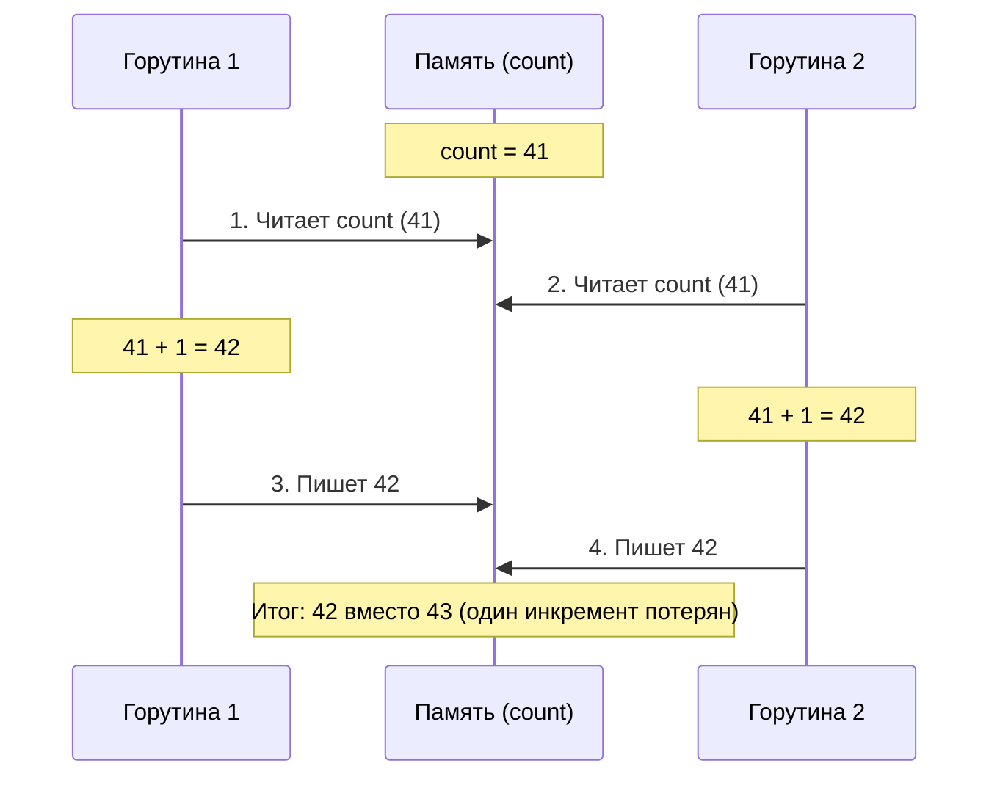

*Почему сломанный конкурентный код иногда проходит обычные тесты, что такое гонка данных и как читать отчёты встроенного детектора `go test -race`.*

Запустите десять горутин и попросите каждую тысячу раз увеличить общий счётчик `count++` без мьютекса. Логика подсказывает ответ `10000`. Но при первом запуске программа напечатает `9412`, при втором — `8735`, а при третьем, если нагрузка на процессор мала, может случайно выдать правильные `10000`.

Именно в этом главное коварство конкурентных ошибок: они не обязаны проявляться на каждом запуске. Программа спокойно проходит обычные тесты на ноутбуке разработчика, а через неделю начинает портить данные или аварийно падать на сервере.

## Что на самом деле происходит при `count++`

В исходном коде Go `count++` выглядит одной неделимой строкой. Но процессор выполняет её в три отдельных шага: читает текущее число из памяти в регистр, прибавляет единицу и записывает новое значение обратно в память.

Когда две горутины выполняют `count++` одновременно на разных ядрах, их шаги могут наложиться друг на друга:



Обе горутины честно увеличили `41` до `42`, и вторая перезаписала результат первой. Один инкремент бесследно исчез.

## Формальное определение гонки данных

**Гонка данных** (*data race*) возникает, когда выполняются три условия одновременно:

1. Две или более горутины обращаются к одной и той же области памяти.
2. Хотя бы одно из этих обращений — запись.
3. Между обращениями нет синхронизации (канала, мьютекса, `WaitGroup` или атомарных операций), задающей строгий порядок «сначала это, потом то».

Если все горутины только **читают** неизменяемую память — гонки нет. Если одна горутина пишет в слайс, затем вызывает `wg.Done()`, а другая читает этот слайс после `wg.Wait()` — гонки тоже нет, потому что `WaitGroup` установила явный порядок.

Со счётчиком мы теряем числа тихо, но со встроенной мапой `map` всё жёстче. Конкурентная запись в обычную мапу способна повредить её внутреннюю структуру, поэтому рантайм Go сам проверяет флаг занятости и при конфликте немедленно аварийно завершает весь процесс:

```go
m := make(map[int]int)
var wg sync.WaitGroup
for i := range 2 {
	wg.Add(1)
	go func(n int) {
		defer wg.Done()
		for k := range 1000 {
			m[k] = n
		}
	}(i)
}
wg.Wait()
```

Запуск этого кода почти мгновенно обрывается фатальной ошибкой, которую **невозможно** перехватить через `recover()`:

```text
fatal error: concurrent map writes
```

## Встроенный детектор `go test -race` и `go run -race`

Искать гонки глазами бесполезно. В Go встроен промышленный детектор гонок — достаточно добавить флаг `-race`:

```bash
go test -race ./...
go run -race .
```

С этим флагом компилятор инструментирует каждое чтение и запись памяти. Если во время выполнения две горутины без синхронизации обращаются к одному адресу и хотя бы одна пишет, детектор печатает `WARNING: DATA RACE` и роняет тест. *(Модель памяти Go и отношение happens-before разбираются в Томе 5.)*

Напишем тест со сломанным счётчиком в `counter_test.go`:

```go
package counter

import (
	"sync"
	"testing"
)

func TestBrokenCounter(t *testing.T) {
	count := 0
	var wg sync.WaitGroup
	for range 10 {
		wg.Add(1)
		go func() {
			defer wg.Done()
			for range 1000 {
				count++
			}
		}()
	}
	wg.Wait()
	if count != 10000 {
		t.Fatalf("got %d, want 10000", count)
	}
}
```

Запуск `go test -race -v ./...` сразу выдаёт точный отчёт:

```text
=== RUN   TestBrokenCounter
==================
WARNING: DATA RACE
Read at 0x00c00001a118 by goroutine 7:
  example/counter.TestBrokenCounter.func1()
      /work/counter_test.go:16 +0x38

Previous write at 0x00c00001a118 by goroutine 6:
  example/counter.TestBrokenCounter.func1()
      /work/counter_test.go:16 +0x4c

Goroutine 7 (running) created at:
  example/counter.TestBrokenCounter()
      /work/counter_test.go:13 +0x64
==================
--- FAIL: TestBrokenCounter (0.01s)
    testing.go:1399: race detected during execution of test
```

## Как читать отчёт `WARNING: DATA RACE`

В отчёте три ключевые точки:

1. **Тип конфликта и адрес:** `Read at 0x... by goroutine 7` против `Previous write at 0x... by goroutine 6` — две горутины без синхронизации обратились к одной ячейке памяти.
2. **Строки кода:** прямо под заголовками указаны `counter_test.go:16` — именно строка `count++`.
3. **Точка создания горутин:** `Goroutine 7 created at` показывает строку `counter_test.go:13`, где оператор `go` запустил участника конфликта.

Добавьте `var mu sync.Mutex` вокруг `count++` (или используйте атомарный счётчик `atomic.Int32` из `sync/atomic`), и `go test -race ./...` вернёт `PASS`.

## Почему тесты без `-race` молчат — и чего не видит сам `-race`

Обычный `go test` часто пропускает редкие гонки: если две горутины делают по пять шагов, первая успевает завершиться до старта второй. Детектор `-race` ловит отсутствие синхронизации даже тогда, когда итоговое число случайно совпало.

При этом `-race` — **динамический** инструмент. Он проверяет только реально выполненные конкурентные ветки. Если тест вызывает `Add` и `List` строго в одной горутине, `go test -race` пройдёт даже без мьютекса. Поэтому для потокобезопасных типов всегда пишут отдельный многопоточный тест. Сборка с `-race` расходует в 2–10 раз больше CPU и в 5–10 раз больше памяти, поэтому её используют в тестах и CI, а не для обычного боевого бинарника.

> [!check] Проверь понимание
> Тест на `SafeStore` прошёл команду `go test -race ./...` без единого предупреждения. Гарантирует ли это, что в коде `SafeStore` в принципе нет гонок данных?
>
> Нет. Детектор проверяет только те методы и пересечения горутин, которые реально запускались во время тестов. Если метод `Delete` не вызывался конкурентно с `List` ни в одном тесте, гонку в нём `-race` не увидит.

## Практика

**Упражнение 1 (Базовое). Читаем отчёт детектора.**  
По фрагменту отчёта ниже определите: какая операция конфликтовала с какой, в каких строках кода произошёл конфликт и какую синхронизацию нужно добавить:

```text
WARNING: DATA RACE
Write at 0x00c000104020 by goroutine 9:
  bookmarkflow.(*Stats).RecordOK()
      /work/stats.go:18 +0x44

Previous read at 0x00c000104020 by goroutine 8:
  bookmarkflow.(*Stats).Summary()
      /work/stats.go:24 +0x30
```

> [!solution] Показать решение
> Горутина 9 писала в память в методе `RecordOK` (`stats.go:18`), а горутина 8 читала ту же ячейку без синхронизации в методе `Summary` (`stats.go:24`). Обе операции должны использовать один и тот же `sync.Mutex` (или `sync.RWMutex`: `Lock` в `RecordOK` и `RLock` в `Summary`), либо счётчик можно перевести на `atomic.Int64`.

**Упражнение 2 (Практическое). Поймайте и почините гонку в мапе.**  
Напишите тест `TestTagCounterRace`, в котором 8 горутин по 50 раз вызывают `tc.Add("go")` у структуры `TagCounter` с полем `counts map[string]int`. Сначала оставьте `TagCounter` без мьютекса и убедитесь, что `go test -race` падает; затем защитите его через `sync.Mutex` и добавьте метод `Count(tag string) int`, чтобы тест проходил `go test -race`.

> [!solution] Показать решение
> Безопасная версия защищает оба метода одним мьютексом:
> ```go
> type TagCounter struct {
> 	mu     sync.Mutex
> 	counts map[string]int
> }
>
> func NewTagCounter() *TagCounter {
> 	return &TagCounter{counts: make(map[string]int)}
> }
>
> func (tc *TagCounter) Add(tag string) {
> 	tc.mu.Lock()
> 	defer tc.mu.Unlock()
> 	tc.counts[tag]++
> }
>
> func (tc *TagCounter) Count(tag string) int {
> 	tc.mu.Lock()
> 	defer tc.mu.Unlock()
> 	return tc.counts[tag]
> }
> ```
> Без мьютекса 8 горутин либо сразу роняют тест с `fatal error: concurrent map writes`, либо получают `WARNING: DATA RACE`. С мьютексом `tc.Count("go")` стабильно равен `400` и проходит `-race`.

**Упражнение 3 (Со звёздочкой \*). Скрытая гонка при возврате слайса.**  
В хранилище `Store` методы `Add` и `List` оба защищены `sync.RWMutex`, но `List` написан так:
```go
func (s *Store) List() []string {
	s.mu.RLock()
	defer s.mu.RUnlock()
	return s.items
}
```
Почему `go test -race` всё равно найдёт гонку, если одна горутина перебирает результат `List()`, а вторая одновременно вызывает `Add()`? Как исправить `List()` одной строкой?

> [!solution] Показать решение
> `List()` возвращает копию заголовка слайса `(ptr, len, cap)`, который указывает на тот же базовый массив, что и `s.items`. Как только `List()` отпускает `RUnlock()`, первая горутина читает элементы этого массива без замка, а вторая через `Add` вызывает `append` и может записать или перезаписать память того же массива.
>
> Исправление — вернуть независимую копию под `RLock()`:
> ```go
> return slices.Clone(s.items)
> ```
> После клонирования вызывающий код работает с собственным массивом, и гонка исчезает.

---

Теперь наши горутины умеют ждать друг друга, безопасно делить память и проходить проверку `go test -race`. Но остаётся серьёзный вопрос: что делать, если внешняя проверка ссылки зависла на тридцать секунд или пользователь решил прервать операцию раньше времени? О том, как аккуратно и массово отменять горутины, — в следующей главе [[9. Отмена и дедлайны — context.Context на практике]].
