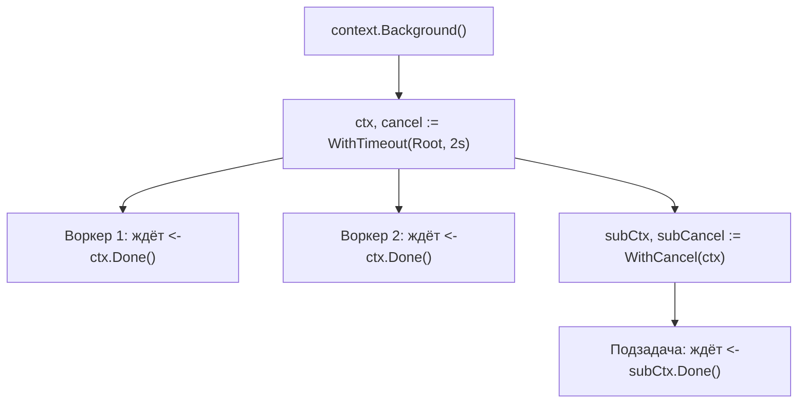

*Как передавать сигнал отмены и таймаут через цепочку вызовов и горутин с помощью `context.Context`, не допуская утечек таймеров и горутин.*

> В отличие от неиспользуемых переменных, утекшие горутины не собираются сборщиком мусора автоматически, поэтому важно следить, чтобы каждая горутина завершалась сама, как только перестаёт быть нужной.
> — *Алан Донован, Брайан Керниган, The Go Programming Language (гл. 8.4.4)*

Представьте, что чекер закладок запустил проверку двадцати ссылок, и один из сайтов «молчит» — не отвечает и не рвёт соединение. Мы готовы ждать не больше двух секунд, а потом хотим остановить всю группу проверок и вернуть пользователю отчёт.

В Go нет команды «убить горутину снаружи». Принудительная остановка посреди функции была бы опасна: горутина могла бы бросить захваченный мьютекс или недописанный файл. Вместо этого в Go работает **кооперативная отмена**: вызывающая сторона передаёт общий сигнал остановки вниз по дереву вызовов, а каждая функция и горутина проверяет этот сигнал и аккуратно завершается сама. Единый стандарт для такого сигнала — интерфейс `context.Context` из пакета `context`.

## Дерево контекстов и сигнал отмены

У каждого контекста есть родитель (кроме корневого). Создавая дочерний контекст с таймаутом или ручной отменой, мы строим дерево операций:



Отмена распространяется строго **сверху вниз**: если истёк таймаут у `ctx` или кто-то вызвал `cancel()`, мгновенно отменяются и `ctx`, и дочерний `subCtx`. Обратное неверно — отмена `subCtx` никак не затрагивает родительский `ctx` и соседних воркеров.

Механизм оповещения прост и опирается на уже знакомое свойство каналов. Метод `ctx.Done()` возвращает канал только для чтения `<-chan struct{}`. Пока операция активна, канал открыт и чтение из него блокируется. В момент отмены контекст **закрывает** этот канал — и все горутины, ждущие `<-ctx.Done()` внутри `select`, просыпаются одновременно. Один вызов `cancel()` рассылает сигнал целому дереву задач.

## Основные функции пакета `context`

На практике хватает пяти функций и двух методов:

- `context.Background()` — корневой контекст, который никогда не отменяется (для `main`, точек входа и тестов).
- `context.TODO()` — временная заглушка при рефакторинге.
- `context.WithCancel(parent)` — дочерний `ctx` с ручной отменой через `cancel()`.
- `context.WithTimeout(parent, d)` — автоматическая отмена через длительность `d`.
- `context.WithDeadline(parent, t)` — автоматическая отмена в момент `time.Time`.

Причину остановки проверяют двумя методами: `<-ctx.Done()` для ожидания сигнала и `ctx.Err()` — он возвращает `nil`, пока контекст жив, `context.Canceled` при вызове `cancel()` и `context.DeadlineExceeded` при истечении таймаута (проверяйте через `errors.Is`).

## Два железных правила

### 1. Всегда вызывайте `defer cancel()`

`WithCancel`, `WithTimeout` и `WithDeadline` привязывают дочерний контекст к родителю, а последние два запускают внутренний таймер. Если операция заняла 10 мс при таймауте 5 секунд, без `cancel()` таймер останется висеть до конца срока. Пишите сразу:

```go
ctx, cancel := context.WithTimeout(context.Background(), 2*time.Second)
defer cancel()
```

Повторный вызов `cancel()` безопасен, а забытый — ловит `go vet`.

### 2. `ctx` — всегда первый параметр функции и никогда не поле структуры

```go
func ProbeURL(ctx context.Context, rawURL string) (bool, error)
```

Контекст описывает время жизни **одной операции**, а структура обслуживает множество вызовов с разными дедлайнами. Передавая `ctx` первым аргументом, мы делаем границы отмены явными.

## Рабочий код: отменяемая проверка ссылки

Напишем имитацию сетевой проверки, которая уважает отмену контекста и корректно освобождает таймер:

```go
package main

import (
	"context"
	"errors"
	"fmt"
	"time"
)

func probeWithDelay(ctx context.Context, rawURL string, delay time.Duration) (bool, error) {
	timer := time.NewTimer(delay)
	defer timer.Stop()

	select {
	case <-ctx.Done():
		return false, fmt.Errorf("проверка %s прервана: %w", rawURL, ctx.Err())
	case <-timer.C:
		return true, nil
	}
}

func main() {
	ctx, cancel := context.WithTimeout(context.Background(), 50*time.Millisecond)
	defer cancel()

	for _, tc := range []struct {
		url   string
		delay time.Duration
	}{
		{"https://fast.example", 20 * time.Millisecond},
		{"https://slow.example", 200 * time.Millisecond},
	} {
		ok, err := probeWithDelay(ctx, tc.url, tc.delay)
		fmt.Printf("%-22s ok=%-5v timeout=%v\n",
			tc.url, ok, errors.Is(err, context.DeadlineExceeded))
	}
}
```

Вывод программы:

```text
https://fast.example   ok=true  timeout=false
https://slow.example   ok=false timeout=true
```

Первая ссылка успела уложиться в 20 мс и вернула `ok=true`. К моменту второй проверки у общего `ctx` осталось около 30 мс — до окончания 200-миллисекундной задержки таймер контекста сработал, закрыл `ctx.Done()`, `select` выбрал первую ветку, а `defer timer.Stop()` сразу остановил ненужный таймер. Ошибка обернута через `%w`, поэтому `errors.Is(err, context.DeadlineExceeded)` честно вернул `true`.

## Подводные камни

1. **Передача `nil` вместо контекста.** Вызов `ctx.Done()` на `nil` немедленно уронит программу с паникой. Если подходящего контекста нет, передавайте `context.Background()` или `context.TODO()`.
2. **Игнорирование `ctx` в длинных циклах.** Если функция принимает `ctx`, но крутит тяжёлый цикл без проверки `ctx.Err() != nil`, отмена не подействует до самого конца цикла.
3. **Попытка «продлить» таймаут родителя.** Если у родителя осталось 100 мс, а вы сделали `WithTimeout(parent, 5*time.Second)`, дочерний контекст всё равно истечёт через 100 мс. Дедлайн дочернего контекста может быть только короче или равен родительскому, но не длиннее.

> [!check] Проверь понимание
> Функция создала `ctx, cancel := context.WithTimeout(parent, 10*time.Second)` и завершила работу за 5 миллисекунд. Зачем ей всё равно вызывать `defer cancel()`, если таймер и так истечёт сам?
>
> Без `cancel()` дочерний контекст и его таймер останутся привязанными к `parent` ещё на 9,995 секунды. При тысячах коротких вызовов в секунду это быстро превращается в утечку памяти и накопление лишних таймеров.

## Практика

**Упражнение 1 (Базовое). Проследи дедлайн.**  
Родительский контекст создан с таймаутом `80 * time.Millisecond`, а от него — дочерний с таймаутом `500 * time.Millisecond`. Сколько примерно времени проработает `<-child.Done()` и какую ошибку вернёт `child.Err()`?

> [!solution] Показать решение
> Ожидание завершится примерно через **80 мс**, а `child.Err()` вернёт **`context.DeadlineExceeded`**. Дочерний контекст не может пережить своего родителя: как только истекает родительский дедлайн, отмена мгновенно каскадом закрывает все дочерние контексты.

**Упражнение 2 (Практическое). Отменяемый сон `SleepContext`.**  
Напишите функцию `SleepContext(ctx context.Context, d time.Duration) error`, которая ждёт длительность `d` и возвращает `nil`, но если контекст отменился раньше — немедленно возвращает `ctx.Err()`. Используйте `time.NewTimer` и `defer timer.Stop()`.

> [!solution] Показать решение
> Используем `select` между каналом таймера и `ctx.Done()`:
> ```go
> func SleepContext(ctx context.Context, d time.Duration) error {
> 	if d <= 0 {
> 		return ctx.Err()
> 	}
> 	timer := time.NewTimer(d)
> 	defer timer.Stop()
>
> 	select {
> 	case <-ctx.Done():
> 		return ctx.Err()
> 	case <-timer.C:
> 		return nil
> 	}
> }
> ```
> При отмене контекста `defer timer.Stop()` сразу освобождает таймер, не дожидаясь истечения `d`.

**Упражнение 3 (Со звёздочкой \*). Первый успешный ответ без утечки горутин.**  
Напишите функцию `FirstOK(ctx context.Context, urls []string, probe func(context.Context, string) bool) (string, error)`, которая конкурентно проверяет все `urls`, как только первая проверка вернула `true` — отменяет остальные через дочерний `WithCancel` и дожидается завершения всех запущенных горутин. Если ни один URL не ответил успешно, верните `"", ctx.Err()` (или `errors.New("ни одна ссылка не доступна")`, если контекст не отменялся).

> [!solution] Показать решение
> Буферизированный канал `winner := make(chan string, 1)` позволяет первому победителю записать URL без блокировки, а `wg.Wait()` гарантирует, что ни одна горутина не утечёт после возврата из функции:
> ```go
> func FirstOK(
> 	ctx context.Context,
> 	urls []string,
> 	probe func(context.Context, string) bool,
> ) (string, error) {
> 	subCtx, cancel := context.WithCancel(ctx)
> 	defer cancel()
>
> 	winner := make(chan string, 1)
> 	var wg sync.WaitGroup
> 	for _, rawURL := range urls {
> 		wg.Add(1)
> 		go func(u string) {
> 			defer wg.Done()
> 			if probe(subCtx, u) {
> 				select {
> 				case winner <- u:
> 					cancel()
> 				default:
> 				}
> 			}
> 		}(rawURL)
> 	}
> 	wg.Wait()
>
> 	select {
> 	case u := <-winner:
> 		return u, nil
> 	default:
> 		if ctx.Err() != nil {
> 			return "", ctx.Err()
> 		}
> 		return "", errors.New("ни одна ссылка не доступна")
> 	}
> }
> ```
> Ветка `default` при отправке в `winner` не даёт второму одновременному победителю заблокироваться навечно, а вызов `cancel()` сразу прерывает остальных.

---

Мы научились аккуратно останавливать дерево горутин по таймауту или сигналу отмены. Но остаётся последняя архитектурная проблема: если в списке не пять закладок, а сто тысяч, запуск отдельной горутины на каждую ссылку всё равно положит сеть и память. Как ограничить число одновременно работающих задач, разберём в главе [[10. Пул воркеров (Worker Pool) и ограничение числа задач]].
