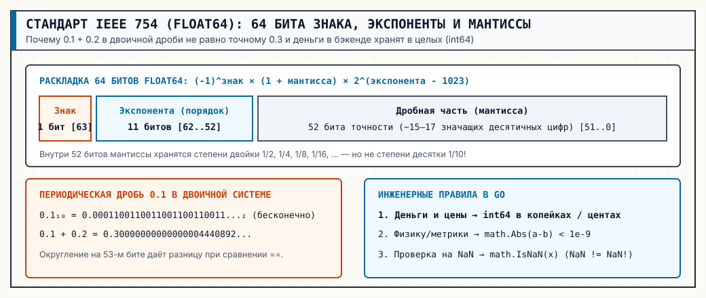

*Как 64 бита вмещают и диаметр атома, и расстояние до галактик, откуда берётся `0.1 + 0.2 != 0.3` и почему финансовые расчёты ведут в целых копейках.*

Вы пишете сервис учёта подписок, складываете две переменные `a := 0.1` и `b := 0.2` и сверяете сумму с порогом `0.3`. Код выглядит безупречно, но проверка `a + b == 0.3` возвращает `false`, а в отчёте за месяц пропадает копейка.

Проблема не в Go и не в процессоре. Она заложена в самом способе хранения дробных чисел в конечном числе битов. Чтобы перестать натыкаться на эти грабли, разберём устройство `float64` на уровне битов.

## Интуиция: научная запись в двоичной системе

Обычная десятичная дробь с фиксированной точкой (например, всегда два знака после запятой) не подходит для универсальных вычислений: она не вместит одновременно массу электрона и бюджет государства. Поэтому ещё в 1985 году инженеры закрепили единый стандарт **IEEE 754**, перенеся в двоичный мир школьную научную запись числа: $(-1)^s \times m \times 2^e$.

Вся идея держится на компромиссе. Внутри 64 битов типа `float64` выделены три поля:

```text
Бит:     63   62        52  51                                                 0
        +---+-------------+----------------------------------------------------+
Поле:   | S |  Экспонента |                      Мантисса                      |
        +---+-------------+----------------------------------------------------+
Ширина:  1б      11 бит                          52 бита
```

* **Знак (`S`, 1 бит):** `0` для положительных чисел, `1` для отрицательных. Здесь действительно существуют `+0.0` и `-0.0`, хотя оператор `==` считает их равными.
* **Экспонента (`E`, 11 битов):** порядок числа — степень двойки, на которую умножается дробная часть. Чтобы хранить и положительные, и отрицательные степени без отдельного знакового бита, используется смещение (*bias*) `1023`: реальная степень равна `E - 1023`.
* **Мантисса (`M`, 52 бита):** значащие двоичные цифры после точки. Для обычных (нормализованных) чисел стандарт прячет ведущую единицу `1.` «в уме» — её не хранят, но подразумевают при вычислении. В итоге мы получаем 53 бита точности (около 15–17 значащих десятичных цифр).

Именно «плавающая» экспонента даёт `float64` колоссальный диапазон — примерно от $10^{-308}$ до $10^{308}$. Но число самих комбинаций из 64 битов конечно ($2^{64}$), поэтому чем больше само число, тем шире шаг между двумя соседними представимыми значениями.



## Почему `0.1 + 0.2 != 0.3`

Вспомните дробь $1/3$ в привычной десятичной системе: `0.333333...` — бесконечная периодическая дробь, потому что знаменатель `3` не раскладывается на множители основания `10` (`2` и `5`). Если оборвать запись на третьем знаке (`0.333`) и сложить три таких числа, вы получите `0.999`, а не `1.0`.

В двоичной системе основание равно `2`, поэтому точно записываются лишь дроби со знаменателем $2^k$: `0.5` ($1/2$), `0.25` ($1/4$), `0.125` ($1/8$). А безобидная десятая доля $1/10 = 1 / (2 \times 5)$ превращается в бесконечную двоичную дробь:

```text
0.1₁₀ = 0.000110011001100110011...₂
```

Когда Go сохраняет `0.1` и `0.2` в `float64`, процессор округляет бесконечные хвосты до ближайшего представимого 53-битного числа. При сложении две крошечные ошибки округления складываются и дают `0.30000000000000004` — на один младший бит мантиссы больше, чем ближайшая к `0.3` комбинация.

## Особые значения: `NaN`, `+Inf` и `-Inf`

Стандарт `IEEE 754` зарезервировал крайнее значение экспоненты (все 11 битов равны `1`, то есть `2047`) под особые состояния, чтобы математические вычисления не роняли программу на каждом шаге:

* **`+Inf` и `-Inf`** (экспонента `2047`, мантисса `0`) — плюс и минус бесконечность. Возникают при переполнении диапазона `float64` или при делении ненулевого дробного числа на `0.0` во время выполнения (`1.0 / z`, где `z == 0.0`). Проверить их можно через `math.IsInf(x, 0)`.
* **`NaN`** (*Not a Number*, экспонента `2047`, мантисса не равна `0`) — результат неопределённой операции вроде `0.0 / 0.0`, `math.Sqrt(-1)` или `+Inf - +Inf`.

У `NaN` есть важное правило стандарта: **любое сравнение с `NaN` возвращает `false`**, включая `x == x`. Это сделано намеренно: две разные бессмысленные операции (`0.0/0.0` и `math.Sqrt(-1)`) не должны внезапно оказаться «равны» друг другу. Поэтому проверять на `NaN` нужно исключительно функцией `math.IsNaN(x)`.

## Рабочий код: смотрим биты через `math.Float64bits` и храним деньги в `int64`

Стандартный пакет `math` позволяет заглянуть прямо в 64-битное представление `float64` функцией `math.Float64bits`. Она возвращает те же 64 бита как `uint64`, ничего не округляя. Заодно сравним два подхода к расчётам: сравнение дробных с допуском (*epsilon*) для физики/метрик и целочисленные копейки для денег.

```go
package main

import (
	"fmt"
	"math"
)

// Kopecks хранит денежную сумму в целых копейках без ошибок округления.
type Kopecks int64

func (k Kopecks) String() string {
	sign := ""
	v := int64(k)
	if v < 0 {
		sign = "-"
		v = -v
	}
	return fmt.Sprintf("%s%d.%02d ₽", sign, v/100, v%100)
}

// AlmostEqual сравнивает два float64 с заданным абсолютным допуском eps.
func AlmostEqual(a, b, eps float64) bool {
	if math.IsNaN(a) || math.IsNaN(b) {
		return false
	}
	return math.Abs(a-b) <= eps
}

func inspectFloat(label string, v float64) {
	bits := math.Float64bits(v)
	sign := bits >> 63
	exp := (bits >> 52) & 0x7ff
	mant := bits & ((1 << 52) - 1)
	fmt.Printf("%-9s = %20.17f | S=%d E=%4d (2^%+d) M=0x%013x\n",
		label, v, sign, exp, int(exp)-1023, mant)
}

func main() {
	a, b := 0.1, 0.2
	sum := a + b
	inspectFloat("a (0.1)", a)
	inspectFloat("b (0.2)", b)
	inspectFloat("a+b", sum)
	inspectFloat("0.3", 0.3)

	fmt.Println("a + b == 0.3:", sum == 0.3)
	fmt.Println("AlmostEqual(1e-9):", AlmostEqual(sum, 0.3, 1e-9))

	zero := 0.0
	posInf := 1.0 / zero
	nan := zero / zero
	fmt.Printf("posInf=%v IsInf=%t | nan=%v nan==nan:%t IsNaN=%t\n",
		posInf, math.IsInf(posInf, 1), nan, nan == nan, math.IsNaN(nan))

	// Деньги в целых копейках: 10 коп. + 20 коп. = ровно 30 коп.
	price := Kopecks(10) + Kopecks(20)
	fmt.Println("Точный баланс:", price, "равен 30 коп.:", price == Kopecks(30))
}
```

Вывод программы наглядно показывает разницу ровно в один младший бит мантиссы (`...3334` против `...3333`):

```text
a (0.1)   =  0.10000000000000001 | S=0 E=1019 (2^-4) M=0x999999999999a
b (0.2)   =  0.20000000000000001 | S=0 E=1020 (2^-3) M=0x999999999999a
a+b       =  0.30000000000000004 | S=0 E=1021 (2^-2) M=0x3333333333334
0.3       =  0.29999999999999999 | S=0 E=1021 (2^-2) M=0x3333333333333
a + b == 0.3: false
AlmostEqual(1e-9): true
posInf=+Inf IsInf=true | nan=NaN nan==nan:false IsNaN=true
Точный баланс: 0.30 ₽ равен 30 коп.: true
```

Тонкость самого Go: если написать константное выражение `0.1 + 0.2 == 0.3` без переменных, компилятор вычислит нетипизированные константы с произвольной точностью и получит `true`. Но как только числа попадают в переменные `float64` во время работы программы, вступает в силу двоичное округление `IEEE 754`, и `a + b == 0.3` возвращает `false`.

Обратите внимание на `Kopecks`: тип `int64` вмещает до $9{,}2 \times 10^{18}$ копеек — больше 92 квадриллионов рублей. Этого запаса хватит для любой биллинговой системы, а сложение и вычитание остаются точными до единой копейки.

## Подводные камни

**Ловушка 1. `NaN` в качестве ключа мапы.**  
Если положить в `map[float64]string` запись по ключу `math.NaN()`, её больше нельзя достать прямым обращением `m[math.NaN()]`: при поиске Go сравнивает ключи, а `NaN == NaN` всегда ложно. Каждый новый `m[math.NaN()] = "x"` создаёт ещё одну недоступную запись.

**Ловушка 2. Исчезающие малые слагаемые.**  
У `float64` всего 53 бита точности мантиссы ($2^{53} \approx 9 \times 10^{15}$). После этого порога шаг между соседними дробными числами становится больше `1.0`, поэтому выражение `float64(1<<53) + 1 == float64(1<<53)` даёт `true`: прибавленная единица просто растворяется при округлении.

**Ловушка 3. Жёсткий абсолютный допуск для очень больших или очень малых чисел.**  
Проверка `math.Abs(a-b) <= 1e-9` хорошо работает рядом с единицей, но бессмысленна для чисел порядка $10^{12}$ (там шаг сетки `float64` уже сопоставим с $10^{-4}$) или порядка $10^{-15}$ (там любые два числа окажутся «равны»). В научных расчётах используют относительный допуск, масштабированный на `max(math.Abs(a), math.Abs(b))`.

> [!check] Проверь понимание
> Почему в `float64` выражение `0.5 + 0.25 == 0.75` возвращает `true`, тогда как `0.1 + 0.2 == 0.3` возвращает `false`?
>
> Числа `0.5` ($2^{-1}$), `0.25` ($2^{-2}$) и `0.75` ($2^{-1} + 2^{-2}$) являются точными суммами отрицательных степеней двойки, поэтому они записываются в двоичной мантиссе без единого потерянного бита. Числа `0.1`, `0.2` и `0.3` имеют в знаменателе множитель `5`, из-за чего превращаются в бесконечные двоичные дроби и округляются.

## Практика

**Упражнение 1 (Базовое). Проследи вывод с особыми значениями.**  
Не запуская программу, определите, что выведет каждая из четырёх строк, и объясните почему:

```go
z := 0.0
a := 1.0 / z
b := -1.0 / z
c := a + b
fmt.Println(a > 1e300, a == a, c == c, math.IsNaN(c))
```

> [!solution] Показать решение
> Программа выведет `true true false true`.
> * `a` равно `+Inf`, поэтому `a > 1e300` и `a == a` истинны (`+Inf == +Inf` в IEEE 754 даёт `true`).
> * `b` равно `-Inf`. Сумма `+Inf + (-Inf)` не определена и даёт `NaN`.
> * Для `NaN` сравнение `c == c` всегда ложно, а `math.IsNaN(c)` возвращает `true`.

**Упражнение 2 (Практическое). Деление счёта в копейках без потери остатка.**  
Напишите функцию `SplitEvenly(total Kopecks, parts int) ([]Kopecks, error)`, которая делит сумму `total` (в копейках) на `parts` человек так, чтобы сумма элементов результата **строго** равнялась `total`. Если остаются лишние копейки от деления (`rem := total % Kopecks(parts)`), раздайте по `+1` копейке первым `rem` участникам. При `parts <= 0` или `total < 0` верните ошибку.

> [!solution] Показать решение
> Разделяем сумму на целую базу `base = total / Kopecks(parts)` и остаток `rem = total % Kopecks(parts)`. Такой приём исключает потерю копеек при делении чека или распределении налога:
> ```go
> package main
>
> import (
> 	"errors"
> 	"fmt"
> )
>
> type Kopecks int64
>
> func SplitEvenly(total Kopecks, parts int) ([]Kopecks, error) {
> 	if parts <= 0 || total < 0 {
> 		return nil, errors.New("некорректные параметры деления")
> 	}
> 	base := total / Kopecks(parts)
> 	rem := int(total % Kopecks(parts))
> 	res := make([]Kopecks, parts)
> 	for i := range parts {
> 		res[i] = base
> 		if i < rem {
> 			res[i]++
> 		}
> 	}
> 	return res, nil
> }
>
> func main() {
> 	shares, err := SplitEvenly(100, 3)
> 	fmt.Println(shares, err) // [34 33 33] <nil>
> }
> ```
> Сумма `34 + 33 + 33` равна ровно `100` копейкам — ни одна копейка не исчезла и не появилась из воздуха.

**Упражнение 3 (Со звёздочкой \*). Предел точных целых внутри `float64`.**  
Напишите небольшую программу, которая проверит равенство `float64(n) == float64(n+1)` для `n = (1 << 53) - 1` и `n = 1 << 53`, а также распечатает биты мантиссы обоих значений через `math.Float64bits`. Почему именно $2^{53}$ становится границей?

> [!solution] Показать решение
> У `float64` 52 хранимых бита мантиссы плюс 1 неявный старший бит — итого 53 бита. Пока число меньше $2^{53}$, шаг между соседними `float64` не превышает `1`. Начиная с $2^{53}$, младший бит мантиссы получает вес `2`, поэтому нечётное число $2^{53} + 1$ не представимо и округляется обратно к чётному $2^{53}$:
> ```go
> package main
>
> import (
> 	"fmt"
> 	"math"
> )
>
> func main() {
> 	for _, n := range []int64{(1 << 53) - 1, 1 << 53} {
> 		a, b := float64(n), float64(n+1)
> 		fmt.Printf("n=%d: a==b -> %t | bits(a)=%016x bits(b)=%016x\n",
> 			n, a == b, math.Float64bits(a), math.Float64bits(b))
> 	}
> }
> ```
> Для `(1<<53)-1` значения различны (`false`), а для `1<<53` битовые паттерны `a` и `b` совпадают полностью (`true`).

---

Мы разобрали, как данные — биты, целые и дробные числа — укладываются в ячейки памяти. Теперь пора посмотреть на сам процессор, который перемалывает эти биты: как устроены его внутренние регистры, зачем ему конвейер и почему один непредсказуемый `if` способен замедлить цикл в несколько раз — [[4. Регистры, инструкции и конвейер процессора на понятной модели]].
