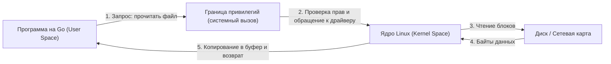

*Как процессор делит код на привилегированное ядро и обычное пользовательское пространство, почему программа на Go не может напрямую трогать диск и сколько стоит переход через эту границу.*

Представьте, что вы запускаете на одном сервере сразу две программы: наш `BookmarkFlow` и чужую утилиту для сжатия картинок. В утилите обнаруживается ошибка — она случайно пишет байты по неверному адресу или шлёт команду форматирования прямо на контроллер диска. Если бы обычная программа могла напрямую управлять оборудованием и памятью, одна опечатка в утилите для картинок уничтожила бы ваши закладки и остановила весь сервер.

В первых компьютерах 1950-х годов именно так и происходило: на машине крутилась одна программа, и она владела процессором и памятью безраздельно. Но как только в 1960-х появились системы разделения времени — а затем и Unix, — возникла жёсткая задача: десятки программ разных пользователей должны делить один процессор и один диск, не имея права мешать друг другу. Программных договорённостей для этого недостаточно. Ограничение пришлось встроить прямо в кремний процессора.


## Два режима работы процессора

Современный процессор умеет выполнять инструкции в разных уровнях привилегий. На архитектуре x86-64 их исторически четыре (так называемые кольца защиты — *Ring 0*..*Ring 3*), но Linux, macOS и Windows на практике используют два главных режима:

* **Пространство ядра (*kernel space*, привилегированный режим).** В этом режиме работает только ядро операционной системы и его драйверы. Коду ядра открыты все инструкции процессора: управление таблицами памяти, прямое обращение к диску и сетевой карте, остановка любого процесса, чтение аппаратных таймеров.
* **Пользовательское пространство (*user space*, непривилегированный режим).** Здесь живёт весь остальной мир: ваш скомпилированный бинарник на Go, текстовый редактор, терминал и браузер. Код в этом режиме умеет считать арифметику, работать со своей выделенной памятью и вызывать свои функции — и больше ничего.

Если программа в пользовательском пространстве попытается выполнить привилегированную инструкцию (например, напрямую прочитать сектор диска или переписать чужую память), процессор сам заблокирует операцию. Ядро немедленно получит аппаратное исключение и аварийно завершит нарушителя.

Удобно думать о ядре как о кассире за бронированным стеклом в банке: вы не заходите в хранилище сами, а передаёте в окошко заявку и паспорт. Граница этой аналогии проста: в отличие от живого кассира, ядро работает на том же самом процессоре, что и ваша программа — просто после пересечения «окна» CPU временно переключается в привилегированный режим.

## Как программа на Go обращается к внешнему миру

Любая работа программы с диском, терминалом, временем или сетью — это просьба к ядру. Всякий раз, когда код на Go вызывает `os.ReadFile`, `fmt.Println` или `os.Getpid`, рантайм Go передаёт управление через границу привилегий с помощью специальной инструкции процессора — **системного вызова** (*system call*).

Путь данных и управления при таком обращении выглядит так:



Ядро выступает единым диспетчером. Сначала оно проверяет, имеет ли текущий пользователь право читать запрошенный файл. Затем обращается к драйверу файловой системы и диска, дожидается данных, копирует их в буфер программы и возвращает процессор обратно в пользовательский режим.

*(NOTE: конкретные имена системных вызовов Linux вроде `openat`, `read` и `write`, а также их ускорение с помощью `bufio` мы подробно разберём в уроке 10 этого подраздела.)*

## Цена пересечения границы

Переход из пользовательского пространства в ядро и обратно не бесплатен. Обычный вызов функции внутри Go занимает **1–3 наносекунды**: процессор остаётся в том же режиме и просто переходит по новому адресу.

Пересечение границы ядра стоит **сотни наносекунд — несколько микросекунд**, то есть в **50–500 раз дороже** обычного вызова функции. Процессору нужно сменить уровень привилегий, сохранить регистры программы, переключиться на стек ядра, выполнить проверку прав и затем вернуть всё назад. На одном запросе эта задержка незаметна. На миллионе мелких запросов подряд она превращается в целые секунды простоя.

Убедимся в обеих сторонах границы привилегий на коротком эксперименте в Go: сравним скорость чистых вычислений в `user space` с многократным обращением к ядру через `os.Stat` и посмотрим, как ядро отвергает попытку прочитать защищённый файл:

```go
package main

import (
	"errors"
	"fmt"
	"os"
	"path/filepath"
	"time"
)

func main() {
	dir, err := os.MkdirTemp("", "priv-*")
	if err != nil {
		panic(err)
	}
	defer os.RemoveAll(dir)

	probe := filepath.Join(dir, "probe.txt")
	if err := os.WriteFile(probe, []byte("ok"), 0o600); err != nil {
		panic(err)
	}

	const iterations = 100_000

	// 1. Чистые вычисления в пользовательском пространстве.
	start := time.Now()
	sum := 0
	for i := range iterations {
		sum += i
	}
	userDur := time.Since(start)

	// 2. Столько же обращений к ядру за метаданными файла.
	start = time.Now()
	for range iterations {
		if _, err := os.Stat(probe); err != nil {
			panic(err)
		}
	}
	kernelDur := time.Since(start)

	fmt.Printf("user space (%d итераций, sum=%d): %v\n", iterations, sum, userDur)
	fmt.Printf("kernel space (%d вызовов os.Stat): %v\n", iterations, kernelDur)

	// 3. Проверка границы прав: запрещаем чтение собственного файла.
	if err := os.Chmod(probe, 0o000); err != nil {
		panic(err)
	}
	defer os.Chmod(probe, 0o600)

	_, err = os.ReadFile(probe)
	fmt.Printf("попытка чтения файла 0o000: err=%v (ErrPermission=%t)\n",
		err, errors.Is(err, os.ErrPermission))
}
```

Запустим программу в терминале Linux (точные цифры зависят от процессора, но порядок разницы сохраняется):

```text
$ go run main.go
user space (100000 итераций, sum=4999950000): 42.1µs
kernel space (100000 вызовов os.Stat): 148.6ms
попытка чтения файла 0o000: err=open /tmp/priv-3182/probe.txt: permission denied (ErrPermission=true)
```

Разница в тысячи раз. Цикл сложения выполнился целиком внутри пользовательского пространства и занял доли миллисекунды. Сто тысяч вызовов `os.Stat` каждый раз пересекали границу ядра и растянулись почти на 150 миллисекунд. А когда мы убрали права чтения у файла, ядро мгновенно пресекло попытку `os.ReadFile` — программа на Go не смогла обойти этот запрет, хотя сама же создала файл секундой ранее.

## Подводные камни

**Ловушка 1. Запуск программ под `root` «чтобы не мешали права».**  
Учётная запись `root` снимает почти все проверки прав на стороне ядра. Если в сервисе под `root` окажется ошибка в формировании пути к файлу, программа сможет случайно перезаписать системные настройки или удалить чужие данные. Всегда запускайте прикладные сервисы от обычного непривилегированного пользователя.

**Ловушка 2. Частые мелкие обращения к ОС внутри горячего цикла.**  
Вызов `os.Stat`, `os.Open` или небуферизованная запись по одному байту внутри цикла на миллион итераций упираются не в быстроту алгоритма, а в накладные расходы пересечения границы ядра. Объединяйте работу в крупные порции в памяти процесса и только потом передавайте их ядру.

> [!check] Проверь понимание
> Программа на Go в пользовательском пространстве читает системный файл `/etc/shadow` (где хранятся хэши паролей Linux) под обычным пользователем. Может ли программист обойти ошибку `permission denied`, написав на Go более «низкоуровневый» код без пакета `os`?
>
> Нет. Проверка прав доступа выполняется внутри ядра Linux в привилегированном режиме, а напрямую обратиться к диску из пользовательского пространства запрещает сам процессор. Любой способ доступа из `user space` всё равно пойдёт через ядро и получит тот же отказ.

## Практика

**Упражнение 1 (Базовое). Где выполняется код?**  
Определите для каждой операции Go, остаётся ли она полностью в пользовательском пространстве или требует пересечения границы ядра:
1. Сортировка слайса `slices.Sort(ids)`.
2. Открытие файла `os.Open("bookmarks.json")`.
3. Подсчёт длины строки `len(title)`.
4. Создание каталога `os.Mkdir("export", 0o755)`.

> [!solution] Показать решение
> 1. `slices.Sort(ids)` — пользовательское пространство (работает только со своей памятью процесса).
> 2. `os.Open("bookmarks.json")` — требует перехода в ядро (проверка прав и обращение к файловой системе).
> 3. `len(title)` — пользовательское пространство (чтение поля длины в памяти программы).
> 4. `os.Mkdir("export", 0o755)` — требует перехода в ядро (изменение файловой системы на диске).

**Упражнение 2 (Практическое). Проверка доступа без паники.**  
Напишите функцию `CanReadFile(path string) (bool, error)`, которая пытается открыть файл `path` через `os.Open` и сразу закрыть его. Если ядро отказало в доступе (`os.ErrPermission`), функция должна вернуть `(false, nil)`. Если файл открылся — `(true, nil)`. Любую другую ошибку (например, файла нет) верните вызывающему коду.

> [!solution] Показать решение
> ```go
> package main
>
> import (
> 	"errors"
> 	"fmt"
> 	"os"
> 	"path/filepath"
> )
>
> func CanReadFile(path string) (bool, error) {
> 	f, err := os.Open(path)
> 	if err != nil {
> 		if errors.Is(err, os.ErrPermission) {
> 			return false, nil
> 		}
> 		return false, err
> 	}
> 	_ = f.Close()
> 	return true, nil
> }
>
> func main() {
> 	dir, err := os.MkdirTemp("", "perm-*")
> 	if err != nil {
> 		panic(err)
> 	}
> 	defer os.RemoveAll(dir)
>
> 	p := filepath.Join(dir, "secret.txt")
> 	_ = os.WriteFile(p, []byte("data"), 0o000)
> 	defer os.Chmod(p, 0o600)
>
> 	ok, err := CanReadFile(p)
> 	fmt.Println("can read:", ok, "err:", err)
> }
> ```
> Проверка `errors.Is(err, os.ErrPermission)` аккуратно отделяет штатный запрет ядра от отсутствия файла или повреждённого пути. (Примечание: если запускать этот пример под `root`, ядро разрешит чтение даже файла с правами `0o000`.)

**Упражнение 3 (Со звёздочкой \*). Цена одного обращения к ядру.**  
Модифицируйте программу из урока так, чтобы она измеряла среднее время **одной** операции `os.Stat` в наносекундах (разделите общее время на число итераций) и сравнивала его со средним временем одной итерации пустого цикла суммирования. Выведите во сколько раз переход в ядро оказался медленнее на вашей машине.

> [!solution] Показать решение
> ```go
> package main
>
> import (
> 	"fmt"
> 	"os"
> 	"path/filepath"
> 	"time"
> )
>
> func main() {
> 	dir, err := os.MkdirTemp("", "bench-*")
> 	if err != nil {
> 		panic(err)
> 	}
> 	defer os.RemoveAll(dir)
>
> 	probe := filepath.Join(dir, "probe.txt")
> 	if err := os.WriteFile(probe, []byte("ok"), 0o600); err != nil {
> 		panic(err)
> 	}
>
> 	const n = 50_000
>
> 	start := time.Now()
> 	acc := 0
> 	for i := range n {
> 		acc += i
> 	}
> 	userNs := float64(time.Since(start).Nanoseconds()) / n
>
> 	start = time.Now()
> 	for range n {
> 		if _, err := os.Stat(probe); err != nil {
> 			panic(err)
> 		}
> 	}
> 	kernelNs := float64(time.Since(start).Nanoseconds()) / n
>
> 	fmt.Printf("acc=%d\n", acc)
> 	fmt.Printf("user:   %.2f нс/оп\n", userNs)
> 	fmt.Printf("kernel: %.2f нс/оп\n", kernelNs)
> 	if userNs > 0 {
> 		fmt.Printf("разница: ~%.0fx\n", kernelNs/userNs)
> 	}
> }
> ```
> Использование `acc` в `fmt.Printf` не даёт компилятору выкинуть вычисление, а усреднение по 50 000 вызовов сглаживает случайные колебания планировщика ОС.

---

Ядро отделяет программы от железа и друг от друга с помощью аппаратной границы привилегий. Но чем именно управляет ядро по нашу сторону этой границы? Главной единицей изоляции выступает процесс — в следующем уроке разберём его паспорт, дерево родства и коды завершения в [[2. Процесс — PID, память, код возврата и дерево процессов]].
