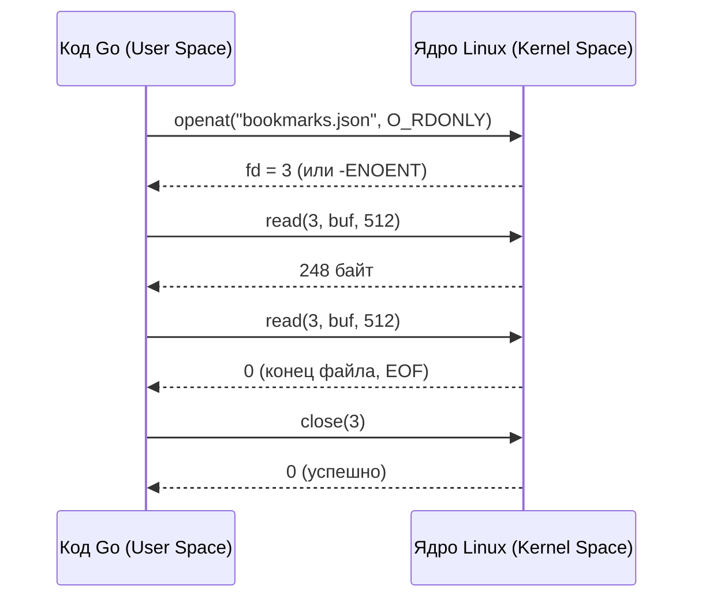

*Как вызовы `os.ReadFile` и `fmt.Println` пересекают границу ядра через системные вызовы Linux, почему буферизация ускоряет запись в сотни раз и как коды ошибок ядра превращаются в `os.ErrNotExist`.*

> «В идеальном мире прикладному программисту достаточно знать только API — без того, как этот API реализован и к какому железу он обращается. В реальности же чуть более глубокие знания порой оказываются весьма кстати.» — Чарльз Петцольд

Вы пишете простой цикл: записать 50 000 коротких строк закладок в файл напрямую через `f.WriteString(line)`. На диске окажется чуть больше мегабайта текста, но программа заметно задумывается. Вы оборачиваете тот же `*os.File` в `bufio.NewWriter(f)` — и время записи падает в десятки раз. Диск тот же, процессор тот же, объём байтов тот же. Изменилось только число переходов через границу ядра.

## Как код на Go просит ядро о работе

В первом уроке этого подраздела мы провели чёткую границу: обычная программа выполняется в пользовательском пространстве (*user space*) и не может напрямую командовать диском, экраном или сетевой картой. Любое обращение к внешнему миру проходит через ядро Linux.

Запрос программы к ядру называется **системным вызовом** (*system call*, коротко *syscall*). На уровне процессора это специальная инструкция (на x86-64 она так и называется — `syscall`), которая переводит CPU в привилегированный режим и передаёт управление коду ядра. Ядро проверяет права доступа, выполняет работу с файловой системой или устройством, кладёт результат в регистры и возвращает управление процессу.

Посмотрим, во что на самом деле превращаются знакомые функции стандартной библиотеки Go:



Одно короткое выражение `os.ReadFile("bookmarks.json")` распадается на цепочку из четырёх-пяти системных вызовов: открыть файл (`openat`), прочитать данные порциями (`read` до возврата `0`), закрыть дескриптор (`close`). За строкой `fmt.Println("готово")` скрывается `write(1, "готово\n", 13)` в дескриптор стандартного вывода `1`. А возврат из функции `main()` завершается вызовом `exit_group(0)`, который сообщает ядру код выхода процесса.

*(NOTE: с сетевым вводом-выводом всё устроено ещё хитрее — ожидание данных из сокетов ядро обрабатывает эффективно, не заставляя потоки ОС простаивать впустую; механику этой связки рантайма Go и ядра разберём подробно в Томе 5.)*

## Цена системного вызова и сила `bufio`

Обычный вызов функции внутри Go стоит единицы наносекунд: процессор просто переходит по адресу в том же пространстве и режиме.

Системный вызов обходится в **сотни наносекунд — несколько микросекунд**, то есть в **50–500 раз дороже** обычного вызова функции. На каждом переходе процессор переключает уровень привилегий, сохраняет и восстанавливает состояние регистров, ядро проверяет дескриптор и права, а затем копирует байты между буфером процесса и памятью ядра.

Теперь посчитаем, что происходит при записи 50 000 строк по 24 байта (итого ~1,2 МБ):

* **Без буферизации (`f.WriteString`):** 50 000 отдельных вызовов `write` в ядро.
* **С `bufio.NewWriter(f)` (буфер 4 КБ по умолчанию):** строки склеиваются в обычном слайсе в памяти процесса, и лишь когда буфер заполнен, выполняется один `write` на 4 096 байт — всего **~293 системных вызова**. Почти в 170 раз меньше переходов в ядро.

Проверим эту разницу реальным замером на Go:

```go
package main

import (
	"bufio"
	"errors"
	"fmt"
	"os"
	"path/filepath"
	"syscall"
	"time"
)

const line = "https://go.dev/doc/effective_go\n"

func writeRaw(path string, n int) (time.Duration, error) {
	f, err := os.Create(path)
	if err != nil {
		return 0, err
	}
	defer f.Close()

	start := time.Now()
	for range n {
		if _, err := f.WriteString(line); err != nil {
			return 0, err
		}
	}
	return time.Since(start), nil
}

func writeBuffered(path string, n int) (time.Duration, error) {
	f, err := os.Create(path)
	if err != nil {
		return 0, err
	}
	defer f.Close()

	bw := bufio.NewWriter(f)
	start := time.Now()
	for range n {
		if _, err := bw.WriteString(line); err != nil {
			return 0, err
		}
	}
	if err := bw.Flush(); err != nil {
		return 0, err
	}
	return time.Since(start), nil
}

func main() {
	dir, err := os.MkdirTemp("", "syscalls-*")
	if err != nil {
		panic(err)
	}
	defer os.RemoveAll(dir)

	const count = 50_000
	dRaw, err := writeRaw(filepath.Join(dir, "raw.txt"), count)
	if err != nil {
		panic(err)
	}
	dBuf, err := writeBuffered(filepath.Join(dir, "buf.txt"), count)
	if err != nil {
		panic(err)
	}
	fmt.Printf("без буфера: %v\nс bufio:    %v\n", dRaw, dBuf)

	// Демонстрация ошибки ядра: ENOENT -> os.ErrNotExist.
	_, err = os.Open(filepath.Join(dir, "missing.json"))
	var errno syscall.Errno
	if errors.As(err, &errno) {
		fmt.Printf("errno=%d (%s), IsNotExist=%t\n", errno, errno, errors.Is(err, os.ErrNotExist))
	}
}
```

Типичный вывод на современном Linux (точные миллисекунды зависят от машины, но порядок разницы стабилен):

```text
без буфера: 52.4ms
с bufio:    2.1ms
errno=2 (no such file or directory), IsNotExist=true
```

Двадцатикратное ускорение — без изменения формата данных и без единого хитрого алгоритма, исключительно за счёт сокращения числа системных вызовов.

## Как коды ошибок ядра попадают в Go

Когда системный вызов Linux завершается неудачей, ядро возвращает числовой код ошибки — `errno`. У каждого кода есть историческое короткое имя:

| Код ядра Linux (`errno`) | Смысл | Как проверять в Go |
|---|---|---|
| `ENOENT` (2) | Файл или каталог не существует | `errors.Is(err, os.ErrNotExist)` |
| `EACCES` (13) / `EPERM` (1) | Недостаточно прав доступа | `errors.Is(err, os.ErrPermission)` |
| `EEXIST` (17) | Файл уже существует (при `O_EXCL`) | `errors.Is(err, os.ErrExist)` |
| `ENOSPC` (28) | На диске закончилось свободное место | `errors.Is(err, syscall.ENOSPC)` |

Пакет `os` оборачивает сырой `syscall.Errno` в структуру `*os.PathError` (хранит имя операции, путь и исходную ошибку). Благодаря интерфейсам `errors.Is` и `errors.As` прикладной код остаётся переносимым между Linux, macOS и Windows: вам не нужно зашивать число `2`, достаточно проверить `errors.Is(err, os.ErrNotExist)`.

## Подводные камни

**Ловушка 1. Поиск подстроки в `err.Error()` вместо `errors.Is`.**  
Код вроде `strings.Contains(err.Error(), "no such file")` хрупок: на Windows текст сообщения другой, а при дополнительном оборачивании может измениться формулировка. Проверяйте семантику через `errors.Is(err, os.ErrNotExist)` или `errors.Is(err, os.ErrPermission)`.

**Ловушка 2. Забытый `bw.Flush()` в конце записи.**  
Смысл `bufio.Writer` в том, что данные ждут в памяти процесса до заполнения буфера. Если закрыть `f` без `bw.Flush()`, хвост файла (до 4 КБ) так и не попадёт в системный вызов `write` и бесследно пропадёт.

> [!check] Проверь понимание
> Чтение файла размером 1 МБ циклом по 1 байту (`f.Read(buf[:1])`) выполняется в десятки раз дольше, чем чтение того же файла порциями по 4 КБ, хотя с диска читается ровно один мегабайт. Почему?
>
> При чтении по 1 байту программа совершает 1 048 576 системных вызовов `read` вместо 256. Основное время уходит не на сам диск, а на миллион переключений между пользовательским пространством и ядром.

## Практика

**Упражнение 1 (Базовое). Цепочка системных вызовов.**  
Перечислите основные системные вызовы ядра Linux в порядке их выполнения для одной строки кода на Go: `os.WriteFile("note.txt", []byte("ok\n"), 0o644)`.

> [!solution] Показать решение
> 1. `openat` — открыть или создать `note.txt` с флагами записи и усечения (`O_WRONLY|O_CREAT|O_TRUNC`) и правами `0o644`; ядро возвращает файловый дескриптор.
> 2. `write` — передать 3 байта `"ok\n"` в полученный дескриптор.
> 3. `close` — закрыть дескриптор и освободить его в таблице процесса.

**Упражнение 2 (Практическое). Классификация ошибок ядра.**  
Напишите функцию `ClassifyOpenError(path string) string`, которая пытается открыть `path` через `os.Open` и возвращает: `"ok"` при успехе, `"not_found"` при `os.ErrNotExist`, `"forbidden"` при `os.ErrPermission` и `"other"` во всех остальных случаях. Не забудьте закрыть файл при успешном открытии.

> [!solution] Показать решение
> ```go
> package main
>
> import (
> 	"errors"
> 	"fmt"
> 	"os"
> 	"path/filepath"
> )
>
> func ClassifyOpenError(path string) string {
> 	f, err := os.Open(path)
> 	if err == nil {
> 		_ = f.Close()
> 		return "ok"
> 	}
> 	switch {
> 	case errors.Is(err, os.ErrNotExist):
> 		return "not_found"
> 	case errors.Is(err, os.ErrPermission):
> 		return "forbidden"
> 	default:
> 		return "other"
> 	}
> }
>
> func main() {
> 	dir, err := os.MkdirTemp("", "errclass-*")
> 	if err != nil {
> 		panic(err)
> 	}
> 	defer os.RemoveAll(dir)
>
> 	okFile := filepath.Join(dir, "ok.txt")
> 	_ = os.WriteFile(okFile, []byte("hi"), 0o644)
>
> 	fmt.Println("existing:", ClassifyOpenError(okFile))
> 	fmt.Println("missing: ", ClassifyOpenError(filepath.Join(dir, "nope.txt")))
> }
> ```
> Проверка через `errors.Is` работает даже тогда, когда ошибку дополнительно обернули через `fmt.Errorf("...: %w", err)`.

**Упражнение 3 (Со звёздочкой \*). Сравнение чтения с буфером и без.**  
Напишите программу `package main`, которая создаёт временный файл на ~512 КБ и замеряет время его полного чтения тремя способами: (1) напрямую по 1 байту через `f.Read(buf[:1])`, (2) по 1 байту через `bufio.NewReader(f).ReadByte()`, (3) напрямую кусками по 32 КБ. Сравните результаты и объясните, почему вариант (2) почти догоняет вариант (3).

> [!solution] Показать решение
> ```go
> package main
>
> import (
> 	"bufio"
> 	"bytes"
> 	"fmt"
> 	"io"
> 	"os"
> 	"path/filepath"
> 	"time"
> )
>
> func readByOne(path string) time.Duration {
> 	f, _ := os.Open(path)
> 	defer f.Close()
> 	var b [1]byte
> 	start := time.Now()
> 	for {
> 		_, err := f.Read(b[:])
> 		if err == io.EOF {
> 			return time.Since(start)
> 		}
> 	}
> }
>
> func readBufioByte(path string) time.Duration {
> 	f, _ := os.Open(path)
> 	defer f.Close()
> 	br := bufio.NewReader(f)
> 	start := time.Now()
> 	for {
> 		_, err := br.ReadByte()
> 		if err == io.EOF {
> 			return time.Since(start)
> 		}
> 	}
> }
>
> func readChunks(path string) time.Duration {
> 	f, _ := os.Open(path)
> 	defer f.Close()
> 	buf := make([]byte, 32*1024)
> 	start := time.Now()
> 	for {
> 		_, err := f.Read(buf)
> 		if err == io.EOF {
> 			return time.Since(start)
> 		}
> 	}
> }
>
> func main() {
> 	dir, _ := os.MkdirTemp("", "readbench-*")
> 	defer os.RemoveAll(dir)
> 	p := filepath.Join(dir, "data.bin")
> 	_ = os.WriteFile(p, bytes.Repeat([]byte("a"), 512*1024), 0o644)
>
> 	fmt.Println("1B raw:   ", readByOne(p))
> 	fmt.Println("1B bufio: ", readBufioByte(p))
> 	fmt.Println("32KB raw: ", readChunks(p))
> }
> ```
> `bufio.NewReader` забирает из ядра сразу 4 КБ за один `read`, а последующие 4 095 вызовов `ReadByte()` берут байты из обычного слайса в памяти — без единого системного вызова.

---

До сих пор мы рассуждали о системных вызовах по косвенным признакам — по секундам на таймере. В следующем уроке подключим живой рентген Linux: увидим каждый `openat` и `write` нашей Go-программы глазами через `strace` и заглянем в виртуальную файловую систему `/proc` — [[11. Инструменты наблюдения — смотрим на Go-процесс через strace и proc]].
