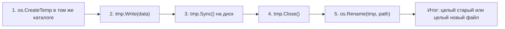

*Почему `os.WriteFile` способен обнулить ваши данные при внезапном сбое и как гарантировать целостность файла через временный файл, `Sync` и атомарный `os.Rename`.*

> «Любая функция ввода-вывода обязана считаться с вероятностью сбоя, и лишь наивный программист верит, что простое чтение или запись не могут завершиться ошибкой. Именно тогда, когда внезапно отказывают самые надёжные операции, нам нужнее всего знать почему.» — Алан Донован и Брайан Керниган

Пользователь добавляет сотую закладку в `BookmarkFlow`. Программа вызывает привычный `os.WriteFile("bookmarks.json", data, 0o600)`. В этот же момент сервер получает `SIGKILL` или на диске заканчивается свободное место. После перезапуска файл `bookmarks.json` существует, но весит 0 байт — либо обрывается посреди JSON-объекта. Пропала не только сотая закладка, пропали все девяносто девять прежних.

## Почему `os.WriteFile` разрушает данные на полпути

Вспомним системные вызовы из десятого урока. Под капотом `os.WriteFile` открывает файл с флагом **`O_TRUNC`** (*truncate* — усечь). Ядро немедленно обнуляет длину старого файла до **0 байт**, ещё до того как ваша программа передаст первый байт нового содержимого.

Дальше данные записываются одним или несколькими вызовами `write`. Между обнулением файла и завершением последней записи открывается окно уязвимости:

1. Процесс убили по `SIGKILL` или он упал с паникой — на диске остался огрызок JSON.
2. Закончилось место на диске (`ENOSPC`) — старые данные уже стёрты, новые не влезли.
3. Другая программа прочитала `bookmarks.json` прямо в момент перезаписи — она получила половину файла и упала с ошибкой парсинга.

Корень проблемы в том, что мы перезаписываем **живой файл по месту**, уничтожая предыдущую исправную версию раньше, чем готова новая.

## Решение: временный файл в том же каталоге и атомарный `os.Rename`

В пятом уроке мы разобрали устройство файловой системы Linux: каталог — это просто таблица соответствий «имя файла → номер `inode`». Сами данные лежат в блоках, на которые ссылается `inode`.

В Linux (и других POSIX-системах) системный вызов `rename` внутри **одной файловой системы** выполняется **атомарно**: ядро за один неделимый шаг переключает запись каталога `bookmarks.json` со старого `inode` на новый. Ни один читатель и никакой сбой не увидят промежуточного состояния.



Посмотрим на каждый шаг этого канонического рецепта — он целиком перекочует в `project/step06/atomic_store.go` нашего проекта `BookmarkFlow`:

1. **Временный файл в том же каталоге (`os.CreateTemp(filepath.Dir(path), ...)`).** Почему нельзя создать его в `/tmp`? Каталог `/tmp` на Linux часто примонтирован на отдельной файловой системе в оперативной памяти (`tmpfs`). Попытка переименовать файл между разными файловыми системами завершится ошибкой ядра `EXDEV` (*invalid cross-device link*) — атомарная перестановка указателей на `inode` там невозможна.
2. **Страховка уборки через `defer`.** Пока переименование не прошло успешно, держим флаг `cleanup := true`. Если любой шаг вернёт ошибку, отложенная функция удалит недописанный временный файл, не оставляя мусора в каталоге.
3. **Запись и принудительный сброс `tmp.Sync()`.** Обычный `tmp.Write` копирует байты только в страничный кэш ядра в RAM. Если сразу сделать `os.Rename`, а через секунду пропадёт питание, в каталоге может оказаться имя файла, указывающее на пустые блоки. Вызов `tmp.Sync()` (системный вызов `fsync`) заставляет ОС протолкнуть данные из кэша на физический накопитель **до** замены имени.
4. **Проверка ошибки `tmp.Close()`.** Для файла на чтение ошибку закрытия часто игнорируют, но для файла на запись — никогда: некоторые ошибки ввода-вывода файловая система возвращает именно при `close`.
5. **Атомарный `os.Rename(tmpName, path)`.** Если мы дошли сюда, на диске уже лежит полный, проверенный файл. Переименование мгновенно подменяет старую версию новой, после чего снимаем флаг `cleanup = false`.

## Каноническая реализация на Go

Соберём функцию `WriteFileAtomic` точно в том виде, в каком она работает в шаге 6 `BookmarkFlow`, и проверим её в деле:

```go
package main

import (
	"fmt"
	"os"
	"path/filepath"
)

// WriteFileAtomic безопасно перезаписывает файл через временный файл
// в том же каталоге и атомарный os.Rename.
func WriteFileAtomic(path string, data []byte) error {
	dir := filepath.Dir(path)
	tmp, err := os.CreateTemp(dir, ".bookmarkflow-*.tmp")
	if err != nil {
		return fmt.Errorf("создание временного файла: %w", err)
	}
	tmpName := tmp.Name()
	cleanup := true
	defer func() {
		if cleanup {
			_ = os.Remove(tmpName)
		}
	}()

	if _, err := tmp.Write(data); err != nil {
		_ = tmp.Close()
		return fmt.Errorf("запись временного файла: %w", err)
	}
	if err := tmp.Sync(); err != nil {
		_ = tmp.Close()
		return fmt.Errorf("синхронизация на диск: %w", err)
	}
	if err := tmp.Close(); err != nil {
		return fmt.Errorf("закрытие временного файла: %w", err)
	}
	if err := os.Rename(tmpName, path); err != nil {
		return fmt.Errorf("атомарное переименование: %w", err)
	}
	cleanup = false
	return nil
}

func main() {
	dir, err := os.MkdirTemp("", "atomic-demo-*")
	if err != nil {
		panic(err)
	}
	defer os.RemoveAll(dir)

	target := filepath.Join(dir, "bookmarks.json")
	if err := WriteFileAtomic(target, []byte(`{"count":1}`+"\n")); err != nil {
		panic(err)
	}
	if err := WriteFileAtomic(target, []byte(`{"count":2}`+"\n")); err != nil {
		panic(err)
	}

	content, err := os.ReadFile(target)
	if err != nil {
		panic(err)
	}
	fmt.Printf("Содержимое: %s", content)
}
```

Обратите внимание на ведущую точку в шаблоне `.bookmarkflow-*.tmp`: в Linux имена с точкой скрыты от обычного `ls`, а звёздочку `os.CreateTemp` заменяет случайной строкой, гарантируя отсутствие конфликта имён даже при параллельной работе.

*(NOTE: для абсолютной гарантии сохранности после внезапного обесточивания на некоторых файловых системах после `os.Rename` дополнительно вызывают `Sync()` ещё и на дескрипторе самого каталога `dir`, чтобы зафиксировать обновлённую запись каталога; подробнее о надёжности журналируемых файловых систем и журналов записи поговорим в Томах 2 и 5.)*

## Подводные камни

**Ловушка 1. Создавать временный файл через `os.CreateTemp("", ...)`.**  
Пустая строка в первом аргументе помещает файл в системный `/tmp`. Локально на ноутбуке с одним разделом диска код может случайно сработать, а на боевом сервере, где `/tmp` и `/var/lib` — разные разделы, упадёт с `invalid cross-device link`. Всегда передавайте `filepath.Dir(path)`.

**Ловушка 2. Забыть закрыть `tmp` перед `os.Rename`.**  
На Linux переименование открытого файла пройдёт, но на Windows вызов `os.Rename` на ещё не закрытом дескрипторе завершится ошибкой доступа. Закрывайте `tmp.Close()` строго до `os.Rename`, заодно проверяя ошибку закрытия.

**Ловушка 3. Права доступа после `os.CreateTemp`.**  
Функция `os.CreateTemp` создаёт файл с правами `0o600` (чтение и запись только владельцу). Для конфигов и закладок пользователя это отличный безопасный выбор, но если файл должны читать другие процессы под другим пользователем, явно вызовите `tmp.Chmod(perm)` до переименования.

> [!check] Проверь понимание
> Программа успешно выполнила `tmp.Write(data)` и `os.Rename(tmpName, path)`, но забыла вызвать `tmp.Sync()`. Чем это грозит при внезапном отключении питания через полсекунды?
>
> Метаданные каталога (новое имя файла) могут успеть записаться на диск раньше, чем ядро сбросит сами блоки данных из страничного кэша RAM. После перезагрузки файл окажется пустым или заполненным нулями.

## Практика

**Упражнение 1 (Базовое). Разбор поломки.**  
Разработчик решил упростить `WriteFileAtomic` и заменил первую строку на `tmp, err := os.CreateTemp("", "bm-*.tmp")`. На его ноутбуке тесты прошли, а на сервере Linux функция начала возвращать ошибку `rename /tmp/bm-123.tmp /data/bookmarks.json: invalid cross-device link`. Объясните причину и назовите точную правку.

> [!solution] Показать решение
> Каталоги `/tmp` и `/data` на сервере находятся на разных файловых системах (например, `/tmp` в `tmpfs` в памяти, а `/data` на диске). Системный вызов `rename` не может атомарно перенести `inode` между двумя разными файловыми системами и возвращает `EXDEV` (`invalid cross-device link`).  
> Правка: создавать временный файл в каталоге целевого файла — `os.CreateTemp(filepath.Dir(path), ".bm-*.tmp")`.

**Упражнение 2 (Практическое). Атомарная запись с заданными правами.**  
Доработайте `WriteFileAtomic` до сигнатуры `WriteFileAtomicPerm(path string, data []byte, perm os.FileMode) error`, чтобы перед закрытием и переименованием на временный файл выставлялись права `perm` через `tmp.Chmod(perm)`. В `main()` запишите файл с правами `0o644` и проверьте их через `os.Stat(path)`.

> [!solution] Показать решение
> ```go
> package main
>
> import (
> 	"fmt"
> 	"os"
> 	"path/filepath"
> )
>
> func WriteFileAtomicPerm(path string, data []byte, perm os.FileMode) error {
> 	dir := filepath.Dir(path)
> 	tmp, err := os.CreateTemp(dir, ".atomic-*.tmp")
> 	if err != nil {
> 		return err
> 	}
> 	tmpName := tmp.Name()
> 	cleanup := true
> 	defer func() {
> 		if cleanup {
> 			_ = os.Remove(tmpName)
> 		}
> 	}()
>
> 	if _, err := tmp.Write(data); err != nil {
> 		_ = tmp.Close()
> 		return err
> 	}
> 	if err := tmp.Chmod(perm); err != nil {
> 		_ = tmp.Close()
> 		return err
> 	}
> 	if err := tmp.Sync(); err != nil {
> 		_ = tmp.Close()
> 		return err
> 	}
> 	if err := tmp.Close(); err != nil {
> 		return err
> 	}
> 	if err := os.Rename(tmpName, path); err != nil {
> 		return err
> 	}
> 	cleanup = false
> 	return nil
> }
>
> func main() {
> 	dir, err := os.MkdirTemp("", "perm-*")
> 	if err != nil {
> 		panic(err)
> 	}
> 	defer os.RemoveAll(dir)
>
> 	p := filepath.Join(dir, "public.txt")
> 	if err := WriteFileAtomicPerm(p, []byte("ok\n"), 0o644); err != nil {
> 		panic(err)
> 	}
> 	info, err := os.Stat(p)
> 	if err != nil {
> 		panic(err)
> 	}
> 	fmt.Printf("Права: %o\n", info.Mode().Perm()) // Вывод: Права: 644
> }
> ```
> Вызов `tmp.Chmod(perm)` выполняется до `os.Rename`, поэтому целевой файл появляется в каталоге сразу с нужными правами — без окна, когда он доступен не тем пользователям.

**Упражнение 3 (Со звёздочкой \*). Безопасное сохранение JSON.**  
Напишите функцию `SaveJSONAtomic(path string, v any) error`, которая кодирует `v` через `json.MarshalIndent(v, "", "  ")` и сохраняет результат с помощью `WriteFileAtomic`. В `main()` сохраните структуру, затем попытайтесь сохранить заведомо некодируемое значение (например, канал `make(chan int)`) в тот же файл и убедитесь, что исходный JSON на диске остался целым.

> [!solution] Показать решение
> ```go
> package main
>
> import (
> 	"encoding/json"
> 	"fmt"
> 	"os"
> 	"path/filepath"
> )
>
> func WriteFileAtomic(path string, data []byte) error {
> 	tmp, err := os.CreateTemp(filepath.Dir(path), ".json-*.tmp")
> 	if err != nil {
> 		return err
> 	}
> 	tmpName := tmp.Name()
> 	cleanup := true
> 	defer func() {
> 		if cleanup {
> 			_ = os.Remove(tmpName)
> 		}
> 	}()
> 	if _, err := tmp.Write(data); err != nil {
> 		_ = tmp.Close()
> 		return err
> 	}
> 	if err := tmp.Sync(); err != nil {
> 		_ = tmp.Close()
> 		return err
> 	}
> 	if err := tmp.Close(); err != nil {
> 		return err
> 	}
> 	if err := os.Rename(tmpName, path); err != nil {
> 		return err
> 	}
> 	cleanup = false
> 	return nil
> }
>
> func SaveJSONAtomic(path string, v any) error {
> 	data, err := json.MarshalIndent(v, "", "  ")
> 	if err != nil {
> 		return fmt.Errorf("кодирование JSON: %w", err)
> 	}
> 	return WriteFileAtomic(path, append(data, '\n'))
> }
>
> func main() {
> 	dir, err := os.MkdirTemp("", "jsonatomic-*")
> 	if err != nil {
> 		panic(err)
> 	}
> 	defer os.RemoveAll(dir)
>
> 	p := filepath.Join(dir, "state.json")
> 	type State struct {
> 		Version int `json:"version"`
> 	}
> 	if err := SaveJSONAtomic(p, State{Version: 1}); err != nil {
> 		panic(err)
> 	}
> 	err = SaveJSONAtomic(p, make(chan int))
> 	fmt.Println("Ожидаемая ошибка:", err)
>
> 	raw, _ := os.ReadFile(p)
> 	fmt.Printf("Файл не пострадал:\n%s", raw)
> }
> ```
> Поскольку сериализация в байты и запись во временный файл происходят до `os.Rename`, любая ошибка на раннем этапе вообще не трогает существующий `state.json`.

---

Мы научились сохранять файлы так, чтобы ни сбой питания, ни внезапная ошибка не превратили данные в мусор. Остался финальный штрих подраздела про Linux — соберём в одном месте концентрированный набор команд терминала и конвейеров, которыми бэкенд-разработчик пользуется каждый день: [[13. Базовый набор команд терминала Linux для разработчика]].
