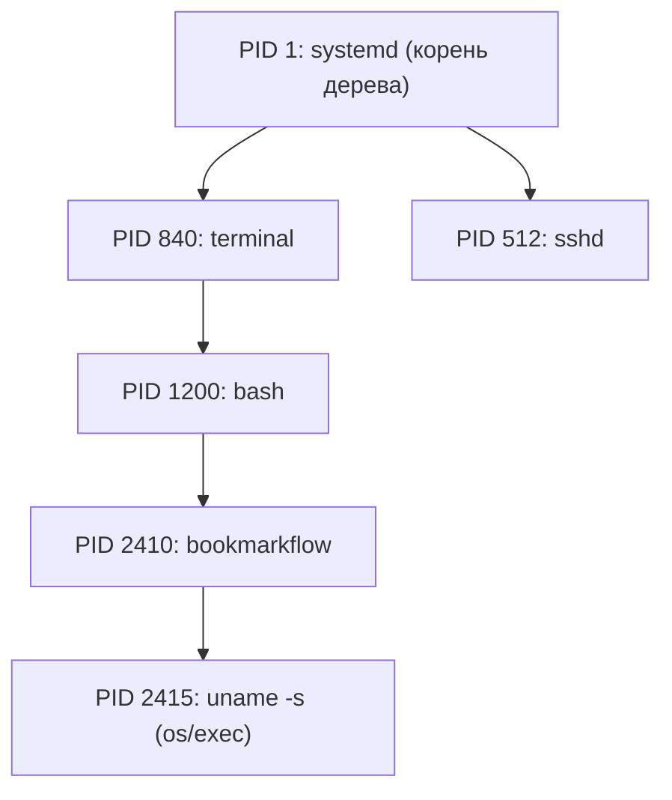

*Чем запущенный процесс отличается от бинарного файла на диске, как устроено дерево процессов от `PID 1`, зачем нужны коды возврата `0..255` и как запускать дочерние программы из Go через `os/exec`.*

Вы собрали утилиту `bookmarkflow` командой `go build` и открыли два окна терминала. В первом запустили `./bookmarkflow list`, во втором — `./bookmarkflow check`. Файл на диске один и тот же, но в системе работают две полностью независимые копии: у каждой свои переменные, свои открытые файлы, своя история выполнения. Если вторая копия завершится с ошибкой, первая даже не моргнёт.

Файл на диске — это просто рецепт, пассивный набор инструкций и данных. Как только вы просите операционную систему запустить этот файл, ядро создаёт **процесс** — живой экземпляр программы с собственной памятью, паспортом и ресурсами.

## Паспорт процесса: `PID`, `PPID` и память

Для каждого запущенного процесса ядро Linux заводит отдельную учётную запись. В ней хранится всё, что нужно для изоляции и контроля:

* **`PID`** (*Process ID*) — уникальный положительный номер процесса, по которому его можно найти или остановить.
* **`PPID`** (*Parent Process ID*) — номер родительского процесса, который его породил.
* **Своё адресное пространство памяти** — код программы, глобальные данные, стек и куча, недоступные соседям.
* **Таблица открытых файлов, переменные окружения и рабочий каталог** — внешний контекст запуска.
* **Код возврата (*exit code*)** — единственное число, которым процесс отчитывается перед родителем при завершении.

В Go узнать собственный `PID` и `PPID` родителя можно двумя функциями из пакета `os`: `os.Getpid()` и `os.Getppid()`.

## Дерево процессов и `PID 1`

В Linux ни один процесс не возникает из пустоты: новый процесс всегда порождает какой-то существующий родитель. Когда вы запускаете `./bookmarkflow` в терминале, оболочка (`bash` или `zsh`) выступает родителем, а ваша Go-программа — дочерним процессом.

Если подняться по цепочке `PPID` до самого верха, мы упрёмся в единственный корень — процесс с **`PID 1`** (в современных дистрибутивах Linux это обычно `systemd`, в минималистичных системах — классический `init`). Ядро запускает его первым сразу после загрузки:



У этой иерархии есть два важных правила:

1. **Если родитель завершился раньше ребёнка**, дочерний процесс становится *сиротой* (*orphan*). Ядро не убивает его — оно «усыновляет» процесс под `PID 1` (или ближайший системный менеджер), чтобы у каждого живого процесса всегда был родитель.
2. **Когда ребёнок завершается**, ядро освобождает его память и открытые файлы, но оставляет в таблице процессов крошечную запись с `PID` и кодом возврата — до тех пор, пока родитель не заберёт этот статус. Такой уже мёртвый, но ещё не «убранный» процесс называют **зомби** (*zombie*). Как только родитель прочитал статус (в Go это делает `cmd.Wait()`), запись исчезает.

## Коды возврата `0..255`

Когда процесс заканчивает работу, он передаёт родителю однобайтовое целое число от **`0` до `255`** — **код возврата** (*exit status*):

* **`0`** — успех. Программа выполнила задачу без ошибок.
* **`1..255`** — ошибка (принято использовать `1` для общей ошибки, `2` для неверных аргументов командной строки; коды `128 + N` оболочка резервирует для завершения по сигналу с номером `N`, например `130` для `Ctrl+C`).

Именно на кодах возврата держатся сценарии автоматизации и сборки. Запись `go test ./... && go build .` в оболочке означает: «запусти сборку, **только если** тесты вернули код `0`». Если передать в `os.Exit(256)` число больше 255, Linux возьмёт остаток по модулю 256 — и код `256` коварно превратится в `0` (успех).

В Go обычный выход из `main()` возвращает код `0`. Чтобы вернуть ненулевой код, вызывают `os.Exit(1)`.

## Запуск дочерних процессов из Go через `os/exec`

Иногда программе на Go нужно вызвать внешнюю утилиту — например, запустить `git` для проверки версии или системную команду `uname`. За это отвечает пакет стандартной библиотеки `os/exec`.

Напишем программу, которая печатает свой `PID` и `PPID`, запускает дочерний процесс `sh`, показывает его `PID`, проверяет, что родитель совпал с нашей программой, и разбирает ненулевой код возврата:

```go
package main

import (
	"errors"
	"fmt"
	"os"
	"os/exec"
	"strings"
)

func runCommand(name string, args ...string) (string, int, error) {
	cmd := exec.Command(name, args...)
	out, err := cmd.Output()
	if err == nil {
		return strings.TrimSpace(string(out)), 0, nil
	}

	var exitErr *exec.ExitError
	if errors.As(err, &exitErr) {
		return strings.TrimSpace(string(out)), exitErr.ExitCode(), nil
	}
	return "", -1, err
}

func main() {
	fmt.Printf("Go-процесс: PID=%d, PPID=%d\n", os.Getpid(), os.Getppid())

	// Встроенная переменная $$ в sh печатает PID дочерней оболочки.
	out, code, err := runCommand("sh", "-c", "echo child_pid=$$")
	if err != nil {
		fmt.Fprintln(os.Stderr, "не удалось запустить sh:", err)
		os.Exit(1)
	}
	fmt.Printf("успешная команда: %s (exit=%d)\n", out, code)

	// Дочерний процесс завершается с кодом 42.
	_, failCode, err := runCommand("sh", "-c", "exit 42")
	if err != nil {
		fmt.Fprintln(os.Stderr, "ошибка запуска:", err)
		os.Exit(1)
	}
	fmt.Printf("команда с ошибкой вернула код: %d\n", failCode)
}
```

Запустим этот код в терминале:

```text
$ go run main.go
Go-процесс: PID=18420, PPID=18391
успешная команда: child_pid=18421 (exit=0)
команда с ошибкой вернула код: 42
```

Обратите внимание на две детали в `runCommand`:
1. `cmd.Output()` запускает дочерний процесс, собирает весь его стандартный вывод и сам вызывает `Wait()`, поэтому зомби-процессы не накапливаются.
2. Мы разделяем две разные ситуации через `errors.As(err, &exitErr)`: команда **запустилась и вернула ненулевой код** (`*exec.ExitError`, здесь `42`), либо команда вообще **не смогла стартовать** (например, бинарник не найден в `PATH`).

## Подводные камни

**Ловушка 1. `os.Exit` пропускает все `defer`.**  
Функция `os.Exit(1)` немедленно просит ядро завершить процесс. Отложенные `defer f.Close()`, сброс буферов и удаление временных файлов **не выполнятся**.

```go
func badMain() {
	f, _ := os.Create("report.txt")
	defer f.Close() // НЕ выполнится при os.Exit ниже
	os.Exit(1)
}
```

Идиоматичный приём в Go — выносить всю логику в функцию `run() error`, а `os.Exit(1)` вызывать ровно в одном месте, в самом конце `main()`, когда все `defer` внутри `run()` уже отработали.

**Ловушка 2. Передача аргументов одной строкой в `exec.Command`.**  
Вызов `exec.Command("ls -la")` завершится ошибкой `executable file not found`: Go не запускает оболочку автоматически и ищет программу с буквальным именем `"ls -la"`. Имя команды и каждый аргумент передаются отдельно: `exec.Command("ls", "-la")`. Такой подход вдобавок защищает от инъекций команд оболочки.

**Ловушка 3. Забытый `cmd.Wait()` после `cmd.Start()`.**  
Если вы запустили процесс асинхронно через `cmd.Start()`, вы обязаны вызвать `cmd.Wait()`. Без этого завершённый ребёнок останется в системе зомби до конца жизни вашей программы.

> [!check] Проверь понимание
> В функции `main()` открыт файл с `defer f.Close()`, а затем при ошибке вызывается `os.Exit(1)`. Будет ли вызван `f.Close()` до завершения процесса? А что произойдёт с самим файловым дескриптором на уровне ОС?
>
> `defer f.Close()` не выполнится — `os.Exit` завершает процесс мгновенно, поэтому буферы в памяти Go (например, `bufio.Writer`) потеряются. Сам файловый дескриптор ядро Linux всё же закроет автоматически при очистке ресурсов мёртвого процесса, но несохранённые данные из пользовательского буфера уже не спасти.

## Практика

**Упражнение 1 (Базовое). Код возврата и `defer`.**  
Что напечатает следующая программа и какой код возврата увидит оболочка (`echo $?`) после её запуска?

```go
package main

import (
	"fmt"
	"os"
)

func work() int {
	defer fmt.Println("шаг 1: очистка work")
	return 2
}

func main() {
	defer fmt.Println("шаг 2: очистка main")
	code := work()
	os.Exit(code)
}
```

> [!solution] Показать решение
> Программа напечатает только `шаг 1: очистка work` и завершится с кодом возврата `2`.
> Функция `work()` вышла штатным `return`, поэтому её `defer` успел отработать. А вот `defer` внутри `main()` был пропущен, потому что `os.Exit(2)` завершил процесс немедленно.

**Упражнение 2 (Практическое). Идиоматичный `main` + `run`.**  
Напишите программу `package main`, которая принимает путь к файлу в `os.Args[1]`, пытается прочитать его размер через `os.Stat` и печатает `<путь>: <размер> байт`. Если аргумент не передан или файла нет, напечатайте ошибку в `os.Stderr` и завершитесь с кодом `1` — но так, чтобы внутри `run() error` корректно отработал `defer fmt.Fprintln(os.Stderr, "ресурсы освобождены")`.

> [!solution] Показать решение
> ```go
> package main
>
> import (
> 	"fmt"
> 	"os"
> )
>
> func run(args []string) error {
> 	defer fmt.Fprintln(os.Stderr, "ресурсы освобождены")
> 	if len(args) < 2 {
> 		return fmt.Errorf("использование: %s <файл>", args[0])
> 	}
> 	info, err := os.Stat(args[1])
> 	if err != nil {
> 		return err
> 	}
> 	fmt.Printf("%s: %d байт\n", args[1], info.Size())
> 	return nil
> }
>
> func main() {
> 	if err := run(os.Args); err != nil {
> 		fmt.Fprintln(os.Stderr, "ошибка:", err)
> 		os.Exit(1)
> 	}
> }
> ```
> Вынесение работы в `run` гарантирует, что все отложенные `defer` успевают выполниться до того, как `main` вызовет `os.Exit(1)`.

**Упражнение 3 (Со звёздочкой \*). Проверка внешней утилиты с таймаутом.**  
Напишите функцию `CheckCommand(ctx context.Context, name string, args ...string) (int, error)`, которая запускает внешнюю команду с контекстом (`exec.CommandContext`) и возвращает её код возврата (`0`, если успешно; точный `ExitCode()`, если команда вернула `*exec.ExitError`). Если истёк таймаут контекста или бинарник не существует — верните `(-1, err)`. Проверьте её на команде, которая спит 2 секунды при таймауте 100 мс.

> [!solution] Показать решение
> ```go
> package main
>
> import (
> 	"context"
> 	"errors"
> 	"fmt"
> 	"os/exec"
> 	"time"
> )
>
> func CheckCommand(ctx context.Context, name string, args ...string) (int, error) {
> 	cmd := exec.CommandContext(ctx, name, args...)
> 	err := cmd.Run()
> 	if err == nil {
> 		return 0, nil
> 	}
> 	if ctx.Err() != nil {
> 		return -1, ctx.Err()
> 	}
> 	var exitErr *exec.ExitError
> 	if errors.As(err, &exitErr) {
> 		return exitErr.ExitCode(), nil
> 	}
> 	return -1, err
> }
>
> func main() {
> 	ctx, cancel := context.WithTimeout(context.Background(), 100*time.Millisecond)
> 	defer cancel()
>
> 	code, err := CheckCommand(ctx, "sh", "-c", "sleep 2")
> 	fmt.Printf("code=%d err=%v\n", code, err)
> }
> ```
> Проверка `ctx.Err() != nil` до разбора `*exec.ExitError` важна: когда контекст истекает, `CommandContext` принудительно убивает дочерний процесс, и `cmd.Run()` возвращает `*exec.ExitError` со статусом `-1`, хотя истинная причина — таймаут контекста.

---

Один процесс даёт нам изоляцию и понятный жизненный цикл, но внутри него код по умолчанию выполняется в одну линию. Чтобы загрузить все ядра процессора и одновременно обслуживать тысячи задач, в дело вступают потоки ОС и горутины — разберём их разницу в следующем уроке [[3. Потоки ОС и переключение контекста — почему 100 000 горутин работают легко]].
