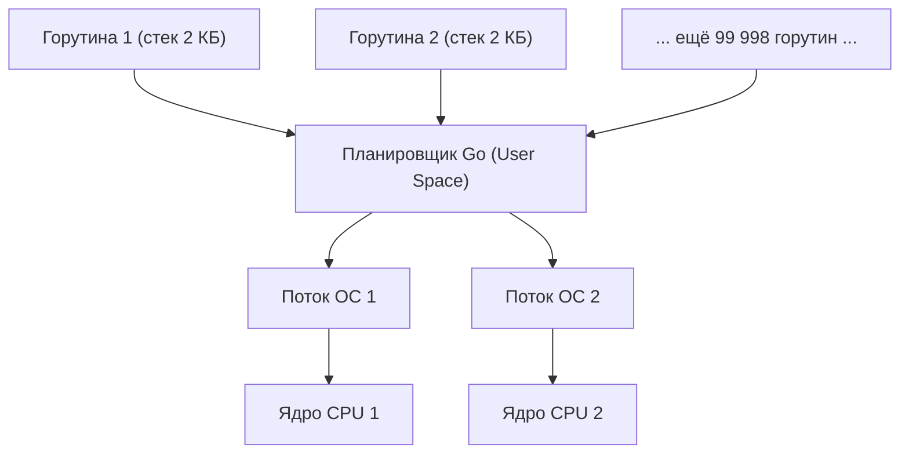

*Чем поток операционной системы отличается от процесса, во сколько обходится переключение контекста через ядро и почему 100 000 горутин помещаются в память обычного ноутбука.*

В Модуле 4 мы легко запускали сотни горутин для параллельной проверки ссылок в `BookmarkFlow`. Если попытаться провернуть тот же трюк напрямую с потоками операционной системы — например, создать 100 000 потоков ОС на обычном ноутбуке с 16 ГБ оперативной памяти — программа рухнет задолго до финиша. Операционная система просто откажется выделять столько памяти и ресурсов планировщика.

Почему слово «горутина» — не просто красивое переименование потока ОС? Чтобы это понять, спустимся на один слой ниже и посмотрим, как Linux делит процессорное время между задачами.

## Процесс против потока ОС

Процесс, который мы разобрали в прошлом уроке, изолирован от соседей: у каждого процесса своя память, своя таблица открытых файлов и свой `PID`. Заводить по целому процессу на каждую задачу внутри одной программы дорого и неудобно — им трудно быстро обмениваться структурами в памяти.

Поэтому внутри одного процесса операционная система позволяет создать несколько **потоков ОС** (*OS threads*). Поток — это самостоятельная линия выполнения инструкций внутри процесса:

* **Общее для всех потоков процесса:** адресное пространство памяти (куча, глобальные переменные), код программы и таблица открытых файлов.
* **Личное у каждого потока ОС:** набор регистров процессора (включая указатель текущей инструкции) и **собственный стек вызовов**.

Вот где прячется первая цена. Ядро ОС заранее не знает, на какую глубину поток будет вызывать функции, и не умеет автоматически перетасовывать его стек при нехватке места. Поэтому Linux по умолчанию резервирует под стек каждого потока ОС крупный кусок памяти — обычно **от 1 до 8 МБ**.

Сделаем простую арифметику. Сто тысяч потоков ОС по 2 МБ стека требуют порядка **200 ГБ** памяти только под пустые стеки — задолго до того, как программа сохранит хоть одну закладку.

## Цена переключения контекста

Вторая проблема — переключение между потоками. Если у процессора 8 ядер, а активных потоков ОС 1 000, ядро должно постоянно ставить одни потоки на паузу и запускать другие. Эта операция называется **переключением контекста** (*context switch*).

Чтобы переключить поток ОС, ядро вынуждено:
1. пересечь границу привилегий и войти в *kernel space*;
2. сохранить все регистры CPU текущего потока в память ядра;
3. выбрать следующий поток из очереди планировщика Linux и загрузить его регистры;
4. вернуться в *user space*.

Одно такое переключение стоит **~1–5 микросекунд** прямого времени — плюс косвенная потеря на «холодных» кэшах L1/L2 (новый поток обращается к другим адресам памяти и вытесняет данные старого). Когда потоков десятки тысяч, процессор тратит заметную долю жизни не на вашу логику, а на перекладывание контекстов.

## Почему 100 000 горутин работают легко

Создатели Go решили не привязывать каждую конкурентную задачу 1-к-1 к тяжелому потоку операционной системы. Вместо этого в каждый бинарник Go встроен лёгкий **планировщик рантайма** в пользовательском пространстве.

Он использует модель «многие ко многим» (*M:N*): тысячи горутин мультиплексируются поверх небольшого пула настоящих потоков ОС (обычно примерно по числу ядер CPU, которое возвращает `runtime.GOMAXPROCS(0)`):



Два инженерных решения дают выигрыш на порядки:

1. **Растущий стек от 2 КБ.** Стартовый стек горутины занимает всего **2 КБ** против **1–8 МБ** у потока ОС — разница в **500–4 000 раз**. Сто тысяч горутин на старте съедают около **200 МБ** памяти вместо сотен гигабайт. Если горутина уйдёт в глубокую рекурсию, рантайм Go сам выделит ей стек побольше и аккуратно перенесёт данные.
2. **Переключение без входа в ядро.** Когда горутина ждёт чтения из канала, таймера или завершения операции ввода-вывода, планировщик Go сам ставит её на паузу и отдаёт тот же самый поток ОС другой готовой горутине. Всё происходит в *user space*: сохраняется лишь несколько регистров, переключение занимает **десятки или сотни наносекунд** — на порядок быстрее системного переключения контекста.

*(NOTE: здесь мы намеренно даём верхнюю инженерную модель без внутренних структур планировщика Go, балансировки очередей между ядрами и взаимодействия с сетевым вводом-выводом — все эти детали мы подробно разберём в Томе 5.)*

Сравним поток ОС и горутину в одной таблице:

| Свойство | Поток ОС (Linux) | Горутина Go |
|---|---|---|
| Кто планирует | Ядро Linux (*kernel space*) | Рантайм Go (*user space*) |
| Стартовый размер стека | Фиксированный, 1–8 МБ | Динамический, от 2 КБ |
| Цена переключения | ~1–5 мкс (вход в ядро) | ~100–300 нс (внутри процесса) |
| Практический потолок на ноутбуке | Сотни — несколько тысяч | Сотни тысяч |

## Эксперимент: 100 000 горутин вживую

Проверим расчёты на реальной машине. Запустим 100 000 живых горутин одновременно, придержим их на одном общем канале, чтобы они гарантированно существовали в памяти в один и тот же момент, и посмотрим на показания `runtime`:

```go
package main

import (
	"fmt"
	"runtime"
	"sync"
	"time"
)

func memMB() float64 {
	var m runtime.MemStats
	runtime.ReadMemStats(&m)
	return float64(m.Alloc) / (1024 * 1024)
}

func main() {
	const total = 100_000

	fmt.Printf("CPU ядер: %d, GOMAXPROCS: %d\n", runtime.NumCPU(), runtime.GOMAXPROCS(0))
	beforeMB := memMB()

	ready := make(chan struct{})
	release := make(chan struct{})
	var wg sync.WaitGroup
	wg.Add(total)

	start := time.Now()
	for range total {
		go func() {
			defer wg.Done()
			ready <- struct{}{}
			<-release // ждём общего сигнала, чтобы все 100 000 жили одновременно
		}()
	}

	// Дожидаемся старта всех 100 000 горутин.
	for range total {
		<-ready
	}
	spawnDur := time.Since(start)
	peakGoroutines := runtime.NumGoroutine()
	peakMB := memMB()

	close(release) // отпускаем все 100 000 горутин одним закрытием канала
	wg.Wait()

	fmt.Printf("старт 100 000 горутин: %v\n", spawnDur)
	fmt.Printf("пик активных горутин:  %d\n", peakGoroutines)
	fmt.Printf("память (Alloc):        %.1f МБ -> %.1f МБ\n", beforeMB, peakMB)
}
```

Запустим программу в терминале (конкретные миллисекунды зависят от процессора, но порядок цифр стабилен):

```text
$ go run main.go
CPU ядер: 8, GOMAXPROCS: 8
старт 100 000 горутин: 145.3ms
пик активных горутин:  100001
память (Alloc):        0.2 МБ -> 18.7 МБ
```

Сто тысяч одновременных горутин поднялись за долю секунды и спокойно разместились в памяти поверх восьми потоков ОС. Обратите внимание на цифру `Alloc`: счётчик `m.Alloc` учитывает объекты в куче, а сами стеки горутин (около 200 МБ) отражаются в `m.StackInuse` — но даже вместе с ними вся программа легко укладывается в четверть гигабайта RAM.

## Подводные камни

**Ловушка 1. «Раз горутины дешёвые, запущу по одной на каждый файл без ограничений».**  
Дешёвые — не значит бесплатные. Если запустить 100 000 горутин, которые одновременно откроют файлы или сетевые соединения, вы не исчерпаете стек, зато мгновенно упрётесь в лимит открытых файлов ОС или перегрузите внешний сервер. Для внешней работы по-прежнему нужен пул воркеров с ограниченной шириной (как мы делали в Модуле 4).

**Ловушка 2. Утечка заблокированных горутин.**  
Сборщик мусора освобождает неиспользуемые переменные, но никогда не удаляет горутину, которая навечно зависла в ожидании канала. За сутки работы сервера тысячи «забытых» горутин незаметно съедят всю память. У каждой запущенной горутины должен быть понятный путь завершения — через закрытие канала или `context.Context`.

> [!check] Проверь понимание
> На сервере с 4 ядрами CPU ваша программа на Go запустила 10 000 горутин, которые в цикле вычисляют хэши (чистая нагрузка на процессор без ожидания сети и диска). Сколько из них выполняются физически в один и тот же наносекундный момент времени?
>
> Не более 4 — по одной на каждое физическое/логическое ядро процессора (`GOMAXPROCS`). Остальные 9 996 горутин ждут своей очереди в планировщике Go. Конкурентность позволяет держать 10 000 задач в работе, но истинный параллелизм всегда ограничен числом ядер CPU.

## Практика

**Упражнение 1 (Базовое). Арифметика стеков.**  
Оцените минимальный объём памяти под стеки для 50 000 одновременных задач в двух системах: (а) по одному потоку ОС со стеком 2 МБ; (б) по одной горутине Go со стартовым стеком 2 КБ. Во сколько раз различаются числа?

> [!solution] Показать решение
> * (а) Потоки ОС: `50 000 × 2 МБ = 100 000 МБ ≈ 97,7 ГБ` памяти.
> * (б) Горутины Go: `50 000 × 2 КБ = 100 000 КБ ≈ 97,7 МБ` памяти.
> Разница ровно в **1 024 раза** (2 МБ / 2 КБ).

**Упражнение 2 (Практическое). Измеряем реальный расход стеков.**  
Доработайте пример из урока так, чтобы вместо `m.Alloc` он выводил сразу две метрики из `runtime.MemStats`: `m.StackInuse` (память, занятая стеками горутин) и `m.HeapAlloc` (память в куче) для 20 000 одновременных горутин. Разделите `m.StackInuse` на `20 000`, чтобы увидеть фактический средний размер стека одной горутины в байтах.

> [!solution] Показать решение
> ```go
> package main
>
> import (
> 	"fmt"
> 	"runtime"
> 	"sync"
> )
>
> func main() {
> 	const n = 20_000
> 	ready := make(chan struct{})
> 	release := make(chan struct{})
> 	var wg sync.WaitGroup
> 	wg.Add(n)
>
> 	for range n {
> 		go func() {
> 			defer wg.Done()
> 			ready <- struct{}{}
> 			<-release
> 		}()
> 	}
> 	for range n {
> 		<-ready
> 	}
>
> 	var m runtime.MemStats
> 	runtime.ReadMemStats(&m)
> 	fmt.Printf("HeapAlloc:  %.2f МБ\n", float64(m.HeapAlloc)/(1024*1024))
> 	fmt.Printf("StackInuse: %.2f МБ (~%d байт на горутину)\n",
> 		float64(m.StackInuse)/(1024*1024), m.StackInuse/n)
>
> 	close(release)
> 	wg.Wait()
> }
> ```
> На практике `m.StackInuse / n` покажет чуть больше 2 048 байт (обычно 2–4 КБ с учётом выравнивания и служебных фреймов), что подтверждает стартовый стек в 2 КБ.

**Упражнение 3 (Со звёздочкой \*). Влияние `GOMAXPROCS` на CPU-задачу.**  
Напишите программу `package main`, которая запускает 8 горутин, где каждая считает сумму первых 50 миллионов целых чисел. Замерьте время выполнения всей группы дважды: сначала с `runtime.GOMAXPROCS(1)`, затем с `runtime.GOMAXPROCS(runtime.NumCPU())`. Объясните разницу в результатах.

> [!solution] Показать решение
> ```go
> package main
>
> import (
> 	"fmt"
> 	"runtime"
> 	"sync"
> 	"time"
> )
>
> func runCPUWork(workers int) (time.Duration, int64) {
> 	start := time.Now()
> 	results := make([]int64, workers)
> 	var wg sync.WaitGroup
> 	wg.Add(workers)
>
> 	for id := range workers {
> 		go func(idx int) {
> 			defer wg.Done()
> 			var s int64
> 			for i := range int64(50_000_000) {
> 				s += i
> 			}
> 			results[idx] = s
> 		}(id)
> 	}
> 	wg.Wait()
> 
> 	var total int64
> 	for _, v := range results {
> 		total += v
> 	}
> 	return time.Since(start), total
> }
>
> func main() {
> 	runtime.GOMAXPROCS(1)
> 	d1, sum1 := runCPUWork(8)
>
> 	cpus := runtime.NumCPU()
> 	runtime.GOMAXPROCS(cpus)
> 	dN, sumN := runCPUWork(8)
>
> 	fmt.Printf("GOMAXPROCS=1:  %v (sum=%d)\n", d1, sum1)
> 	fmt.Printf("GOMAXPROCS=%d:  %v (sum=%d)\n", cpus, dN, sumN)
> }
> ```
> При `GOMAXPROCS(1)` все 8 горутин делят один поток ОС и одно ядро процессора — они выполняются конкурентно, но не параллельно. При `GOMAXPROCS(NumCPU())` планировщик распределяет их по всем доступным ядрам, и чисто вычислительная задача ускоряется кратно числу физических ядер.

---

Мы увидели, как процессы делят ядра процессора с помощью потоков и горутин. Но как десятки процессов делят одну физическую оперативную память так, чтобы ни один из них не смог прочитать или испортить чужие переменные? Об этом в следующем уроке — [[4. Виртуальная память на пальцах — изоляция процессов и страницы]].
