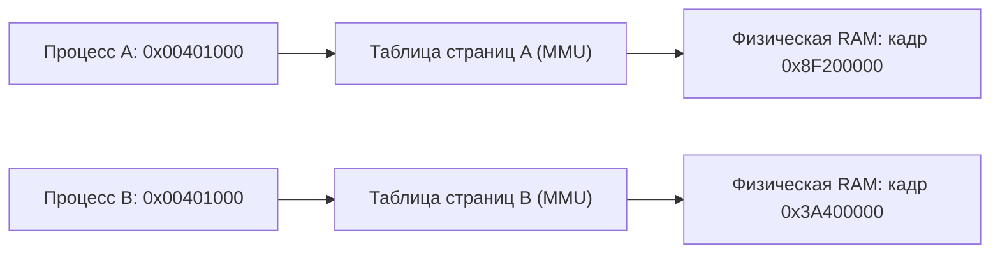
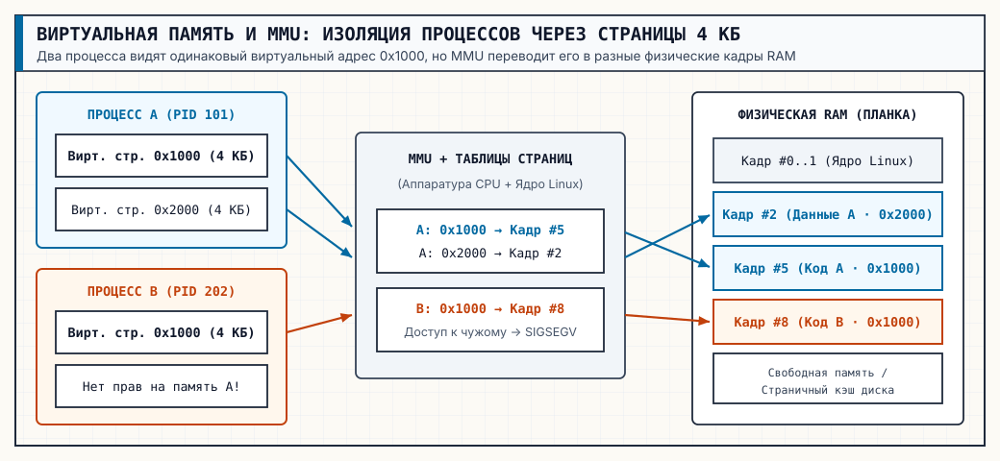

*Почему два процесса могут использовать один и тот же адрес `0x00401000` и не мешать друг другу, как работают страницы памяти по 4 КБ, чем `VSZ` отличается от `RSS` и когда приходит `OOM Killer`.*

Запустите два экземпляра одной и той же программы на Go и выведите в каждом адрес переменной: `fmt.Printf("%p\n", &counter)`. Нередко обе программы напечатают похожий или даже **совпадающий** адрес вроде `0x00401000` или `0xc0000140a0`. Но когда первая программа записывает по этому адресу `100`, вторая по-прежнему читает свой `0`.

Если бы указатель в Go был прямым физическим номером ячейки в микросхеме RAM, две программы немедленно затёрли бы данные друг друга. Чтобы изолировать процессы, операционная система и процессор ввели между программой и физической памятью слой перевода — **виртуальную память**.

## Адрес в программе — не адрес в RAM

Каждый процесс Linux видит вокруг себя иллюзию: будто вся память компьютера принадлежит только ему одному и начинается с нуля. Адреса, которые вы видите в `%p`, — это **виртуальные адреса**. Они имеют смысл только внутри адресного пространства конкретного процесса.

Чтобы эта иллюзия работала без потери скорости, операционную систему поддерживает специальный блок прямо внутри процессора — **MMU** (*Memory Management Unit*, блок управления памятью). Вся память — и виртуальная, и физическая — нарезана на одинаковые блоки фиксированного размера, **страницы** (*pages*). На Linux для x86-64 стандартный размер страницы — **4 КБ** (4 096 байт).

Ядро Linux ведёт для каждого процесса отдельную **таблицу страниц** (*page table*) — справочник соответствия: «виртуальная страница N этого процесса лежит в физическом кадре M оперативной памяти». При каждом обращении к памяти MMU мгновенно переводит виртуальный адрес в физический:



Один и тот же виртуальный адрес `0x00401000` у Процесса A и у Процесса B ведёт в совершенно разные участки физической RAM. Процесс A физически не способен дотянуться до памяти Процесса B — её просто нет в его таблице страниц.



Эта же механика ловит ошибки с нулевым указателем. Самая первая страница (вокруг адреса `0x00000000`) намеренно **не привязана** ни к какой физической памяти. Как только код на Go разыменовывает `nil`-указатель, MMU обнаруживает несуществующую страницу и бьёт тревогу, ядро шлёт сигнал нарушения защиты памяти, а рантайм Go превращает его в знакомую панику `invalid memory address or nil pointer dereference`.

*(NOTE: на реальном x86-64 таблица страниц многоуровневая, а частые переводы кэшируются в аппаратном буфере TLB внутри CPU — подробную физику этого механизма мы разберём в Томе 5.)*

## `VSZ` против `RSS`: обещанная и реальная память

Когда вы смотрите на Go-программу в системных утилитах (`ps`, `top`), рядом с процессом почти всегда стоят два числа, и новичков пугает первое из них:

* **`VSZ` (*Virtual Size*)** — весь объём виртуального адресного пространства, который процесс зарезервировал. Рантайм Go при старте просит у Linux крупный диапазон виртуальных адресов «на вырост» (нередко больше 1 ГБ), чтобы потом быстро распределять память.
* **`RSS` (*Resident Set Size*)** — объём страниц, которые **прямо сейчас** реально заняты в физической оперативной памяти RAM.

Linux не тратит физические кадры RAM впустую. Когда программа резервирует 64 МБ виртуальных адресов, ядро только делает пометку в таблице страниц, но не выдаёт настоящую RAM. Физическая страница по 4 КБ подключается **лениво** — в тот самый момент, когда программа впервые запишет в неё хотя бы один байт (*demand paging*).

Убедимся в этом прямо на живой программе Go. Прочитаем строки `VmSize` (`VSZ`) и `VmRSS` (`RSS`) из виртуального файла `/proc/self/status` до выделения 64 МБ, сразу после `make` и после записи одного байта в каждую страницу по 4 096 байт:

```go
package main

import (
	"fmt"
	"os"
	"strings"
)

func printMem(stage string) {
	data, err := os.ReadFile("/proc/self/status")
	if err != nil {
		fmt.Printf("%-15s недоступно (%v)\n", stage, err)
		return
	}

	var vsz, rss string
	for _, line := range strings.Split(string(data), "\n") {
		if strings.HasPrefix(line, "VmSize:") {
			vsz = strings.TrimSpace(strings.TrimPrefix(line, "VmSize:"))
		}
		if strings.HasPrefix(line, "VmRSS:") {
			rss = strings.TrimSpace(strings.TrimPrefix(line, "VmRSS:"))
		}
	}
	fmt.Printf("%-15s VSZ=%-12s RSS=%s\n", stage, vsz, rss)
}

func main() {
	const size = 64 << 20 // 64 МБ
	const pageSize = 4096

	printMem("до make:")

	buf := make([]byte, size)
	printMem("после make:")

	// Трогаем по 1 байту в каждой странице размером 4 КБ.
	for i := 0; i < len(buf); i += pageSize {
		buf[i] = 1
	}
	printMem("после записи:")

	fmt.Printf("контрольные байты: первый=%d, последняя страница=%d\n",
		buf[0], buf[len(buf)-pageSize])
}
```

Запустим программу на Linux:

```text
$ go run main.go
до make:        VSZ=1227132 kB   RSS=2580 kB
после make:     VSZ=1293316 kB   RSS=3120 kB
после записи:   VSZ=1293828 kB   RSS=68952 kB
контрольные байты: первый=1, последняя страница=1
```

Посмотрите на цифры — они наглядно опровергают страх перед `VSZ`:
1. Ещё до `make` наш крошечный бинарник имеет `VSZ` **1,2 ГБ**, но физически занимает всего **2,5 МБ** (`RSS`).
2. После `make([]byte, 64<<20)` виртуальный объём `VSZ` вырос на ~66 МБ, а физический `RSS` почти не сдвинулся (**3,1 МБ**). Ядро выдало 16 384 виртуальные страницы, но не выделило под них реальную RAM.
3. Стоило записать всего по **одному байту** в каждую из 16 384 страниц — и `RSS` скакнул сразу на **+65 МБ** (до 69 МБ). Каждое первое касание новой страницы заставило ядро выдать целый физический кадр на 4 КБ.

## Когда кончается физическая память: `OOM Killer`

Виртуального пространства у 64-битного процесса почти бесконечно много, а физическая память на сервере конечна. Если программа (например, из-за утечки слайса или загрузки гигантского файла целиком через `os.ReadFile`) продолжает касаться всё новых страниц и исчерпывает всю доступную RAM и область подкачки (*swap*), ядро Linux оказывается перед выбором: зависнуть всей машиной или спасти систему, пожертвовав одним процессом.

В этот момент просыпается **OOM Killer** (*Out-Of-Memory Killer*) — встроенный защитный механизм ядра. Он оценивает процессы по потреблению физической памяти (`RSS`), выбирает главного «пожирателя» и мгновенно уничтожает его сигналом `SIGKILL` (код возврата `137` = `128 + 9`).

При гибели от `OOM Killer` программа на Go **не успевает** выполнить `defer`, сбросить логи или напечатать стек вызовов. В терминале появляется лаконичное `Killed`, а истинная причина остаётся только в системном журнале ядра (`dmesg`: `Out of memory: Killed process ...`).

## Подводные камни

**Ловушка 1. Паника из-за большого `VSZ` в мониторинге.**  
Если ваш Go-сервис показывает `VSZ = 1.5 GB` и `RSS = 28 MB`, утечки памяти нет. Для оценки реального потребления RAM на сервере всегда смотрите на `RSS`, а не на `VSZ`.

**Ловушка 2. Чтение неизвестно большого файла целиком через `os.ReadFile`.**  
На тестовом файле в 10 КБ `os.ReadFile` работает мгновенно. На сервере, куда подложили выгрузку логов на 4 ГБ при лимите памяти 512 МБ, попытка загрузить всё в один `[]byte` приведёт прямо к `OOM Killer`. Для больших файлов читайте поток построчно через `bufio.Scanner` или порциями через `io.Reader`.

> [!check] Проверь понимание
> Программа выделила `buf := make([]byte, 40<<20)` (40 МБ), но записала данные только в первые 10 000 байт (`buf[:10000]`). На сколько примерно вырастет её физическая память `RSS`?
>
> Примерно на 12 КБ (три страницы по 4 096 байт = 12 288 байт), а не на 40 МБ. Остальные ~40 МБ останутся лишь виртуальным резервом в `VSZ`, пока программа не обратится к этим страницам.

## Практика

**Упражнение 1 (Базовое). Считаем страницы.**  
Размер страницы памяти в Linux равен 4 096 байт. Сколько страниц памяти потребуется, чтобы разместить массив данных размером: (а) 100 байт; (б) 4 097 байт; (в) 1 МБ (1 048 576 байт)?

> [!solution] Показать решение
> * (а) 100 байт — **1 страница** (ядро выделяет физическую память целиком страницами, минимум 4 096 байт).
> * (б) 4 097 байт — **2 страницы** (один байт сверх 4 096 требует второй страницы).
> * (в) 1 048 576 / 4 096 = **256 страниц**.

**Упражнение 2 (Практическое). Парсер `RSS` из `/proc/self/status`.**  
Напишите функцию `CurrentRSSKB() (int64, error)`, которая читает `/proc/self/status`, находит строку `VmRSS:` (например, `VmRSS:	    3120 kB`) и возвращает число килобайт как `int64` с помощью `strings.Fields` и `strconv.ParseInt`.

> [!solution] Показать решение
> ```go
> package main
>
> import (
> 	"bufio"
> 	"fmt"
> 	"os"
> 	"strconv"
> 	"strings"
> )
>
> func CurrentRSSKB() (int64, error) {
> 	f, err := os.Open("/proc/self/status")
> 	if err != nil {
> 		return 0, err
> 	}
> 	defer f.Close()
>
> 	sc := bufio.NewScanner(f)
> 	for sc.Scan() {
> 		line := sc.Text()
> 		if strings.HasPrefix(line, "VmRSS:") {
> 			fields := strings.Fields(line)
> 			if len(fields) < 2 {
> 				return 0, fmt.Errorf("неожиданный формат строки: %q", line)
> 			}
> 			return strconv.ParseInt(fields[1], 10, 64)
> 		}
> 	}
> 	if err := sc.Err(); err != nil {
> 		return 0, err
> 	}
> 	return 0, fmt.Errorf("поле VmRSS не найдено")
> }
>
> func main() {
> 	kb, err := CurrentRSSKB()
> 	if err != nil {
> 		fmt.Fprintln(os.Stderr, "ошибка:", err)
> 		os.Exit(1)
> 	}
> 	fmt.Printf("текущий RSS: %d КБ (%.2f МБ)\n", kb, float64(kb)/1024)
> }
> ```
> Использование `bufio.Scanner` вместо `os.ReadFile` позволяет остановиться, как только найдена нужная строка `VmRSS:`, а `strings.Fields` аккуратно игнорирует любое число пробелов и табуляций.

**Упражнение 3 (Со звёздочкой \*). Шаг по страницам против записи каждого байта.**  
Дополните программу из урока: выделите 32 МБ (`make([]byte, 32<<20)`) и проверьте `RSS` в двух вариантах — сначала если записать по одному байту через каждые **8 192 байта** (через страницу), а затем если пройтись с шагом **4 096 байт**. Объясните, почему в первом случае `RSS` вырастет примерно на 16 МБ, а во втором — на все 32 МБ.

> [!solution] Показать решение
> ```go
> package main
>
> import (
> 	"fmt"
> 	"os"
> 	"strings"
> )
>
> func readRSS() string {
> 	data, err := os.ReadFile("/proc/self/status")
> 	if err != nil {
> 		return "н/д"
> 	}
> 	for _, line := range strings.Split(string(data), "\n") {
> 		if strings.HasPrefix(line, "VmRSS:") {
> 			return strings.TrimSpace(strings.TrimPrefix(line, "VmRSS:"))
> 		}
> 	}
> 	return "н/д"
> }
>
> func main() {
> 	buf := make([]byte, 32<<20)
> 	fmt.Println("сразу после make:  ", readRSS())
>
> 	for i := 0; i < len(buf); i += 8192 {
> 		buf[i] = 1
> 	}
> 	fmt.Println("шаг 8192 (через 1):", readRSS())
>
> 	for i := 4096; i < len(buf); i += 8192 {
> 		buf[i] = 1
> 	}
> 	fmt.Println("все страницы 4096: ", readRSS())
> 	fmt.Println("контроль:", buf[0]+buf[4096])
> }
> ```
> При шаге 8 192 байта программа касается только каждой второй 4-килобайтной страницы, поэтому ядро выделяет физические кадры ровно для половины буфера (~16 МБ). Второй проход касается пропущенных нечётных страниц и добирает оставшиеся ~16 МБ в `RSS`.

---

Мы разобрались, как ядро изолирует оперативную память процессов с помощью виртуальных страниц. Но оперативная память энергозависима — для долгого хранения данных программа обращается к диску. В следующем уроке посмотрим, как Linux организует файлы на диске без магии имён — [[5. Файловая система Linux — inode, ссылки и права доступа]].
