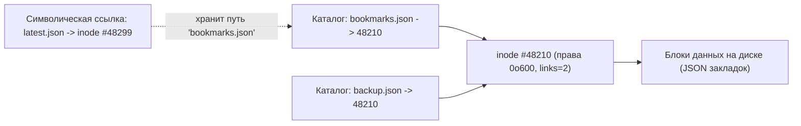

*Как Linux отделяет имя файла от его данных через `inode`, чем жёсткая ссылка отличается от символической и откуда в нашем `BookmarkFlow` взялась загадочная маска прав `0o600`.*

Вы удаляете огромный файл логов командой `rm app.log`, пока сервис продолжает работать. Файл мгновенно пропадает из вывода `ls`, но команда проверки свободного места на диске показывает ту же самую цифру: гигабайты **не освободились**. Сервис при этом не падает и спокойно продолжает дописывать новые строки в «удалённый» файл.

Чтобы понять эту загадку, нужно отказаться от привычной бытовой картинки, будто «файл — это его имя в папке». В Unix и Linux имя файла и сам файл — две разные сущности.

## Имя, `inode` и блоки данных

Файловая система Linux устроена в три слоя:

1. **Каталог (*directory*)** — это всего лишь таблица пар «имя → номер **`inode`**». Каталог не хранит внутри себя содержимое файлов.
2. **`inode`** (*index node*, индексный узел) — паспорт самого файла с уникальным номером в пределах раздела диска. В нём лежат метаданные: владелец (`UID`), группа (`GID`), права доступа, размер, время изменения, **счётчик жёстких ссылок** и указатели на блоки данных на диске. Имени файла внутри `inode` **нет**.
3. **Блоки данных** — сами байты файла, разложенные по сектору диска.

Проследим путь от имени `"bookmarks.json"` до байтов на диске:



Теперь разгадка «неисчезающего» лога становится очевидной. Команда `rm` (в Go — `os.Remove`) **не стирает блоки с диска**. Она лишь удаляет запись из каталога и уменьшает счётчик ссылок в `inode` на единицу. Блоки на диске освобождаются только тогда, когда выполнены **два условия сразу**: счётчик ссылок упал до `0` **и** ни один живой процесс больше не держит этот `inode` открытым. Пока сервис пишет в открытый файл, данные продолжают жить, хотя имени в каталоге уже нет.

## Жёсткие ссылки против символических

Разделение имени и `inode` подарило Unix два вида ссылок с разной механикой:

* **Жёсткая ссылка (*hard link*, в Go `os.Link`)** — просто второе имя в каталоге, указывающее на **тот же самый `inode`**. Обе записи полностью равноправны: нет «оригинала» и «копии». Удалите `bookmarks.json` — данные останутся доступны через `backup.json`, потому что счётчик ссылок упал с 2 до 1. Ограничения: жёсткая ссылка работает только внутри одного раздела файловой системы и запрещена для каталогов (чтобы не создавать циклы в дереве папок).
* **Символическая ссылка (*symlink*, в Go `os.Symlink`)** — отдельный маленький файл со **своим собственным `inode`**, внутри которого записан просто текст пути (например, `"bookmarks.json"` или `"/var/lib/bf/data.json"`). Она умеет указывать на каталоги и на файлы на другом диске. Но если целевой файл удалить, символическая ссылка станет *битой* (*dangling*): имя останется, а `os.Open` по нему вернёт `os.ErrNotExist`.

В Go для проверки метаданных есть две функции: `os.Stat(path)` **переходит по символической ссылке** к целевому файлу, а `os.Lstat(path)` читает метаданные **самой ссылки**.

## Права доступа `rwx` и маска `0o600`

В каждом `inode` хранятся права доступа для трёх категорий пользователей:
* **владелец файла** (*user*, `u`);
* **группа владельца** (*group*, `g`);
* **все остальные** (*others*, `o`).

Для каждой тройки задаются три бита (вспомните побитовые флаги из Подраздела 5.1):
* **`r`** (чтение, *read*) = `4` (`100` в двоичной системе);
* **`w`** (запись, *write*) = `2` (`010`);
* **`x`** (выполнение, *execute*; **для каталога** — право войти в каталог и открыть файлы внутри) = `1` (`001`).

Складывая биты каждой тройки, получаем знакомую восьмеричную запись из трёх цифр. Именно отсюда в Модуле 4 в коде `BookmarkFlow` взялась строка `os.WriteFile(path, data, 0o600)`:

| Восьмеричная запись | Символьная запись | Владелец (`u`) | Группа (`g`) | Остальные (`o`) | Типичное применение |
|---|---|---|---|---|---|
| `0o600` | `rw-------` | `r+w` (6) | нет (0) | нет (0) | Приватные файлы: закладки `BookmarkFlow`, токены, SSH-ключи |
| `0o644` | `rw-r--r--` | `r+w` (6) | `r` (4) | `r` (4) | Обычные текстовые файлы, конфиги без секретов |
| `0o755` | `rwxr-xr-x` | `r+w+x` (7) | `r+x` (5) | `r+x` (5) | Исполняемые бинарники и общие каталоги |
| `0o700` | `rwx------` | `r+w+x` (7) | нет (0) | нет (0) | Приватный каталог с данными пользователя |

Префикс `0o` в Go (появившийся ещё в Go 1.13) явно обозначает восьмеричное число. Маска `0o600` говорит ядру: читать и изменять файл закладок может **только владелец**; другие пользователи на том же сервере при попытке открыть его получат отказ ядра `permission denied`.

*(NOTE: при создании новых файлов ядро дополнительно применяет пользовательскую маску `umask` — обычно `0o022`, — которая может урезать лишние биты записи для группы и остальных, но никогда не добавляет прав сверх запрошенных.)*

## Эксперимент в Go: `inode`, ссылки и права

Проверим работу жёстких ссылок, символических ссылок и прав доступа на реальном коде:

```go
package main

import (
	"fmt"
	"os"
	"path/filepath"
)

func main() {
	dir, err := os.MkdirTemp("", "fs-demo-*")
	if err != nil {
		panic(err)
	}
	defer os.RemoveAll(dir)

	orig := filepath.Join(dir, "bookmarks.json")
	hard := filepath.Join(dir, "backup.json")
	sym := filepath.Join(dir, "latest.json")

	if err := os.WriteFile(orig, []byte(`["https://go.dev"]`), 0o600); err != nil {
		panic(err)
	}
	if err := os.Link(orig, hard); err != nil {
		panic(err)
	}
	if err := os.Symlink(orig, sym); err != nil {
		panic(err)
	}

	fiOrig, _ := os.Stat(orig)
	fiHard, _ := os.Stat(hard)
	fiSymLstat, _ := os.Lstat(sym)
	fiSymStat, _ := os.Stat(sym)

	fmt.Printf("права orig: %o (%s)\n", fiOrig.Mode().Perm(), fiOrig.Mode().Perm())
	fmt.Printf("orig и hard — один inode? %t\n", os.SameFile(fiOrig, fiHard))
	fmt.Printf("Lstat(sym) — это symlink? %t\n", fiSymLstat.Mode()&os.ModeSymlink != 0)
	fmt.Printf("Stat(sym) ведёт к orig?   %t\n", os.SameFile(fiOrig, fiSymStat))

	// Удаляем исходное имя bookmarks.json.
	_ = os.Remove(orig)

	data, err := os.ReadFile(hard)
	fmt.Printf("после удаления orig: hard читается -> %s (err=%v)\n", data, err)

	_, err = os.ReadFile(sym)
	fmt.Printf("после удаления orig: sym сломался  -> err=%v\n", err)
}
```

Запустим программу:

```text
$ go run main.go
права orig: 600 (-rw-------)
orig и hard — один inode? true
Lstat(sym) — это symlink? true
Stat(sym) ведёт к orig?   true
после удаления orig: hard читается -> ["https://go.dev"] (err=<nil>)
после удаления orig: sym сломался  -> err=open /tmp/fs-demo-9120/latest.json: no such file or directory
```

Функция `os.SameFile` сравнивает номера `inode` и устройства на уровне ОС. После `os.Remove(orig)` жёсткая ссылка `backup.json` без проблем отдала те же байты (данные не пострадали), а символическая ссылка `latest.json` мгновенно стала битой.

## Подводные камни

**Ловушка 1. Десятичное `644` вместо восьмеричного `0o644`.**  
Если случайно написать `os.WriteFile("a.txt", data, 644)` без префикса `0o` (или устаревшего `0`), Go передаст десятичное число `644` — а в восьмеричной системе это `0o1204`, то есть бессмысленная и опасная комбинация прав (`--w----r-T`). Всегда пишите префикс `0o`: `0o600`, `0o644`, `0o755`.

**Ловушка 2. Каталог с правами `0o600` вместо `0o700`.**  
Если создать каталог командой `os.Mkdir("data", 0o600)` без бита `x`, владелец сможет увидеть список имён, но не сможет открыть или создать ни один файл внутри него. Для каталогов всегда нужен бит входа `x` (`0o700` или `0o755`).

> [!check] Проверь понимание
> Программа открыла файл `events.log` для записи, и во время её работы администратор переименовал файл в `events.log.1` (`mv events.log events.log.1`). Куда программа продолжит писать следующие строки: в новый `events.log` или в переименованный `events.log.1`?
>
> В `events.log.1`. Переименование меняет только запись имени в каталоге, но не меняет номер `inode`, к которому привязан открытый файл процесса. Чтобы программа начала писать в новый `events.log`, она должна закрыть старый файл и открыть новый по имени.

## Практика

**Упражнение 1 (Базовое). Расшифруй права.**  
Переведите в восьмеричную запись Go (`0o...`) следующие наборы прав:
1. `rw-r-----` (чтение и запись владельцу, чтение группе, ничего остальным).
2. `rwx------` (все права только владельцу).
3. `r--r--r--` (только чтение для всех).

> [!solution] Показать решение
> 1. `rw-` = 4+2 = 6, `r--` = 4, `---` = 0 → **`0o640`**.
> 2. `rwx` = 4+2+1 = 7, `---` = 0, `---` = 0 → **`0o700`**.
> 3. `r--` = 4, `r--` = 4, `r--` = 4 → **`0o444`**.

**Упражнение 2 (Практическое). Проверка «приватности» файла секретов.**  
Напишите функцию `CheckPrivateFile(path string) error`, которая вызывает `os.Stat(path)` и проверяет, что у файла **нет никаких прав** для группы и остальных (подсказка: побитовая операция `info.Mode().Perm() & 0o077 != 0`). Если права слишком широкие, верните понятную ошибку с фактической восьмеричной маской.

> [!solution] Показать решение
> ```go
> package main
>
> import (
> 	"fmt"
> 	"os"
> 	"path/filepath"
> )
>
> func CheckPrivateFile(path string) error {
> 	info, err := os.Stat(path)
> 	if err != nil {
> 		return err
> 	}
> 	perm := info.Mode().Perm()
> 	if perm&0o077 != 0 {
> 		return fmt.Errorf("файл %q доступен другим пользователям (права %04o, нужно 0600)", path, perm)
> 	}
> 	return nil
> }
>
> func main() {
> 	dir, err := os.MkdirTemp("", "privcheck-*")
> 	if err != nil {
> 		panic(err)
> 	}
> 	defer os.RemoveAll(dir)
>
> 	okPath := filepath.Join(dir, "ok.json")
> 	badPath := filepath.Join(dir, "wide.json")
> 	_ = os.WriteFile(okPath, []byte("{}"), 0o600)
> 	_ = os.WriteFile(badPath, []byte("{}"), 0o644)
>
> 	fmt.Println("0600:", CheckPrivateFile(okPath))
> 	fmt.Println("0644:", CheckPrivateFile(badPath))
> }
> ```
> Маска `0o077` выделяет ровно шесть младших битов (`rwx` для группы и `rwx` для остальных). Если результат побитового И не равен нулю, кто-то кроме владельца имеет права на файл — так же проверяет права на приватные ключи утилита `ssh`.

**Упражнение 3 (Со звёздочкой \*). Детектор битых символических ссылок.**  
Напишите функцию `IsBrokenSymlink(path string) (bool, error)`. Она должна возвращать `(true, nil)`, только если `path` — это символическая ссылка, цель которой не существует. Если `path` — обычный файл, рабочая ссылка или вообще не существует, верните `(false, nil)` (при иных ошибках ввода-вывода верните ошибку).

> [!solution] Показать решение
> ```go
> package main
>
> import (
> 	"errors"
> 	"fmt"
> 	"os"
> 	"path/filepath"
> )
>
> func IsBrokenSymlink(path string) (bool, error) {
> 	info, err := os.Lstat(path)
> 	if err != nil {
> 		if errors.Is(err, os.ErrNotExist) {
> 			return false, nil
> 		}
> 		return false, err
> 	}
> 	if info.Mode()&os.ModeSymlink == 0 {
> 		return false, nil
> 	}
> 	_, err = os.Stat(path)
> 	if errors.Is(err, os.ErrNotExist) {
> 		return true, nil
> 	}
> 	return false, err
> }
>
> func main() {
> 	dir, err := os.MkdirTemp("", "sym-*")
> 	if err != nil {
> 		panic(err)
> 	}
> 	defer os.RemoveAll(dir)
>
> 	broken := filepath.Join(dir, "dangling")
> 	_ = os.Symlink(filepath.Join(dir, "missing.txt"), broken)
>
> 	isBroken, err := IsBrokenSymlink(broken)
> 	fmt.Println("broken:", isBroken, "err:", err)
> }
> ```
> Ключевое сочетание здесь — `os.Lstat` (видит саму ссылку) + `os.Stat` (пытается пройти по ней к цели). Если `Lstat` нашёл `ModeSymlink`, а `Stat` вернул `os.ErrNotExist`, перед нами битая ссылка.

---

Мы узнали, как ядро хранит файлы на диске через `inode` и защищает их правами. Но как сам запущенный процесс держит открытый файл и почему он может неожиданно упереться в загадочный потолок `too many open files`? Об этом в следующем уроке — [[6. Файловые дескрипторы — «всё есть файл» и лимит ulimit]].
