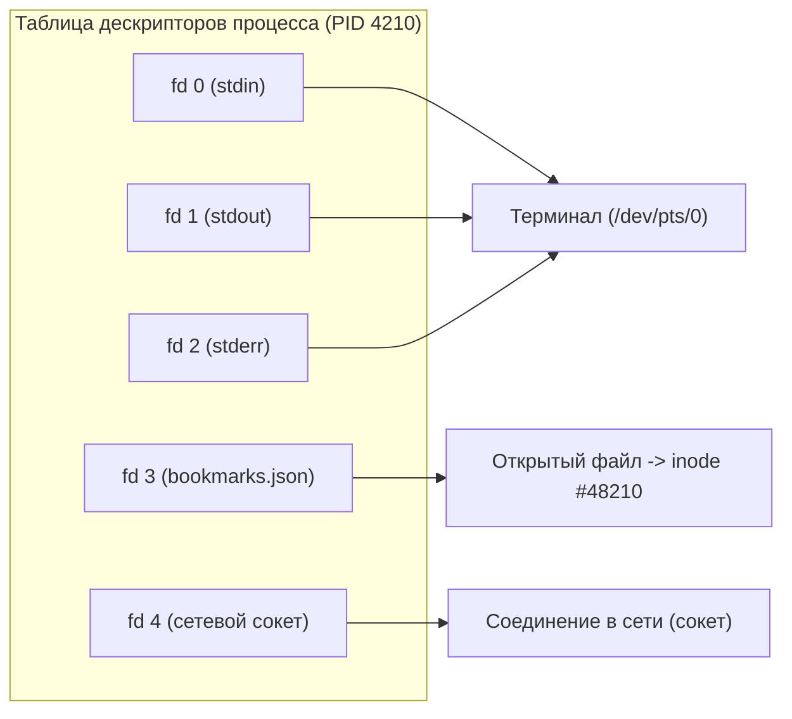

*Как ядро Linux ведёт таблицу файловых дескрипторов процесса, почему забытый `f.Close()` заканчивается ошибкой `too many open files`, что ограничивает `ulimit -n` и как заглянуть в `/proc/<pid>/fd`.*

Вы пишете утилиту, которая обходит каталог с 5 000 JSON-файлами закладок и проверяет каждый на валидность. Код выглядит аккуратно — в цикле стоит знакомый `defer f.Close()`. Программа бодро обрабатывает первую тысячу файлов и внезапно падает со странной ошибкой:

```text
open data/bookmark-1021.json: too many open files
```

На диске десятки свободных гигабайт, в RAM почти пусто — но операционная система наотрез отказывается открыть ещё хотя бы один файл. Проблема не в диске, а в том, как процесс учитывает открытые ресурсы через **файловые дескрипторы**.

## Принцип «всё есть файл» и таблица дескрипторов

Одна из самых удачных идей создателей Unix — единый интерфейс ввода-вывода, известный как принцип **«всё есть файл»** (*everything is a file*). Обычный файл на диске, экран терминала, клавиатура, конвейер между программами и сетевое соединение для ядра Linux выглядят одинаково: как поток байтов, с которым работают одни и те же базовые операции чтения, записи и закрытия. Именно на эту унификацию опираются интерфейсы `io.Reader` и `io.Writer` в Go.

Когда процесс просит ядро открыть файл или сетевой сокет, ядро не отдаёт программе сырой указатель на свои внутренние структуры — граница привилегий это запрещает. Вместо этого ядро заводит для каждого процесса **таблицу файловых дескрипторов** (*file descriptor table*) и возвращает программе обычный небольшой номер-индекс: **файловый дескриптор** (*file descriptor*, `fd`).

Первые три номера закреплены за процессом с момента рождения:

* **`0`** — стандартный ввод (`stdin`, в Go — `os.Stdin`);
* **`1`** — стандартный вывод (`stdout`, в Go — `os.Stdout`);
* **`2`** — стандартный вывод ошибок (`stderr`, в Go — `os.Stderr`).

Каждый следующий открытый файл, каталог или сокет получает наименьший свободный номер: `3`, `4`, `5` и так далее:



У каждого процесса таблица своя. Дескриптор `3` в вашей программе может указывать на `bookmarks.json`, а дескриптор `3` в соседнем процессе — на совсем другой файл или сетевой сокет. Когда вы вызываете `f.Close()`, ядро освобождает строку `3` в таблице, и следующий `os.Open` снова сможет занять этот номер.

## Лимит `ulimit -n` и взгляд внутрь `/proc/<pid>/fd`

Таблица файловых дескрипторов не бесконечна. Ядро защищает машину от «прожорливых» программ, ограничивая максимальное число одновременно открытых дескрипторов для одного процесса. Проверить текущий лимит в терминале Linux можно одной командой:

```text
$ ulimit -n
1024
```

Часто по умолчанию мягкий лимит равен именно **1 024** (хотя на некоторых системах его поднимают до 65 536 и выше). В эту квоту попадает **всё сразу**: три стандартных потока, каждый открытый файл на диске, каждый читаемый каталог и каждое активное сетевое соединение. Поэтому, если процесс забывает закрывать файлы, на 1 021-м файле таблица переполняется, и ядро возвращает код ошибки `EMFILE` — в Go он превращается в `too many open files`.

Посмотреть, какие именно дескрипторы держит открытыми любой ваш процесс прямо сейчас, можно без всяких отладчиков — через виртуальную файловую систему `/proc`:

```text
$ ls -l /proc/<pid>/fd
0 -> /dev/pts/0
1 -> /dev/pts/0
2 -> /dev/pts/0
3 -> /tmp/fd-demo/bookmarks.json
```

Для самого себя процесс может обратиться к удобному псевдониму `/proc/self/fd`.

## Разбираем ловушку `defer f.Close()` в цикле

Вернёмся к ошибке из начала урока. Почему программа с `defer f.Close()` исчерпала лимит? Потому что в Go **`defer` выполняется при выходе из функции, а не при окончании итерации цикла `for`**. Если открыть 2 000 файлов внутри одного цикла `for`, все 2 000 вызовов `f.Close()` выстроятся в очередь до конца функции — и на 1 021-й итерации ядро откажет.

Напишем программу на Go, которая печатает номера стандартных дескрипторов, показывает рост числа записей в `/proc/self/fd` и демонстрирует правильный способ обработки файлов в цикле — через выделение короткой функции-помощника:

```go
package main

import (
	"fmt"
	"os"
	"path/filepath"
)

func countOpenFDs() (int, error) {
	entries, err := os.ReadDir("/proc/self/fd")
	if err != nil {
		return 0, err
	}
	// Минус 1, потому что сам os.ReadDir временно держит fd на /proc/self/fd.
	return len(entries) - 1, nil
}

func readSizeSafely(path string) (int64, error) {
	f, err := os.Open(path)
	if err != nil {
		return 0, err
	}
	defer f.Close() // выполнится сразу по завершении readSizeSafely

	info, err := f.Stat()
	if err != nil {
		return 0, err
	}
	return info.Size(), nil
}

func main() {
	fmt.Printf("стандартные fd: stdin=%d, stdout=%d, stderr=%d\n",
		os.Stdin.Fd(), os.Stdout.Fd(), os.Stderr.Fd())

	dir, err := os.MkdirTemp("", "fd-demo-*")
	if err != nil {
		panic(err)
	}
	defer os.RemoveAll(dir)

	p := filepath.Join(dir, "bookmarks.json")
	_ = os.WriteFile(p, []byte(`["https://go.dev"]`), 0o600)

	baseFDs, _ := countOpenFDs()

	// Демонстрация удержания дескриптора.
	f, err := os.Open(p)
	if err != nil {
		panic(err)
	}
	withFileFDs, _ := countOpenFDs()
	fmt.Printf("открыт файл: fd=%d, открытых дескрипторов: %d -> %d\n",
		f.Fd(), baseFDs, withFileFDs)
	_ = f.Close()

	// Безопасный цикл из 2 000 открытий через функцию-помощник.
	for range 2000 {
		if _, err := readSizeSafely(p); err != nil {
			panic(err)
		}
	}
	afterLoopFDs, _ := countOpenFDs()
	fmt.Printf("после 2 000 итераций открытых дескрипторов: %d\n", afterLoopFDs)
}
```

Посмотрим на вывод в Linux:

```text
$ go run main.go
стандартные fd: stdin=0, stdout=1, stderr=2
открыт файл: fd=3, открытых дескрипторов: 4 -> 5
после 2 000 итераций открытых дескрипторов: 4
```

После двух тысяч открытий число дескрипторов вернулось точно к исходному значению (помимо `0`, `1` и `2` рантайм Go держит 1–2 служебных дескриптора): на каждой итерации `readSizeSafely` возвращала управление, её `defer f.Close()` срабатывал немедленно, и номер тут же переиспользовался.

## Подводные камни

**Ловушка 1. Игнорирование ошибки `f.Close()` при записи.**  
При чтении файла `_ = f.Close()` обычно безобидно. Но при **записи** часть буферизованных ошибок ядра (например, внезапно кончилось место на диске) может проявиться только на `Close()`. Для файлов, открытых на запись, проверяйте возвращаемую ошибку `Close()`.

**Ловушка 2. Уверенность, что `ulimit -n` касается только файлов на диске.**  
Сетевые сокеты в Linux используют ту же самую таблицу дескрипторов. Сервер, который принимает 1 500 одновременных TCP-подключений при `ulimit -n 1024`, упадёт с `too many open files`, даже если не открыл ни одного файла на диске. На боевых серверах лимит дескрипторов для сетевых сервисов поднимают заранее (например, до `65536`).

> [!check] Проверь понимание
> Программа открыла файл `a.txt` (получила `fd = 3`), затем открыла `b.txt` (`fd = 4`), потом закрыла `a.txt` (`fA.Close()`) и сразу открыла `c.txt`. Какой номер дескриптора с большой вероятностью назначит Linux для `c.txt`?
>
> `3`. По стандарту POSIX ядро Linux при открытии нового ресурса всегда выдаёт наименьший свободный неотрицательный номер дескриптора.

## Практика

**Упражнение 1 (Базовое). Найди утечку дескрипторов.**  
Почему следующая функция сломается с ошибкой `too many open files`, если передать ей слайс из 3 000 путей, хотя в ней написан `defer f.Close()`? Как исправить её минимальным изменением?

```go
func totalBytes(paths []string) (int64, error) {
	var total int64
	for _, p := range paths {
		f, err := os.Open(p)
		if err != nil {
			return 0, err
		}
		defer f.Close()
		info, err := f.Stat()
		if err != nil {
			return 0, err
		}
		total += info.Size()
	}
	return total, nil
}
```

> [!solution] Показать решение
> `defer f.Close()` привязан к выходу из функции `totalBytes`, а не к окончанию шага цикла `for`. Пока цикл не дойдёт до конца, все открытые дескрипторы остаются занятыми.
> Минимальное исправление — вынести обработку одного файла в отдельную функцию `fileSize(path string) (int64, error)` (либо закрывать `f.Close()` явно в конце итерации и на каждой ветке ошибки). Вариант с отдельной функцией чище и безопаснее: `defer` гарантированно освободит дескриптор при любом `return`.

**Упражнение 2 (Практическое). Инспектор открытых дескрипторов.**  
Напишите функцию `ListOpenFDs() (map[string]string, error)`, которая читает `/proc/self/fd` и для каждого номера дескриптора (кроме того, которым открыт сам каталог — при ошибке `os.Readlink` просто пропустите запись) возвращает в мапе пару `номер -> цель` с помощью `os.Readlink`. Выведите результат до и во время открытия временного файла.

> [!solution] Показать решение
> ```go
> package main
>
> import (
> 	"fmt"
> 	"os"
> 	"path/filepath"
> )
>
> func ListOpenFDs() (map[string]string, error) {
> 	const fdDir = "/proc/self/fd"
> 	entries, err := os.ReadDir(fdDir)
> 	if err != nil {
> 		return nil, err
> 	}
> 	res := make(map[string]string, len(entries))
> 	for _, e := range entries {
> 		target, err := os.Readlink(filepath.Join(fdDir, e.Name()))
> 		if err != nil {
> 			continue // временный fd самого ReadDir уже закрыт
> 		}
> 		res[e.Name()] = target
> 	}
> 	return res, nil
> }
>
> func main() {
> 	f, err := os.CreateTemp("", "inspect-fd-*")
> 	if err != nil {
> 		panic(err)
> 	}
> 	defer os.Remove(f.Name())
> 	defer f.Close()
>
> 	fds, err := ListOpenFDs()
> 	if err != nil {
> 		panic(err)
> 	}
> 	fmt.Printf("открыт файл %s (fd=%d), найдено записей: %d\n",
> 		f.Name(), f.Fd(), len(fds))
> 	fmt.Printf("fd %d -> %s\n", f.Fd(), fds[fmt.Sprint(f.Fd())])
> }
> ```
> Каждая запись в `/proc/self/fd` устроена как символическая ссылка на открытый ресурс, поэтому `os.Readlink` показывает точный путь к файлу, терминалу или сокету.

**Упражнение 3 (Со звёздочкой \*). Проверка ошибки при закрытии файла записи.**  
Напишите функцию `WriteReport(path string, lines []string) (err error)`, которая создаёт файл, записывает в него строки и корректно возвращает ошибку `f.Close()`, если основная запись прошла успешно, — используя именованный возврат `err` и `defer`. Объясните, почему нельзя просто написать `defer func() { err = f.Close() }()`.

> [!solution] Показать решение
> ```go
> package main
>
> import (
> 	"fmt"
> 	"os"
> 	"path/filepath"
> )
>
> func WriteReport(path string, lines []string) (err error) {
> 	f, err := os.Create(path)
> 	if err != nil {
> 		return err
> 	}
> 	defer func() {
> 		if closeErr := f.Close(); err == nil && closeErr != nil {
> 			err = closeErr
> 		}
> 	}()
>
> 	for _, line := range lines {
> 		if _, err := fmt.Fprintln(f, line); err != nil {
> 			return err
> 		}
> 	}
> 	return nil
> }
>
> func main() {
> 	dir, err := os.MkdirTemp("", "report-*")
> 	if err != nil {
> 		panic(err)
> 	}
> 	defer os.RemoveAll(dir)
>
> 	p := filepath.Join(dir, "out.txt")
> 	if err := WriteReport(p, []string{"https://go.dev", "https://pkg.go.dev"}); err != nil {
> 		panic(err)
> 	}
> 	data, _ := os.ReadFile(p)
> 	fmt.Print(string(data))
> }
> ```
> Если написать `err = f.Close()` без проверки `err == nil`, то успешное закрытие (`nil`) затрёт настоящую ошибку записи, которая произошла внутри цикла `for`. Проверка `err == nil && closeErr != nil` сохраняет первую ошибку и не теряет ошибку закрытия.

---

Мы увидели, что каждый процесс рождается с тремя зарезервированными дескрипторами — `0`, `1` и `2`. Именно эти три канала позволили Unix превратить маленькие одиночные программы в мощные цепочки обработки данных. В следующем уроке разберём стандартные потоки и конвейеры — [[7. Стандартные потоки stdin, stdout, stderr и конвейеры (pipes)]].
