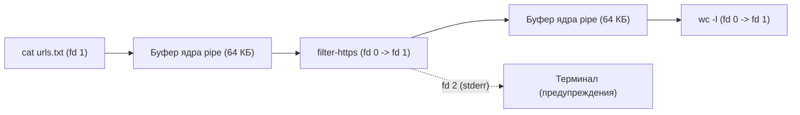

*Зачем разделять `stdout` и `stderr`, как работают перенаправления `>`, `2>`, `2>&1` и конвейер `cmd1 | cmd2` через буфер в ядре, и как написать чистую Go-утилиту-фильтр на `bufio.Scanner`.*

> «Гениальность конвейера Unix именно в том, что он собирается из тех самых команд, которыми постоянно пользуются поодиночке. Чтобы разглядеть эту возможность и придумать для неё запись, действительно требовался огромный скачок мысли.»  
> — Деннис Ритчи, *«The Evolution of the Unix Time-sharing System»* (1984)

Вы запускаете утилиту экспорта закладок и перенаправляете результат в файл: `./bookmarkflow export > urls.txt`. Утилита находит одну битую запись и печатает предупреждение `fmt.Println("предупреждение: пропущена строка 14")`. Когда вы открываете `urls.txt`, эта фраза оказывается прямо посреди списка ссылок и ломает следующую программу в цепочке.

Такой сбой случается каждый раз, когда программа смешивает **полезные данные** и **диагностику** в одном потоке вывода. В Unix для их разделения с самого начала предусмотрели два разных канала.

## Три стандартных потока процесса

Как мы узнали в прошлом уроке, каждый процесс получает при старте три открытых файловых дескриптора:

* **`0` (`stdin`, `os.Stdin`)** — стандартный ввод. По умолчанию подключён к клавиатуре, но легко подменяется файлом или выводом другой программы.
* **`1` (`stdout`, `os.Stdout`)** — стандартный вывод. Предназначен **только для полезного результата** программы: строк данных, JSON, отчёта.
* **`2` (`stderr`, `os.Stderr`)** — стандартный поток ошибок. Предназначен для предупреждений, прогресса, логов и сообщений об ошибках.

По умолчанию `stdout` и `stderr` оба печатаются в одно окно терминала, поэтому на экране они выглядят одинаково. Разница проявляется в ту секунду, когда пользователь перенаправляет вывод или строит конвейер.

## Перенаправления оболочки: `>`, `2>` и `2>&1`

Программа на Go не знает и не должна знать, куда именно подключены её дескрипторы `0`, `1` и `2`. Их подменяет родительская оболочка (`bash`, `zsh`) ещё до запуска `main()`:

| Запись в терминале | Что делает оболочка с дескрипторами |
|---|---|
| `cmd > out.txt` | Перенаправляет `fd 1` (`stdout`) в файл `out.txt` (перезаписывает). `fd 2` (`stderr`) остаётся на экране. |
| `cmd >> out.txt` | То же самое, но дописывает в конец `out.txt`. |
| `cmd < in.txt` | Подключает `fd 0` (`stdin`) на чтение из файла `in.txt`. |
| `cmd 2> err.log` | Перенаправляет `fd 2` (`stderr`) в `err.log`. `stdout` остаётся на экране. |
| `cmd > all.log 2>&1` | Сначала направляет `fd 1` в `all.log`, затем направляет `fd 2` **туда же, куда сейчас указывает `fd 1`** — оба потока идут в один файл. |

Обратите внимание на порядок в последней строке: оболочка разбирает перенаправления слева направо.

## Конвейер `cmd1 | cmd2` и буфер в ядре

В начале 1970-х в Bell Labs Дуг Макилрой долго настаивал, что программы должны соединяться друг с другом «как садовые шланги». В 1972 году Кен Томпсон добавил в ядро системный вызов `pipe`, а в оболочке появился символ `|` — **конвейер** (*pipeline*). После этого за одну ночь почти все системные утилиты перевели на чтение из `stdin` и запись в `stdout`.

Когда вы запускаете `cat urls.txt | filter-https | wc -l`, оболочка запускает все программы **одновременно** и соединяет `stdout` (дескриптор `1`) левой команды со `stdin` (дескриптор `0`) правой через **анонимный канал в памяти ядра** (*pipe*):



У конвейера два важнейших свойства:
1. **Никаких временных файлов на диске.** Байты перетекают прямо через кольцевой буфер в RAM ядра (в Linux по умолчанию **64 КБ**).
2. **Автоматическое обратное давление (*backpressure*).** Если правая программа читает медленно и 64 КБ буфера заполняются, ядро само усыпляет левую программу на вызове записи, пока не освободится место. Если левая временно молчит, правая спокойно ждёт на чтении. Таким образом конвейер способен обработать файл на 50 ГБ, занимая в памяти считанные килобайты.

А поток `stderr` (`fd 2`) при этом **не попадает в трубу `|`**: предупреждения фильтра сразу видны человеку в терминале и не засоряют данные, которые считает `wc -l`.

## Пишем Go-утилиту для конвейера

Напишем компактный фильтр ссылок `urlfilter` для нашего `BookmarkFlow`. Программа читает строки из `os.Stdin` через `bufio.Scanner`, отбирает корректные `https://`-адреса (или адреса, содержащие заданную подстроку из `os.Args[1]`), чистый результат отдаёт в `os.Stdout`, а предупреждения о некорректных строках и итоговую сводку пишет в `os.Stderr`:

```go
package main

import (
	"bufio"
	"fmt"
	"os"
	"strings"
)

func main() {
	needle := ""
	if len(os.Args) > 1 {
		needle = os.Args[1]
	}

	scanner := bufio.NewScanner(os.Stdin)
	lineNum, kept, skipped := 0, 0, 0

	for scanner.Scan() {
		lineNum++
		url := strings.TrimSpace(scanner.Text())
		if url == "" {
			continue
		}
		if !strings.HasPrefix(url, "https://") {
			skipped++
			fmt.Fprintf(os.Stderr, "строка %d: пропущена небезопасная ссылка %q\n", lineNum, url)
			continue
		}
		if needle != "" && !strings.Contains(url, needle) {
			continue
		}
		fmt.Fprintln(os.Stdout, url)
		kept++
	}

	if err := scanner.Err(); err != nil {
		fmt.Fprintln(os.Stderr, "ошибка чтения stdin:", err)
		os.Exit(1)
	}
	fmt.Fprintf(os.Stderr, "итого: принято=%d, пропущено=%d\n", kept, skipped)
}
```

Проверим утилиту прямо в живом конвейере в терминале:

```text
$ printf "https://go.dev\nhttp://old.example\nhttps://pkg.go.dev/os\n" | go run main.go go.dev > clean.txt
строка 2: пропущена небезопасная ссылка "http://old.example"
итого: принято=2, пропущено=1

$ cat clean.txt
https://go.dev
https://pkg.go.dev/os
```

Обратите внимание, как чисто разделились потоки: в `clean.txt` попали только валидные ссылки, готовые для следующей команды в конвейере, а человек в терминале сразу увидел диагностику и счётчики из `stderr`.

## Подводные камни

**Ловушка 1. Неверный порядок `2>&1 > out.log`.**  
Запись `cmd 2>&1 > out.log` делает не то, что ожидается: сначала `fd 2` копирует текущее назначение `fd 1` (экран терминала), и только потом `fd 1` переключается на файл `out.log`. В результате ошибки всё равно уходят на экран. Правильный порядок — всегда `cmd > out.log 2>&1`.

**Ловушка 2. Печать логов через `fmt.Println` в CLI-утилитах.**  
Функция `fmt.Println` пишет в `os.Stdout`. Любое сообщение об ошибке, отладочная строка или баннер вроде `"Загрузка..."`, выведенные через `fmt.Println`, испортят вывод утилиты в конвейере. Для диагностики используйте `fmt.Fprintln(os.Stderr, ...)` или `log.New(os.Stderr, ...)` (стандартный пакет `log` и `log/slog` по умолчанию пишут именно в `os.Stderr`).

**Ловушка 3. Забытый `scanner.Err()` и лимит строки `bufio.Scanner`.**  
По умолчанию `bufio.Scanner` ограничивает длину одной строки 64 КБ. Если в конвейер попадёт длинная строка без переноса, `scanner.Scan()` вернёт `false`, а причина окажется в `scanner.Err()` (`bufio.ErrTooLong`). Всегда проверяйте `scanner.Err()` после цикла; для длинных строк увеличивайте буфер методом `scanner.Buffer`.

> [!check] Проверь понимание
> У вас есть команда `app | wc -l`. Внутри `app` вызывается `fmt.Println("https://go.dev")` и `fmt.Fprintln(os.Stderr, "ошибка: таймаут")`. Какое число напечатает `wc -l` и куда попадёт строка про таймаут?
>
> `wc -l` напечатает `1` — он посчитает только строку из `stdout`, прошедшую по конвейеру. Строка из `stderr` попадёт напрямую в терминал и в подсчёт `wc -l` не войдёт.

## Практика

**Упражнение 1 (Базовое). Разбери перенаправления.**  
Куда попадут `stdout` и `stderr` программы `bookmarkflow` при каждом из трёх запусков?
1. `bookmarkflow check > report.txt`
2. `bookmarkflow check > report.txt 2> errors.log`
3. `bookmarkflow check > all.log 2>&1`

> [!solution] Показать решение
> 1. `stdout` — в `report.txt`; `stderr` — на экран терминала.
> 2. `stdout` — в `report.txt`; `stderr` — в `errors.log`.
> 3. И `stdout`, и `stderr` — вместе в `all.log`.

**Упражнение 2 (Практическое). Нумератор строк на `io.Reader` и `io.Writer`.**  
Чтобы фильтр можно было тестировать в `go test` без реального терминала, напишите функцию `NumberLines(r io.Reader, w io.Writer) error`, которая читает строки из `r` через `bufio.Scanner` и записывает их в `w` в формате `"1: <строка>\n"`. В `main()` вызовите `NumberLines(os.Stdin, os.Stdout)`.

> [!solution] Показать решение
> ```go
> package main
>
> import (
> 	"bufio"
> 	"fmt"
> 	"io"
> 	"os"
> )
>
> func NumberLines(r io.Reader, w io.Writer) error {
> 	sc := bufio.NewScanner(r)
> 	bw := bufio.NewWriter(w)
> 	n := 0
> 	for sc.Scan() {
> 		n++
> 		if _, err := fmt.Fprintf(bw, "%d: %s\n", n, sc.Text()); err != nil {
> 			return err
> 		}
> 	}
> 	if err := sc.Err(); err != nil {
> 		return err
> 	}
> 	return bw.Flush()
> }
>
> func main() {
> 	if err := NumberLines(os.Stdin, os.Stdout); err != nil {
> 		fmt.Fprintln(os.Stderr, "ошибка:", err)
> 		os.Exit(1)
> 	}
> }
> ```
> Приём из Модуля 4 работает здесь безупречно: передача `io.Reader` и `io.Writer` отвязывает логику фильтра от глобальных `os.Stdin`/`os.Stdout`, а `bufio.NewWriter` сокращает число записей в конвейер.

**Упражнение 3 (Со звёздочкой \*). Фильтр дубликатов в потоке.**  
Напишите Go-утилиту `dedup` (`package main`), которая читает строки из `os.Stdin`, пропускает уже встречавшиеся ранее строки (сохраняя порядок первого появления) и печатает уникальные строки в `os.Stdout`. В `os.Stderr` в конце выведите статистику: сколько строк прочитано и сколько дубликатов удалено. Поддержка пустых строк — сохранять только первую пустую строку, если она встретилась.

> [!solution] Показать решение
> ```go
> package main
>
> import (
> 	"bufio"
> 	"fmt"
> 	"os"
> )
>
> func main() {
> 	sc := bufio.NewScanner(os.Stdin)
> 	bw := bufio.NewWriter(os.Stdout)
> 	seen := make(map[string]struct{})
>
> 	total, dups := 0, 0
> 	for sc.Scan() {
> 		total++
> 		line := sc.Text()
> 		if _, exists := seen[line]; exists {
> 			dups++
> 			continue
> 		}
> 		seen[line] = struct{}{}
> 		if _, err := fmt.Fprintln(bw, line); err != nil {
> 			fmt.Fprintln(os.Stderr, "ошибка записи:", err)
> 			os.Exit(1)
> 		}
> 	}
> 	if err := sc.Err(); err != nil {
> 		fmt.Fprintln(os.Stderr, "ошибка чтения:", err)
> 		os.Exit(1)
> 	}
> 	if err := bw.Flush(); err != nil {
> 		fmt.Fprintln(os.Stderr, "ошибка сброса буфера:", err)
> 		os.Exit(1)
> 	}
> 	fmt.Fprintf(os.Stderr, "прочитано=%d, дубликатов=%d\n", total, dups)
> }
> ```
> Использование `map[string]struct{}` не тратит память на значения в мапе, а разделение данных (`Stdout`) и статистики (`Stderr`) позволяет свободно встраивать утилиту в цепочки вроде `cat urls.txt | go run main.go | sort`.

---

Стандартные потоки и конвейеры дают процессу чистый канал для данных и ошибок. Но помимо потоков ввода-вывода, родитель передаёт процессу при рождении ещё два элемента контекста — переменные окружения и текущий рабочий каталог. Разберём их в следующем уроке [[8. Переменные окружения ENV и рабочий каталог процесса]].
