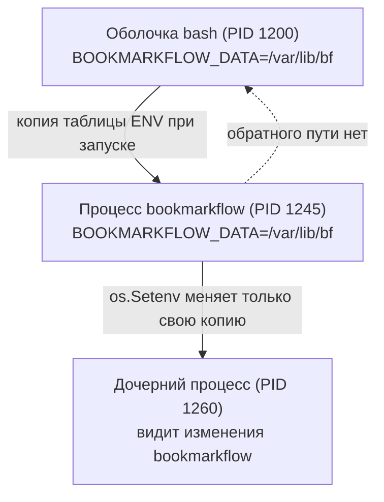

*Как процесс наследует переменные окружения от родителя, чем `os.LookupEnv` надёжнее `os.Getenv` и почему относительный путь к файлу зависит от рабочего каталога.*

Вы запускаете `BookmarkFlow` из каталога проекта командой `./bookmarkflow` — всё работает, файл `"bookmarks.json"` открывается без ошибок. Затем вы переходите в `/tmp` и вызываете тот же бинарник по полному пути `/opt/bookmarkflow/bookmarkflow`. Программа стартует чисто, но внезапно показывает пустой список: она создала новый файл `/tmp/bookmarks.json` и «потеряла» старые закладки. Вдобавок в исходнике зашит токен API — стоит отправить коммит в репозиторий, и секрет окажется в истории Git.

Обе проблемы связаны с контекстом, который операционная система передаёт процессу при запуске: **таблицей переменных окружения** и **текущим рабочим каталогом**.

## Переменные окружения и наследование

При создании нового процесса ядро Linux передаёт ему не только аргументы командной строки (`os.Args`), но и плоский список пар `КЛЮЧ=ЗНАЧЕНИЕ` — **переменные окружения** (*environment variables*, `ENV`). В них живут базовые настройки среды: `PATH` (где оболочка ищет исполняемые файлы), `HOME` (домашний каталог пользователя), `LANG` (локаль).

Главное правило окружения — **одностороннее наследование**. Когда оболочка (`bash` или `zsh`) запускает ваш бинарник, ядро копирует таблицу экспортированных переменных родителя в память дочернего процесса:



Изменения через `os.Setenv` видны только самому процессу и программам, которые он запустит позже. Поменять переменные родительской оболочки из дочернего процесса невозможно — так ядро защищает процессы друг от друга.

Именно поэтому адреса сервисов, порты, пути к хранилищу и секретные токены передают через `ENV`, а не зашивают константами в код. Один и тот же скомпилированный бинарник без пересборки работает на ноутбуке разработчика, на тестовом стенде и на боевом сервере — меняется лишь его окружение при запуске. Секреты при этом никогда не попадают в систему контроля версий.

## `os.Getenv` против `os.LookupEnv`

В пакете `os` есть две похожие функции для чтения переменной окружения, но между ними скрыта важная разница:

* `os.Getenv(key)` возвращает `string`. Если переменная не задана, функция вернёт пустую строку `""`.
* `os.LookupEnv(key)` возвращает `(string, bool)` по знакомому принципу *comma ok*: второй результат равен `true`, если переменная присутствует в окружении, даже если её значение пустое.

Представьте, что у `BookmarkFlow` параметр `BOOKMARKFLOW_PREFIX` по умолчанию равен `"[bf]"`, но администратор хочет полностью отключить префикс, передав `BOOKMARKFLOW_PREFIX=""`. Код с `os.Getenv` проверит `if v == ""`, решит, что параметр не задан, и снова подставит `"[bf]"`. Программа проигнорирует явную настройку. С `os.LookupEnv` два случая разделены строго: `("", false)` означает «переменной нет — берите умолчание», а `("", true)` — «переменная задана пустой строкой».

## Рабочий каталог процесса (`cwd`)

Кроме таблицы `ENV`, ядро хранит для каждого процесса **текущий рабочий каталог** (*current working directory*, `cwd`). Он тоже наследуется от родителя: если вы выполнили `cd /tmp` и запустили `/opt/bookmarkflow/bookmarkflow`, то `cwd` нового процесса равен `/tmp`, а не `/opt/bookmarkflow`.

Каждый относительный путь — `"bookmarks.json"`, `"./data/export.csv"`, `"../config.json"` — ядро разрешает строго относительно `cwd`. Именно поэтому запуск бинарника из другой папки внезапно перенаправил запись в `/tmp/bookmarks.json`.

В Go узнать рабочий каталог позволяет `os.Getwd()`, превратить относительный путь в абсолютный от `cwd` — `filepath.Abs(p)`, а получить путь к самому исполняемому файлу — `os.Executable()`.

Соберём конфигуратор для `BookmarkFlow`, который честно различает отсутствие переменной и пустую строку и сразу переводит путь к файлу в абсолютный:

```go
package main

import (
	"fmt"
	"os"
	"path/filepath"
	"strings"
)

type Config struct {
	DataPath string
	Prefix   string
	TokenSet bool
}

func loadConfig() (Config, error) {
	cwd, err := os.Getwd()
	if err != nil {
		return Config{}, fmt.Errorf("рабочий каталог: %w", err)
	}

	rawPath := "bookmarks.json"
	if v, ok := os.LookupEnv("BOOKMARKFLOW_DATA"); ok {
		if strings.TrimSpace(v) == "" {
			return Config{}, fmt.Errorf("BOOKMARKFLOW_DATA задана пустой")
		}
		rawPath = v
	}

	absPath := rawPath
	if !filepath.IsAbs(rawPath) {
		absPath = filepath.Join(cwd, rawPath)
	}

	prefix := "[bf]"
	if v, ok := os.LookupEnv("BOOKMARKFLOW_PREFIX"); ok {
		prefix = v // пустая строка разрешена и отключает префикс
	}

	token, hasToken := os.LookupEnv("BOOKMARKFLOW_TOKEN")
	return Config{
		DataPath: absPath,
		Prefix:   prefix,
		TokenSet: hasToken && token != "",
	}, nil
}

func main() {
	cfg, err := loadConfig()
	if err != nil {
		fmt.Fprintln(os.Stderr, "ошибка конфигурации:", err)
		os.Exit(1)
	}
	fmt.Printf("data=%s prefix=%q token_set=%t\n", cfg.DataPath, cfg.Prefix, cfg.TokenSet)
}
```

Посмотрим на живой запуск из разных каталогов и с разным окружением:

```text
$ cd /tmp
$ /opt/bookmarkflow/app
data=/tmp/bookmarks.json prefix="[bf]" token_set=false

$ BOOKMARKFLOW_DATA=/var/lib/bf/bookmarks.json BOOKMARKFLOW_PREFIX="" /opt/bookmarkflow/app
data=/var/lib/bf/bookmarks.json prefix="" token_set=false

$ BOOKMARKFLOW_DATA="" /opt/bookmarkflow/app
ошибка конфигурации: BOOKMARKFLOW_DATA задана пустой
```

Запись `KEY=VAL ./app` в оболочке передаёт переменную **только** этому одному запуску, не засоряя текущую сессию терминала. Чтобы переменная наследовалась всеми последующими командами в окне терминала, используют `export KEY=VAL`.

## Подводные камни

**Ловушка 1. Смешивание пустой строки и отсутствия переменной.**  
Проверка `if os.Getenv("BOOKMARKFLOW_TOKEN") == ""` подходит, когда пустое значение эквивалентно отсутствию. Но для флагов, префиксов и обязательных путей, где пустая строка означает явную ошибку конфигурации, используйте `os.LookupEnv`.

**Ловушка 2. Относительные пути в фоновых сервисах.**  
На ноутбуке вы почти всегда запускаете программу из корня репозитория. На сервере системный менеджер часто стартует процесс с рабочим каталогом `/` или `/root`, куда у обычного пользователя нет прав на запись. Задавайте пути к данным абсолютным значением через `ENV` или флаг командной строки, а в стартовом логе печатайте итоговый `absPath`.

**Ловушка 3. Печать секретов в логи.**  
Не выводите значения `BOOKMARKFLOW_TOKEN` или паролей в `stdout`/`stderr` и не логируйте целиком `os.Environ()`. Достаточно булевого флага `token_set=true`, как в примере выше.

> [!check] Проверь понимание
> Программа на Go вызывает `os.Setenv("MODE", "debug")` и успешно завершается. Вы сразу выполняете в том же терминале `echo "$MODE"`. Что напечатает терминал?
>
> Пустую строку (или прежнее значение `MODE`, если оно было задано до запуска). `os.Setenv` меняет только копию таблицы окружения внутри процесса Go; окружение родительской оболочки остаётся нетронутым.

## Практика

**Упражнение 1 (Базовое). Проследи вывод `Getenv` и `LookupEnv`.**  
Что напечатает следующий фрагмент при трёх запусках: (а) переменная `APP_ENV` не задана; (б) `APP_ENV=""`; (в) `APP_ENV="staging"`?

```go
v1 := os.Getenv("APP_ENV")
v2, ok := os.LookupEnv("APP_ENV")
fmt.Printf("get=%q lookup=(%q, %t)\n", v1, v2, ok)
```

> [!solution] Показать решение
> * (а) `get="" lookup=("", false)` — переменной нет в таблице окружения.
> * (б) `get="" lookup=("", true)` — переменная есть, но её значение пустое; `os.Getenv` не отличает этот случай от (а).
> * (в) `get="staging" lookup=("staging", true)`.

**Упражнение 2 (Практическое). Чтение длительности из `ENV`.**  
Напишите функцию `EnvDuration(key string, fallback time.Duration) (time.Duration, error)`. Если переменная `key` не задана — верните `fallback, nil`. Если задана, но пуста, не парсится `time.ParseDuration` или даёт значение `<= 0` — верните понятную ошибку.

> [!solution] Показать решение
> ```go
> package main
>
> import (
> 	"fmt"
> 	"os"
> 	"time"
> )
>
> func EnvDuration(key string, fallback time.Duration) (time.Duration, error) {
> 	raw, ok := os.LookupEnv(key)
> 	if !ok {
> 		return fallback, nil
> 	}
> 	d, err := time.ParseDuration(raw)
> 	if err != nil {
> 		return 0, fmt.Errorf("%s=%q: некорректная длительность: %w", key, raw, err)
> 	}
> 	if d <= 0 {
> 		return 0, fmt.Errorf("%s=%q: длительность должна быть положительной", key, raw)
> 	}
> 	return d, nil
> }
>
> func main() {
> 	d, err := EnvDuration("BOOKMARKFLOW_TIMEOUT", 5*time.Second)
> 	fmt.Println(d, err) // Вывод: 5s <nil>
> }
> ```
> Использование `os.LookupEnv` гарантирует, что ошибочный запуск `BOOKMARKFLOW_TIMEOUT=""` не замаскируется тихим откатом к 5 секундам, а сразу сообщит о проблеме конфигурации.

**Упражнение 3 (Со звёздочкой \*). Безопасное разрешение пути к данным.**  
Напишите функцию `ResolveDataPath(envKey, defaultName string) (string, error)`, которая читает путь из `envKey` (если переменная не задана, берёт `defaultName`), приводит его к абсолютному через `filepath.Abs` и проверяет с помощью `os.Stat(filepath.Dir(abs))`, что родительский каталог существует и действительно является каталогом. Если переменная задана пустой строкой — верните ошибку.

> [!solution] Показать решение
> ```go
> package main
>
> import (
> 	"fmt"
> 	"os"
> 	"path/filepath"
> 	"strings"
> )
>
> func ResolveDataPath(envKey, defaultName string) (string, error) {
> 	raw := defaultName
> 	if v, ok := os.LookupEnv(envKey); ok {
> 		if strings.TrimSpace(v) == "" {
> 			return "", fmt.Errorf("переменная %s задана пустой", envKey)
> 		}
> 		raw = v
> 	}
> 	abs, err := filepath.Abs(raw)
> 	if err != nil {
> 		return "", fmt.Errorf("абсолютный путь для %q: %w", raw, err)
> 	}
> 	info, err := os.Stat(filepath.Dir(abs))
> 	if err != nil {
> 		return "", fmt.Errorf("родительский каталог для %q недоступен: %w", abs, err)
> 	}
> 	if !info.IsDir() {
> 		return "", fmt.Errorf("%q не является каталогом", filepath.Dir(abs))
> 	}
> 	return abs, nil
> }
>
> func main() {
> 	p, err := ResolveDataPath("BOOKMARKFLOW_DATA", "bookmarks.json")
> 	fmt.Println(p, err)
> }
> ```
> Ранняя проверка родительского каталога при старте позволяет поймать опечатку в пути сразу, а не спустя часы при первом сохранении закладок.

---

Мы разобрались, как операционная система передаёт процессу настройки при рождении через `ENV` и рабочий каталог. Но как ОС разговаривает с программой, когда та уже работает и её пора аккуратно остановить? Эту задачу решают сигналы — о них в следующем уроке [[9. Сигналы ОС — SIGINT, SIGTERM и SIGKILL]].
