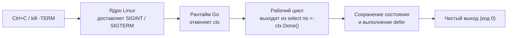

*Как операционная система просит работающий процесс остановиться, чем `SIGINT` и `SIGTERM` отличаются от `SIGKILL` и как корректно завершать цикл программы в Go через `signal.NotifyContext`.*

Фоновый воркер `BookmarkFlow` проверяет список ссылок и каждые несколько секунд обновляет локальный кэш статусов. Вы нажимаете `Ctrl+C` в терминале, или серверный менеджер служб останавливает процесс перед обновлением бинарника. Если программа не ждёт такого события, ядро обрывает её мгновенно — прямо посреди записи файла или сохранения отчёта. Отложенные `defer` даже не успевают сработать.

Чтобы программа могла доделать текущий шаг, сбросить буферы и чисто закрыть файлы, операционная система посылает ей **сигнал**.

## Как ОС общается с живым процессом

Сигнал (*signal*) — это короткое асинхронное уведомление с целочисленным кодом, которое ядро Linux доставляет процессу. Можно сравнить его с коротким звонком в дверь, который заставляет программу отложить текущую работу и отреагировать. Граница аналогии простая: сигнал не несёт произвольного текста или данных — только сам номер события.

В Linux определены десятки сигналов, но в повседневной работе бэкенд-инженера решающую роль играют три:

| Сигнал | Номер (Linux) | Кто обычно отправляет | Можно перехватить? | Поведение по умолчанию |
|---|---:|---|---|---|
| `SIGINT` | 2 | Терминал при нажатии `Ctrl+C` | Да | Немедленное завершение |
| `SIGTERM` | 15 | `kill <pid>`, менеджер сервисов (`systemd`) при остановке или перезапуске | Да | Немедленное завершение |
| `SIGKILL` | 9 | `kill -9 <pid>`, ядро при исчерпании памяти (OOM Killer) | **Нет** | Безусловное уничтожение ядром |

Разница между `SIGTERM` и `SIGKILL` — фундаментальная.

`SIGTERM` и `SIGINT` — это вежливые просьбы остановиться. Процесс вправе подписаться на них, получить уведомление, довести текущую операцию до безопасной точки, закрыть дескрипторы и выйти сам с кодом `0`.

`SIGKILL` — аварийный рубильник. Ядро **не доставляет** его в код процесса: оно просто снимает процесс с планировщика и освобождает память и дескрипторы. Перехватить, отложить или проигнорировать `SIGKILL` невозможно — на этом держится право администратора и ядра остановить зависшую программу.

На практике менеджер служб действует в два шага: сначала шлёт сервису `SIGTERM`, даёт фиксированное окно времени (обычно 10–30 секунд) на корректное завершение процесса, и только если процесс не вышел сам — добивает его сигналом `SIGKILL`.

## Перехват сигналов в Go: `signal.NotifyContext`

В пакете `os/signal` есть функция `signal.NotifyContext`, которая связывает сигналы ОС с привычным `context.Context`. Вся цепочка управления выглядит так:



Достаточно одной строки в начале `main()`:

```go
ctx, stop := signal.NotifyContext(context.Background(), syscall.SIGINT, syscall.SIGTERM)
defer stop()
```

Пока сигнал не пришёл, `ctx` активен, и программа работает в обычном цикле. Как только поступает `SIGINT` или `SIGTERM`, рантайм Go отменяет `ctx`, канал `ctx.Done()` закрывается, и любая горутина, которая слушает контекст, узнаёт о начале остановки.

Вызов `stop()` освобождает внутренние ресурсы подписки и возвращает процессу стандартную реакцию на сигнал. Если вызвать `stop()` сразу после получения первого сигнала, повторное нажатие `Ctrl+C` не будет ждать финализации и оборвёт программу мгновенно — удобная страховка на случай, если очистка сама зависла.

Соберём рабочий цикл фонового проверяльщика закладок с корректным завершением процесса:

```go
package main

import (
	"context"
	"fmt"
	"os"
	"os/signal"
	"syscall"
	"time"
)

func runWorker(ctx context.Context) error {
	ticker := time.NewTicker(1 * time.Second)
	defer ticker.Stop()

	step := 0
	for {
		select {
		case <-ctx.Done():
			fmt.Println("получен сигнал остановки, завершаем цикл...")
			return flushState(step)
		case <-ticker.C:
			step++
			fmt.Printf("шаг %d: проверка закладок выполнена\n", step)
		}
	}
}

func flushState(completed int) error {
	// Имитируем сохранение прогресса перед выходом.
	time.Sleep(200 * time.Millisecond)
	fmt.Printf("состояние сохранено (выполнено шагов: %d)\n", completed)
	return nil
}

func main() {
	ctx, stop := signal.NotifyContext(context.Background(), syscall.SIGINT, syscall.SIGTERM)
	defer stop()

	fmt.Printf("воркер запущен (PID=%d); нажмите Ctrl+C для остановки\n", os.Getpid())
	if err := runWorker(ctx); err != nil {
		fmt.Fprintln(os.Stderr, "ошибка завершения:", err)
		os.Exit(1)
	}
	fmt.Println("процесс завершён чисто")
}
```

Запустим программу и нажмём `Ctrl+C` спустя две секунды:

```text
$ go run .
воркер запущен (PID=4821); нажмите Ctrl+C для остановки
шаг 1: проверка закладок выполнена
шаг 2: проверка закладок выполнена
^Cполучен сигнал остановки, завершаем цикл...
состояние сохранено (выполнено шагов: 2)
процесс завершён чисто
```

Точно такой же вывод вы получите, если откроете второе окно терминала и выполните `kill -TERM 4821` (или просто `kill 4821`, так как `SIGTERM` — сигнал по умолчанию). А вот команда `kill -9 4821` оборвёт процесс на полуслове, и строки `состояние сохранено` вы не увидите — ядро напечатает лишь `Killed`.

*(NOTE: здесь мы отрабатываем перехват сигналов для простого рабочего цикла; полную схему остановки сетевых серверов с дожиданием активных запросов разберём в Модуле 7.)*

## Подводные камни

**Ловушка 1. Подписка на `syscall.SIGKILL`.**  
Вызов `signal.NotifyContext(ctx, syscall.SIGKILL)` скомпилируется без предупреждений, но никогда не сработает. Ядро просто игнорирует попытку процесса перехватить сигнал 9. Не рассчитывайте в логике программы на код очистки после `SIGKILL`.

**Ловушка 2. Бесконечная очистка после сигнала.**  
Если `flushState` обращается к медленному диску или внешнему ресурсу и зависнет, процесс не выйдет сам — и через 10–30 секунд системный менеджер всё равно добьёт его через `SIGKILL`. Для этапа финализации создавайте отдельный контекст с жёстким таймаутом от `context.Background()`, потому что основной `ctx` уже отменён.

**Ловушка 3. Блокирующий цикл без проверки `ctx.Done()`.**  
Сам по себе `signal.NotifyContext` не прерывает выполнение функции посередине. Если цикл внутри `runWorker` нигде не проверяет `ctx.Done()` и не передаёт `ctx` дальше, процесс не заметит отмену и будет игнорировать `Ctrl+C`!

> [!check] Проверь понимание
> Выполнится ли `defer fmt.Println("bye")` в функции `main()`, если: (1) процесс без перехвата сигналов получил `SIGTERM`; (2) процесс с `signal.NotifyContext` получил `SIGTERM`; (3) процесс с `signal.NotifyContext` получил `SIGKILL`?
>
> Только во втором случае. При `SIGTERM` без перехвата и при `SIGKILL` ядро прекращает процесс напрямую, не возвращая управление в Go — отложенные `defer` не вызываются.

## Практика

**Упражнение 1 (Базовое). Два этапа остановки службы.**  
Почему системный менеджер Linux при перезапуске сервиса сначала отправляет ему `SIGTERM`, ждёт заданный таймаут и лишь потом отправляет `SIGKILL`, вместо того чтобы сразу вызывать `SIGKILL`?

> [!solution] Показать решение
> `SIGTERM` даёт процессу шанс перехватить сигнал, закончить текущую операцию, сбросить буферы на диск и закрыть соединения без потери данных. `SIGKILL` служит страховкой на случай, если процесс завис, попал в дедлок или игнорирует `SIGTERM` — тогда ядро гарантированно освободит ресурсы.

**Упражнение 2 (Практическое). Финализация с жёстким таймаутом.**  
Доработайте функцию сохранения состояния из примера так, чтобы она принимала `shutdownCtx context.Context` и прерывалась, если сохранение не уложилось в 2 секунды. Помните: основной `ctx` после прихода сигнала уже отменён, поэтому контекст финализации нужно создавать от `context.Background()`.

> [!solution] Показать решение
> ```go
> package main
>
> import (
> 	"context"
> 	"fmt"
> 	"time"
> )
>
> func flushWithTimeout(workDuration, limit time.Duration) error {
> 	shutdownCtx, cancel := context.WithTimeout(context.Background(), limit)
> 	defer cancel()
>
> 	select {
> 	case <-time.After(workDuration):
> 		return nil
> 	case <-shutdownCtx.Done():
> 		return fmt.Errorf("сохранение не уложилось в %s: %w", limit, shutdownCtx.Err())
> 	}
> }
>
> func main() {
> 	fmt.Println("быстрое:", flushWithTimeout(100*time.Millisecond, 2*time.Second))
> 	fmt.Println("зависшее:", flushWithTimeout(5*time.Second, 200*time.Millisecond))
> }
> ```
> Новый контекст от `context.Background()` даёт этапу завершения собственный бюджет времени, не унаследовав отмену от сигнального контекста.

**Упражнение 3 (Со звёздочкой \*). Двойное нажатие `Ctrl+C`.**  
Напишите законченную программу `package main`, в которой первое нажатие `Ctrl+C` запускает 5-секундную финализацию и немедленно вызывает `stop()` (снимая перехват сигнала), чтобы второе нажатие `Ctrl+C` во время долгой очистки мгновенно прервало процесс стандартным способом.

> [!solution] Показать решение
> ```go
> package main
>
> import (
> 	"context"
> 	"fmt"
> 	"os/signal"
> 	"syscall"
> 	"time"
> )
>
> func main() {
> 	ctx, stop := signal.NotifyContext(context.Background(), syscall.SIGINT, syscall.SIGTERM)
> 	defer stop()
>
> 	fmt.Println("работаем... нажмите Ctrl+C для плавной остановки")
> 	<-ctx.Done()
>
> 	// Снимаем перехват: повторный Ctrl+C теперь мгновенно завершит процесс.
> 	stop()
> 	fmt.Println("завершаем работу (нажмите Ctrl+C ещё раз для немедленного выхода)...")
>
> 	time.Sleep(5 * time.Second)
> 	fmt.Println("очистка завершена")
> }
> ```
> Вызов `stop()` сразу после `<-ctx.Done()` — распространённая практика в CLI-утилитах и серверах: пользователь сохраняет контроль, если остановка затянулась.

---

Сигналы идут в одну сторону: от ядра к вашему процессу. В следующем уроке посмотрим на обратное направление — как сама программа на Go обращается к ядру за чтением файлов, выводом в терминал и завершением работы через системные вызовы [[10. Системные вызовы — как программа на Go просит ядро о работе]].
