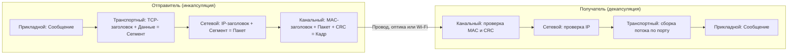
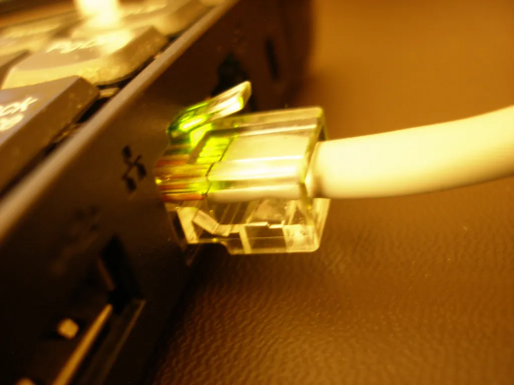

*Как 4-слойная модель TCP/IP разделяет доставку байтов по кабелю, маршрутизацию между сетями, надёжность соединения и язык приложения.*

Когда ваш сервис `BookmarkFlow` проверяет доступность ссылки, его код не знает, как компьютер подключён к сети. Дома это Wi-Fi, в офисе — медный кабель Ethernet, в дороге — мобильный модем. Между вашей машиной и удалённым сервером лежит десяток маршрутизаторов, о существовании которых программа даже не догадывается.

Если бы каждое приложение вручную управляло радиосигналом, строило маршруты по планете и переотправляло потерянные фрагменты, даже простейший сетевой клиент занимал бы сотни тысяч строк кода. В 1970-х годах инженеры нашли выход, разбив сложную задачу на четыре независимых уровня ответственности.

## Модель слоёв и честная граница аналогии

Стек протоколов **TCP/IP** устроен как вертикальная стопка из четырёх уровней. Каждый уровень решает ровно одну узкую задачу и пользуется услугами соседа снизу, не вникая в его внутреннее устройство.

При отправке данных сверху вниз работает **инкапсуляция** (*encapsulation*): каждый нижележащий уровень берёт блок данных сверху, считает его непрозрачным набором байтов и приклеивает спереди свой служебный заголовок. На стороне получателя происходит обратный процесс — **декапсуляция**: уровни по очереди снимают свои заголовки и передают очищенное содержимое выше.



Инкапсуляцию удобно сравнивать с **вложенными конвертами**: вы кладёте письмо в конверт с номером квартиры (порт), этот конверт — в конверт с адресом дома (IP), а его — в мешок для доставки до ближайшего почтового отделения (MAC). Аналогия верна ровно в одном: нижележащий слой не читает содержимое вложенного конверта и отвечает только за свой заголовок.

На этом сходство заканчивается, и дальше аналогия ломается в двух местах. Во-первых, если сообщение велико, транспортный уровень сам разрежет его на несколько кусков по размеру канала (обычно около **1 500 байтов** для Ethernet — этот предел называют **MTU**, *Maximum Transmission Unit*). Во-вторых, внешний канальный конверт не едет до самого финиша: каждый маршрутизатор по пути срывает старый MAC-заголовок и оборачивает IP-пакет в новый кадр для следующего участка сети.

## Четыре уровня и четыре единицы данных

В разговорной речи разработчики часто называют «пакетом» всё подряд, что летит по сети. Но в документации, спецификациях и инструментах диагностики у каждого уровня своё точное имя единицы данных.

| Уровень TCP/IP | Главная задача | Типичные протоколы | Адресация | Единица данных |
|---|---|---|---|---|
| **4. Прикладной** (*Application*) | Смысл и формат обмена между программами | HTTP, DNS, SSH, свой протокол | Имена доменов, пути | **Сообщение** (*message*) |
| **3. Транспортный** (*Transport*) | Выбор нужного процесса, порядок и надёжность | TCP, UDP | Номер порта (`0..65535`) | **Сегмент** (TCP) / **датаграмма** (UDP) |
| **2. Сетевой** (*Internet*) | Маршрутизация между разными сетями | IPv4, IPv6 | IP-адрес | **Пакет** (*packet*) |
| **1. Канальный** (*Link*) | Передача битов между двумя соседями в одной сети | Ethernet, Wi-Fi | MAC-адрес (`48 бит`) | **Кадр** (*frame*) |

Обратите внимание на разницу между **MAC-адресом** и **IP-адресом**. MAC-адрес прошит в сетевой карте и действует только в пределах одного локального сегмента — например, от ноутбука до домашнего роутера. Как только кадр доходит до роутера, тот проверяет контрольную сумму (CRC), отбрасывает канальный заголовок, читает IP-адрес получателя, выбирает следующий прыжок и упаковывает пакет в новый кадр с новым MAC-адресом получателя. Сам IP-пакет внутри при этом продолжает путь к конечному серверу.



В академических курсах встречается также 7-уровневая эталонная модель **OSI** (она дополнительно выделяет сеансовый, представительский и физический уровни). В реальной разработке бэкенда и в самом Интернете живёт именно 4-слойная модель TCP/IP — на ней построен стек ОС и стандартная библиотека Go.

Честное упрощение: прикладной код на Go почти никогда не собирает IP-пакеты и Ethernet-кадры вручную — этим занимается ядро операционной системы (подробнее см. Том 5). Программа отдаёт ядру байты на транспортном или прикладном уровне, а стек ОС сам доклеивает нужные заголовки.

## Инкапсуляция в байтах: смотрим руками в Go

Чтобы увидеть, что заголовки — не абстракция, а обычные байты спереди полезной нагрузки, смоделируем упаковку короткого сообщения `BookmarkFlow` в два вложенных заголовка: упрощённый транспортный (порты и длина) и сетевой (адреса IPv4). В сетевых протоколах многобайтовые числа всегда кодируют в порядке **big-endian** (сетевой порядок байтов, знакомый нам из Подраздела 5.1).

```go
package main

import (
	"encoding/binary"
	"fmt"
)

func wrapTransport(srcPort, dstPort uint16, payload []byte) []byte {
	// Заголовок 6 байт: srcPort (2) + dstPort (2) + length (2).
	segment := make([]byte, 6+len(payload))
	binary.BigEndian.PutUint16(segment[0:2], srcPort)
	binary.BigEndian.PutUint16(segment[2:4], dstPort)
	binary.BigEndian.PutUint16(segment[4:6], uint16(len(payload)))
	copy(segment[6:], payload)
	return segment
}

func wrapIP(srcIP, dstIP [4]byte, segment []byte) []byte {
	// Упрощённый IP-заголовок 8 байт: srcIP (4) + dstIP (4).
	packet := make([]byte, 8+len(segment))
	copy(packet[0:4], srcIP[:])
	copy(packet[4:8], dstIP[:])
	copy(packet[8:], segment)
	return packet
}

func main() {
	message := []byte("PING\n")
	segment := wrapTransport(52000, 8080, message)
	packet := wrapIP([4]byte{192, 168, 1, 10}, [4]byte{10, 0, 0, 5}, segment)

	fmt.Printf("Сообщение: %d Б -> %q\n", len(message), message)
	fmt.Printf("Сегмент:   %d Б -> % x\n", len(segment), segment)
	fmt.Printf("Пакет:     %d Б -> % x\n", len(packet), packet)

	// Декапсуляция на стороне получателя: снимаем заголовки по очереди.
	gotDstPort := binary.BigEndian.Uint16(packet[10:12])
	gotPayload := packet[14:]
	fmt.Printf("Распаковано: порт=%d, сообщение=%q\n", gotDstPort, gotPayload)
}
```

Запуск программы показывает, как полезная нагрузка обрастает служебными байтами:

```text
Сообщение: 5 Б -> "PING\n"
Сегмент:   11 Б -> cb 20 1f 90 00 05 50 49 4e 47 0a
Пакет:     19 Б -> c0 a8 01 0a 0a 00 00 05 cb 20 1f 90 00 05 50 49 4e 47 0a
Распаковано: порт=8080, сообщение="PING\n"
```

Здесь `50 49 4e 47 0a` — это байты `"PING\n"`, перед ними лежат `cb 20` (порт `52000`), `1f 90` (порт `8080`) и длина `00 05`, а ещё левее — два IPv4-адреса. Никакой магии: протокол — это строгое соглашение о том, какой байт на каком смещении что означает.

## Подводные камни

**Ловушка 1. Накладные расходы на мелкие сообщения.**  
Настоящий IPv4-заголовок занимает минимум **20 байтов**, TCP-заголовок — ещё минимум **20 байтов**, Ethernet-кадр добавляет **18 байтов** (заголовок и контрольная сумма). Итого **58 байтов** служебных данных даже ради одного полезного байта. Отправка текста по одному символу за системный вызов превращает канал в перевозку пустых конвертов — поэтому в сетевых программах так важна буферизация.

**Ловушка 2. Путаница между слоями при отладке.**  
Если не открывается сайт, причина может лежать на любом из четырёх этажей: оборван Wi-Fi (канальный), нет маршрута к подсети (сетевой), закрыт порт или процесс не запущен (транспортный) либо сервер вернул ошибку формата (прикладной). Понимание границ слоёв позволяет сужать поиск за минуты, а не гадать вслепую.

> [!check] Проверь понимание
> На каком уровне модели TCP/IP работает MAC-адрес, а на каком — номер порта?
>
> MAC-адрес работает на **канальном уровне** (доставка кадра между двумя соседними устройствами в одной сети). Номер порта работает на **транспортном уровне** (выбор конкретной программы внутри компьютера).

## Практика

**Упражнение 1 (Базовое). Сопоставление уровней.**  
Разложите перечисленные элементы по четырём уровням модели TCP/IP (канальный, сетевой, транспортный, прикладной): `IPv4-пакет`, `HTTP-запрос`, `Ethernet-кадр`, `порт 8080`, `MAC-адрес`, `TCP-сегмент`, `DNS-ответ`.

> [!solution] Показать решение
> * **Канальный:** `Ethernet-кадр`, `MAC-адрес`.
> * **Сетевой:** `IPv4-пакет`.
> * **Транспортный:** `порт 8080`, `TCP-сегмент`.
> * **Прикладной:** `HTTP-запрос`, `DNS-ответ`.
>
> Критерий простой: кабель и локальные соседи — канальный, маршрут между сетями — сетевой, доставка до процесса — транспортный, формат данных самой программы — прикладной.

**Упражнение 2 (Практическое). Декапсуляция с проверкой длины.**  
Допишите функцию `unwrapTransport(segment []byte) (srcPort, dstPort uint16, payload []byte, err error)` для формата из примера выше (6-байтный заголовок: `srcPort`, `dstPort`, `length`). Если слайс короче 6 байтов или фактический хвост не совпадает с полем `length`, верните понятную ошибку.

> [!solution] Показать решение
> ```go
> package main
>
> import (
> 	"encoding/binary"
> 	"errors"
> 	"fmt"
> )
>
> func unwrapTransport(segment []byte) (uint16, uint16, []byte, error) {
> 	if len(segment) < 6 {
> 		return 0, 0, nil, errors.New("сегмент короче 6-байтного заголовка")
> 	}
> 	srcPort := binary.BigEndian.Uint16(segment[0:2])
> 	dstPort := binary.BigEndian.Uint16(segment[2:4])
> 	wantLen := int(binary.BigEndian.Uint16(segment[4:6]))
> 	payload := segment[6:]
> 	if len(payload) != wantLen {
> 		return 0, 0, nil, fmt.Errorf("длина данных %d не совпадает с заголовком %d", len(payload), wantLen)
> 	}
> 	return srcPort, dstPort, payload, nil
> }
>
> func main() {
> 	raw := []byte{0xcb, 0x20, 0x1f, 0x90, 0x00, 0x04, 'P', 'O', 'N', 'G'}
> 	src, dst, body, err := unwrapTransport(raw)
> 	fmt.Printf("src=%d dst=%d body=%q err=%v\n", src, dst, body, err)
> 	// Вывод: src=52000 dst=8080 body="PONG" err=<nil>
> }
> ```
> Сетевой код обязан проверять границы слайса до чтения индексов и сверять заявленную в заголовке длину с реально пришедшими байтами, иначе битый пакет вызовет панику.

**Упражнение 3 (Со звёздочкой \*). Что меняется на каждом маршрутизаторе.**  
Ноутбук с адресом `192.168.1.10` отправляет IP-пакет на сервер `203.0.113.50` через домашний роутер и три маршрутизатора провайдера. Какие адреса в заголовках — MAC или IP — меняются при проходе через каждый промежуточный маршрутизатор (без учёта NAT) и почему?

> [!solution] Показать решение
> На каждом промежуточном узле **меняются MAC-адреса** в канальном кадре (отправителем становится выходной интерфейс текущего маршрутизатора, получателем — входной интерфейс следующего соседа), потому что канальный уровень работает только в пределах одного физического линка.
>
> **IP-адрес получателя** (и в чистой маршрутизации без NAT — IP-адрес отправителя) остаётся прежним на всём пути, чтобы каждый следующий маршрутизатор знал конечную цель пакета.

---

Слои сети разложили ответственность по полкам: канальный доставляет кадр до ближайшего соседа, а сетевой ведёт пакет через весь Интернет по IP-адресу. Теперь разберём сами IP-адреса вплотную — как работают маски подсетей и почему выбор между `127.0.0.1` и `0.0.0.0` решает, увидят ли ваш сервер снаружи: [[2. IPv4, IPv6, подсети, localhost и 0.0.0.0]].
