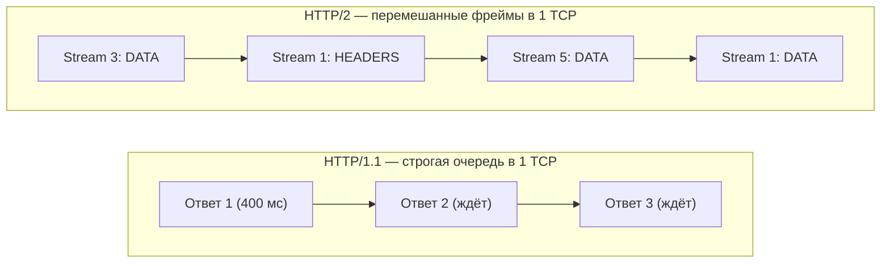
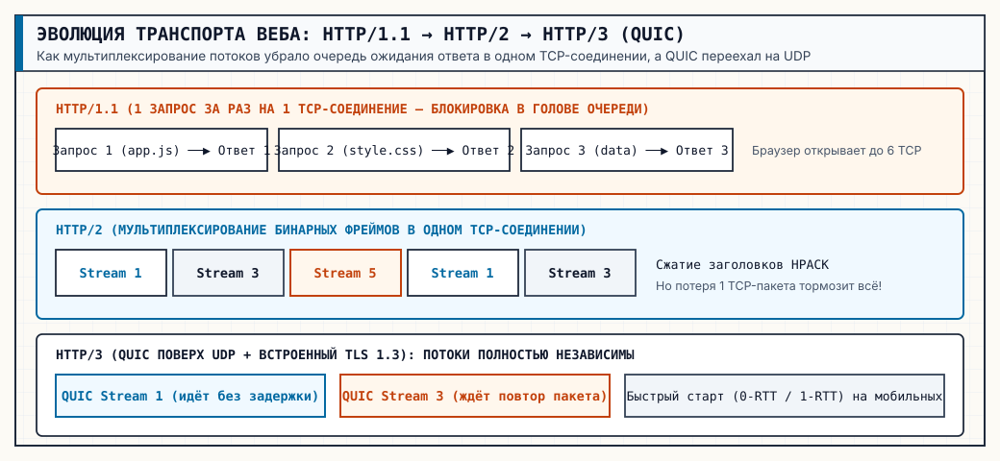

*Почему HTTP/1.1 упёрся в блокировку очереди, как HTTP/2 перешёл на бинарные фреймы и мультиплексирование и зачем HTTP/3 сменил TCP на протокол QUIC поверх UDP.*

Одна современная веб-страница загружает 60–100 ресурсов: HTML, стили, скрипты, шрифты, иконки и JSON-запросы. Постоянные соединения `Keep-Alive` в HTTP/1.1 избавили браузер от лишних рукопожатий, но не сняли главное ограничение: поверх одного TCP-соединения запросы всё равно идут **строго по очереди**.

## Блокировка начала очереди в HTTP/1.1

Если первый запрос обрабатывается сервером 400 миллисекунд, следующие запросы в том же сокете молча ждут его последнего байта. Это явление называют **блокировкой начала очереди** (*Head-of-Line blocking*, **HoL-блокировка**).

Браузеры обходили затор, открывая до **6 параллельных TCP-соединений** на каждый домен. Цена оказалась высокой: шесть TCP- и TLS-рукопожатий, шесть буферов в памяти ядра и шесть «холодных» стартов разгона TCP. Вдобавок текстовый HTTP/1.1 раз за разом пересылал сотни байтов повторяющихся заголовков (`Cookie`, `User-Agent`, `Accept`).

## HTTP/2: бинарные фреймы, мультиплексирование и HPACK

Стандарт **HTTP/2** (2015) сохранил всю семантику HTTP (методы, статусы, заголовки), но полностью заменил формат передачи на проводе:

1. **Бинарное фреймирование (*binary framing*).** Сообщения режутся на компактные бинарные **фреймы** (`HEADERS` для заголовков, `DATA` для тела), которые проще и быстрее парсить.
2. **Мультиплексирование потоков (*multiplexing*).** Каждый запрос получает номер логического **потока** (*Stream ID*: `1`, `3`, `5`…). Фреймы разных потоков перемешиваются внутри **одного TCP-соединения**. Медленный API-ответ в потоке `1` больше не задерживает быстрый файл в потоке `3`.
3. **Сжатие заголовков HPACK.** Обе стороны держат общие таблицы частых заголовков, заменяя длинные повторяющиеся строки короткими индексами.

Сравним передачу трёх ответов по одному TCP-соединению:

Одного соединения на домен стало хватать для десятков параллельных запросов.

## Почему в HTTP/2 осталась TCP-блокировка

HTTP/2 победил блокировку на прикладном уровне, но упёрся в ограничение самого **TCP**. Все потоки HTTP/2 по-прежнему едут внутри **одного последовательного потока байтов**, а ядро ОС обязано отдавать байты TCP строго по порядку номеров.

Если в мобильной сети с потерей 2% пакетов пропал один IP-пакет потока `1`, уже долетевшие пакеты потоков `3` и `5` застревают в буфере ядра — пока не придёт повторно потерянный пакет потока `1`. Весь HTTP/2-канал замирает на целое время кругового обхода (*RTT*) из-за чужой потери. Это **TCP Head-of-Line blocking**.

## HTTP/3 и QUIC поверх UDP

Обновлять TCP во всех ядрах ОС и маршрутизаторах мира слишком долго — промежуточные устройства часто отбрасывают незнакомые TCP-опции. Поэтому инженеры построили новый надёжный транспорт **QUIC** поверх **UDP** (урок 6), где ядро отдаёт датаграммы приложению без принудительного выстраивания в одну очередь.

**HTTP/3** (HTTP поверх QUIC, 2022) принёс три ключевых улучшения:

1. **Независимые потоки на уровне транспорта.** QUIC отслеживает потери для каждого потока отдельно: пропажа датаграммы потока `1` тормозит только поток `1`, а потоки `3` и `5` продолжают доставку.
2. **Встроенный TLS 1.3.** Шифрование встроено в QUIC и обязательно. Транспортное и криптографическое рукопожатия слиты в **1 RTT** вместо TCP (1 RTT) + TLS (1–2 RTT), а повторное подключение умеет слать данные за **0 RTT**.
3. **Миграция соединений (*Connection ID*).** При переходе смартфона с Wi-Fi на 5G меняется его IP-адрес. TCP при этом рвётся, потому что привязан к четвёрке `(src IP, src port, dst IP, dst port)`. QUIC опознаёт сессию по **Connection ID**, поэтому связь не обрывается.

Сведём три поколения HTTP в одну таблицу:

| Характеристика | HTTP/1.1 | HTTP/2 | HTTP/3 |
|---|---|---|---|
| **Транспорт** | TCP | TCP | QUIC поверх UDP |
| **Формат** | Текст (`\r\n`) | Бинарные фреймы | Бинарные фреймы |
| **Мультиплексирование** | Нет (очередь) | Да (1 TCP) | Да (независимые потоки) |
| **Блокировка HoL** | Прикладная + TCP | Только TCP | Нет между потоками |
| **TLS** | Опционально | На практике всегда | Встроен (TLS 1.3) |

Подробное устройство буферов UDP, управления перегрузкой QUIC и сетевого стека Linux мы разберём в **Томе 5**.

## Подводные камни

**Ловушка 1. Ожидание новой семантики API в HTTP/2 и HTTP/3.**  
Поколение протокола меняет только транспортную упаковку: методы, коды статусов, `Content-Type` и идемпотентность остаются прежними.

**Ловушка 2. Блокировка UDP `443` корпоративными экранами.**  
Некоторые сети режут исходящий UDP-трафик кроме DNS (`53`), поэтому клиенты HTTP/3 всегда умеют прозрачно откатиться на HTTP/2 поверх TCP.

> [!check] Проверь понимание
> В одном соединении идут три потока: картинка (`Stream 1`), JSON закладок (`Stream 3`) и шрифт (`Stream 5`). Потерялся пакет из `Stream 1`. Какие потоки приостановятся в HTTP/2, а какие — в HTTP/3?
>
> В **HTTP/2** встанут все три потока (`1`, `3`, `5`) из-за последовательной доставки TCP. В **HTTP/3** задержится только `Stream 1`, а `3` и `5` продолжат работу.

## Практика

**Упражнение 1 (Базовое). Определение версии HTTP.**  
Назовите поколение HTTP (`1.1`, `2` или `3`) для каждого признака: (а) текстовые заголовки и до 6 TCP-соединений на домен; (б) бинарные фреймы и HPACK в одном TCP; (в) встроенный TLS 1.3 и независимые потоки поверх UDP.

> [!solution] Показать решение
> (а) **HTTP/1.1**; (б) **HTTP/2**; (в) **HTTP/3**.

**Упражнение 2 (Практическое). Выигрыш в рукопожатиях.**  
В мобильной сети круговая задержка `RTT = 80 мс`. Сколько минимум займёт установка нового защищённого соединения до первого байта HTTP для **HTTP/2 (TCP + TLS 1.3)** и для **HTTP/3 (QUIC)**?

> [!solution] Показать решение
> - **HTTP/2:** 1 RTT на TCP + 1 RTT на TLS 1.3 = **2 RTT ≈ 160 мс**.
> - **HTTP/3 (QUIC):** транспортное и TLS-рукопожатия объединены в **1 RTT ≈ 80 мс** (вдвое быстрее; при повторном соединении — 0 RTT).

**Упражнение 3 (Со звёздочкой \*). Переход с Wi-Fi на 5G.**  
Почему при смене IP-адреса телефона TCP-соединение неизбежно рвётся, а QUIC-соединение продолжает передачу?

> [!solution] Показать решение
> Ядро ОС опознаёт TCP-сокет по четвёрке `(src IP, src port, dst IP, dst port)`. Смена `src IP` делает старое соединение неизвестным для сервера — приходится открывать новый сокет. QUIC привязывает сессию к полю **Connection ID** внутри заголовка, поэтому сервер узнаёт клиента с нового IP и продолжает обмен.

---

Мы прошли весь стек — от кадров Ethernet до HTTP/3. Закрепим подраздел практикой в терминале и разберём четыре инструмента сетевой диагностики: [[13. Диагностика сети в терминале — curl, dig, ss и nc]].
