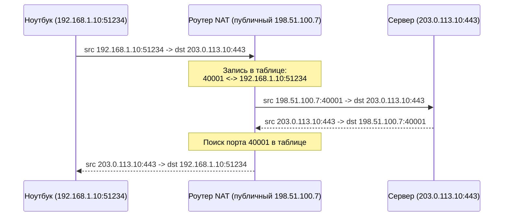

*Как 16-битные порты и четвёрка адресов разделяют тысячи соединений на одной машине и как NAT позволяет десятку устройств делить один публичный IP.*

На вашем сервере открыт один публичный IP-адрес, и прямо сейчас к нему подключены триста клиентов `BookmarkFlow` на порту `8080`, а рядом работает SSH на порту `22`. Тем временем у вас дома ноутбук, смартфон и телевизор одновременно выходят в Интернет через один-единственный публичный IP-адрес от провайдера. Почему ответ сервера не попадает со смартфона на ноутбук и не путается между тремя сотнями клиентов?

Здесь работают три простых механизма: **порты**, **четвёрка сокета** и **NAT**.

## 16-битные номера портов и их диапазоны

Транспортные протоколы TCP и UDP отводят под номер порта **16 битов** — целое число от `0` до `65535`. Все порты делятся на три зоны по соглашению (IANA):

* **Системные (*well-known*, `0–1023`)** — закреплены за стандартными службами: `22` (SSH), `53` (DNS), `80` (HTTP), `443` (HTTPS). В Linux открыть слушающий порт ниже `1024` обычно может только процесс с правами администратора (`root`) или специальной привилегией.
* **Прикладные (*registered*, `1024–49151`)** — порты для пользовательских сервисов и серверов разработки (например, `8080` или `8443`).
* **Эфемерные (*ephemeral*, `49152–65535`; в Linux по умолчанию `32768–60999`)** — временные клиентские порты. Когда ваша программа открывает исходящее соединение, ядро ОС само подбирает ей свободный порт из этого диапазона на время жизни соединения.

Особую роль играет порт **`0`**. Если передать серверу адрес `127.0.0.1:0`, ядро само выделит любой свободный эфемерный порт. Этот приём незаменим в автоматических тестах, чтобы параллельные запуски не дрались за фиксированный порт.

## Сокет, четвёрка адресов и «порт уже занят»

Для программы в Linux сетевое соединение выглядит как **сокет** (*socket*) — конечная точка обмена, которой ядро выдаёт обычный **файловый дескриптор** (тот самый механизм из Подраздела 5.2, на который действуют лимиты `ulimit`).

Когда сервер вызывает привязку к адресу `127.0.0.1:8080`, ядро регистрирует слушающий сокет за парой `(IP, порт)` и текущим процессом. Если запустить вторую копию сервера на той же паре `(127.0.0.1, 8080)`, ядро немедленно откажет с ошибкой **`bind: address already in use`**: на одну и ту же пару адреса и порта по умолчанию может слушать только один сокет, иначе ОС не поймёт, какому процессу отдавать новые подключения.

Но как тогда один-единственный порт `8080` обслуживает сотни клиентов одновременно? Секрет в том, что каждое установленное TCP-соединение ядро различает не по одному порту, а по **четвёрке сокета** (*4-tuple*):

```text
(srcIP, srcPort, dstIP, dstPort)
```

Если к вашему серверу `203.0.113.10:8080` подключаются даже две вкладки с одного ноутбука, ядро клиента выдаёт им разные эфемерные порты:

* Соединение 1: `(198.51.100.7, 51402, 203.0.113.10, 8080)`
* Соединение 2: `(198.51.100.7, 51403, 203.0.113.10, 8080)`

Четвёрки различаются хотя бы в одном числе, поэтому ядро сервера без малейшей путаницы раскладывает входящие сегменты по разным сокетам-дескрипторам.

## Как домашний роутер делает NAT

В прошлой главе мы видели, что домашний ноутбук получает приватный адрес вроде `192.168.1.10`. Если отправить пакет с таким адресом отправителя в Интернет, сервер просто не сможет ответить: приватный адрес не маршрутизируется в глобальной сети.

Эту задачу решает **NAT** (*Network Address Translation*, точнее его разновидность с подменой портов — NAPT/PAT), встроенный в каждый домашний и офисный роутер. Когда пакет выходит из локальной сети наружу, роутер переписывает в заголовках приватный `srcIP:srcPort` на свой единственный публичный IP и свободный внешний порт, записывая соответствие в **таблицу трансляции**:



Когда ответ возвращается на `198.51.100.7:40001`, роутер находит порт `40001` в таблице, подменяет адрес получателя обратно на `192.168.1.10:51234` и отдаёт пакет ноутбуку. Если рядом смартфон `192.168.1.11` случайно выбрал тот же локальный порт `51234`, роутер просто выдаст ему другой внешний порт, например `40002`.

Из этой механики сразу следует важное следствие: **по умолчанию снаружи нельзя инициировать соединение к машине за NAT**. Когда чужой пакет приходит на роутер без предварительной исходящей записи в таблице трансляции, роутер не знает, какому устройству внутри квартиры его передать, и молча отбрасывает пакет (пока вы явно не настроите проброс порта — *port forwarding*).

## Проверяем порты и ошибку занятого адреса в Go

Запустим короткую программу на Go: попросим ОС выдать нам случайный свободный порт на `127.0.0.1:0`, разберём его через `net.SplitHostPort` и намеренно попробуем занять тот же адрес повторно.

```go
package main

import (
	"fmt"
	"net"
)

func main() {
	// Порт 0 просит ядро ОС выделить свободный эфемерный порт.
	ln1, err := net.Listen("tcp", "127.0.0.1:0")
	if err != nil {
		fmt.Println("не удалось открыть первый сокет:", err)
		return
	}
	defer ln1.Close()

	addr := ln1.Addr().String()
	host, port, err := net.SplitHostPort(addr)
	if err != nil {
		fmt.Println("ошибка разбора адреса:", err)
		return
	}
	fmt.Printf("Первый сокет слушает host=%s port=%s\n", host, port)

	// Пробуем занять тот же адрес вторым слушателем.
	ln2, err := net.Listen("tcp", addr)
	if err != nil {
		fmt.Println("Второй сокет отклонён:", err)
		return
	}
	ln2.Close()
}
```

Реальный вывод в Linux наглядно показывает выделенный эфемерный порт и дословную системную ошибку:

```text
Первый сокет слушает host=127.0.0.1 port=41823
Второй сокет отклонён: listen tcp 127.0.0.1:41823: bind: address already in use
```

Номер порта при каждом запуске будет разным, потому что его выбирает ядро. А вот текст ошибки `bind: address already in use` вы ещё не раз встретите на практике, когда забудете остановить старую копию своего сервиса в соседней вкладке терминала.

## Подводные камни

**Ловушка 1. Разбор `host:port` через `strings.Split(addr, ":")`.**  
На IPv4 строка `"127.0.0.1:8080"` разделится ровно на две части, но на IPv6 строка `"[::1]:8080"` содержит несколько двоеточий и сломает наивный код. Всегда пользуйтесь парой функций `net.SplitHostPort` / `net.JoinHostPort` или типом `netip.AddrPort` (`netip.ParseAddrPort`).

**Ловушка 2. Миф «на одном порту не бывает больше 65 535 соединений».**  
Лимит в 65 535 портов (точнее, число свободных эфемерных портов) ограничивает количество одновременных соединений **с одного клиентского IP** на один конкретный `(dstIP, dstPort)`. Но если клиенты приходят с разных IP-адресов, их четвёрки `(srcIP, srcPort, dstIP, dstPort)` уникальны, и один сервер на порту `8080` способен держать сотни тысяч открытых сокетов (пока хватает памяти и лимита файловых дескрипторов `ulimit`).

> [!check] Проверь понимание
> Два пользователя из разных офисов одновременно подключаются к вашему серверу `203.0.113.10:8080`, и у обоих случайно совпал клиентский эфемерный порт `54321`. Перепутает ли сервер их соединения?
>
> Нет. Четвёрки сокета `(srcIP, srcPort, dstIP, dstPort)` различаются полем `srcIP` (публичные адреса двух офисов разные), поэтому ядро сервера хранит для них два независимых сокета.

## Практика

**Упражнение 1 (Базовое). Что пойдёт не так с разбором адреса?**  
Какой результат вернёт `strings.Split("[::1]:8080", ":")` и какой результат вернёт `net.SplitHostPort("[::1]:8080")`?

> [!solution] Показать решение
> `strings.Split` вернёт слайс из 4 элементов: `["[", "", "1]", "8080"]`, испортив адрес.  
> `net.SplitHostPort` корректно снимет квадратные скобки и вернёт `host = "::1"`, `port = "8080"`, `err = nil`.

**Упражнение 2 (Практическое). Безопасная сборка `host:port`.**  
Напишите функцию `FormatEndpoint(host string, port uint16) string` на базе `net.JoinHostPort` и `strconv.Itoa`, которая корректно формирует сетевой адрес и для IPv4 (`127.0.0.1`, `8080` → `127.0.0.1:8080`), и для IPv6 (`::1`, `8080` → `[::1]:8080`).

> [!solution] Показать решение
> ```go
> package main
>
> import (
> 	"fmt"
> 	"net"
> 	"strconv"
> )
>
> func FormatEndpoint(host string, port uint16) string {
> 	return net.JoinHostPort(host, strconv.Itoa(int(port)))
> }
>
> func main() {
> 	fmt.Println(FormatEndpoint("127.0.0.1", 8080)) // Вывод: 127.0.0.1:8080
> 	fmt.Println(FormatEndpoint("::1", 8080))       // Вывод: [::1]:8080
> }
> ```
> `net.JoinHostPort` сам распознаёт двоеточия в IPv6-адресе и добавляет квадратные скобки только тогда, когда они нужны.

**Упражнение 3 (Со звёздочкой \*). Мини-модель таблицы NAT.**  
Реализуйте структуру `NATTable` с методами `TranslateOut(internal netip.AddrPort) uint16` (выделяет новый внешний порт начиная с `40000`, либо возвращает уже существующий для того же `internal`) и `LookupIn(externalPort uint16) (netip.AddrPort, bool)` (находит внутренний адрес по внешнему порту для обратного пакета).

> [!solution] Показать решение
> ```go
> package main
>
> import (
> 	"fmt"
> 	"net/netip"
> )
>
> type NATTable struct {
> 	nextPort uint16
> 	outToExt map[netip.AddrPort]uint16
> 	extToIn  map[uint16]netip.AddrPort
> }
>
> func NewNATTable() *NATTable {
> 	return &NATTable{
> 		nextPort: 40000,
> 		outToExt: make(map[netip.AddrPort]uint16),
> 		extToIn:  make(map[uint16]netip.AddrPort),
> 	}
> }
>
> func (n *NATTable) TranslateOut(internal netip.AddrPort) uint16 {
> 	if ext, ok := n.outToExt[internal]; ok {
> 		return ext
> 	}
> 	ext := n.nextPort
> 	n.nextPort++
> 	n.outToExt[internal] = ext
> 	n.extToIn[ext] = internal
> 	return ext
> }
>
> func (n *NATTable) LookupIn(externalPort uint16) (netip.AddrPort, bool) {
> 	in, ok := n.extToIn[externalPort]
> 	return in, ok
> }
>
> func main() {
> 	nat := NewNATTable()
> 	laptop := netip.MustParseAddrPort("192.168.1.10:51234")
> 	phone := netip.MustParseAddrPort("192.168.1.11:51234")
>
> 	p1 := nat.TranslateOut(laptop)
> 	p2 := nat.TranslateOut(phone)
> 	back, ok := nat.LookupIn(p2)
> 	fmt.Printf("laptop->%d, phone->%d, обратный поиск %d -> %v (%t)\n", p1, p2, p2, back, ok)
> }
> ```
> Обратите внимание, как чисто `netip.AddrPort` ложится прямо в ключ мапы `map[netip.AddrPort]uint16` без ручного преобразования в строки.

---

Мы научились доставлять пакеты до конкретной машины и конкретной программы по числам `IP:порт`. Осталось понять, как программа вообще узнаёт эти числа, когда пользователь вводит человеческое имя вроде `go.dev`, и почему смена адреса сервера не применяется по всей планете мгновенно: [[4. DNS — разрешение имён, записи A, AAAA, CNAME и кэширование]].
