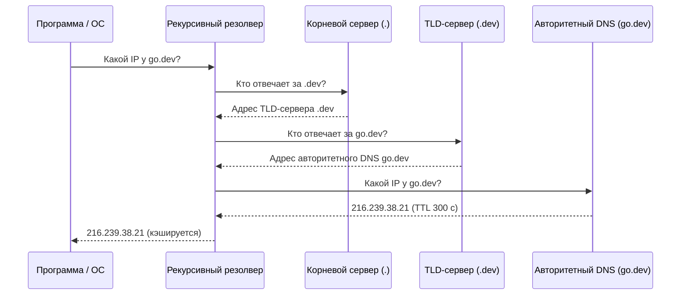

*Как доменное имя превращается в IP-адрес через иерархию серверов, зачем нужны записи A, AAAA, CNAME, TXT и MX и почему кэш с TTL задерживает переезд сервера.*

Вы перенесли `BookmarkFlow` на новый сервер с новым IP-адресом и обновили настройки домена у регистратора. Через пять минут сайт со смартфона уже открывается на новом сервере, а ваш рабочий ноутбук по-прежнему упорно ходит на старый адрес. Сервер исправен, настройки верны — вы столкнулись с распределённым кэшированием **DNS**.

В Модуле 1 мы назвали DNS «телефонной книгой Интернета». Настало время заглянуть внутрь этой книги и увидеть, как запрос проходит путь от вашей программы до авторитетного ответа.

## Полный путь разрешения имени `go.dev`

Доменные имена устроены как перевёрнутое дерево, которое читается **справа налево**: невидимый корень `.` → домен верхнего уровня `.dev` → конкретный домен `go.dev`. Ни один сервер в мире не хранит всю базу Интернета целиком — ответственность разделена по этажам.

Когда ваша программа хочет подключиться к `go.dev`, операционная система запускает пошаговый поиск:

1. **Локальный кэш ОС и файл `/etc/hosts`.** Сначала система проверяет собственный кэш и локальный текстовый файл `/etc/hosts` (там, например, жёстко прописано соответствие `localhost` → `127.0.0.1`). Если запись нашлась, в сеть никто не ходит.
2. **Рекурсивный резолвер (*recursive resolver*).** Если локально пусто, ОС отправляет запрос резолверу — обычно это сервер провайдера или публичный резолвер вроде `1.1.1.1` или `8.8.8.8`. Если ответ уже есть в его кэше (кто-то недавно спрашивал `go.dev`), поиск заканчивается на этом шаге.
3. **Корневой сервер (*Root DNS*).** Если кэш резолвера пуст, он обращается к одному из корневых серверов зоны `.`. Корень не знает IP-адрес `go.dev`, но подсказывает адреса серверов зоны `.dev`.
4. **Сервер TLD (*Top-Level Domain*).** Сервер зоны `.dev` тоже не хранит конечный IP, но знает, какой **авторитетный DNS-сервер** отвечает за домен `go.dev`.
5. **Авторитетный DNS-сервер (*Authoritative DNS*).** Именно там владелец домена хранит первоисточник всех записей. Авторитетный сервер возвращает итоговый IP-адрес `go.dev`, резолвер сохраняет его в свой кэш и отдаёт вашему компьютеру.



Обычные DNS-запросы настолько компактны, что почти всегда отправляются поверх лёгкого протокола **UDP** на порт `53` — без затрат на установку соединения. Если ответ оказывается слишком большим (например, содержит длинные текстовые записи), клиент автоматически повторяет запрос по TCP.

## Типы DNS-записей

DNS хранит не только IPv4-адреса. У каждого домена может быть набор записей разных типов:

| Тип записи | Что хранит | Пример значения |
|---|---|---|
| **`A`** | Соответствие имени адресу **IPv4** (32 бита) | `go.dev` → `216.239.38.21` |
| **`AAAA`** | Соответствие имени адресу **IPv6** (128 битов; в 4 раза длиннее `A`) | `go.dev` → `2001:4860:4802:32::15` |
| **`CNAME`** | Псевдоним (*Canonical Name*) — переадресация на другое имя | `www.example.com` → `example.com` |
| **`MX`** | Адрес почтового сервера домена и его приоритет | `10 mail.example.com` |
| **`TXT`** | Произвольная текстовая строка (подтверждение владения доменом, правила антиспама SPF/DKIM) | `"v=spf1 include:_spf.example.com ~all"` |

Если у имени настроена запись `CNAME`, резолвер автоматически делает второй шаг: разрешает целевое имя до получения реальной `A`- или `AAAA`-записи.

## Время жизни `TTL` и почему переезд не бывает мгновенным

Если бы каждый клик в браузере тревожил корневые и авторитетные серверы, DNS захлебнулся бы под нагрузкой за секунды. Поэтому к каждой записи владелец домена прикрепляет число **`TTL`** (*Time To Live*) — срок хранения ответа в кэше в секундах, например `300` (5 минут) или `3600` (1 час).

Рекурсивные резолверы и операционные системы обязаны хранить полученный ответ у себя ровно до истечения `TTL` и не спрашивать авторитетный сервер повторно. Именно поэтому телефон в мобильной сети (через резолвер оператора с пустым кэшем) увидел новый IP сразу, а ноутбук продолжил брать старый адрес из кэша домашнего провайдера до конца старого `TTL`.

Инженерная привычка при переезде сервера проста: **за сутки до смены IP снизьте `TTL` записи до `60` секунд**. Когда старый длинный `TTL` выветрится изо всех кэшей мира, сам переезд займёт около минуты вместо суток.

## Разрешение имён в Go: `net.DefaultResolver`

В стандартной библиотеке Go для DNS-запросов есть готовый тип `*net.Resolver` и глобальный экземпляр `net.DefaultResolver`. В отличие от устаревшей функции `net.LookupHost(host)`, метод `LookupHost(ctx, host)` принимает `context.Context` и позволяет жёстко ограничить время ожидания ответа сети.

```go
package main

import (
	"context"
	"fmt"
	"net"
	"os"
	"time"
)

func main() {
	host := "localhost"
	if len(os.Args) > 1 {
		host = os.Args[1]
	}

	ctx, cancel := context.WithTimeout(context.Background(), 2*time.Second)
	defer cancel()

	addrs, err := net.DefaultResolver.LookupHost(ctx, host)
	if err != nil {
		fmt.Printf("Не удалось разрешить %q: %v\n", host, err)
		return
	}

	fmt.Printf("Адреса для %q:\n", host)
	for _, a := range addrs {
		fmt.Println(" -", a)
	}
}
```

Запуск без аргументов (разрешает локальное имя даже без Интернета) и запуск с заведомо несуществующим доменом:

```text
$ go run main.go
Адреса для "localhost":
 - ::1
 - 127.0.0.1

$ go run main.go nonexistent.invalid
Не удалось разрешить "nonexistent.invalid": lookup nonexistent.invalid: no such host
```

Если вам нужны типизированные значения `netip.Addr` вместо строк (и возможность запросить строго IPv4 `"ip4"` или строго IPv6 `"ip6"`), в современном Go используйте `net.DefaultResolver.LookupNetIP(ctx, "ip4", host)`. Для текстовых и почтовых записей рядом лежат `LookupTXT` и `LookupMX`.

## Подводные камни

**Ловушка 1. DNS-запрос без контекста и таймаута.**  
Вызов `net.LookupHost` без контекста может подвесить горутину на десятки секунд, если локальный DNS-сервер недоступен. Всегда передавайте контекст с дедлайном через `net.DefaultResolver.LookupHost(ctx, host)`.

**Ловушка 2. Ожидание одного-единственного IP от домена.**  
Крупные сервисы привязывают к одному имени сразу несколько `A`/`AAAA`-записей для балансировки и отказоустойчивости. Не случайно `LookupHost` возвращает слайс `[]string`, а не одну строку.

> [!check] Проверь понимание
> У домена `api.bookmarkflow.example` стоял `TTL = 3600` (1 час). В 12:00 вы поменяли его `A`-запись на новый IP. В какое максимальное время клиенты гарантированно перестанут получать старый адрес из исправных DNS-кэшей?
>
> К **13:00** — спустя ровно один час, когда истечёт максимальный остаток прежнего `TTL` у всех резолверов, успевших закэшировать старую запись в 11:59.

## Практика

**Упражнение 1 (Базовое). Выбор типа записи.**  
Какой тип DNS-записи нужен в каждой из четырёх ситуаций: (а) привязать `bookmarks.example` к IPv4-адресу `203.0.113.10`; (б) добавить ему же IPv6-адрес; (в) сделать `www.bookmarks.example` псевдонимом для `bookmarks.example`; (г) подтвердить владение доменом строкой верификации?

> [!solution] Показать решение
> (а) **`A`**, (б) **`AAAA`**, (в) **`CNAME`**, (г) **`TXT`**.  
> Записи `A` и `AAAA` указывают на числовые адреса, `CNAME` — на другое доменное имя, а `TXT` переносит произвольные служебные строки.

**Упражнение 2 (Практическое). Поиск первого IPv4-адреса.**  
Напишите функцию `ResolveFirstIPv4(ctx context.Context, host string) (netip.Addr, error)`, которая через `net.DefaultResolver.LookupNetIP(ctx, "ip4", host)` возвращает первый найденный IPv4-адрес, либо ошибку, если список пуст.

> [!solution] Показать решение
> ```go
> package main
>
> import (
> 	"context"
> 	"errors"
> 	"fmt"
> 	"net"
> 	"net/netip"
> 	"time"
> )
>
> func ResolveFirstIPv4(ctx context.Context, host string) (netip.Addr, error) {
> 	addrs, err := net.DefaultResolver.LookupNetIP(ctx, "ip4", host)
> 	if err != nil {
> 		return netip.Addr{}, err
> 	}
> 	if len(addrs) == 0 {
> 		return netip.Addr{}, errors.New("IPv4-адреса не найдены")
> 	}
> 	return addrs[0], nil
> }
>
> func main() {
> 	ctx, cancel := context.WithTimeout(context.Background(), time.Second)
> 	defer cancel()
>
> 	ip, err := ResolveFirstIPv4(ctx, "localhost")
> 	fmt.Println(ip, err) // Вывод: 127.0.0.1 <nil>
> }
> ```
> Использование `"ip4"` и `LookupNetIP` сразу отсекает IPv6-записи и избавляет от ручного вызова `netip.ParseAddr`.

**Упражнение 3 (Со звёздочкой \*). Кэш DNS-записей с TTL.**  
Реализуйте потокобезопасный кэш `DNSCache` на базе `sync.RWMutex` и `map[string]cacheEntry`, где `Set(host string, addrs []netip.Addr, ttl time.Duration)` сохраняет адреса со временем истечения, а `Get(host string) ([]netip.Addr, bool)` возвращает их, только пока срок `ttl` не истёк.

> [!solution] Показать решение
> ```go
> package main
>
> import (
> 	"fmt"
> 	"net/netip"
> 	"slices"
> 	"sync"
> 	"time"
> )
>
> type cacheEntry struct {
> 	addrs     []netip.Addr
> 	expiresAt time.Time
> }
>
> type DNSCache struct {
> 	mu      sync.RWMutex
> 	entries map[string]cacheEntry
> }
>
> func NewDNSCache() *DNSCache {
> 	return &DNSCache{entries: make(map[string]cacheEntry)}
> }
>
> func (c *DNSCache) Set(host string, addrs []netip.Addr, ttl time.Duration) {
> 	c.mu.Lock()
> 	defer c.mu.Unlock()
> 	c.entries[host] = cacheEntry{
> 		addrs:     slices.Clone(addrs),
> 		expiresAt: time.Now().Add(ttl),
> 	}
> }
>
> func (c *DNSCache) Get(host string) ([]netip.Addr, bool) {
> 	c.mu.RLock()
> 	entry, ok := c.entries[host]
> 	c.mu.RUnlock()
> 	if !ok || time.Now().After(entry.expiresAt) {
> 		return nil, false
> 	}
> 	return slices.Clone(entry.addrs), true
> }
>
> func main() {
> 	cache := NewDNSCache()
> 	cache.Set("go.dev", []netip.Addr{netip.MustParseAddr("216.239.38.21")}, 50*time.Millisecond)
>
> 	addrs, ok := cache.Get("go.dev")
> 	fmt.Println("Сразу:", addrs, ok)
> 	time.Sleep(60 * time.Millisecond)
> 	_, ok = cache.Get("go.dev")
> 	fmt.Println("После TTL:", ok)
> }
> ```
> Вызов `slices.Clone` защищает кэш от алиасинга: внешний код не сможет испортить сохранённый слайс, изменив его элементы после `Set` или `Get`.

---

Теперь у нашей программы есть IP-адрес сервера и номер порта. Пора открыть соединение и передать данные без потерь — разберём, как протокол **TCP** устанавливает связь, нумерует каждый байт и почему в нём не существует границ сообщений: [[5. TCP — рукопожатие, нумерация байтов, повторная отправка и закрытие]].
