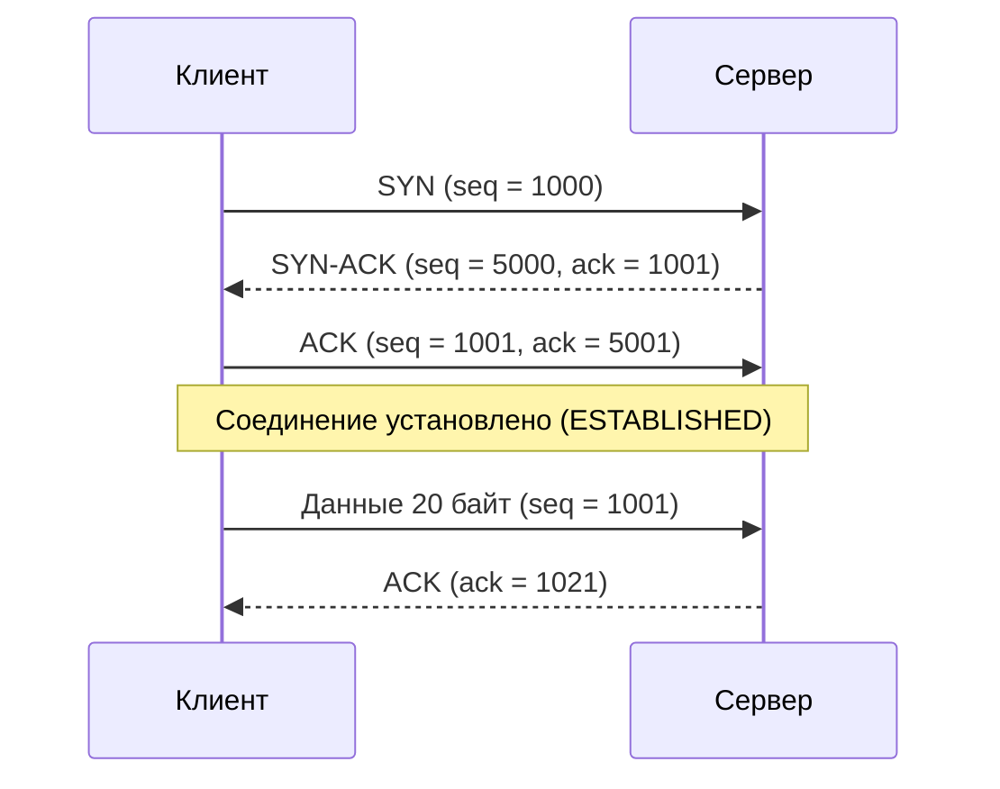
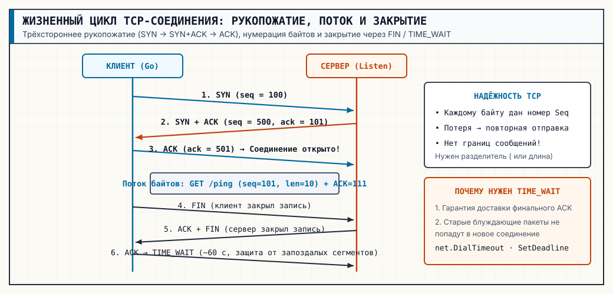

*Как протокол TCP создаёт надёжный упорядоченный поток байтов поверх ненадёжной IP-сети, зачем нужны тройное рукопожатие и состояние `TIME_WAIT` и почему один `Read` может вернуть половину строки.*

Клиент отправляет серверу две короткие команды подряд: `conn.Write([]byte("PING\n"))` и `conn.Write([]byte("COUNT\n"))`. На стороне сервера один вызов `conn.Read(buf)` вдруг возвращает `"PING\nCOU"`, а следующий — `"NT\n"`. Ошибки в сети нет и данные не испорчены. Вы только что столкнулись с главным свойством протокола **TCP**.

Уровень IP (урок 2) ничего не обещает: маршрутизатор в любой момент вправе выбросить пакет из-за перегрузки, пустить второй пакет в обход первого или продублировать его. Чтобы программы не писали логику восстановления данных с нуля, поверх IP работает транспортный протокол **TCP** (*Transmission Control Protocol*).

## Тройное рукопожатие: `SYN → SYN-ACK → ACK`

Прежде чем передать хотя бы один байт данных, клиент и сервер договариваются о начальных номерах байтов и размере приёмных буферов. Этот обмен состоит из трёх сегментов и называется **тройным рукопожатием** (*three-way handshake*):



1. Клиент шлёт сегмент **`SYN`** (*synchronize*) со случайным начальным номером последовательности, например `seq = 1000`.
2. Сервер отвечает **`SYN-ACK`**: подтверждает получение (`ack = 1001` — «жду байт 1001») и сообщает свой начальный номер (`seq = 5000`).
3. Клиент отправляет финальный **`ACK`** (`ack = 5001`). Соединение переходит в состояние `ESTABLISHED`, и обе стороны могут обмениваться данными.

Установка TCP-соединения стоит ровно один полный оборот пакета до сервера и обратно — **1 RTT** (*Round-Trip Time*). При задержке до дата-центра в 40 мс клиент потратит 40 мс ещё до отправки первого байта запроса.



## Нумерация байтов, повторная отправка и контроль потока

В TCP пронумерован **каждый переданный байт**, а не пакет целиком. Если клиент отправил 20 байт начиная с номера `1001`, сервер отвечает подтверждением `ack = 1021` — это означает: «все байты до `1020` включительно доставлены без пропусков, жду `1021`».

Дальше механика надёжности складывается из трёх правил:

* **Повторная отправка (*retransmission*).** На каждый отправленный сегмент TCP запускает таймер. Если подтверждение `ACK` не пришло вовремя (или пришли несколько повторных `ACK` на старый номер), отправитель повторно высылает потерянный диапазон байтов.
* **Упорядочивание.** Если сегменты пришли в перепутанном порядке, стек TCP в ядре складывает «забежавший вперёд» сегмент в буфер и не отдаёт его приложению, пока не приедет недостающий кусок.
* **Контроль потока (*flow control*).** В каждом `ACK` получатель сообщает свободный размер своего приёмного буфера — **окно приёма** (*receive window*). Если ваша Go-программа медленно читает из сокета, окно сжимается до нуля, и ядро отправителя автоматически притормаживает передачу, чтобы не захлебнуть получателя.

*(NOTE: помимо контроля потока, TCP решает задачу контроля перегрузки сети — постепенно разгоняет скорость и снижает её при потерях; подробности алгоритмов управления перегрузкой и тюнинга ядра Linux разберём в Томе 5.)*

## Закрытие соединения (`FIN`) и загадочное `TIME_WAIT`

TCP-соединение двустороннее, поэтому каждая сторона закрывает свою половину отдельно сегментом **`FIN`** (*finish*). Полное закрытие обычно требует четырёх шагов: `FIN → ACK` в одну сторону и `FIN → ACK` в другую.

Сторона, которая отправила первый `FIN` (активно инициировала закрытие), не удаляет запись о соединении мгновенно, а переводит сокет в состояние **`TIME_WAIT`** примерно на 60 секунд в Linux. Зачем ждать целую минуту? В сети всё ещё может блуждать запоздалый дубликат пакета от старого соединения. Пока сокет держится в `TIME_WAIT`, ядро не выдаст ту же четвёрку адресов и портов новому соединению, и старый пакет не сможет испортить чужие данные.

## Главное правило: TCP — поток байтов, а не сообщений

В заголовках TCP нет поля «граница сообщения». Для ядра соединение — это непрерывная труба байтов, точно такая же, как файл или Unix-конвейер.

Стек TCP вправе **склеить** два ваших вызова `Write("PING\n")` и `Write("COUNT\n")` в один сегмент, чтобы сэкономить заголовки. Или, наоборот, **разрезать** одну строку на три сегмента, если так сложился размер буфера или максимального пакета в сети (MTU).

Поэтому поверх TCP всегда договариваются о **фрейминге** (*framing*) — правиле, по которому получатель понимает, где кончилось одно сообщение и началось следующее. Два самых распространённых способа:

1. **Разделитель (например `\n`).** Идеально для текстовых команд вроде `PING\n` и `GET 1\n`. Получатель читает байты через `bufio.Scanner` или `bufio.Reader.ReadString('\n')`, пока не встретит перевод строки.
2. **Префикс длины.** Перед полезной нагрузкой отправляют её размер (например, 4 байта `uint32` в порядке *big-endian*). Получатель сначала читает ровно 4 байта длины через `io.ReadFull`, затем ровно столько байтов тела. Этот способ незаменим для бинарных данных, где внутри сообщения может встретиться любой байт, включая `\n`.

Посмотрим в Go, как один и тот же поток байтов, намеренно разрезанный на мелкие куски по 3 байта, ломает наивный `Read`, но безупречно собирается через `bufio.Scanner`:

```go
package main

import (
	"bufio"
	"fmt"
	"io"
	"strings"
)

// tinyChunkReader имитирует сетевой сокет, который отдаёт за один Read не больше limit байт.
type tinyChunkReader struct {
	src   io.Reader
	limit int
}

func (r *tinyChunkReader) Read(p []byte) (int, error) {
	if len(p) > r.limit {
		p = p[:r.limit]
	}
	return r.src.Read(p)
}

func main() {
	stream := "PING\nCOUNT\nGET 1\n"

	// 1. Наивное чтение одним вызовом Read: получаем лишь обрывок.
	raw := &tinyChunkReader{src: strings.NewReader(stream), limit: 3}
	buf := make([]byte, 64)
	n, _ := raw.Read(buf)
	fmt.Printf("Один сырой Read вернул %d байт: %q\n", n, buf[:n])

	// 2. Построчный фрейминг через bufio.Scanner поверх того же рваного потока.
	framed := &tinyChunkReader{src: strings.NewReader(stream), limit: 3}
	scanner := bufio.NewScanner(framed)
	for i := 1; scanner.Scan(); i++ {
		fmt.Printf("Сообщение %d: %q\n", i, scanner.Text())
	}
}
```

Вывод программы наглядно показывает разницу:

```text
Один сырой Read вернул 3 байт: "PIN"
Сообщение 1: "PING"
Сообщение 2: "COUNT"
Сообщение 3: "GET 1"
```

## Подводные камни

**Ловушка 1. Считать, что один `conn.Write` равен одному `conn.Read`.**  
На `localhost` (петлевом интерфейсе) короткие сообщения часто долетают целиком, и баг прячется месяцами. Как только сервис выезжает в реальную сеть с задержками и фрагментацией, наивный парсер начинает падать на «обрубленных» строках. Всегда закладывайте явный фрейминг с первого дня.

**Ловушка 2. Исчерпание портов из-за тысяч коротких соединений в `TIME_WAIT`.**  
Если клиент на каждый крошечный запрос открывает новое TCP-соединение и сразу закрывает его, тысячи сокетов повисают в `TIME_WAIT` на минуту, и свободные эфемерные порты заканчиваются. Постоянные (переиспользуемые) соединения решают эту проблему и заодно экономят 1 RTT рукопожатия на каждом запросе.

> [!check] Проверь понимание
> Клиент отправил серверу 200 байт одним вызовом `conn.Write`. Гарантирует ли протокол TCP, что первый же вызов `conn.Read(make([]byte, 1024))` на сервере вернёт ровно 200 байт?
>
> Нет. TCP гарантирует только порядок и сохранность байтов, но не границы вызовов `Write`. Вызов `Read` может вернуть, например, 80 байт, а оставшиеся 120 придут в следующем `Read`.

## Практика

**Упражнение 1 (Базовое). Арифметика `seq` и `ack`.**  
После тройного рукопожатия клиент начинает передачу с `seq = 2000`. Он отправляет два сегмента подряд: сначала 120 байт, затем ещё 80 байт. Оба доходят без потерь. Какой номер `ack` сервер пришлёт в подтверждении после второго сегмента?

> [!solution] Показать решение
> Сервер пришлёт **`ack = 2200`**.  
> Первый сегмент занял байты `2000..2119` (подтверждение `2120`), второй — байты `2120..2199`. Номер `ack` всегда указывает на **следующий ожидаемый** байт, то есть `2000 + 120 + 80 = 2200`.

**Упражнение 2 (Практическое). Фрейминг с префиксом длины.**  
Напишите пару функций `WriteFrame(w io.Writer, payload []byte) error` и `ReadFrame(r io.Reader) ([]byte, error)`: перед полезной нагрузкой записывается её длина как 4-байтное число `uint32` в порядке `binary.BigEndian`, а при чтении сначала читаются ровно 4 байта длины, затем ровно столько байтов тела через `io.ReadFull`. Проверьте обе функции в `main()` через `bytes.Buffer` на двух сообщениях подряд.

> [!solution] Показать решение
> ```go
> package main
>
> import (
> 	"bytes"
> 	"encoding/binary"
> 	"fmt"
> 	"io"
> )
>
> func WriteFrame(w io.Writer, payload []byte) error {
> 	var header [4]byte
> 	binary.BigEndian.PutUint32(header[:], uint32(len(payload)))
> 	if _, err := w.Write(header[:]); err != nil {
> 		return err
> 	}
> 	_, err := w.Write(payload)
> 	return err
> }
>
> func ReadFrame(r io.Reader) ([]byte, error) {
> 	var header [4]byte
> 	if _, err := io.ReadFull(r, header[:]); err != nil {
> 		return nil, err
> 	}
> 	size := binary.BigEndian.Uint32(header[:])
> 	payload := make([]byte, size)
> 	if _, err := io.ReadFull(r, payload); err != nil {
> 		return nil, err
> 	}
> 	return payload, nil
> }
>
> func main() {
> 	var wire bytes.Buffer
> 	_ = WriteFrame(&wire, []byte("первое\nс переносом"))
> 	_ = WriteFrame(&wire, []byte("второе"))
>
> 	for range 2 {
> 		msg, err := ReadFrame(&wire)
> 		if err != nil {
> 			panic(err)
> 		}
> 		fmt.Printf("Получено: %q\n", msg)
> 	}
> }
> ```
> Вызов `io.ReadFull` в цикле дочитывает поток, пока не наберёт запрошенное число байтов, поэтому короткие куски от сети никогда не сломают разбор кадра.

**Упражнение 3 (Со звёздочкой \*). Проверка `ReadFrame` на рваном потоке.**  
Объедините `ReadFrame` из предыдущего упражнения с обёрткой `tinyChunkReader` (с `limit = 2`, отдающей по 2 байта за вызов) и убедитесь, что сообщение длиной 25 байт с префиксом длины читается целиком без потерь. Добавьте ограничение максимального размера кадра (`maxSize = 64 * 1024`), чтобы повреждённый заголовок не заставил программу выделить 4 ГБ памяти.

> [!solution] Показать решение
> ```go
> package main
>
> import (
> 	"bytes"
> 	"encoding/binary"
> 	"errors"
> 	"fmt"
> 	"io"
> )
>
> const maxFrameSize = 64 * 1024
>
> type tinyChunkReader struct {
> 	src   io.Reader
> 	limit int
> }
>
> func (r *tinyChunkReader) Read(p []byte) (int, error) {
> 	if len(p) > r.limit {
> 		p = p[:r.limit]
> 	}
> 	return r.src.Read(p)
> }
>
> func ReadFrameSafe(r io.Reader) ([]byte, error) {
> 	var header [4]byte
> 	if _, err := io.ReadFull(r, header[:]); err != nil {
> 		return nil, err
> 	}
> 	size := binary.BigEndian.Uint32(header[:])
> 	if size > maxFrameSize {
> 		return nil, errors.New("кадр превышает допустимый размер")
> 	}
> 	payload := make([]byte, size)
> 	if _, err := io.ReadFull(r, payload); err != nil {
> 		return nil, err
> 	}
> 	return payload, nil
> }
>
> func main() {
> 	msg := []byte("bookmarkflow-tcp-payload!")
> 	var wire bytes.Buffer
> 	var hdr [4]byte
> 	binary.BigEndian.PutUint32(hdr[:], uint32(len(msg)))
> 	wire.Write(hdr[:])
> 	wire.Write(msg)
>
> 	slow := &tinyChunkReader{src: &wire, limit: 2}
> 	got, err := ReadFrameSafe(slow)
> 	if err != nil {
> 		panic(err)
> 	}
> 	fmt.Printf("Собрано %d байт: %q\n", len(got), got)
> }
> ```
> Проверка `size > maxFrameSize` до `make([]byte, size)` — обязательная защита любого сетевого парсера от случайного мусора или атаки на исчерпание памяти.

---

TCP гарантирует доставку каждого байта, но расплачивается за это рукопожатием, повторами и задержкой всей очереди при потере одного сегмента. А что делать задачам, где опоздавший на секунду пакет хуже потерянного? Познакомимся со вторым главным транспортным протоколом Интернета — [[6. UDP — когда скорость важнее гарантированной доставки]].
